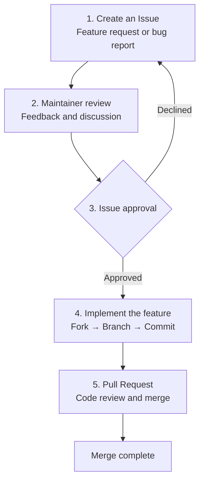

# Contributing

Follow this process to propose features, bug fixes, and documentation improvements for Spine and submit a Pull Request. Discuss the purpose and scope of your change in a GitHub Issue before implementation.

## Contribution process

Start by opening an Issue, then proceed through maintainer review and approval, implementation, and a Pull Request.



## 1. Create an Issue

Always open an Issue before implementing a feature.

Create a new Issue in [Spine GitHub Issues](https://github.com/NARUBROWN/spine/issues) and include the information for your proposal type.

For feature requests:

- The feature you propose
- Why the feature is needed
- Expected usage examples

For bug reports:

- Steps to reproduce the bug
- Expected and actual behavior
- Your runtime environment, including Go version and operating system

## 2. Maintainer review

A maintainer reviews the Issue and leaves feedback. Discuss the design and implementation scope together as needed.

## 3. Issue approval

Start implementation after a maintainer approves the Issue. Pull Requests opened before approval may not be merged.

## 4. Pull Request

Once implementation is complete, create a Pull Request on GitHub and include the related Issue number in the description.

```
Closes #123
```

## Documentation changes and translations

This documentation site uses `docs/ko` as the single source of truth for its content. Update and review the Korean documentation first, then translate it into `docs/en`, `docs/ja`, `docs/zh-Hans`, and `docs/zh-Hant`, preserving the same content, code, and structure.

From the documentation site's repository root, run the following command to check that document structure and executable code match across languages.

```bash
python3 scripts/check-doc-translations.py
```

After building the documentation, also check translated internal paths and section links.

```bash
npm run docs:build
python3 scripts/check-doc-translations.py --check-rendered
```

## Questions

If you need clarification during implementation, leave a comment on the related Issue.
