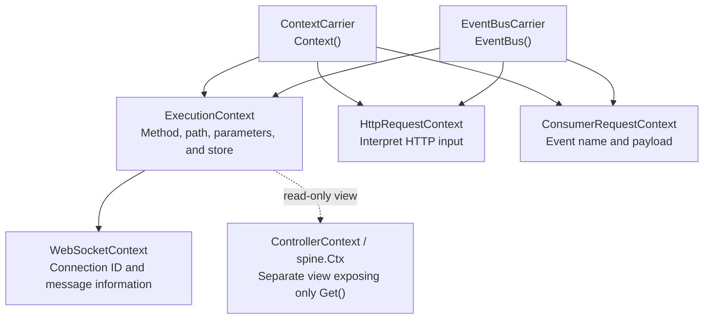

# Execution Context (ExecutionContext)

::: info
See [input migration](/en/learn/migration/v0.7.1-preview) for compatibility with legacy input APIs and [OpenAPI](/en/reference/api/openapi) for document options.
:::

Spine creates an execution context for each request or message to pass input information and execution state through the pipeline. Interceptors read and write execution state through `core.ExecutionContext`, while HTTP controllers receive only the values they need through semantic types and read-only `spine.Ctx`.

The `src/user` examples use the `legacy` layout from [Project Structure](/en/learn/tutorial/1-project-structure).

Understanding this distinction helps you pass values stored by interceptors to controllers and determine which inputs are available in HTTP, event consumers, and WebSocket. The interfaces and behavior in this document are based on Spine v0.7.1.

The app handler examples are manual extensions to a [project created with the CLI](/en/learn/tutorial/1-project-structure). Keep the generated `BuildApplication` and the `user.Register(app)` call that checks for errors. The `core/` interfaces are public contracts; you do not need to copy `internal/` implementations into your app.

## Controller and Interceptor Access

The context does not expose one large object to all code. It separates the access needed to control the pipeline from the access needed for business logic.

| Usage | Type received | Available functionality |
| --- | --- | --- |
| HTTP controller | `context.Context` | Propagate cancellation and timeouts, and publish domain events |
| HTTP controller | `pkg/spine.Ctx` | Read values stored by interceptors |
| HTTP controller | `input.Path[T]`, `input.Query[T]`, DTOs, and others | Bound request input |
| Interceptor | `core.ExecutionContext` | Read request information, read and write the store, and run processing before and after execution |
| HTTP argument resolver | `core.HttpRequestContext` | Interpret HTTP input such as bodies, headers, and forms |
| Consumer argument resolver | `core.ConsumerRequestContext` | Interpret the event name and payload |
| WebSocket argument resolver | `core.WebSocketContext` | Interpret the connection ID, message type, and payload |

In this document, `spine.Ctx` is a type from `github.com/NARUBROWN/spine/pkg/spine`, not the root app package `github.com/NARUBROWN/spine`. Use aliases to distinguish the two packages if you import both in one file.

The default HTTP resolvers do not inject `core.ExecutionContext` or `core.HttpRequestContext` as controller arguments. Express the required behavior through input types and `httpx.Response[T]` return values instead of handling response writers or body binding directly in controllers.

## Relationships Between Context Contracts

`ContextCarrier` and `EventBusCarrier` represent shared functionality. The HTTP and consumer input contracts embed these two contracts directly, while the WebSocket message contract extends `ExecutionContext`.



The arrows show which contracts are embedded. `ControllerContext` and `spine.Ctx` do not embed `ExecutionContext`. They are separate interfaces that expose only `Get()` to read from the same store.

For HTTP, the kernel HTTPContext wraps the platform input view and provides `ExecutionContext` and `HttpRequestContext`. Access the response writer through the separate `core.HTTPResponseContext`. `SetRoute` stores routing state separately from user `Set/Get` storage. Consumer contexts implement both `ExecutionContext` and `ConsumerRequestContext`.

## Shared Base Contracts

### ContextCarrier

This contract provides Go's standard `context.Context`. Use it to propagate cancellation signals and deadlines to services, repositories, and external API calls.

```go
// core/context.go
type ContextCarrier interface {
    Context() context.Context
}
```

For HTTP, it uses the request's `context.Context`. When a controller declares a `context.Context` argument, the standard context resolver passes the request context and attaches the EventBus needed to publish domain events.

### EventBusCarrier

This contract provides access to the EventBus for the execution.

```go
// core/context.go
type EventBusCarrier interface {
    EventBus() EventBus
}
```

`core.EventBus` is the minimal contract for collecting and draining events. `publish.DomainEvent` is defined in `github.com/NARUBROWN/spine/pkg/event/publish`.

```go
// core/event_bus.go
type EventBus interface {
    Publish(events ...publish.DomainEvent)
    Drain() []publish.DomainEvent
}
```

Controllers usually call `publish.Event()` with the `context.Context` they receive rather than calling `EventBus()` directly. See [EventBus and Event Publishing](#event-publishing) below for usage details.

## ExecutionContext: Pipeline and Interceptor Execution State

`core.ExecutionContext` is the contract shared by the pipeline, router, and interceptors.

```go
// core/context.go
type ExecutionContext interface {
    ContextCarrier
    EventBusCarrier

    Method() string
    Path() string
    Params() map[string]string
    Header(name string) string
    PathKeys() []string
    SetRoute(params map[string]string, pathKeys []string)
    Queries() map[string][]string
    Set(key string, value any)
    Get(key string) (any, bool)
}
```

### Request and Routing Information

| Method | Meaning in HTTP | Notes |
| --- | --- | --- |
| `Method()` | Request method, such as `GET` or `POST` | Returns `EVENT` for consumers and `WS` for WebSocket |
| `Path()` | Actual request path, such as `/users/123` | Distinct from the route pattern `/users/:id` |
| `Header(name)` | Specified request header | Empty string if the header is absent |
| `Params()` | Path values extracted by the router | Global `PreHandle` runs before Spine routing |
| `PathKeys()` | Order of path parameters declared in the route | Used for order-based binding of `path.*` types |
| `Queries()` | Query map that preserves multiple values | A key can have more than one value |

For example, after routing a request for `/users/123/posts/456?tag=go&tag=web` to `/users/:userId/posts/:postId`, you can read the following information.

```go
ctx.Method()   // "GET"
ctx.Path()     // "/users/123/posts/456"
ctx.Params()   // {"userId": "123", "postId": "456"}
ctx.PathKeys() // ["userId", "postId"]
ctx.Queries()  // {"tag": ["go", "web"]}
```

This code illustrates values available to interceptors and similar components. It does not mean that HTTP controllers receive this context directly.

### Set() and Get(): Sharing Values During Execution

Interceptors can use `Set()` to store authentication results or request tracing information. Controllers read the same values through `Get()` on the read-only view.

```go
// Store in an interceptor
ctx.Set("auth.user", authInfo)

// Read within the same execution
value, ok := ctx.Get("auth.user")
```

`Get()` returns both the value and whether the key exists. A key's presence does not guarantee the expected type, so check the type where you use the value. The store belongs to a request or message execution; do not use it as a global cache.

As with ordinary maps, concurrency guarantees depend on the implementation. Do not assume that the HTTP context store supports concurrent reads and writes from multiple goroutines.

## ControllerContext and spine.Ctx: Read-Only Controller Views

`core.ControllerContext` and `pkg/spine.Ctx` provide the same method set.

```go
// core/context.go
type ControllerContext interface {
    Get(key string) (any, bool)
}
```

```go
// pkg/spine/types.go
type Ctx interface {
    Get(key string) (any, bool)
}
```

The default HTTP resolver wraps the execution context in this view before passing it to the controller. Controllers can call `Get()`, but not `Set()`, `Method()`, or `EventBus()`. A custom interface that extends the type with additional methods is not automatically supported.

### Reading Authentication Information Stored by an Interceptor

The following method is an example to add to `UserController` in an app where an authentication interceptor stores `auth.user`. Import `context`, `github.com/NARUBROWN/spine/pkg/spine`, `pkg/input`, and `pkg/httpx`. In a real app, check whether `authInfo` exists and has the expected type according to your authentication policy.

```go
// src/user/user_controller.go
func (c *UserController) GetUser(ctx context.Context, cc spine.Ctx, userId input.Path[int64]) httpx.Response[any] {
    authInfo, _ := cc.Get("auth.user")
    return httpx.Response[any]{Body: authInfo}
}
```

Declaring `core.ControllerContext` provides the same read-only view in HTTP. App code can use `spine.Ctx` to express the access it needs. See the [interceptor tutorial](/en/learn/tutorial/4-interceptor) for how to write and register an authentication interceptor.

`ControllerContextResolver` is not registered in the default event consumer or WebSocket pipelines. Do not assume that the `spine.Ctx` argument available in HTTP can also be declared unchanged in handlers for other protocols.

## HttpRequestContext: Interpreting HTTP Input

`core.HttpRequestContext` is the contract HTTP resolvers use to read individual parameters, all headers, the body, and multipart forms. It embeds the two base contracts directly rather than embedding `ExecutionContext`.

```go
// core/context.go
type HttpRequestContext interface {
    ContextCarrier
    EventBusCarrier

    Param(name string) string
    Query(name string) string
    Header(name string) string

    Params() map[string]string
    Queries() map[string][]string
    Headers() map[string][]string

    Bind(out any) error
    MultipartForm() (*multipart.Form, error)
}
```

Here, `multipart.Form` is a type from Go's standard `mime/multipart` package.

| Method | Behavior |
| --- | --- |
| `Param(name)` | Read the value of the specified path parameter |
| `Query(name)` | Read the first value of the specified query parameter, or an empty string if absent |
| `Header(name)` | Read a request header value |
| `Params()` | Read the path parameter map |
| `Queries()` | Read the query map with multiple values preserved |
| `Headers()` | Read the complete request header map |
| `Bind(out)` | Bind request input to the supplied DTO |
| `MultipartForm()` | Read multipart form and file information |

### HTTP Adapter Behavior

In HTTP v3, Echo or net/http supplies the raw request and the core request view resolves path, query, headers, and body input. Ownership of complete header maps may vary by platform, so treat returned values as read-only.

`Bind()` and `MultipartForm()` are provided by the core request view. The ordinary body DTO resolver uses `Bind()`; path and query values are not merged into the body DTO. Spine DTO input does not call Echo Binder or JSONSerializer extensions.

```go
func (c *UserController) CreateUser(req *CreateUserRequest) (httpx.Response[User], error)
```

This code is a method signature example; `CreateUserRequest` and `User` are types defined by the app. Form DTOs use `form` tags on their fields, and uploaded files can be received as `pkg/multipart.UploadedFiles`.

Spine `v0.7.1` with Echo platform `v0.2.0-rc.1` returns HTTP 400 for malformed JSON and invalid numeric or boolean path values, 415 for unsupported body Content-Type, and 413 when the request-body limit is exceeded. Binding fails before the controller runs. Distinguish these failures from business validation and verify them with actual requests. [Execution Pipeline](/en/learn/core-concepts/pipeline#error-responses)

## ConsumerRequestContext: Interpreting Event Input

`core.ConsumerRequestContext` provides the event name and raw payload.

```go
// core/context.go
type ConsumerRequestContext interface {
    ContextCarrier
    EventBusCarrier

    EventName() string
    Payload() []byte
}
```

The consumer adapter implements this contract together with `ExecutionContext`. Since it is not an HTTP request, the shared methods behave as follows.

| Method | Value returned by a consumer |
| --- | --- |
| `Method()` | `EVENT` |
| `Path()` | Event name |
| `EventName()` | Event name |
| `Payload()` | Raw bytes of the received message |
| `Header(name)` | Empty string |
| `Params()` | `nil` |
| `PathKeys()` | `nil` |
| `Queries()` | `nil` |

The default consumer resolvers support `context.Context`, a string event name, a `[]byte` payload, and struct DTO values. DTOs are created by deserializing the JSON payload. The HTTP DTO pointer rule does not apply unchanged to consumers.

If a resolver requires a payload that is absent, or JSON deserialization fails, the handler is not invoked. The consumer runtime and message transport configuration determine how this execution failure affects message acknowledgment, retries, and dead-letter handling. Do not apply the HTTP error response table unchanged.

## WebSocketContext: Message and Connection Information

`core.WebSocketContext` adds WebSocket message information to `ExecutionContext`.

```go
// core/context.go
type WebSocketContext interface {
    ExecutionContext

    ConnID() string
    MessageType() int
    Payload() []byte
}
```

The WebSocket runtime creates an execution context for each received message. `Method()` returns `WS`, and `Path()` returns the actual path of the connection request. `ConnID()` returns the connection ID, `MessageType()` returns the frame type, such as text or binary, and `Payload()` returns the bytes of that message.

The default resolvers support `context.Context`, `pkg/ws.ConnectionID`, `[]byte`, and struct DTO values. DTOs are created by deserializing the message payload as JSON. Unlike HTTP, DTOs are received as struct values.

### Information from the Original Connection Request

During WebSocket message processing, you can still read the headers, query parameters, and cookies received during the HTTP upgrade. A separate request view provides this information.

```go
// core/context.go
type WebSocketRequestContext interface {
    ContextCarrier

    Path() string
    Header(name string) string
    Headers() map[string][]string
    Query(name string) string
    Queries() map[string][]string
    Cookie(name string) (string, bool)
    Cookies() map[string]string
    RemoteAddr() string
    Host() string
    RequestURI() string
}
```

```go
type WebSocketHandshakeContext interface {
    WebSocketRequestContext
}

type WebSocketMessageContext interface {
    WebSocketContext
    WebSocketRequestContext
}
```

The default WebSocket implementation copies and retains the upgrade request information. `Headers()`, `Queries()`, and `Cookies()` also return copies, so changing the returned values does not change the stored request information. These values describe the request at connection time; they do not mean that a new HTTP request arrives for each message.

| Required values | Contract to use |
| --- | --- |
| Message payload and connection ID | `core.WebSocketContext` |
| Inspect headers, query parameters, and cookies before upgrade | `core.WebSocketHandshakeContext` |
| Read message information together with the original request information | `core.WebSocketMessageContext` |

The default implementation's `Header()` and `Queries()` read this request information. Values may be absent, but these methods do not always return empty values simply because the protocol is WebSocket. Check the type rather than assuming that a custom `WebSocketContext` implementation also supports the additional request view.

```go
// Read the value in an interceptor that handles a WebSocket message
if requestCtx, ok := ctx.(core.WebSocketMessageContext); ok {
    origin := requestCtx.Header("Origin")
    _ = origin
}
```

This code is not a controller argument injection example. It checks for additional capabilities on the `core.ExecutionContext` received by an interceptor.

### Checks Before Connection and Message Pre-Processing

Implement the optional `core.WebSocketHandshakeInterceptor` contract if authentication or authorization checks are required before a connection is established.

```go
type WebSocketHandshakeInterceptor interface {
    PreHandshake(ctx WebSocketHandshakeContext, meta HandlerMeta) error
}
```

When a `core.Interceptor` registered for WebSocket also implements this contract, the runtime first reserves a connection slot, then calls `PreHandshake` before the HTTP upgrade. Connections waiting for authentication count toward the connection limit. The ordinary `core.Interceptor.PreHandle` runs each time a message is processed after connection. Keep checks that must reject the connection itself separate from per-message pre-processing.

## Comparing Input Across Protocols

Even with the same execution pipeline, context semantics and default argument types differ.

| Item | HTTP | Event consumer | WebSocket |
| --- | --- | --- | --- |
| Execution unit | One HTTP request | One received event | One received message |
| `Method()` | HTTP method | `EVENT` | `WS` |
| `Path()` | Actual request path | Event name | Actual path of the connection request |
| `Header()` | Request header | Empty string | Retained upgrade request header |
| `Queries()` | Request query parameters | `nil` | Retained upgrade request query parameters |
| Body input | HTTP `Bind()` | Event `Payload()` | Message `Payload()` |
| Default DTO type | Struct pointer | Struct value | Struct value |
| `context.Context` argument | Supported | Supported | Supported |
| `spine.Ctx` argument | Supported | Not registered by default | Not registered by default |

Check the type for the relevant interface before using protocol-specific functionality. Having an `ExecutionContext` does not mean you can call both HTTP `Bind()` and WebSocket `ConnID()` on it.

## Store Keys and Execution Timing

Routing state and the HTTP response writer use typed contracts separate from user Set/Get storage. The router stores path values through `SetRoute`, and the HTTP pipeline selects its writer through `HTTPResponseContext`.

| API | Value type | Purpose |
| --- | --- | --- |
| `Params()` | `map[string]string` | Path parameters extracted by the router |
| `PathKeys()` | `[]string` | Declaration order of path parameters |
| `HTTPResponseContext.ResponseWriter()` | `core.ResponseWriter` | HTTP response writing and buffering |

`HTTPResponseContext.ResponseWriter()` returns the HTTP response writer. The pipeline swaps it for a staging writer while preparing a response and restores it before transmission. Controllers normally return `httpx.Response[T]`, `httpx.Redirect`, or `httpx.Binary` instead of accessing a writer directly.

The values available in the context also depend on execution timing. Global `PreHandle` runs before routing, while route `PreHandle` runs after routing and argument binding. Design the stage that creates a value together with the point at which the store must contain it.

## EventBus and Event Publishing {#event-publishing}

When a controller declares `context.Context`, the standard context resolver attaches the execution's EventBus and passes the context to the controller. The controller can use this context to collect domain events.

In the following excerpt, `publish` is imported from `github.com/NARUBROWN/spine/pkg/event/publish`. `OrderCreated` is an event type defined by the app that implements `Name() string` and `OccurredAt() time.Time`.

```go
// src/user/user_controller.go
func (c *UserController) CreateOrder(ctx context.Context, orderId input.Path[int64]) httpx.Response[string] {
    // Collect events through the EventBus attached to context.Context.
    publish.Event(ctx, OrderCreated{
        OrderID: *orderId,
        At:      time.Now(),
    })

    return httpx.Response[string]{Body: "OK"}
}
```

Calling `publish.Event()` alone does not complete transmission to an external broker. It collects events in the attached EventBus. If an event dispatch hook is registered, the hook drains the events after the success response has been serialized and validated, then passes them to the dispatcher. Registering the hook requires event publisher configuration.

The dispatch hook does not run if the handler returns an error or success response preparation fails. If dispatch fails, the pipeline treats the error as an execution error. The dispatch hook runs before `BeforeResponse` and actual HTTP response transmission, so collecting or dispatching events alone does not establish that a transaction has committed or the response has been sent.

See [Execution Pipeline](/en/learn/core-concepts/pipeline) for the order of event publishing, transaction completion, and response writing.
