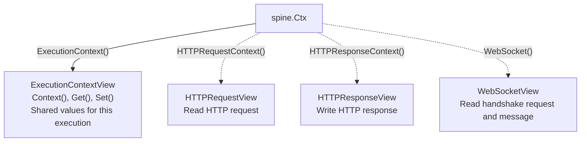

# Execution context

::: info 0.7.5
This documentation targets the 0.7.5 API. Check [available versions](/en/community/versions) for published tags and compatible platforms.
:::

## Common entry point {#public-context}

Handlers and interceptors receive `github.com/NARUBROWN/spine/pkg/spine.Ctx`. Use the `spinectx` alias alongside the root application package. Pass the standard Go context from `ctx.ExecutionContext().Context()` to services and repositories. Direct context.Context injection remains compatible.

```go
import spinectx "github.com/NARUBROWN/spine/pkg/spine"

func readRequest(ctx spinectx.Ctx) {
	execution := ctx.ExecutionContext()
	execution.Set("userID", "alice")
	value, exists := execution.Get("userID")
	goContext := execution.Context()
	request, supported := ctx.HTTPRequestContext()
	if supported {
		_ = request.Header("Authorization")
	}
	_, _, _ = value, exists, goContext
}
```

## Public contract {#contract}



```go
type Ctx interface {
	ExecutionContext() ExecutionContextView
	HTTPRequestContext() (HTTPRequestView, bool)
	HTTPResponseContext() (HTTPResponseView, bool)
	WebSocket() (WebSocketView, bool)
	Get(key string) (any, bool) // Deprecated
}
type ExecutionContextView interface {
	Context() context.Context
	Get(key string) (any, bool)
	Set(key string, value any)
}
```

## Transport views {#views}

| Getter | Available operations |
| --- | --- |
| `ExecutionContext()` | Go context and per-execution Get/Set |
| `HTTPRequestContext()` | Method, Path, Param, Query, Header, MultipartForm |
| `HTTPResponseContext()` | SetHeader, AddHeader, IsCommitted, WriteStatus/JSON/String/Bytes |
| `WebSocket()` | Handshake request, ConnID, MessageType, Payload |

Unsupported transport getters return nil, false. HTTP executions provide request and response views; WS handshakes and messages provide a WS view. Do not assume HTTP/WS views exist in event executions. Payload and multipart headers are copies.

<span id="event-publishing"></span>

## Lifetime and migration {#lifetime}

The store is isolated per request or message and shared by that execution’s hooks and handler. References are released after all AfterCompletion hooks; subsequent Get returns nil, false and Set does nothing. Execution completion does not itself cancel the Go context. WS handshakes do not share a store with later messages. Internal writer replacement, Bind, SetRoute, EventBus, and SenderKey access are not public contracts. Publish with `publish.Event(ctx.ExecutionContext().Context(), event)` and send with `ws.Send(ctx.ExecutionContext().Context(), ws.TextMessage, data)`. Use input wrappers for default HTTP DTO binding.

[Inputs and DTOs](/en/learn/tutorial/2-controller) | [Interceptors](/en/learn/tutorial/4-interceptor)

## WebSocket request view {#websocket-request-context}

Handshake PreHandshake and message hooks receive spine.Ctx. Check request, ok := ctx.WebSocket() before reading request.Header or Cookie. During handshake, ConnID is empty and no message type or payload exists yet. Do not assume HTTPRequestContext() is available. Handshake and individual messages use separate Set/Get stores.

```go
type WebSocketRequestView interface {
	Context() context.Context
	Path() string
	Header(string) string
	Headers() map[string][]string
	Query(string) string
	Queries() map[string][]string
	Cookie(string) (string, bool)
	Cookies() map[string]string
	RemoteAddr() string
	Host() string
	RequestURI() string
}
type WebSocketView interface {
	WebSocketRequestView
	ConnID() string
	MessageType() int
	Payload() []byte
}
```
