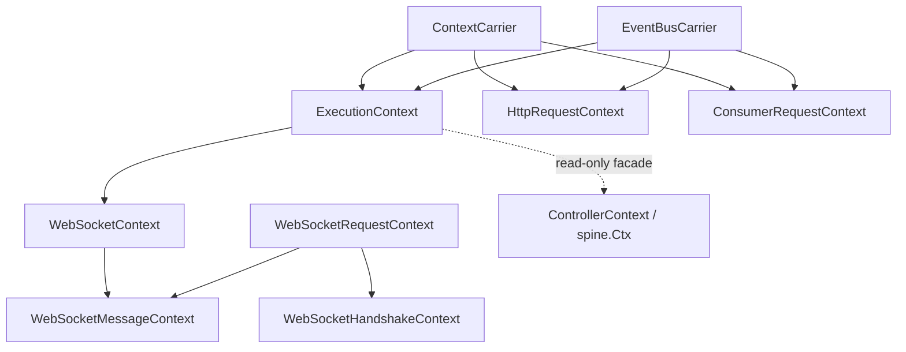

# Execution Context

Spine separates execution control, protocol input, and controller-visible state into small context interfaces.

The application handlers below are manual extensions to `src/user/user_controller.go` in a [CLI project](/en/learn/tutorial/1-project-structure). Import response types from `github.com/NARUBROWN/spine/pkg/httpx` and `spine.Ctx` from `github.com/NARUBROWN/spine/pkg/spine`. Keep `BuildApplication` and its checked `user.Register(app)` call; framework implementation excerpts do not belong in application files.

## Why contexts are separated



- The pipeline and interceptors need mutable request state, routing data, and event access.
- Resolvers need only the protocol-specific input they decode.
- Controllers should read values placed by interceptors without mutating framework state.
- WebSocket authentication needs HTTP upgrade data, while message handlers also need frame data.

There is no catch-all `RequestContext` interface in the current public contract. Resolver implementations accept `ExecutionContext` and assert the narrow protocol interface they need.

## ExecutionContext

`ExecutionContext` is the pipeline contract:

```go
type ExecutionContext interface {
    ContextCarrier
    EventBusCarrier

    Method() string
    Path() string
    Params() map[string]string
    Header(name string) string
    PathKeys() []string
    Queries() map[string][]string
    Set(key string, value any)
    Get(key string) (any, bool)
}
```

An interceptor can store request-scoped authentication or transaction state. This complete minimal implementation makes the three unused lifecycle methods explicit:

```go
func (i *AuthInterceptor) PreHandle(
    ctx core.ExecutionContext,
    meta core.HandlerMeta,
) error {
    user, err := i.verify(ctx.Header("Authorization"))
    if err != nil {
        return httperr.Unauthorized("invalid credentials")
    }
    ctx.Set("myapp.auth.user", user)
    return nil
}

func (i *AuthInterceptor) PostHandle(core.ExecutionContext, core.HandlerMeta) {}

func (i *AuthInterceptor) BeforeResponse(
    core.ExecutionContext,
    core.HandlerMeta,
    error,
) error {
    return nil
}

func (i *AuthInterceptor) AfterCompletion(
    core.ExecutionContext,
    core.HandlerMeta,
    error,
) {}
```

Controllers read the same value through `spine.Ctx`, the public resolver type backed by `ControllerContext`:

```go
func (c *UserController) Me(ctx spine.Ctx) (httpx.Response[User], error) {
    value, ok := ctx.Get("myapp.auth.user")
    if !ok {
        return httpx.Response[User]{}, httperr.Unauthorized("authentication required")
    }
    return httpx.Response[User]{Body: value.(User)}, nil
}
```

Keep application keys namespaced and avoid the reserved `spine.` prefix.

## Protocol-specific input

`HttpRequestContext` supplies `Param`, `Query`, `Header`, complete defensive views, body binding, and multipart parsing. HTTP argument resolvers use it to construct semantic types such as `path.Int`, `query.Values`, `header.Values`, DTOs, and uploads.

`ConsumerRequestContext` supplies `EventName` and `Payload`. Consumer resolvers derive event-name semantic types, raw payload, and event DTOs from it.

`WebSocketContext` extends `ExecutionContext` with `ConnID`, `MessageType`, and `Payload` for each frame.

## WebSocket request snapshots

v0.5.1 preserves immutable HTTP handshake information:

- headers and multi-value queries;
- cookies;
- path, host, remote address, and request URI;
- the request `context.Context`.

`WebSocketHandshakeInterceptor.PreHandshake` receives `WebSocketHandshakeContext` before HTTP upgrade. The connection slot is reserved first, so a pending or rejected authentication attempt counts against the configured capacity.

During message handling, assert `WebSocketMessageContext` when you need both frame data and the original request snapshot:

```go
request, ok := ctx.(core.WebSocketMessageContext)
if !ok {
    return errors.New("request snapshot unavailable")
}
origin := request.Header("Origin")
room := request.Query("room")
```

Returned header, query, cookie, and path-parameter collections are defensive copies. Treat all request views as immutable.

## Context and events

`Context()` carries cancellations and deadlines. Consumer shutdown waits for the active handler and ACK/NACK path to drain, so handlers should pass this context through external calls.

`EventBus()` collects domain events during a handler. In HTTP, post-execution dispatch begins only after the response has serialized and its cookies/status have validated. This reduces inconsistent outcomes, but broker publication is not atomic with a database commit; durable workflows still need an outbox and idempotency.

## Concurrency

WebSocket execution contexts protect their mutable store and event-bus initialization because messages and connection lifecycle work can overlap. Values stored in the context can still be mutable application objects; synchronize those objects according to your own ownership rules.

## Design rules

- Interceptors use `ExecutionContext` to control the pipeline.
- Controllers use `spine.Ctx` only when they need interceptor-provided state.
- Resolvers assert `HttpRequestContext`, `ConsumerRequestContext`, or `WebSocketContext`.
- Handshake authentication uses `WebSocketHandshakeContext`.
- Message code needing upgrade metadata asserts `WebSocketMessageContext`.
- Collection views are snapshots, not mutation APIs.

## See also

- [ExecutionContext API](/en/reference/api/execution-context)
- [Execution pipeline](/en/learn/core-concepts/pipeline)
- [Interceptors](/en/learn/tutorial/4-interceptor)
