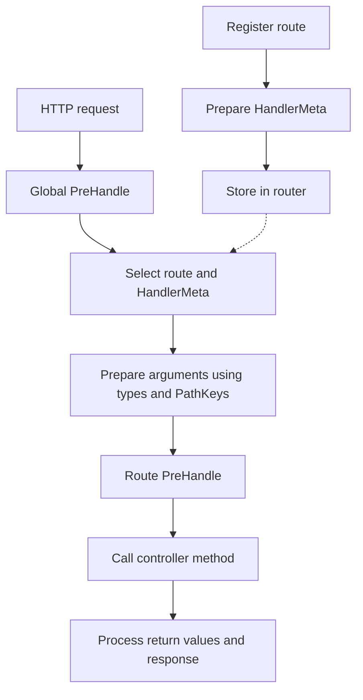

# Handler Metadata (HandlerMeta)

`core.HandlerMeta` contains the information needed to execute the controller method for a request: the controller type, method, order of path parameters, and route interceptors. Register handlers with `app.Route`, then read `HandlerMeta` in an interceptor to identify the handler being executed.

The feature-based `src/user` examples on this page use the `my-app` project created with `--layout legacy` in [Project Structure](/en/learn/tutorial/1-project-structure). CLI `v0.4.0` defaults to the role-based `layered-v1` layout. Both layouts use Spine `v0.6.0` and Echo platform `v0.1.0`.

This page describes the public types and HTTP execution flow in Spine v0.6.0. You do not need to implement metadata creation functions or router internals in your app.

## Where It Fits in a CLI Project

In `example.com/my-app` from [CLI Project Structure](/en/learn/tutorial/1-project-structure), declare user routes in `Register(app)` in `src/user/user_route.go`. The generated handler is `(*UserController).Get`, and its route is `GET /user/:id`. `BuildApplication` in `internal/application/application.go` checks and returns errors from `user.Register(app)`, while the generated `main.go` handles validation and execution.

```go
// src/user/user_route.go의 Register 내부 발췌
app.Route(
    "GET",
    "/user/:id",
    (*UserController).Get,  // 메서드 표현식
)
```

The `GetUser` method, admin handler, and authentication interceptor below are examples of app extensions used to explain the concepts. They are separate from the CLI-generated `Get` method, so you must also implement their types and methods to add them as shown. See the [Interceptor Tutorial](/en/learn/tutorial/4-interceptor) for a complete interceptor implementation and registration instructions.

## HandlerMeta Fields

`core.HandlerMeta` has the following fields. It uses `reflect` types to represent controller and method information.

```go
// core/handler_meta.go
type HandlerMeta struct {
    // 컨트롤러 타입 (Container Resolve 대상)
    ControllerType reflect.Type

    // 호출할 메서드
    Method reflect.Method

    // 라우트에 선언된 경로 매개변수 키의 순서
    PathKeys []string

    // 핸들러에 적용된 인터셉터
    Interceptors []Interceptor
}
```

| Field | Type | Role |
| --- | --- | --- |
| `ControllerType` | `reflect.Type` | Pointer type of the controller to resolve from the dependency container |
| `Method` | `reflect.Method` | Name, signature, and function information for the method to call |
| `PathKeys` | `[]string` | Ordered names of the path parameters declared in the route |
| `Interceptors` | `[]core.Interceptor` | List of interceptors to apply to this route |

If `ControllerType` is `*UserController` and `Method.Name` is `GetUser`, the pipeline obtains a `*UserController` instance from the container and calls `GetUser`.

```go
meta.ControllerType  // reflect.Type of *UserController
```

```go
meta.Method.Name           // "GetUser"
meta.Method.Type           // func(*UserController, path.Int) (httpx.Response[User], error)
meta.Method.Func           // 호출 가능한 reflect.Value
```

`PathKeys` contains path parameter names rather than actual request values. For example, `/users/:userId/orders/:orderId` stores `userId` followed by `orderId`, and the handler's `path` arguments are bound in that order. Path parameter values, which vary for each request, are read from the request context.

`Interceptors` contains only route interceptors. The pipeline manages global interceptors registered with `app.Interceptor` separately.

```go
meta.Interceptors  // []core.Interceptor (라우트 레벨)
```

## Registering a Handler with a Method Expression

Pass a **method expression** such as `(*UserController).GetUser` to the route. This expression is a function that is not bound to a particular controller instance and takes a controller pointer as its first argument.

```go
// 메서드 표현식의 실제 타입
func(*UserController, path.Int) (httpx.Response[User], error)
//   ↑ receiver가 첫 번째 인자로 변환됨
```

Spine uses this information to identify the controller type and method to call. It obtains the controller instance from the dependency container according to the app's constructor registrations.

Distinguish between the following registration forms.

| Registration Form | Supported | Description |
| --- | --- | --- |
| `(*UserController).GetUser` | Yes | Method expression whose first argument is `*UserController` |
| `UserController.GetUser` | No | Takes a value type as its first argument, so it does not meet the pointer type requirement |
| `ctrl.GetUser` | No | Method value bound to a specific instance, so it does not take a separate controller argument |
| Regular function or closure | No | Does not match the registration form used to identify the controller type and method |

This requirement concerns the form of the expression passed to the route. Define app controllers with pointer receivers, as in the tutorial, and register them as `(*Controller).Method`.

## Specifying Route Interceptors

`route.WithInterceptors` accepts the interceptors to apply to that route. Import `github.com/NARUBROWN/spine/pkg/route` to use it.

```go
app.Route(
    "GET",
    "/users/:id",
    (*UserController).GetUser,
    route.WithInterceptors(&AuthInterceptor{}),
)
```

There are two ways to pass an interceptor.

| Value Passed | How the Instance Is Created |
| --- | --- |
| `&AuthInterceptor{}` | Uses the instance created by the app as is |
| `(*AuthInterceptor)(nil)` | Creates an instance of that pointer type through the container during bootstrap |

You can use a typed nil pointer for an interceptor that needs dependency injection. In this case, register the interceptor constructor and its required dependencies. Passing `nil` without type information causes route interceptor registration to fail.

```go
// src/user/user_route.go의 Register 내부 발췌
app.Route("GET", "/users/:id", (*UserController).GetUser)

// 라우트 인터셉터와 함께
app.Route("GET", "/admin/users/:id", (*AdminController).GetUser,
    route.WithInterceptors((*AuthInterceptor)(nil)),  // nil 포인터 → Container에서 Resolve
)
```

You can also use global and route interceptors together. Global interceptors apply to every request, while route interceptors apply only to their route.

```go
// 글로벌: 모든 요청에 적용 (라우팅 전 실행)
app.Interceptor(&CORSInterceptor{})

// 라우트: 특정 핸들러에만 적용 (라우팅 후, Controller 호출 전 실행)
app.Route("GET", "/admin/:id", (*AdminController).Get,
    route.WithInterceptors(&AuthInterceptor{}),
)
```

## Identifying the Handler in an Interceptor

The interceptor methods `PreHandle`, `PostHandle`, `BeforeResponse`, and `AfterCompletion` receive `HandlerMeta`. Read this information when logging or applying policies for individual handlers.

Global `PreHandle` runs before routing, so it receives an empty `HandlerMeta`. At this point, `ControllerType` is nil and `Method.Name` is empty. Once a route is selected, the actual handler metadata is passed, but a request whose routing fails may have no handler to execute. Check the fields before accessing them.

The following example shows only `PreHandle`. It requires the `core` and `log` imports. An interceptor must also implement the other three methods before it can be registered.

```go
// src/interceptor/logging_interceptor.go
func (i *LoggingInterceptor) PreHandle(ctx core.ExecutionContext, meta core.HandlerMeta) error {
    controllerName := "<unresolved>"
    if meta.ControllerType != nil {
        controllerName = meta.ControllerType.String()
    }
    log.Printf(
        "[REQ] %s %s -> %s.%s",
        ctx.Method(),
        ctx.Path(),
        controllerName,
        meta.Method.Name,            // "GetUser"
    )
    return nil
}
```

Interceptors use `core.ExecutionContext` to access request information in this way. HTTP controllers do not have to accept the same type as an argument. In a controller, declare request types supported by [Type-Based Argument Injection](/en/learn/tutorial/2-controller).

## Registration and Request Execution

During bootstrap, route declarations are prepared for execution.

1. Identify the controller type and method from the handler declared in `app.Route`.
2. Prepare the route interceptors and attach them to `HandlerMeta`.
3. Register the full path and path parameter order with the router.
4. Create the registered controllers and their dependencies in advance.

Server startup fails if the handler form is invalid or if the controller or interceptor dependencies cannot be created. Preserve the generated project's error return path so the caller receives these failures.

When a request arrives, the prepared metadata is used in the following order.

1. Run `PreHandle` on global interceptors.
2. Find the route that matches the request and obtain its `HandlerMeta`.
3. Prepare arguments according to the method's parameter types and `PathKeys`.
4. Run `PreHandle` on route interceptors.
5. Obtain the controller instance and call the method.
6. Process return values and complete pre-response processing, then send the response.

The normal execution flow is shown below. An error or an interceptor's request to stop processing may cause later steps to be skipped.



For successful requests, `PostHandle` runs on route interceptors first, then global interceptors. Within each list, it runs in reverse registration order. See the [Interceptor Tutorial](/en/learn/tutorial/4-interceptor) for the execution conditions and error handling of `BeforeResponse` and `AfterCompletion`.

## Where to Check Errors

| Situation | What to Check |
| --- | --- |
| Handler registration fails | Check that the handler uses `(*Controller).Method` and that the method can be found |
| Controller creation fails | Check that the controller constructor and the dependencies it accepts are registered |
| Route interceptor creation fails | Check that a typed nil pointer is used and that the required constructors are registered |
| Request argument preparation fails | Check that the handler argument types are supported and the path parameter declaration order is correct |
| No matching route | Check the HTTP method, path, and global path prefix. Default HTTP handling returns a 404 error response |

`HandlerMeta` describes the handler to execute. Argument resolvers convert request data, and return value handlers convert actual return values into HTTP responses. Check route declarations and controller signatures before attempting to replace these components yourself.
