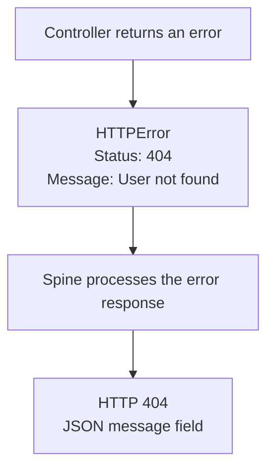

# httperr Package

::: info
This page describes error handling in Spine `v0.7.1`. See [input migration](/en/learn/migration/v0.7.1-preview) for changes from legacy inputs and [OpenAPI](/en/reference/api/openapi) for document options.
:::

`httperr` contains HTTP status codes and error messages to send to clients. When a controller returns an error such as `httperr.NotFound("User not found")`, Spine converts it to a status code and a JSON error response. Controllers do not need to work directly with response objects from Echo or similar frameworks.

This page describes `github.com/NARUBROWN/spine/pkg/httperr` in Spine v0.7.1.

## Using It in a CLI Project

The controller below is a code snippet to add to a [CLI-generated project](/en/learn/tutorial/1-project-structure). `httpx`, `httperr`, and `input` are packages under `github.com/NARUBROWN/spine/pkg`. Connect the controller constructor and route to the registration path used by `BuildApplication`. The app defines domain types such as `User`, repositories, and services.

Wrap successful values in `httpx.Response[T]`. On failure, return an empty response value together with the error. In examples that receive a request body, declare the DTO as a pointer, such as `*PaymentRequest`.

```go
func (c *UserController) GetUser(userId input.Path[int64]) (httpx.Response[User], error) {
    if *userId <= 0 {
        return httpx.Response[User]{}, httperr.BadRequest("Invalid user ID")
    }

    user, err := c.repo.FindByID(*userId)
    if err != nil {
        return httpx.Response[User]{}, httperr.NotFound("User not found")
    }

    return httpx.Response[User]{Body: user}, nil
}
```

If this method is registered for `GET /users/:id`, it responds as follows. The example assumes that every repository lookup error is treated as a 404. In a real app, distinguish a missing result from a database failure when choosing the status code.

```text
# Invalid ID
GET /users/-1
→ 400 {"message": "Invalid user ID"}

# User does not exist
GET /users/999
→ 404 {"message": "User not found"}

# Valid request
GET /users/123
→ 200 {"id": 123, "name": "john"}
```



## HTTPError Fields

`HTTPError` implements Go's `error` interface, and `Error()` returns `Message`.

```go
// pkg/httperr/types.go
type HTTPError struct {
    Status  int    // HTTP status code
    Message string // Error message
    Cause   error  // Underlying error (optional)
}

// Implement the error interface
func (e *HTTPError) Error() string {
    return e.Message
}
```

| Field | Type | Purpose |
| --- | --- | --- |
| `Status` | `int` | HTTP error status code to send to the client |
| `Message` | `string` | Message to send in the JSON response's `message` field |
| `Cause` | `error` | Underlying error retained by the app. Not included in the JSON response |

The helper functions return the `error` interface type, but the concrete value is a `*httperr.HTTPError`. Use `errors.As` to find this type. Even when an error is wrapped with `fmt.Errorf("context: %w", err)`, Spine finds the inner `HTTPError` and uses its status code and `Message`.

`Message` is sent to the client as is. Keep information that must not be public, such as SQL, secrets, or internal paths, in the underlying error or logs rather than in the message.

## Built-in Helper Functions

Spine v0.7.1 provides the following four helpers. Each accepts `msg string` and returns `error`.

| Function | Status Code | When to Use It |
| --- | --- | --- |
| `BadRequest(msg)` | 400 | A request value does not meet the API's requirements |
| `Unauthorized(msg)` | 401 | Authentication information is missing or authentication fails |
| `NotFound(msg)` | 404 | The requested resource cannot be found |
| `InternalServerError(msg)` | 500 | An internal server error must be returned with an explicit message |

### Invalid Request Values

Use `BadRequest` to check business conditions that still need validation after type conversion.

```go
func BadRequest(msg string) error {
    return &HTTPError{Status: 400, Message: msg}
}
```

```go
if *userId <= 0 {
    return httpx.Response[User]{}, httperr.BadRequest("Invalid user ID")
}
```

### Authentication Failure

Use `Unauthorized` when authentication is required or fails. If an already authenticated user lacks permission, you can choose a 403 status code as shown in the extension examples below.

```go
func Unauthorized(msg string) error {
    return &HTTPError{Status: 401, Message: msg}
}
```

```go
if !c.auth.IsValid(token) {
    return httpx.Response[User]{}, httperr.Unauthorized("Authentication required")
}
```

### Missing Resources

Use `NotFound` when the requested resource does not exist.

```go
func NotFound(msg string) error {
    return &HTTPError{Status: 404, Message: msg}
}
```

```go
user, err := c.repo.FindByID(id)
if err != nil {
    return httpx.Response[User]{}, httperr.NotFound("User not found")
}
```

### Internal Server Errors

`InternalServerError` returns status code 500 and the specified message. Unlike returning a regular `error` directly, this exposes the message to the client.

```go
func InternalServerError(msg string) error {
    return &HTTPError{Status: 500, Message: msg}
}
```

```go
result, err := c.externalService.Call()
if err != nil {
    return httpx.Response[Result]{}, httperr.InternalServerError("External service call failed")
}
```

## Controller Return Values and Error Responses

Spine first checks the controller's return values for a non-nil error. If an error is present, it does not process the success value as a response.

| Return Values | Default HTTP Handling |
| --- | --- |
| `httpx.Response[T]`, nil error | Processes the success value |
| `httpx.Response[T]`, `httperr.NotFound(...)` | Returns a 404 error response instead of the success value |
| `httpx.Response[T]`, regular `error` | Returns a 500 error response instead of the success value |
| Only `error`, with a nil value | Does not write an error response |

Return JSON success values inside `httpx.Response[T]`. Use `httpx.Redirect` for redirects and `httpx.Binary` for binary responses. Returning an arbitrary DTO differs from returning an HTTP success response type.

Error response bodies use the `{"message":"..."}` format. The default handling differs as follows.

| Error Type | Status Code | `message` |
| --- | --- | --- |
| `*httperr.HTTPError` | Error status code specified by `Status` | `Message` |
| Error wrapping an `HTTPError` with `%w` | Status code of the inner `HTTPError` | `Message` of the inner `HTTPError` |
| Regular `error` | 500 | `"Internal server error"` |

The default error response does not expose the `Error()` string of a regular error. Use `httperr` to state failure conditions the client needs to know, and inspect logs for detailed causes.

## Validating Business Rules

Even after receiving a request body, you must check app-defined conditions such as amounts, limits, and balances. Returning an error from each failure branch causes that error to be handled without creating a success response.

```go
func (c *PaymentController) Process(req *PaymentRequest) (httpx.Response[Receipt], error) {
    if req.Amount <= 0 {
        return httpx.Response[Receipt]{}, httperr.BadRequest("Payment amount must be greater than zero")
    }

    if req.Amount > 10000000 {
        return httpx.Response[Receipt]{}, httperr.BadRequest("Payment exceeds the per-transaction limit")
    }

    balance, err := c.wallet.GetBalance(req.UserID)
    if err != nil {
        return httpx.Response[Receipt]{}, httperr.NotFound("Wallet not found")
    }

    if balance < req.Amount {
        return httpx.Response[Receipt]{}, httperr.BadRequest("Insufficient balance")
    }

    receipt, err := c.processPayment(req)
    if err != nil {
        return httpx.Response[Receipt]{}, err
    }
    return httpx.Response[Receipt]{Body: receipt}, nil
}
```

The app implements `PaymentRequest`, `Receipt`, wallet lookup, and payment processing in this example. The app is also responsible for distinguishing a missing wallet from a lookup system failure. If `c.processPayment` returns a regular error, the client receives the default 500 message.

## Handlers That Return Only an Error

Methods that do not need a success response body can return only `error`.

```go
func (c *UserController) DeleteUser(userId input.Path[int64]) error {
    exists, err := c.repo.Exists(*userId)
    if err != nil {
        return err
    }
    if !exists {
        return httperr.NotFound("User not found")
    }

    if err := c.repo.Delete(*userId); err != nil {
        return err
    }

    return nil  // Return nil on success
}
```

Returning nil does not write an error response. This form alone does not specify a particular success status code. Use an `httpx` response type if you need an explicit status code, such as 204 after a successful deletion.

A missing user returns 404; repository failures are returned unchanged. Choose status codes and retry policies according to the application error type.

## Using Other Error Status Codes

For status codes without a built-in helper, create an `HTTPError` directly. The following functions are examples defined by the app; they are not provided by `httperr`.

```go
// Create an HTTPError directly
func Forbidden(msg string) error {
    return &httperr.HTTPError{Status: 403, Message: msg}
}

func Conflict(msg string) error {
    return &httperr.HTTPError{Status: 409, Message: msg}
}

func UnprocessableEntity(msg string) error {
    return &httperr.HTTPError{Status: 422, Message: msg}
}

func TooManyRequests(msg string) error {
    return &httperr.HTTPError{Status: 429, Message: msg}
}
```

Use error status codes from 400 through 599. Status code validity is also checked when the response is written, so do not use a success or redirect status in `HTTPError.Status` to control the flow.

## Retaining and Logging Underlying Errors

`Cause` lets you retain both the client-facing message and the internal cause. The following `WithCause` helper is defined by the app.

```go
func WithCause(status int, msg string, cause error) error {
    return &httperr.HTTPError{
        Status:  status,
        Message: msg,
        Cause:   cause,
    }
}

// Usage
user, err := c.repo.FindByID(id)
if err != nil {
    return httpx.Response[User]{}, WithCause(404, "User not found", err)
}
```

`HTTPError.Unwrap()` returns `Cause`. Use `errors.Is` and `errors.As` to inspect the cause chain, or read the `Cause` field directly. The cause is not included in the JSON response.

An interceptor's `AfterCompletion` can log the cause after the request finishes. The following example shows only that method and uses the `core`, `httperr`, `errors`, and `log` packages. A registrable implementation also needs `PreHandle`, `PostHandle`, and `BeforeResponse`.

```go
func (i *LoggingInterceptor) AfterCompletion(ctx core.ExecutionContext, meta core.HandlerMeta, err error) {
    if err != nil {
        var httpErr *httperr.HTTPError
        if errors.As(err, &httpErr) && httpErr.Cause != nil {
            log.Printf("[ERR] %s %s: %s (cause: %v)",
                ctx.Method(), ctx.Path(), httpErr.Message, httpErr.Cause)
        }
    }
}
```

## Runtime Errors and After Response Completion

Errors can occur during routing, argument conversion, controller invocation, or response processing, in addition to errors returned by a controller. Spine converts these errors into the final error response within the HTTP execution flow.

| Situation | Default Behavior |
| --- | --- |
| No matching route | 404 error response |
| `HTTPError` occurs during execution | Responds with the specified error status code and message |
| DTO rule violation from the selected validator (`validation.Error`) | 400 response with `message` and `fields` |
| Regular execution error occurs | Responds with 500 and `"Internal server error"` |
| Request body exceeds the size limit | Responds with 413 and `"Request entity too large"` |
| An actual response has already been written | Does not write another error response, preventing a double response |

Spine v0.7.1 applies the prepared response to the actual transport layer after pre-response processing is complete. An error in `BeforeResponse` can replace the pending success response with an error response. Since `AfterCompletion` runs after response processing, use this stage to log errors and transmission results rather than attempting to write a new error response.

Pass errors through Go return values. Do not use `panic` for normal input validation or business failures. See the [Interceptor Tutorial](/en/learn/tutorial/4-interceptor) for interceptor termination and cleanup behavior.
