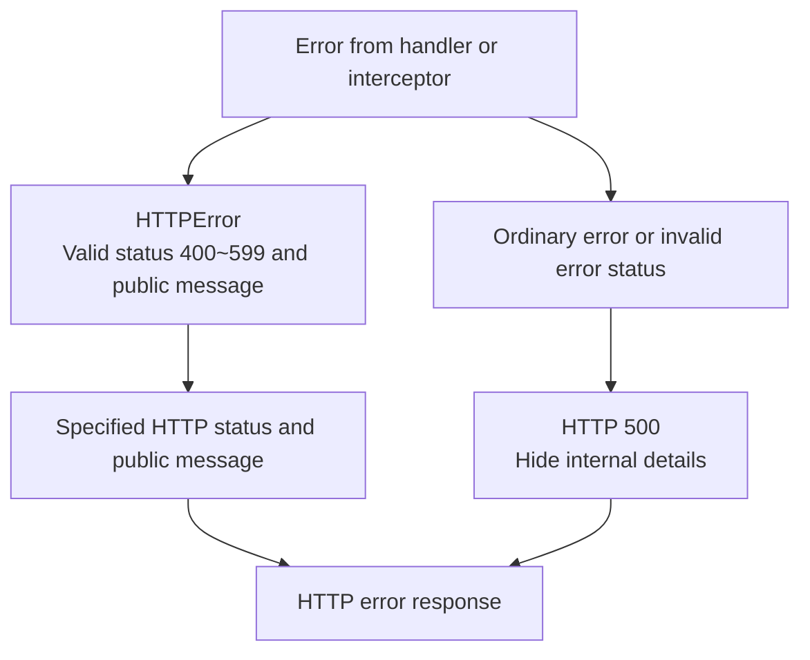

# HTTP errors

Handlers and interceptors use the public httperr contract for status and public messages. Return internal details as ordinary errors.




## Public helpers

```go
func BadRequest(msg string) error
func Unauthorized(msg string) error
func NotFound(msg string) error
func InternalServerError(msg string) error
```

These map to 400, 401, 404 and 500. Use &httperr.HTTPError{Status: 409, Message: "conflict"} for another error status. Only 400–599 are valid. Returning 200 or 302 as errors yields a sanitized 500. Set success statuses through httpx.Response.Options and redirects through httpx.Redirect.

## Ordinary and wrapped errors

Ordinary errors return 500 without exposing err.Error(). HTTPError is found through errors.As, including fmt.Errorf with %w. Its explicit message is public, so never insert raw DB errors. Parsing and registered-validator failures return 400 before handlers.

## Interceptor priority

PreHandle precedes binding, so authentication failure returns 401 even with a malformed body. A later BeforeResponse error takes HTTP response priority over the handler error. The last failing BeforeResponse wins; AfterCompletion also receives previous errors. Completion runs after the write attempt and cannot change the status or serve as a commit point.

## Examples

[Errors and validation](/en/learn/tutorial/7-error-handling) / [Interceptors](/en/learn/tutorial/4-interceptor) / [Transactions](/en/learn/tutorial/6-transaction)
