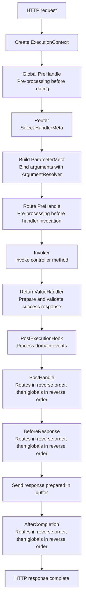

# Execution Pipeline

::: warning v0.7.0 Preview input API migration
The existing API descriptions and examples on this page target stable `v0.6.5`. From `v0.7.0-preview.1`, source-specific Path, Query, and Header DTOs are supported. `query.Values`, `header.Values` and their construction and lookup APIs, `query.Pagination`, `path.Int`, `path.String`, and `path.Boolean` are Deprecated.

The new DTO approach cannot be applied unchanged to `v0.6.5`. In Preview, mixing new DTOs with Deprecated inputs in one handler fails during boot. Existing body DTOs and contexts can still be used alongside either approach.

See [Preview handler input migration](/en/learn/migration/v0.7.0-preview) for versions and migration examples, and [Runtime OpenAPI](/en/reference/api/openapi) for specification options.
:::

Spine's execution pipeline receives a request, selects a handler, binds its arguments, and turns its return value into a response. Use this flow to understand when interceptors run and how far execution proceeds when an error occurs.

This document describes the HTTP execution order in Spine v0.6.5. HTTP, event consumers, and WebSocket use the same pipeline implementation, but their input resolvers and response handling configurations differ.

The controller examples are code to add to a [project generated by the CLI](/en/learn/tutorial/1-project-structure). Receive request DTOs as pointers and return ordinary success responses as `httpx.Response[T]` from `github.com/NARUBROWN/spine/pkg/httpx`. Register constructors and routes in `BuildApplication`.

## HTTP Request Execution Order

A successful request follows this sequence. Each interceptor's `PreHandle` runs in registration order, and its post-processing methods run in reverse order.



A success response returned by the handler is not sent immediately. The pipeline prepares it in a buffer, then writes it to the actual HTTP response after post-processing and `BeforeResponse` finish. If an error occurs along the way, the pipeline can replace the pending response with an error response.

## Creating the Request Context

The HTTP adapter creates a `core.ExecutionContext` for each request. The pipeline uses this object to read the request method and path, share values stored by interceptors, and collect events that belong to the request.

Components use the same context with different scopes of access.

| Component | Context usage |
| --- | --- |
| Router | Find the handler by method and path, and store path parameters |
| Interceptor | Read request information, store execution state, and run processing before and after the response |
| Argument resolver | Create controller arguments from the context |
| Return value handler | Prepare the response with the response writer attached to the context |
| Controller | Receive only the values it needs through semantic types, `context.Context`, and read-only `spine.Ctx` |

Controllers do not receive `core.ExecutionContext` directly. Use `pkg/spine.Ctx` when a controller needs to read values stored by an interceptor. [Execution Context](/en/learn/core-concepts/execution-context) explains the scope of access for each method.

## Global Interceptors: Processing Before Routing

The `PreHandle` methods of global interceptors registered with `app.Interceptor()` run first. Since no handler has been selected yet, these calls receive an empty `core.HandlerMeta{}`.

Use this stage for work that must happen before route selection, such as CORS preflight. For example, a CORS interceptor can prepare a response to an allowed `OPTIONS` request and return `core.ErrAbortPipeline` to stop further execution.

Keep these constraints in mind in global `PreHandle`:

- The controller and method to execute have not been determined yet.
- The Spine router has not stored path parameters yet.
- Request DTOs and other controller arguments, such as `path.Int`, have not been created yet.

After routing succeeds, `PostHandle`, `BeforeResponse`, and `AfterCompletion` receive the selected handler's metadata. If execution stops or fails before routing, it finishes with empty metadata.

## Router: Selecting the Handler and Path Parameters

The router uses `ctx.Method()` and `ctx.Path()` to find a registered handler. If no handler matches, it returns a 404 error. If the path contains parameters, the router stores their values in the context and preserves their declaration order in the metadata.

`HandlerMeta` contains the execution target and route configuration.

```go
// core/handler_meta.go
type HandlerMeta struct {
    ControllerType reflect.Type   // Controller type to resolve from the dependency container
    Method         reflect.Method // Method to invoke
    PathKeys       []string       // Order of path parameters declared in the route
    Interceptors   []Interceptor  // Interceptors to apply to this handler
}
```

`HandlerMeta` does not instruct the pipeline to create a new controller for each request. The Invoker uses this information to find the target in the dependency container and pass arguments to its method. See [HandlerMeta](/en/learn/core-concepts/handler-meta) for details about its fields.

## Argument Binding: ParameterMeta and ArgumentResolver

After selecting a handler, the pipeline reads its method signature and builds `ParameterMeta` to describe the type and position of each argument. The first registered resolver that supports the type then creates its value.

If a resolver cannot create a value, or no resolver supports the type, the pipeline moves to error handling without invoking the controller. **This stage runs before the route interceptor's `PreHandle`.** Do not assume that a route interceptor performs checks before body binding.

### Path Parameters Bind in Declaration Order

`path.Int`, `path.String`, and `path.Boolean` bind in the order of the parameters declared in the route. They do not match by Go argument name.

```go
// Route: /users/:userId/posts/:postId
// userId receives the first path value, and postId receives the second.
func GetPost(userId path.Int, postId path.Int) (httpx.Response[Post], error)
```

Keep the path types in the correct order even when arguments of other types appear between them. When changing the number or types of path parameters, check both the route declaration and the method signature.

### Supported HTTP Arguments

| Resolver | Controller argument type | Value provided |
| --- | --- | --- |
| `StdContextResolver` | `context.Context` | Request cancellation and timeout information, and the context used to publish events |
| `ControllerContextResolver` | `spine.Ctx`, `core.ControllerContext` | Read-only view of the interceptor store |
| `HeaderResolver` | `header.Values` | HTTP header view |
| `PathIntResolver` | `path.Int` | Integer parsed from a path value |
| `PathStringResolver` | `path.String` | String from the path |
| `PathBooleanResolver` | `path.Boolean` | Boolean parsed from a path value |
| `PaginationResolver` | `query.Pagination` | The `page` and `size` query values |
| `QueryValuesResolver` | `query.Values` | View of all query values |
| `DTOResolver` | `*struct` | DTO bound from the HTTP body |
| `FormDTOResolver` | `*struct` with a `form` tag | DTO bound from a form or multipart body |
| `UploadedFilesResolver` | `multipart.UploadedFiles` | Uploaded files |

`header`, `path`, `query`, and `multipart` are packages under `github.com/NARUBROWN/spine/pkg/`. Distinguish `multipart.UploadedFiles` in the table from the types in Go's standard `mime/multipart` package.

Declare HTTP DTOs as struct pointers. If any field has a `form` tag, the ordinary DTO resolver skips the type and the form DTO resolver handles it. If `page` or `size` in `query.Pagination` is omitted or cannot be parsed as an integer, it defaults to 1 or 20, respectively.

### Resolver Contract

Internal resolvers follow this contract. You do not need to copy and register this interface or the `internal/` packages in your app.

```go
type ArgumentResolver interface {
    Supports(parameterMeta ParameterMeta) bool
    Resolve(ctx core.ExecutionContext, parameterMeta ParameterMeta) (any, error)
}
```

A resolver receives the shared `ExecutionContext`, then checks for `core.HttpRequestContext` when it needs HTTP input. Consumer and WebSocket resolvers read message bodies from their respective protocol contexts.

## Route Interceptors: Processing Before Handler Invocation

Interceptors registered with `route.WithInterceptors()` apply only to a specific handler. Their `PreHandle` runs after routing and argument binding, so they can use the selected `HandlerMeta` and path parameters.

| Scope | Registration | When `PreHandle` runs | Metadata provided |
| --- | --- | --- | --- |
| Global | `app.Interceptor()` | Before routing | Empty `HandlerMeta{}` |
| Route | `route.WithInterceptors()` | After argument binding, before handler invocation | Selected `HandlerMeta` |

Both kinds implement the four methods of `core.Interceptor`.

```go
// core/interceptor.go
type Interceptor interface {
    PreHandle(ctx ExecutionContext, meta HandlerMeta) error
    PostHandle(ctx ExecutionContext, meta HandlerMeta)
    BeforeResponse(ctx ExecutionContext, meta HandlerMeta, executionErr error) error
    AfterCompletion(ctx ExecutionContext, meta HandlerMeta, err error)
}
```

If `PreHandle` returns an ordinary error, execution moves to error handling. If it returns `core.ErrAbortPipeline`, the pipeline treats the request as deliberately terminated. In this case, the interceptor must prepare the required response itself. In both cases, subsequent `PreHandle` methods and the controller do not run.

See the [interceptor tutorial](/en/learn/tutorial/4-interceptor) for a registration example.

## Invoker: Calling the Controller

The Invoker retrieves the controller instance from the dependency container and calls its method with the bound arguments. The controller validates input, calls services, and returns a result or an error.

The following method is an example to add to an app that defines `UserController`, `User`, and `c.repo`. Import `path`, `httpx`, and `httperr` from Spine's respective `pkg/` packages.

```go
func (c *UserController) GetUser(userId path.Int) (httpx.Response[User], error) {
    if userId.Value <= 0 {
        return httpx.Response[User]{}, httperr.BadRequest("유효하지 않은 사용자 ID")
    }
    user, err := c.repo.FindByID(userId.Value)
    if err != nil {
        return httpx.Response[User]{}, err
    }
    return httpx.Response[User]{Body: user}, nil
}
```

The numeric conversion of `userId` finishes before the controller is invoked. The `BadRequest` above runs only when the parsed number is zero or less. Do not assume that a path value that cannot be parsed as a number reaches this check.

## ReturnValueHandler: Converting Return Values into Responses

The pipeline first looks for a non-`nil` `error` among the return values. If it finds one, it moves to the error response path without processing success values. Otherwise, it passes the first non-`nil` success value to a return value handler that supports it.

Pointers and interfaces that contain a typed `nil` are also skipped. Returning an unsupported success type causes an error. Wrap ordinary structs in `httpx.Response[T]` instead of returning them directly.

| Return value handler | Supported return type | HTTP response |
| --- | --- | --- |
| `RedirectReturnValueHandler` | `httpx.Redirect` or a pointer to it | `Location` header and status code; defaults to 302 |
| `BinaryReturnHandler` | `httpx.Binary` or a pointer to it | Binary body |
| `StringReturnHandler` | `httpx.Response[string]` or a pointer to it | Text body |
| `JSONReturnHandler` | `httpx.Response[T]` with a non-string body, or a pointer to it | JSON body |
| `ErrorReturnHandler` | `error` | JSON containing the status code and `message` |

Use `ResponseOptions` to set the status code, headers, and cookies. If serialization or cookie validation fails during response preparation, the success response is not sent.

Internal return value handlers follow this contract.

```go
type ReturnValueHandler interface {
    Supports(returnType reflect.Type) bool
    Handle(value any, ctx core.ExecutionContext) error
}
```

## PostExecutionHook: Processing Events

Once the success return value has been serialized and the response validated, the pipeline runs registered `PostExecutionHook` hooks. The domain event dispatch hook takes events from the request's EventBus and passes them to the dispatcher.

Execution does not reach this stage if the handler returns an error or success response preparation fails. If a hook itself returns an error, the pipeline also treats it as an execution failure and skips the subsequent `PostHandle` methods.

Completion of this stage does not mean that the HTTP response has been sent. `BeforeResponse` and the actual response transmission run later. See [EventBus in Execution Context](/en/learn/core-concepts/execution-context#event-publishing) for how to collect and publish events.

## Interceptor Processing Before and After the Response

### PostHandle

The pipeline calls `PostHandle` when the handler, success response preparation, and post-execution hooks all succeed. It runs route interceptors in reverse order, then global interceptors in reverse order.

`PostHandle` cannot return an error. Use `BeforeResponse` for work whose outcome must affect the final response, such as committing a transaction.

### BeforeResponse

On both success and failure paths, the pipeline calls `BeforeResponse` **only for interceptors whose `PreHandle` succeeded**. It runs route interceptors in reverse order, then global interceptors in reverse order.

`executionErr` contains the errors that have occurred up to that point. If `BeforeResponse` returns a new error, the pipeline combines it with the existing error and passes it to the next interceptor and final error handling. A transaction interceptor can use the execution outcome at this stage to commit or roll back.

An interceptor whose own `PreHandle` returned an error or `core.ErrAbortPipeline` is not included in the `BeforeResponse` calls.

### AfterCompletion

After response processing, the pipeline calls `AfterCompletion`. If a route was selected, it calls all route interceptors in reverse order, then all global interceptors in reverse order. Success, errors, and deliberate termination all go through this cleanup stage.

Its scope differs from `BeforeResponse`. `AfterCompletion` can also run for interceptors whose `PreHandle` never ran or failed. Write cleanup code that works even when the resource was never created. If execution ends before routing, no route interceptors have been selected, so only global cleanup runs.

Use this stage for logging, metrics collection, and resource cleanup. It runs after the attempt to write the HTTP response, so an error in `AfterCompletion` cannot change a response that has already been sent.

## Error Responses and Response Transmission {#error-responses}

After `BeforeResponse` finishes, execution errors are converted into HTTP error responses. If a success response has already been prepared, the pipeline rolls it back and prepares an error response. It then writes the buffered response to the actual response writer.

| Error condition | HTTP handling |
| --- | --- |
| No registered handler found | 404 |
| Valid `httperr.HTTPError` | Specified status code and message |
| DTO rule violation from the selected validator (`validation.Error`) | 400 response with `message` and `fields` |
| `http.MaxBytesError` from exceeding the request body limit | 413 |
| Execution error without a separate mapping | 500, `Internal server error` |
| Actual response already committed | Do not write a second response |

Spine `v0.6.5` with Echo platform `v0.1.0` returns HTTP 400 for malformed JSON and invalid numeric or boolean path values, 415 for unsupported body Content-Type, and 413 when the request-body limit is exceeded. Binding fails before the controller runs. Distinguish these failures from business validation and verify them with actual requests.

An error during actual response transmission becomes part of the final execution error. If the response has not yet been committed, the pipeline attempts to write a 500 response. A response that has already been sent cannot be rolled back.

## Execution Scope at Each Stopping Point

The following examples assume one global interceptor and one route interceptor. `before` means `BeforeResponse`, and `after` means `AfterCompletion`.

### Successful Processing

```text
pre:global → routing → binding → pre:route → handler
→ return → hook → post:route → post:global
→ before:route → before:global → flush → after:route → after:global
```

### Termination in Route PreHandle

```text
pre:global → routing → binding → pre:route(terminated)
→ before:global → flush → after:route → after:global
```

The controller is not invoked. The route interceptor that terminated execution does not receive `BeforeResponse`, but it does receive `AfterCompletion`.

### Termination in Global PreHandle

```text
pre:global(terminated) → flush → after:global
```

The router and argument binding do not run. In this example, no `PreHandle` has succeeded, so `BeforeResponse` does not run either.

### Failure During Argument Binding

```text
pre:global → routing → binding(failed)
→ before:global → prepare error response → flush → after:route → after:global
```

Since the route interceptor has been selected, its `AfterCompletion` runs. Its `PreHandle` has not run yet, so the route `BeforeResponse` does not run.

## Execution Beyond HTTP

Event consumers and WebSocket use the same execution structure in separate pipeline instances. The HTTP resolvers and return value handlers do not apply unchanged.

| Execution type | Routing criteria | Default arguments | Response handling |
| --- | --- | --- | --- |
| HTTP | HTTP method and request path | `context.Context`, `spine.Ctx`, path and query types, DTOs, and others | Prepare responses with HTTP return value handlers |
| Event consumer | `EVENT` and event name | `context.Context`, event name, raw payload, struct DTO | Handle execution results in the consumer runtime |
| WebSocket | `WS` and connection request path | `context.Context`, `ws.ConnectionID`, raw payload, struct DTO | Use the message handler's send API |

In particular, HTTP DTOs use pointers, while the default consumer and WebSocket DTO resolvers support struct values. The HTTP `spine.Ctx` resolver is also not registered in the default consumer or WebSocket pipelines. See [Execution Context](/en/learn/core-concepts/execution-context) for differences in context and input between protocols.
