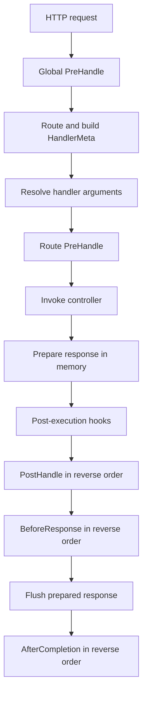

# Execution Pipeline

Controller examples extend a [CLI-generated project](/en/learn/tutorial/1-project-structure). Wrap successful responses with `httpx.Response[T]` from `github.com/NARUBROWN/spine/pkg/httpx`, accept request DTOs as pointers, and register constructors and routes in `BuildApplication`.

Understanding Spine's request lifecycle.

## Overview

Spine routes HTTP, consumer, and WebSocket work through the same explicit pipeline shape. Each transport supplies its own context, resolvers, handlers, and response behavior.

For HTTP, v0.5.1 stages the complete response in memory so application-controlled failures happen before transaction finalization and before bytes are flushed to the client.



## 1. Context and global interceptors

The transport adapter creates an `ExecutionContext`. Global interceptors run before route selection, so their initial `PreHandle` receives an empty `HandlerMeta`.

```go
for _, interceptor := range globalInterceptors {
    if err := interceptor.PreHandle(ctx, core.HandlerMeta{}); err != nil {
        return err
    }
}
```

`App.Interceptor` includes both HTTP and WebSocket. Use `App.InterceptorFor` for an explicit transport scope.

## 2. Route selection

The router resolves an HTTP method and path to a `HandlerMeta`. Static-route dead ends backtrack to valid parameter routes, so a partial static match does not hide a later dynamic route.

Path parameters bind to `path.*` handler arguments in declaration order:

```go
// Route: /users/:userId/posts/:postId
func (c *PostController) Get(userID path.Int, postID path.Int) (httpx.Response[Post], error)
```

`HandlerMeta` also contains route interceptors and the path-key ordering used to construct parameter metadata.

## 3. Argument resolution

Each handler argument is resolved by the first compatible resolver. Built-in support includes:

| Input | Resolver view |
|---|---|
| `path.Int`, `path.String`, `path.Boolean` | ordered path value |
| `query.Pagination`, `query.Values` | query string |
| `header.Values` | request headers |
| Pointer to a DTO struct | JSON/form binding |
| `context.Context` | cancellation and deadline context |
| `pkg/spine.Ctx` / `core.ControllerContext` | read-only request store |
| consumer event-name and payload types | consumer message |
| WebSocket message types | connection ID, message type, payload |

HTTP request DTOs must be pointers to structs. Use the documented handler input types; controller-context interfaces with extra methods are unsupported.

## 4. Route interceptors and invocation

Route `PreHandle` runs after route selection and argument resolution. It receives the actual `HandlerMeta`. If all interceptors succeed, Spine resolves one controller singleton from the DI container and invokes the method.

Constructor and provider failures are caught during bootstrap warm-up. Nil constructors and invalid nil pointer/interface/function/channel results are explicit errors; nil slices and maps remain valid empty collections.

## 5. Prepared responses

Controller results are inspected for a non-nil `error` before success values. On success, the selected return-value handler performs serialization, status validation, and cookie validation against a staged writer.

HTTP success values use `httpx.Response[T]`, `httpx.Binary`, or `httpx.Redirect`, including their supported pointer forms. Error returns use `error`.

No staged success response is flushed yet. If serialization, a cookie, or a status is invalid, that failure becomes the pipeline error and reaches `BeforeResponse`.

## 6. Post-execution hooks

Domain-event hooks run only after the success response has been prepared and validated. This prevents a response-serialization failure from publishing an external event first.

Event publication and database commit still cannot be atomic with a physical socket write or broker publish. Use a transactional outbox and idempotent consumers when those operations must converge reliably.

## 7. Interceptor finalization

`PostHandle` runs route-first and then global, each in reverse registration order. It runs only on the success path.

`BeforeResponse(ctx, meta, executionErr)` then runs in the same reverse order for interceptors whose `PreHandle` succeeded. Each finalizer sees the accumulated error, including an earlier finalizer failure. This is the transaction commit/rollback boundary.

```go
func (i *TxInterceptor) BeforeResponse(
    ctx core.ExecutionContext,
    meta core.HandlerMeta,
    executionErr error,
) error {
    tx, ok := transactionFrom(ctx)
    if !ok {
        return nil
    }
    if executionErr != nil {
        return tx.Rollback()
    }
    return tx.Commit()
}
```

If the pipeline failed, Spine discards the staged success response and renders the returned `httperr.HTTPError` or a generic internal error. Otherwise it flushes the prepared response.

`AfterCompletion` runs after response handling and sees the final error, including a flush failure. Use it for metrics, logging, and cleanup.

## Error and abort behavior

| Condition | Controller | `PostHandle` | `BeforeResponse` | Response |
|---|---:|---:|---:|---|
| success | yes | yes | yes | prepared response is flushed |
| controller/preparation/hook error | maybe | no | yes for entered interceptors | typed HTTP error or generic 500 |
| `PreHandle` returns `ErrAbortPipeline` | no | no | yes for earlier successful interceptors | interceptor-prepared response |
| panic | interrupted | no | yes for entered interceptors | generic 500 when possible |

Ordinary internal errors are not disclosed in the response body. A public message is exposed only through a deliberate `httperr.HTTPError`.

## Ordering example

Given two global interceptors `G1`, `G2` and route interceptors `R1`, `R2`, normal HTTP execution is:

```text
G1.Pre → G2.Pre → route/resolve → R1.Pre → R2.Pre → controller
→ R2.Post → R1.Post → G2.Post → G1.Post
→ R2.BeforeResponse → R1.BeforeResponse → G2.BeforeResponse → G1.BeforeResponse
→ flush
→ R2.AfterCompletion → R1.AfterCompletion → G2.AfterCompletion → G1.AfterCompletion
```

## Protocol-specific contexts

The pipeline depends on narrow context contracts:

- `HttpRequestContext` exposes HTTP binding, headers, parameters, and multipart data.
- `ConsumerRequestContext` exposes the event name and payload.
- `WebSocketContext` exposes message data.
- `WebSocketMessageContext` additionally exposes the immutable HTTP handshake snapshot.
- `ControllerContext` is the read-only view injected into controllers.

This keeps controllers transport-focused without coupling them to adapter implementations.

## See also

- [Interceptor API](/en/reference/api/interceptor)
- [ExecutionContext API](/en/reference/api/execution-context)
- [Transaction tutorial](/en/learn/tutorial/6-transaction)
- [Current Release](/en/community/changelog)
