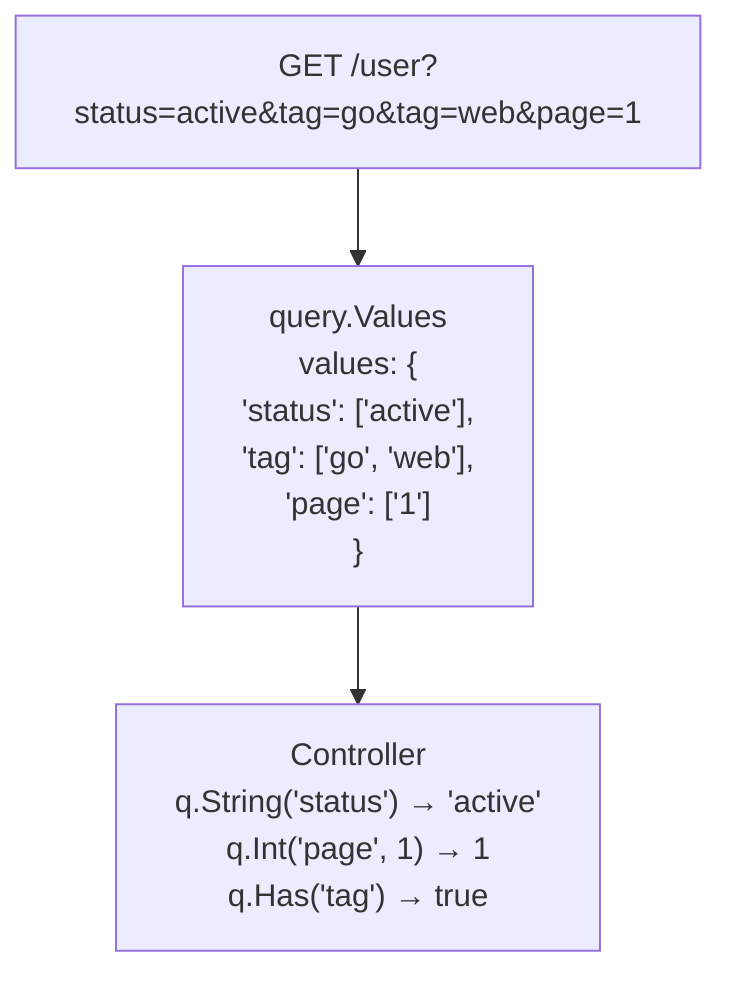

# query.Values

Use `query.Values` to read HTTP query parameters and specify defaults. Declare `q query.Values` as a controller argument, then read the keys you need as strings, integers, or booleans. Automatically mapping query parameters to an arbitrary DTO is not supported.

This page describes `github.com/NARUBROWN/spine/pkg/query` in Spine v0.5.1.

## Using It in a CLI Project

Continue after creating a project in [Your First App](/en/learn/getting-started/first-app) and generating the `src/user` resource in [Controllers](/en/learn/tutorial/2-controller). Add the example handlers to the same `package user` and register routes for the handlers you use.

The app defines `User`, search criteria and page response types, and the service's search methods. The product and order examples are feature extensions built in the same way. Each example is an independent alternative, so add only the methods and routes you need. Wrap successful responses in `httpx.Response[T]` and import the following two packages.

```go
import (
    "github.com/NARUBROWN/spine/pkg/httpx"
    "github.com/NARUBROWN/spine/pkg/query"
)
```

The basic example reads `id` and `name` from query parameters and returns them in the response.

```go
// src/user/user_controller.go
func (c *UserController) GetUserQuery(q query.Values) httpx.Response[User] {
    return httpx.Response[User]{Body: User{
        ID:   q.Int("id", 0),
        Name: q.String("name"),
    }}
}
```

When this method is registered for `GET /user`, the request and response are as follows.

```bash
# 요청
GET /user?id=123&name=john

# 응답
{
    "id": 123,
    "name": "john"
}
```

## How Query Values Are Passed

An HTTP query parameter can contain multiple string values for one key. For example, `?tag=go&tag=web` has two values for `tag`. Spine wraps this query map in `query.Values` and passes it to the controller.



Declare `query.Values` as a value type in the handler. The default resolver handles this exact type; `*query.Values` is not the same injection target. Query value injection is for HTTP requests, so do not expect the same behavior in Consumer or WebSocket handlers.

The read methods on `query.Values` do not modify the original query map. To create a value directly in app code or a unit test, use `query.NewValues(values map[string][]string)`.

```go
// pkg/query/types.go
type Values struct {
    values map[string][]string
}

func NewValues(values map[string][]string) Values {
    return Values{values: values}
}
```

`NewValues` retains the supplied map without copying it. If you change the original map after creation, a `Values` wrapping the same map reads the updated values. You do not need to create it directly in a typical HTTP handler.

## Read Methods

| Method | Return Type | When a Value Is Missing or Cannot Be Converted |
| --- | --- | --- |
| `Get(key)` | `string` | Empty string |
| `String(key)` | `string` | Empty string. Same behavior as `Get` |
| `Int(key, def)` | `int64` | The `def` specified in the call |
| `GetBoolByKey(key, def)` | `bool` | The `def` specified in the call |
| `Has(key)` | `bool` | `false` if the key is absent |

Methods that read values use only the first value. Even when a key is repeated, `Get`, `String`, `Int`, and `GetBoolByKey` do not return or check all its values.

### Reading Strings

`Get` and `String` behave the same way. They return an empty string if the key is absent or its value list is empty.

```go
// GET /user?name=john&status=active

q.Get("name")    // "john"
q.Get("status")  // "active"
q.Get("missing") // ""
```

```go
q.String("name")  // "john"
```

### Reading Integers

`Int(key string, def int64) int64` converts the first value to a signed 64-bit integer in base 10. It returns `def` if the key is absent or the value is an empty string. If the value is not a number or is outside the `int64` range, it also uses `def` without returning an error.

```go
// GET /user?page=3&size=20

q.Int("page", 1)    // 3
q.Int("size", 10)   // 20
q.Int("offset", 0)  // 0 (키 없음 → 기본값)
q.Int("page", 1)    // 1 (만약 page=abc라면 → 기본값)
```

Negative values and zero are returned as is when conversion succeeds. The app must separately validate values that must be positive, such as page numbers or price ranges.

### Reading Booleans

`GetBoolByKey(key string, def bool) bool` converts the first value to lowercase, then checks for the following strings.

| Result | Recognized Values |
| --- | --- |
| `true` | `"true"`, `"1"`, `"yes"`, `"y"`, `"on"` |
| `false` | `"false"`, `"0"`, `"no"`, `"n"`, `"off"` |
| `def` | The key is absent or the value is not in the lists above |

Matching is case-insensitive, but whitespace is not trimmed. For example, `" TRUE "` is not in the recognized list, so the default is used.

```go
// GET /user?active=true&verified=1&premium=yes

q.GetBoolByKey("active", false)    // true
q.GetBoolByKey("verified", false)  // true
q.GetBoolByKey("premium", false)   // true
q.GetBoolByKey("deleted", false)   // false (키 없음 → 기본값)
q.GetBoolByKey("active", false)    // false (만약 active=maybe → 기본값)
```

### Checking Whether a Key Exists

`Has(key string) bool` checks whether the key exists, regardless of its value. It returns `true` if the key exists, even with an empty value such as `?empty=`.

```go
// GET /user?status=active&empty=

q.Has("status")  // true
q.Has("empty")   // true (값은 비었지만 키는 존재)
q.Has("missing") // false
```

To distinguish an absent key from an explicitly supplied empty string, check `Has` as well as the result of `Get`. Likewise, a `true` result from `Has` does not mean integer or boolean conversion succeeded.

## Using Query Values for Search and Filters

You can specify a default for each filter at the call site. The following example reads a search term, category, price range, and stock availability, then passes them to a service.

```go
func (c *ProductController) Search(q query.Values) httpx.Response[SearchResult] {
    keyword := q.String("q")
    category := q.String("category")
    minPrice := q.Int("min_price", 0)
    maxPrice := q.Int("max_price", 999999)
    inStock := q.GetBoolByKey("in_stock", true)

    products := c.service.Search(SearchCriteria{
        Keyword:  keyword,
        Category: category,
        MinPrice: minPrice,
        MaxPrice: maxPrice,
        InStock:  inStock,
    })

    return httpx.Response[SearchResult]{Body: SearchResult{
        Query:    keyword,
        Count:    len(products),
        Products: products,
    }}
}
```

```bash
GET /product?q=laptop&category=electronics&min_price=500&in_stock=true
```

This example uses defaults for invalid numbers and booleans as well. If your API must return a 400 response for invalid input, read the original string with `String`, check the conversion result from a function such as `strconv.ParseInt`, and return `httperr.BadRequest`. Default handling and validation are separate policies.

### Applying Only Supplied Filters

For optional filters, use `Has` to check whether the key was supplied.

```go
func (c *OrderController) List(q query.Values) httpx.Response[[]Order] {
    filters := OrderFilters{}

    if q.Has("user_id") {
        filters.UserID = q.Int("user_id", 0)
    }

    if q.Has("status") {
        filters.Status = q.String("status")
    }

    if q.Has("from_date") {
        filters.FromDate = parseDate(q.String("from_date"))
    }

    if q.Has("to_date") {
        filters.ToDate = parseDate(q.String("to_date"))
    }

    return httpx.Response[[]Order]{Body: c.service.FindByFilters(filters)}
}
```

`OrderFilters` and `parseDate` are types and functions defined by the app. The app must also define the date format, the required order of start and end dates, and the behavior when a filter is omitted. The `Has` checks in this example do not replace format validation.

### Selecting Allowed Filters Explicitly

You can also check only the filter names accepted by the app and pass them to the service, as shown below.

```go
// 동적 필터 처리
func (c *ProductController) Search(q query.Values) httpx.Response[[]Product] {
    filters := make(map[string]string)

    // 어떤 필터가 올지 미리 알 수 없음
    if q.Has("min_price") {
        filters["min_price"] = q.String("min_price")
    }
    if q.Has("max_price") {
        filters["max_price"] = q.String("max_price")
    }
    if q.Has("category") {
        filters["category"] = q.String("category")
    }

    return httpx.Response[[]Product]{Body: c.service.FindByFilters(filters)}
}
```

## Using Query Values with Pagination

Use `query.Pagination` to handle the fixed `page` and `size` parameters, and `query.Values` to read search criteria.

```go
func (c *UserController) List(p query.Pagination, q query.Values) httpx.Response[PagedResult] {
    status := q.String("status")
    sortBy := q.String("sort_by")

    users := c.service.FindAll(status, sortBy, p.Page, p.Size)
    total := c.service.Count(status)

    return httpx.Response[PagedResult]{Body: PagedResult{
        Data:  users,
        Page:  p.Page,
        Size:  p.Size,
        Total: total,
    }}
}
```

```bash
GET /user?page=2&size=20&status=active&sort_by=created_at
```

| Aspect | `query.Values` | `query.Pagination` |
| --- | --- | --- |
| Purpose | Query parameters whose names and defaults are defined by the app | Pagination using `page` and `size` |
| Defaults | Specified when calling each read method | `page=1`, `size=20` |
| Type Conversion | Call a method for each required key | Converted when the pagination argument is injected |

You can declare both types for the same request. Since `query.Values` can also read `page` and `size`, choose one source for the page information passed to the service to avoid duplicate handling.

```go
// 고정된 페이지네이션만 필요 → query.Pagination
func List(p query.Pagination) httpx.Response[[]User]

// 동적 필터 + 페이지네이션 → 둘 다 사용
func Search(p query.Pagination, q query.Values) httpx.Response[[]User]

// 완전히 동적인 쿼리 → query.Values만
func CustomSearch(q query.Values) httpx.Response[[]User]
```

## Multiple Values for the Same Key

An HTTP query can repeat the same key as follows.

```
GET /product?tag=go&tag=web&tag=api
```

For this request, `q.String("tag")` and `q.Get("tag")` return only `"go"`. In Spine v0.5.1, `query.Values` has no public method for retrieving the full list of values, and app code cannot access the private `values` field directly.

If you need multiple values, one option is to define the API to accept a single comma-separated string and split it in the app. The following example also requires the `strings` package.

```go
// 쉼표 구분 방식
// GET /product?tags=go,web,api

func (c *ProductController) Search(q query.Values) httpx.Response[[]Product] {
    tagsRaw := q.String("tags")
    tags := strings.Split(tagsRaw, ",")

    return httpx.Response[[]Product]{Body: c.service.FindByTags(tags)}
}
```

In this example, an empty `tags` value causes `strings.Split` to return a slice containing an empty string. The app must define and check whether empty entries, duplicate tags, and commas in tag names are allowed.

Keep query parameter keys, defaults, and allowed ranges close to the controller so that request handling rules are easy to find. See the [Controller Tutorial](/en/learn/tutorial/2-controller) for receiving request body DTOs, and [httperr](/en/learn/core-concepts/httperr) for error responses.
