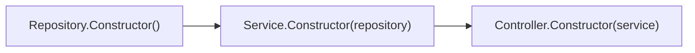

# Dependency injection

Connect repositories, services and controllers by constructor argument types. This standalone app returns hello from GET /greeting without a database.

Constructor argument types determine the creation order: repository, service, then controller. Arrows show where each created instance is injected.




## Constructor contract

Each type implements Constructor(dependencies...) *Self. Register Repository, Service, Controller and Interceptor roles through the constructor package. Controllers also implement RegisterRoutes; interceptors implement four hooks. Custom accepts external factories or general objects.

&Service{} is a type marker. Its fields are not copied: Constructor runs on a fresh receiver. The resulting instance is shared within the app.

## Runnable example

[Controller dependencies](/en/learn/tutorial/2-controller)

```go
package main

import (
	"github.com/NARUBROWN/spine"
	echoplatform "github.com/NARUBROWN/spine-echo-platform"
	"github.com/NARUBROWN/spine/pkg/api"
	"github.com/NARUBROWN/spine/pkg/boot"
	"github.com/NARUBROWN/spine/pkg/constructor"
	"github.com/NARUBROWN/spine/pkg/httpx"
	"log"
)

type Repository struct{}

func (*Repository) Constructor() *Repository { return &Repository{} }
func (*Repository) Greeting() string         { return "hello" }

type Service struct{ repository *Repository }

func (*Service) Constructor(repository *Repository) *Service { return &Service{repository: repository} }

type Controller struct{ service *Service }

func (*Controller) Constructor(service *Service) *Controller { return &Controller{service: service} }
func (c *Controller) RegisterRoutes(r *api.Registry) {
	r.GET("/greeting", func() httpx.Response[string] {
		return httpx.Response[string]{Body: c.service.repository.Greeting()}
	})
}
func BuildApplication() (spine.App, boot.Options, error) {

	app := spine.New(echoplatform.Option())
	app.Constructor(constructor.Controller(&Controller{}), constructor.Service(&Service{}), constructor.Repository(&Repository{}))
	return app, boot.Options{Address: ":8080", HTTP: &boot.HTTPOptions{}, EnableGracefulShutdown: true}, nil
}
func main() {
	app, options, err := BuildApplication()
	if err != nil {
		log.Fatal(err)
	}
	if err := app.Validate(options); err != nil {
		log.Fatal(err)
	}
	if err := app.Run(options); err != nil {
		log.Fatal(err)
	}
}
```

## Dependency resolution

```sh
go run .
#
curl http://localhost:8080/greeting
```

Creation follows dependency order regardless of registration order and returns hello. Graph checks reject duplicate types, missing dependencies, ambiguous interfaces and cycles. Nil returns and panics are detected when constructors run during preparation.

## External factories

```go
app.Constructor(constructor.Custom(database.NewDB))
```

For example, database.NewDB has signature func NewDB() *bun.DB. Object and function constructors support one return value. (T, error) and variadic parameters are rejected; ordinary []T parameters are supported. Interfaces prefer an exact-return-type provider, otherwise exactly one assignable provider is required.

## Validation and lifetime

BuildApplication only assembles the app. app.Validate checks what it can without running constructors; Prepare runs them and collects RegisterRoutes. Run prepares and starts the app. Arbitrary DI Close methods are not called automatically, so owners manage DB resources. Pass request transactions through ExecutionContext().Set/Get and explicit service arguments, never by overwriting shared object fields.

## Next steps

[Interceptors](/en/learn/tutorial/4-interceptor) / [Database](/en/learn/tutorial/5-database) / [Transactions](/en/learn/tutorial/6-transaction)
