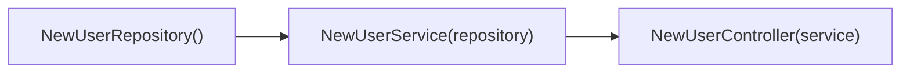

# Dependency injection

::: info
The `legacy` layout uses `app.Route`, which remains available for compatibility but is deprecated. See [controller and route migration](/en/learn/migration/preview-controller-routes) for the new registration style.
:::

Explore constructor registration and dependency injection (DI) using the `src/user` resource created in [Controllers](/en/learn/tutorial/2-controller). By the end, you can connect controllers, services, and repositories, and identify circular dependencies or missing constructors.

The `src/user` examples use the app created with `--layout legacy` in [Project Structure](/en/learn/tutorial/1-project-structure). The default `layered-v1` layout uses directories organized by role.

Prepare the project from [Your first app](/en/learn/tutorial/1-project-structure) and work from the `my-app` root. The database and wrapper type examples later in this page are separate extensions that are not included automatically in the basic resource.


## Core concepts

Spine inspects the parameter types of registered constructors, creates the required objects first, and passes them in. It does not use annotations such as `@Autowired` or `@Injectable`, or a dedicated DI configuration file. `spine.toml` is the CLI project configuration file.

In the constructor below, `*UserRepository` is a dependency required by `UserService`.

```go
// Inject dependencies automatically by parameter type
func NewUserService(repository *UserRepository) *UserService {
    return &UserService{repository: repository}
}
```

## Register constructors by role

This standalone app registers a repository, service, and controller using `Constructor` methods and role markers. Dependencies resolve by type even though registration is in reverse order. Install Spine `v0.7.1` and a compatible Echo platform in a separate Go module, save this as `main.go`, and run it.

```bash
go get github.com/NARUBROWN/spine@v0.7.1 github.com/NARUBROWN/spine-echo-platform@v0.2.0
```

```go
package main

import (
	"github.com/NARUBROWN/spine"
	echoplatform "github.com/NARUBROWN/spine-echo-platform"
	"github.com/NARUBROWN/spine/pkg/api"
	"github.com/NARUBROWN/spine/pkg/boot"
	"github.com/NARUBROWN/spine/pkg/constructor"
	"github.com/NARUBROWN/spine/pkg/httpx"
	"log"
)

type Repository struct{}

func (*Repository) Constructor() *Repository { return &Repository{} }
func (*Repository) Greeting() string         { return "hello" }

type Service struct{ repository *Repository }

func (*Service) Constructor(repository *Repository) *Service { return &Service{repository: repository} }

type Controller struct{ service *Service }

func (*Controller) Constructor(service *Service) *Controller { return &Controller{service: service} }
func (c *Controller) RegisterRoutes(r *api.Registry) {
	r.GET("/greeting", func() httpx.Response[string] {
		return httpx.Response[string]{Body: c.service.repository.Greeting()}
	})
}
func main() {
	app := spine.New(echoplatform.Option())
	app.Constructor(
		constructor.Controller(&Controller{}),
		constructor.Service(&Service{}),
		constructor.Repository(&Repository{}),
	)
	if err := app.Run(boot.Options{Address: ":8080", HTTP: &boot.HTTPOptions{}}); err != nil {
		log.Fatal(err)
	}
}
```

The following request from another terminal returns `hello`. A role marker registers a type; global or per-route interceptor application must be configured separately.

```bash
curl http://localhost:8080/greeting
```

## CLI-generated dependencies

If you have not generated the resource yet, run the following command from the `my-app` root. If you have already generated it, do not run it again.

```bash
spine generate resource user --dry-run
```

Review the files to be generated and the registration code changes in the preview, then generate them with the following command.

```bash
spine generate resource user
```

The following excerpts show only the types and constructors from the code the CLI generated in the same `user` package. Do not overwrite existing files with this code. Keep the controller's `Get` method in the generated file.

```go
// src/user/user_repository.go
package user

type UserRepository struct{}

func NewUserRepository() *UserRepository { return &UserRepository{} }
```

```go
// src/user/user_service.go
package user

type UserService struct{ repository *UserRepository }

func NewUserService(repository *UserRepository) *UserService {
    return &UserService{repository: repository}
}
```

```go
// src/user/user_controller.go
package user

type UserController struct{ service *UserService }

func NewUserController(service *UserService) *UserController {
    return &UserController{service: service}
}
```

`Register` in `src/user/user_route.go` registers the three constructors and `GET /user/:id`. The CLI adds a `user.Register(app)` call and error handling to `BuildApplication()` in `internal/application/application.go`. Do not add constructors that are already registered.

```go
// src/user/user_route.go: Register
app.Constructor(NewUserRepository, NewUserService, NewUserController)
app.Route("GET", "/user/:id", (*UserController).Get)
```

## Registration order and resolution order

Constructor registration order does not determine object creation order. Creating the controller requires a service, and creating the service requires a repository, so the repository is created first. The container shares the created instances; it does not create new ones for every request.

The dependency resolution order stays the same even if you change the registration order as follows.

```go
// This example replaces the existing Constructor call in user_route.go.
app.Constructor(NewUserController, NewUserService, NewUserRepository)
```



## Constructor rules

### Parameters

A constructor that provides each parameter type must be registered. Omit parameters if there are no dependencies, or declare multiple parameters if multiple dependencies are needed.

The following example shows signatures only. In actual code, you must implement each function's body and return type.

```go
// Declare a repository dependency
func NewUserService(repo *UserRepository) *UserService

// Declare multiple dependencies
func NewUserController(svc *UserService, logger *Logger) *UserController

// Constructor without dependencies
func NewLogger() *Logger
```

### Return types

A constructor must return exactly one value. Its return type is the type registered in the container. Constructors that return `(value, error)` are not supported. Dependency resolution fails if a constructor that returns a pointer or interface returns `nil`.

```go
func NewUserService(repository *UserRepository) *UserService {
    return &UserService{repository: repository}
}
```

Implement database connection functions to return a single value as well, such as `database.NewDB() *bun.DB` in the [database example](/en/learn/tutorial/5-database). Registering a constructor in `BuildApplication` does not call the connection function. A passing generated validation test therefore does not mean the database connection succeeded. Check connection initialization and error handling during app startup, when the constructor executes.

```go
// internal/application/application.go: BuildApplication
app.Constructor(database.NewDB)
```

## Use interfaces

When a parameter has an interface type, dependencies are resolved in the following order.

1. Use a constructor whose return type exactly matches the interface.
2. If there is no exact match, look for return types assignable to the interface.
3. If there is one candidate, inject it. If there are multiple candidates, return a `multiple constructors registered for interface` error. If there are no candidates, return a missing dependency error.

The following extension example applies to an app with the [database](/en/learn/tutorial/5-database) setup completed. The CLI's `resource` output does not include Bun configuration.

### A common type for databases and transactions

If a repository field has the fixed type `*bun.DB`, you cannot assign a `bun.Tx` to it.

```go
// This field can only hold *bun.DB
type UserRepository struct {
    db *bun.DB  // Cannot accept bun.Tx
}
```

Use `bun.IDB`, implemented by both `*bun.DB` and `bun.Tx`, to handle the two types through the same contract. The following code shows a repository constructor that accepts `bun.IDB` as a dependency.

```go
// Both *bun.DB and bun.Tx implement bun.IDB
type UserRepository struct {
    db bun.IDB
}

func NewUserRepository(db bun.IDB) *UserRepository {
    return &UserRepository{db: db}
}
```

### Pass transactions for each request

Constructor injection and passing values for individual requests have different lifetimes. Services and repositories created by constructors are shared across the app. A `bun.Tx` created for each request is not automatically reinjected into the fields of existing instances. Overwriting a shared field with a request's transaction can mix transactions across requests.

Pass transactions for each request in the following order.

1. Start a transaction in the interceptor's `PreHandle` and store it with `ctx.Set("tx", tx)`.
2. Read the value with `spine.Ctx.Get("tx")` in the controller and check that it is a `bun.Tx`.
3. Explicitly pass the transaction from the controller to service and repository methods as a `bun.IDB` argument.
4. Commit or roll back in the interceptor's `BeforeResponse` according to the execution result, and return any error from that operation.

For the implementation and registration of the interceptor's four lifecycle methods, see [Interceptors that need dependency injection](/en/learn/tutorial/4-interceptor).


## Register by feature

When you generate another feature with the CLI, it connects the package's `Register` function to `BuildApplication`, which assembles the app. The following optional example adds a separate `order` resource. The CLI adds the `order.Register(app)` call, so do not register it again manually.

```bash
spine generate resource order --dry-run
```

Review the files to be generated and the registration code changes in the preview, then generate them with the following command.

```bash
spine generate resource order
```

### Split constructor registration across calls

You can split registration into multiple calls within the same `Register` function. Register each type once.

```go
// src/user/user_route.go: Register
app.Constructor(NewUserRepository)
app.Constructor(NewUserService)
app.Constructor(NewUserController)
```

## Multiple values of the same type

If you register primary and replica databases with the same type, parameter names alone cannot distinguish them. Declare separate wrapper types to distinguish them.

The following is a separate repository design example. You must implement `App`, the `writer` and `reader` fields of `UserRepository`, `connectToPrimary`, and `connectToReplica` for your app.

```go
// Parameter names alone cannot distinguish instances
func NewApp(db1 *bun.DB, db2 *bun.DB) *App  // Which instance is which?

// Distinguish instances with separate wrapper types
type PrimaryDB struct{ *bun.DB }
type ReplicaDB struct{ *bun.DB }

func NewPrimaryDB() *PrimaryDB {
    return &PrimaryDB{connectToPrimary()}
}

func NewReplicaDB() *ReplicaDB {
    return &ReplicaDB{connectToReplica()}
}

func NewUserRepository(primary *PrimaryDB, replica *ReplicaDB) *UserRepository {
    return &UserRepository{
        writer: primary.DB,
        reader: replica.DB,
    }
}
```

## Identify dependency errors

### Circular dependencies

If `A` needs `B` and `B` needs `A`, neither object can be created first. The pseudocode below illustrates this relationship.

```go
// A → B → A dependency cycle
func NewA(b *B) *A { ... }
func NewB(a *A) *B { ... }

// An error occurs at startup
// circular dependency detected: *user.A -> *user.B -> *user.A
```

### Missing dependencies

Dependency resolution fails if no constructor provides a required type. The example below omits registration of `NewUserRepository`.

```go
// If UserRepository is not registered
app.Constructor(
    NewUserService,     // Requires *UserRepository
    NewUserController,
)

// An error occurs at startup
// no constructor registered for *user.UserRepository
```

## Validate registration and check execution

Run the following commands from the project root.

```bash
spine doctor
spine contract check
spine verify
```

`spine contract check` checks the DI contract extracted from the source. `spine verify` also checks formatting, `go vet`, and tests. A successful `app.Validate(options)` alone does not confirm that constructors execute or instances initialize.

Run the app with `spine dev` to check actual initialization and request handling. If you connect a database, check the actual connection and queries separately as well. Circular dependencies or missing constructors return errors during dependency resolution, and the generated `main.go` checks errors from `Run`.

## Next steps

- [Tutorial: Interceptors](/en/learn/tutorial/4-interceptor) — Handle requests before and after execution
- [Tutorial: Databases](/en/learn/tutorial/5-database) — Connect Bun ORM
