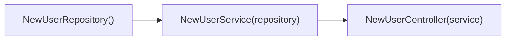

# Dependency Injection

Inspect the dependency graph of the CLI-generated `src/user` resource from [Controllers](/en/learn/tutorial/2-controller). Follow [First App](/en/learn/getting-started/first-app) for installation and project creation.

Understanding DI in Spine.

## Core Concepts

Spine's Dependency Injection is **constructor-based**.

- No annotations (No `@Autowired`, `@Injectable`)
- No separate DI binding configuration (`spine.toml` configures the CLI project)
- Constructor parameters are the dependency declarations

```go
// Automatically injects dependency based on parameter type
func NewUserService(repository *UserRepository) *UserService {
    return &UserService{repository: repository}
}
```

## CLI-generated dependencies

If the resource does not exist yet, run this from the `hello-spine` root. Skip generation if it already exists.

```bash
spine generate resource user --dry-run
```

Review the generated files and registration changes in the preview, then run the command below to generate them.

```bash
spine generate resource user
```

The CLI generates these constructors in the same `package user` under `src/user`.

```go
// src/user/user_repository.go
package user

type UserRepository struct{}

func NewUserRepository() *UserRepository { return &UserRepository{} }
```

```go
// src/user/user_service.go
package user

type UserService struct{ repository *UserRepository }

func NewUserService(repository *UserRepository) *UserService {
    return &UserService{repository: repository}
}
```

```go
// src/user/user_controller.go
package user

type UserController struct{ service *UserService }

func NewUserController(service *UserService) *UserController {
    return &UserController{service: service}
}
```

`Register` in `src/user/user_route.go` registers these constructors and `GET /user/:id`. The CLI adds a checked `user.Register(app)` call to `BuildApplication()` in `internal/application/application.go`. Do not register the same constructors again.

```go
// src/user/user_route.go: Register
app.Constructor(NewUserRepository, NewUserService, NewUserController)
app.Route("GET", "/user/:id", (*UserController).Get)
```

## Registration and resolution order

Dependencies resolve before the components that need them, regardless of registration order. The container shares resolved instances rather than creating them for each request.

```go
// An alternative to the existing Constructor call in user_route.go.
app.Constructor(NewUserController, NewUserService, NewUserRepository)
```



## Constructor Rules

### Parameters

Constructor parameters must be **types with registered providers**.

```go
// ✅ Correct Example
func NewUserService(repo *UserRepository) *UserService

// ✅ Multiple dependencies allowed
func NewUserController(svc *UserService, logger *Logger) *UserController

// ✅ No dependency also allowed
func NewLogger() *Logger
```

### Return Types

A constructor must return exactly one value. Constructors returning `(value, error)` are unsupported. The return type identifies the provided type; a nil return is also an error.

```go
func NewUserService(repository *UserRepository) *UserService {
    return &UserService{repository: repository}
}
```

Implement database providers with one return value, such as `database.NewDB() *bun.DB` in the [database example](/en/learn/tutorial/5-database), and register the constructor. `BuildApplication` only registers it, so the generated validation test does not connect to the database. Connection failures are handled when the provider runs during application startup; verify live connectivity separately.

```go
// internal/application/application.go: BuildApplication
app.Constructor(database.NewDB)
```

## Using Interfaces

This section is a manual extension covered in [Database](/en/learn/tutorial/5-database); `resource` does not generate Bun setup. An exact interface provider takes precedence; otherwise, one implementing provider can satisfy the interface. Multiple matching providers produce an error. A request transaction is not automatically reinjected into an application-wide constructor. Read `bun.Tx` from the request context and pass it through controller/service calls to repository methods accepting `bun.IDB`.

### Problem Scenario

When using transactions, Repository needs to handle both `*bun.DB` and `bun.Tx`.

```go
// ❌ Cannot use transaction with this
type UserRepository struct {
    db *bun.DB  // Cannot accept bun.Tx
}
```

### Solution: Use Interfaces

Using the `bun.IDB` interface accepts both.

```go
// ✅ bun.IDB is implemented by both *bun.DB and bun.Tx
type UserRepository struct {
    db bun.IDB
}

func NewUserRepository(db bun.IDB) *UserRepository {
    return &UserRepository{db: db}
}
```

### Injecting Transaction in Interceptor

```go
// src/interceptor/tx_interceptor.go
func (i *TxInterceptor) PreHandle(ctx core.ExecutionContext, meta core.HandlerMeta) error {
    tx, err := i.db.BeginTx(ctx.Context(), nil)
    if err != nil {
        return err
    }
    
    ctx.Set("tx", tx)  // Store transaction
    return nil
}

func (i *TxInterceptor) PostHandle(ctx core.ExecutionContext, meta core.HandlerMeta) {}

func (i *TxInterceptor) BeforeResponse(ctx core.ExecutionContext, meta core.HandlerMeta, executionErr error) error {
    v, ok := ctx.Get("tx")
    if !ok {
        return nil
    }

    tx, ok := v.(bun.Tx)
    if !ok {
        return errors.New("invalid transaction type")
    }
    
    if executionErr != nil {
        return tx.Rollback()
    }
    return tx.Commit()
}

func (i *TxInterceptor) AfterCompletion(ctx core.ExecutionContext, meta core.HandlerMeta, err error) {}
```


## Register features

Generate another feature to register it in the same composition root. This example creates an independent `order` resource. The CLI adds `user.Register` and `order.Register` calls; do not duplicate them manually.

```bash
spine generate resource order --dry-run
```

Review the generated files and registration changes in the preview, then run the command below to generate them.

```bash
spine generate resource order
```

### Multiple Constructor calls

You can split registration across several calls inside the same `Register`. Register each type once.

```go
// src/user/user_route.go: Register
app.Constructor(NewUserRepository)
app.Constructor(NewUserService)
app.Constructor(NewUserController)
```

## Multiple Instances of Same Type

If you need multiple instances of the same type, use wrapper types.

```go
// ❌ Indistinguishable
func NewApp(db1 *bun.DB, db2 *bun.DB) *App  // Which is which?

// ✅ Distinguish with wrapper types
type PrimaryDB struct{ *bun.DB }
type ReplicaDB struct{ *bun.DB }

func NewPrimaryDB() *PrimaryDB {
    return &PrimaryDB{connectToPrimary()}
}

func NewReplicaDB() *ReplicaDB {
    return &ReplicaDB{connectToReplica()}
}

func NewUserRepository(primary *PrimaryDB, replica *ReplicaDB) *UserRepository {
    return &UserRepository{
        writer: primary.DB,
        reader: replica.DB,
    }
}
```

## Error Handling

### Circular Dependency

```go
// ❌ A → B → A Circular
func NewA(b *B) *A { ... }
func NewB(a *A) *B { ... }

// Error at boot time
// circular dependency detected: *user.A -> *user.B -> *user.A
```

### Missing Dependency

```go
// If UserRepository is not registered
app.Constructor(
    NewUserService,     // Needs *UserRepository
    NewUserController,
)

// Error at boot time
// no constructor registered for *user.UserRepository
```

## Verification boundaries

```bash
spine doctor
spine contract check
spine verify
```

`contract check` checks the static DI contract; `verify` also runs local code checks. `app.Validate(options)` alone does not prove constructor execution or DI warm-up. Check initialization, database connections, and requests by running the app and separate E2E checks. Dependency resolution returns errors for circular or missing dependencies; generated main checks Run errors.

## Key Takeaways

| Concept | Description |
|------|------|
| **Constructor-Based** | Parameter types declare dependencies |
| **Auto Resolution** | Registration order irrelevant, created after graph analysis |
| **Type Matching** | Auto-injected if types match |
| **Interfaces** | Allows flexible dependency handling |

## Next Steps

- [Tutorial: Interceptor](/en/learn/tutorial/4-interceptor) — Pre/Post request processing
- [Tutorial: Database](/en/learn/tutorial/5-database) — Bun ORM connection
