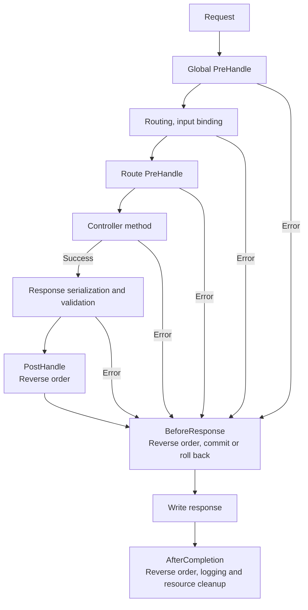

# Interceptors

Interceptors handle shared concerns such as authentication and logging. This standalone app applies authentication to every route in a group and to an individual route. The token is for demonstration only.

## Apply to a group and a route

Save the following code as `main.go` in a separate Go module and run it.

```bash
go get github.com/NARUBROWN/spine@v0.7.1 github.com/NARUBROWN/spine-echo-platform@v0.2.0
```

```go
package main

import (
	"github.com/NARUBROWN/spine"
	echoplatform "github.com/NARUBROWN/spine-echo-platform"
	"github.com/NARUBROWN/spine/core"
	"github.com/NARUBROWN/spine/pkg/api"
	"github.com/NARUBROWN/spine/pkg/boot"
	"github.com/NARUBROWN/spine/pkg/constructor"
	"github.com/NARUBROWN/spine/pkg/httperr"
	"github.com/NARUBROWN/spine/pkg/httpx"
	"github.com/NARUBROWN/spine/pkg/input"
	"log"
)

type Auth struct{}

func (*Auth) PreHandle(ctx core.ExecutionContext, meta core.HandlerMeta) error {
	if ctx.Header("Authorization") != "Bearer demo-token" {
		return httperr.Unauthorized("unauthorized")
	}
	return nil
}
func (*Auth) PostHandle(core.ExecutionContext, core.HandlerMeta)                  {}
func (*Auth) BeforeResponse(core.ExecutionContext, core.HandlerMeta, error) error { return nil }
func (*Auth) AfterCompletion(core.ExecutionContext, core.HandlerMeta, error)      {}

type Controller struct{}

func (*Controller) Constructor() *Controller { return &Controller{} }
func (*Controller) RegisterRoutes(r *api.Registry) {
	users := r.Group("/users", api.Interceptors(&Auth{}))
	users.GET("/:id", func(id input.Path[int64]) httpx.Response[map[string]int64] {
		return httpx.Response[map[string]int64]{Body: map[string]int64{"id": *id}}
	})
	r.GET("/profile", func() httpx.Response[string] {
		return httpx.Response[string]{Body: "profile"}
	}, api.Interceptors(&Auth{}))
}
func main() {
	app := spine.New(echoplatform.Option())
	app.Constructor(constructor.Controller(&Controller{}))
	if err := app.Run(boot.Options{Address: ":8080", HTTP: &boot.HTTPOptions{}}); err != nil {
		log.Fatal(err)
	}
}
```

`/users/:id` inherits authentication from its group, while `/profile` declares it on the route. Nested groups inherit their parent configuration.

Requests without authentication return 401; requests with the token return 200. Implement secure token verification in production.

```bash
curl -i http://localhost:8080/users/1
curl -i -H 'Authorization: Bearer demo-token' http://localhost:8080/users/1
curl -i -H 'Authorization: Bearer demo-token' http://localhost:8080/profile
```

## Interceptor lifecycle

In Spine v0.7.1, HTTP requests run through global interceptors, routing and input binding, route interceptors, and the controller, in that order. Interceptors must implement all four lifecycle methods.



If input binding fails, the route's `PreHandle` does not run either. Use a global interceptor for policies that require authentication before checking the body format.


## Interface

```go
type Interceptor interface {
    PreHandle(ctx ExecutionContext, meta HandlerMeta) error
    PostHandle(ctx ExecutionContext, meta HandlerMeta)
    BeforeResponse(ctx ExecutionContext, meta HandlerMeta, executionErr error) error
    AfterCompletion(ctx ExecutionContext, meta HandlerMeta, err error)
}
```

| Method | When it runs | Returns | Purpose |
|--------|----------|------|------|
| `PreHandle` | Before routing for global interceptors; after input binding for route interceptors | `error` | Authenticate, validate, start transactions |
| `PostHandle` | After the controller and response preparation succeed | Nothing | Record completion, perform follow-up work |
| `BeforeResponse` | Before the response is actually written | `error` | Commit or roll back transactions |
| `AfterCompletion` | After an attempt to write the response | Nothing | Log, clean up resources |

`BeforeResponse` receives earlier execution errors and errors from response serialization, cookie validation, and status code validation as `executionErr`. Only interceptors whose `PreHandle` succeeded run this method, making it suitable for completing transactions started in that phase. Return an error if committing or rolling back fails.

`AfterCompletion` is called on global interceptors and route interceptors identified during routing, even when an error occurs. This can include interceptors whose `PreHandle` did not run, so first check whether there are resources to clean up. The response may already have been written at this point, so do not use this method to change it.


## Learn more

See the [interceptor API](/en/reference/api/interceptor) for global registration, constructor injection and lifecycle details.
