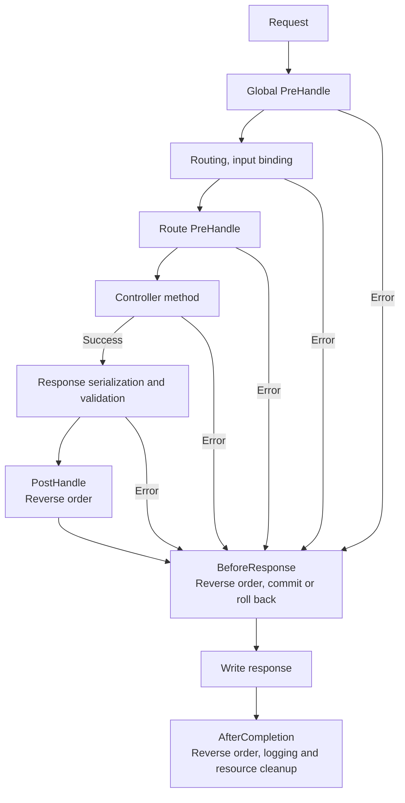

# Interceptors

::: info
The existing project examples below use the `legacy` layout and compatibility `app.Route`. New controllers attach route policies with `api.Interceptors`. See [route migration](/en/learn/migration/preview-controller-routes).
:::

Add logging and demo authentication to user lookup requests, and check the order in which requests pass through interceptors. Interceptors handle authentication, authorization checks, logging, and transactions shared by multiple handlers.

The `src/user` examples use the app created with `--layout legacy` in [Project Structure](/en/learn/tutorial/1-project-structure). The default `layered-v1` layout uses role-based directories.

## Apply an interceptor to a new controller

This standalone app attaches an authentication interceptor to one route with `api.Interceptors`. Install Spine `v0.7.1` and a compatible Echo platform in a separate Go module, save it as `main.go`, and run it. The token is only for demonstration.

```bash
go get github.com/NARUBROWN/spine@v0.7.1 github.com/NARUBROWN/spine-echo-platform@v0.2.0
```

```go
package main

import (
	"github.com/NARUBROWN/spine"
	echoplatform "github.com/NARUBROWN/spine-echo-platform"
	"github.com/NARUBROWN/spine/core"
	"github.com/NARUBROWN/spine/pkg/api"
	"github.com/NARUBROWN/spine/pkg/boot"
	"github.com/NARUBROWN/spine/pkg/constructor"
	"github.com/NARUBROWN/spine/pkg/httperr"
	"github.com/NARUBROWN/spine/pkg/httpx"
	"github.com/NARUBROWN/spine/pkg/input"
	"log"
)

type Auth struct{}

func (*Auth) PreHandle(ctx core.ExecutionContext, meta core.HandlerMeta) error {
	if ctx.Header("Authorization") != "Bearer demo-token" {
		return httperr.Unauthorized("unauthorized")
	}
	return nil
}
func (*Auth) PostHandle(core.ExecutionContext, core.HandlerMeta)                  {}
func (*Auth) BeforeResponse(core.ExecutionContext, core.HandlerMeta, error) error { return nil }
func (*Auth) AfterCompletion(core.ExecutionContext, core.HandlerMeta, error)      {}

type Controller struct{}

func (*Controller) Constructor() *Controller { return &Controller{} }
func (*Controller) RegisterRoutes(r *api.Registry) {
	r.GET("/users/:id", func(id input.Path[int64]) httpx.Response[map[string]int64] {
		return httpx.Response[map[string]int64]{Body: map[string]int64{"id": *id}}
	}, api.Interceptors(&Auth{}))
}
func main() {
	app := spine.New(echoplatform.Option())
	app.Constructor(constructor.Controller(&Controller{}))
	if err := app.Run(boot.Options{Address: ":8080", HTTP: &boot.HTTPOptions{}}); err != nil {
		log.Fatal(err)
	}
}
```

The first request returns 401; the second returns 200 and `{"id":1}`. Implement secure token validation for real authentication.

```bash
curl -i http://localhost:8080/users/1
curl -i -H 'Authorization: Bearer demo-token' http://localhost:8080/users/1
```

## Start from a CLI project

Use the project created in [Your first app](/en/learn/tutorial/1-project-structure) and [Project structure](/en/learn/tutorial/1-project-structure). The code uses `example.com/my-app` as its module path. If you created the project with a different module path, adjust it to match your project.

If you do not have a user resource yet, generate it from the project root. If you have already created it, skip generation.

```sh
spine generate resource user --dry-run
```

Review the files to be generated and the registration code changes in the preview, then generate them.

```sh
spine generate resource user
```

The CLI generates the `src/user` files and the `user.Register(app)` call in `BuildApplication`. There is no interceptor generator, so create the `src/interceptor` directory and write the logging and authentication interceptor files below yourself.

Put app-wide registration in `internal/application/application.go` and the authentication policy for user routes in `src/user/user_route.go`. Keep the configuration, validation, and execution flow in the root `main.go`. The audit logging and order transaction examples later in this page are separate extensions and are not needed to verify the basic app.


## Interceptor lifecycle

In Spine v0.7.1, HTTP requests run through global interceptors, routing and input binding, route interceptors, and the controller, in that order. Interceptors must implement all four lifecycle methods.



If input binding fails, the route's `PreHandle` does not run either. Use a global interceptor for policies that require authentication before checking the body format.


## Interface

```go
type Interceptor interface {
    PreHandle(ctx ExecutionContext, meta HandlerMeta) error
    PostHandle(ctx ExecutionContext, meta HandlerMeta)
    BeforeResponse(ctx ExecutionContext, meta HandlerMeta, executionErr error) error
    AfterCompletion(ctx ExecutionContext, meta HandlerMeta, err error)
}
```

| Method | When it runs | Returns | Purpose |
|--------|----------|------|------|
| `PreHandle` | Before routing for global interceptors; after input binding for route interceptors | `error` | Authenticate, validate, start transactions |
| `PostHandle` | After the controller and response preparation succeed | Nothing | Record completion, perform follow-up work |
| `BeforeResponse` | Before the response is actually written | `error` | Commit or roll back transactions |
| `AfterCompletion` | After an attempt to write the response | Nothing | Log, clean up resources |

`BeforeResponse` receives earlier execution errors and errors from response serialization, cookie validation, and status code validation as `executionErr`. Only interceptors whose `PreHandle` succeeded run this method, making it suitable for completing transactions started in that phase. Return an error if committing or rolling back fails.

`AfterCompletion` is called on global interceptors and route interceptors identified during routing, even when an error occurs. This can include interceptors whose `PreHandle` did not run, so first check whether there are resources to clean up. The response may already have been written at this point, so do not use this method to change it.


## Global and route interceptors

Register app-wide policies as global interceptors and policies for specific routes as route interceptors.

| Category | Global interceptor | Route interceptor |
|------|--------------|----------------|
| Scope | All requests for the relevant transport | Specific routes only |
| Registration | `app.Interceptor()` | `route.WithInterceptors()` |
| Purpose | CORS, logging, transactions | Authentication, authorization checks |
| Execution order | Runs first | Runs after global interceptors |


## Global interceptors

Register the logging interceptor below globally to log each request's method and path. Check the `PostHandle` logs on success and the `AfterCompletion` logs on failure.

### Logging interceptor example

```go
// src/interceptor/logging_interceptor.go
package interceptor

import (
    "log"
    "github.com/NARUBROWN/spine/core"
)

type LoggingInterceptor struct{}

func (i *LoggingInterceptor) PreHandle(ctx core.ExecutionContext, meta core.HandlerMeta) error {
    log.Printf("[REQ] %s %s", ctx.Method(), ctx.Path())
    return nil
}

func (i *LoggingInterceptor) PostHandle(ctx core.ExecutionContext, meta core.HandlerMeta) {
    log.Printf("[RES] %s %s OK",
        ctx.Method(),
        ctx.Path(),
    )
}

func (i *LoggingInterceptor) BeforeResponse(ctx core.ExecutionContext, meta core.HandlerMeta, executionErr error) error {
    return nil
}

func (i *LoggingInterceptor) AfterCompletion(ctx core.ExecutionContext, meta core.HandlerMeta, err error) {
    if err != nil {
        log.Printf("[ERR] %s %s : %v",
            ctx.Method(),
            ctx.Path(),
            err,
        )
    }
}
```

Global HTTP `PreHandle` runs before routing, so `HandlerMeta` has no controller type or method at this stage. If you need this information, read it in a route interceptor or a later lifecycle phase.

### Register a global interceptor

Modify `internal/application/application.go` as follows. Add the logging interceptor while keeping the generated health check controller and the `user.Register(app)` call.

```go
// internal/application/application.go
package application

import (
    echoplatform "github.com/NARUBROWN/spine-echo-platform"
    "os"

    "example.com/my-app/src/interceptor"
    "example.com/my-app/src/user"
    "github.com/NARUBROWN/spine"
    "github.com/NARUBROWN/spine/pkg/boot"
    "github.com/NARUBROWN/spine/pkg/httpx"
)

type HealthController struct{}

func NewHealthController() *HealthController { return &HealthController{} }

func (c *HealthController) Get() httpx.Response[map[string]string] {
    return httpx.Response[map[string]string]{Body: map[string]string{"status": "ok"}}
}

func BuildApplication() (spine.App, boot.Options, error) {
    app := spine.New(echoplatform.Option())
    app.Constructor(NewHealthController)
    app.Route("GET", "/health", (*HealthController).Get)
    app.Interceptor(&interceptor.LoggingInterceptor{})

    if err := user.Register(app); err != nil {
        return nil, boot.Options{}, err
    }

    address := ":8080"
    if port := os.Getenv("SPINE_PORT"); port != "" {
        address = ":" + port
    }
    return app, boot.Options{Address: address, HTTP: &boot.HTTPOptions{}}, nil
}
```


## Route interceptors

Register an authentication interceptor on `GET /user/:id` to reject requests without a token with HTTP 401. Do not apply this authentication policy to the `/health` health check route.

### Authentication interceptor example

```go
// src/interceptor/auth_interceptor.go
package interceptor

import (
    "errors"

    "github.com/NARUBROWN/spine/core"
    "github.com/NARUBROWN/spine/pkg/httperr"
)

type AuthInterceptor struct{}

func (i *AuthInterceptor) PreHandle(ctx core.ExecutionContext, meta core.HandlerMeta) error {
    token := ctx.Header("Authorization")

    if token == "" {
        return httperr.Unauthorized("Authentication is required.")
    }

    user, err := validateToken(token)
    if err != nil {
        return httperr.Unauthorized("The token is invalid.")
    }

    ctx.Set("currentUser", user)
    return nil
}

func (i *AuthInterceptor) PostHandle(ctx core.ExecutionContext, meta core.HandlerMeta) {}

func (i *AuthInterceptor) BeforeResponse(ctx core.ExecutionContext, meta core.HandlerMeta, executionErr error) error { return nil }

func (i *AuthInterceptor) AfterCompletion(ctx core.ExecutionContext, meta core.HandlerMeta, err error) {}

func validateToken(token string) (map[string]string, error) {
    if token != "Bearer demo-token" {
        return nil, errors.New("invalid demo token")
    }
    return map[string]string{"id": "1", "name": "Alice"}, nil
}
```

This example accepts only `Authorization: Bearer demo-token` and returns HTTP 401 for other tokens. The fixed token is a public demo for checking behavior. Replace it with an authentication service in a real app.

### Register a route interceptor

Modify the generated `src/user/user_route.go` with the following code. Add the authentication policy with `route.WithInterceptors()` and keep the `user.Register(app)` call in `BuildApplication`.

```go
// src/user/user_route.go
package user

import (
    "example.com/my-app/src/interceptor"
    "github.com/NARUBROWN/spine"
    "github.com/NARUBROWN/spine/pkg/route"
)

func Register(app spine.App) error {
    app.Constructor(NewUserRepository, NewUserService, NewUserController)
    app.Route(
        "GET",
        "/user/:id",
        (*UserController).Get,
        route.WithInterceptors(&interceptor.AuthInterceptor{}),
    )
    return nil
}
```


## Apply logging, authentication, and CORS together

Replace `BuildApplication` from the previous section with the following code to apply a CORS policy in addition to logging. Keep the user route's authentication interceptor in `user_route.go`.

Configure CORS to allow requests from `https://app.example.com`. Check configuration errors from `cors.NewValidated`. Because this is an HTTP-only policy, register it with `InterceptorFor(boot.InterceptorHTTP, ...)`.

```go
// internal/application/application.go
package application

import (
    echoplatform "github.com/NARUBROWN/spine-echo-platform"
    "os"

    "example.com/my-app/src/interceptor"
    "example.com/my-app/src/user"
    "github.com/NARUBROWN/spine"
    "github.com/NARUBROWN/spine/pkg/boot"
    "github.com/NARUBROWN/spine/pkg/httpx"
    "github.com/NARUBROWN/spine/interceptor/cors"
)

type HealthController struct{}

func NewHealthController() *HealthController { return &HealthController{} }

func (c *HealthController) Get() httpx.Response[map[string]string] {
    return httpx.Response[map[string]string]{Body: map[string]string{"status": "ok"}}
}

func BuildApplication() (spine.App, boot.Options, error) {
    app := spine.New(echoplatform.Option())
    app.Constructor(NewHealthController)
    app.Route("GET", "/health", (*HealthController).Get)
    app.Interceptor(&interceptor.LoggingInterceptor{})
    corsInterceptor, err := cors.NewValidated(cors.Config{
        AllowOrigins:     []string{"https://app.example.com"},
        AllowMethods:     []string{"GET", "POST", "PUT", "DELETE", "OPTIONS"},
        AllowHeaders:     []string{"Authorization", "Content-Type"},
        AllowCredentials: true,
    })
    if err != nil {
        return nil, boot.Options{}, err
    }
    app.InterceptorFor(boot.InterceptorHTTP, corsInterceptor)

    if err := user.Register(app); err != nil {
        return nil, boot.Options{}, err
    }

    address := ":8080"
    if port := os.Getenv("SPINE_PORT"); port != "" {
        address = ":" + port
    }
    return app, boot.Options{Address: address, HTTP: &boot.HTTPOptions{}}, nil
}
```


## Verify logging and authentication behavior

After applying the logging, authentication, and CORS code from the basic example, run the following commands from the project root. `spine contract check` checks the static contract, and `spine verify` checks local code. Run the server to check authentication and responses for actual requests separately.

```sh
gofmt -w src/interceptor/*.go src/user/user_route.go internal/application/application.go
spine contract check
spine verify
spine dev
```

Send the following requests from another terminal.

- `/health` should return HTTP 200 without authentication.
- A request to `/user/1` without a token should return HTTP 401.
- A request to `/user/1` with the demo token should return HTTP 200 and `{"id":1}`.
- The last response should include the `Access-Control-Allow-Origin: https://app.example.com` header.

```bash
curl -i http://localhost:8080/health
curl -i http://localhost:8080/user/1
curl -i http://localhost:8080/user/1 \
  -H 'Authorization: Bearer demo-token' \
  -H 'Origin: https://app.example.com'
```

These requests check only the demo HTTP authentication. Configure each environment and separately verify the behavior of a real authentication service, WebSocket authentication, and database transactions.

## Execution order

`PreHandle` runs in registration order. After successful execution, `PostHandle`, `BeforeResponse`, and `AfterCompletion` run through route interceptors in reverse order, then global interceptors in reverse order.

### Execution flow for a successful request

If all the logging, CORS, and authentication interceptors registered earlier succeed, they run in the following order.

```text
Request (GET /user/1)
   │
   ├─→ Logging.PreHandle     (global 1)
   ├─→ CORS.PreHandle        (global 2)
   ├─→ Routing and input binding
   ├─→ Auth.PreHandle        (route 1)
   │
   ├─→ UserController.Get
   ├─→ Response serialization and validation
   │
   ├─→ Auth.PostHandle       (route 1)
   ├─→ CORS.PostHandle       (global 2)
   ├─→ Logging.PostHandle    (global 1)
   │
   ├─→ Auth.BeforeResponse       (route 1)
   ├─→ CORS.BeforeResponse       (global 2)
   ├─→ Logging.BeforeResponse    (global 1)
   │
   ├─→ Write response
   │
   ├─→ Auth.AfterCompletion       (route 1)
   ├─→ CORS.AfterCompletion       (global 2)
   └─→ Logging.AfterCompletion    (global 1)

Complete
```

`PostHandle` does not run if response serialization or validation fails, even when the controller succeeds. `BeforeResponse` runs only on interceptors whose `PreHandle` succeeded. `AfterCompletion` also includes interceptors identified during routing in its cleanup.


## Handle requests that encounter errors

### Return an error from PreHandle

If `PreHandle` returns an error, subsequent interceptors' `PreHandle` methods and the controller are not called. Interceptors whose `PreHandle` has already succeeded run `BeforeResponse`, and cleanup runs through `AfterCompletion` at the end.

The following excerpt shows only the authentication failure branch. Keep the `AuthInterceptor` you wrote earlier: replacing it with this code would remove token validation.

```go
func (i *AuthInterceptor) PreHandle(ctx core.ExecutionContext, meta core.HandlerMeta) error {
    token := ctx.Header("Authorization")
    if token == "" {
        return httperr.Unauthorized("Authentication is required.")
    }
    return nil
}
```

```text
Request (GET /user/1, no token)
   │
   ├─→ Logging.PreHandle     (success)
   ├─→ CORS.PreHandle        (success)
   ├─→ Routing and input binding
   ├─→ Auth.PreHandle        (returns an error)
   │
   ├─→ CORS.BeforeResponse
   ├─→ Logging.BeforeResponse
   │
   ├─→ Write response (401 Unauthorized)
   │
   ├─→ Auth.AfterCompletion
   ├─→ CORS.AfterCompletion
   └─→ Logging.AfterCompletion

Complete
```


## Share request values: ExecutionContext

Interceptors read request information from `core.ExecutionContext` and pass values to other interceptors or controllers handling the same request. Controllers read shared values through the read-only `spine.Ctx`.

### Methods

| Method | Description |
|--------|------|
| `Context()` | Return `context.Context` |
| `Method()` | HTTP method, such as GET or POST |
| `Path()` | Request path |
| `Header(name)` | Read a header value |
| `Params()` | Read all path parameters |
| `PathKeys()` | Names of path parameters in the order declared in the route |
| `Queries()` | Read all query parameters |
| `EventBus()` | Get the request's event bus |
| `Set(key, value)` | Store a value |
| `Get(key)` | Read a value |

### Pass data between interceptors

The following excerpt shows only how an audit interceptor reads `currentUser` stored by an authentication interceptor. To add an audit interceptor, implement the `AuditInterceptor` type and all four lifecycle methods, then register it after the authentication interceptor. Do not declare a second `PreHandle` for the existing authentication interceptor.

```go
// AuthInterceptor stores user information
func (i *AuthInterceptor) PreHandle(ctx core.ExecutionContext, meta core.HandlerMeta) error {
    token := ctx.Header("Authorization")
    user, err := validateToken(token)
    if err != nil {
        return httperr.Unauthorized("invalid credentials")
    }
    ctx.Set("currentUser", user)
    return nil
}

// Read through the read-only spine.Ctx in the controller
// Or read from another interceptor
func (i *AuditInterceptor) PreHandle(ctx core.ExecutionContext, meta core.HandlerMeta) error {
    user, ok := ctx.Get("currentUser")
    if ok {
        log.Printf("User %v accessing %s", user, ctx.Path())
    }
    return nil
}
```


## Handler information: HandlerMeta

`core.HandlerMeta` holds information about the controller and method selected during routing. Global `PreHandle` runs before routing, so the type and method are not yet available.

| Field | Type | Description |
|------|------|------|
| `ControllerType` | `reflect.Type` | Controller type |
| `Method` | `reflect.Method` | Handler method |
| `PathKeys` | `[]string` | Names of path parameters in the order declared in the route |
| `Interceptors` | `[]Interceptor` | Interceptors bound to the route |

### Usage example

The following separate example shows how to read metadata. Run it in a route interceptor to log the controller and method. Do not declare a duplicate of a method in the existing logging interceptor.

```go
func (i *LoggingInterceptor) PreHandle(ctx core.ExecutionContext, meta core.HandlerMeta) error {
    if meta.ControllerType != nil {
        log.Printf("Controller: %s", meta.ControllerType.String())
    }
    log.Printf("Method: %s", meta.Method.Name)              // GetUser
    return nil
}
```


## Interceptors that need dependency injection

For an interceptor that accepts dependencies, register its constructor with `app.Constructor` and pass a pointer representing its type when registering the interceptor. The container creates and injects an instance of that type.

### Transaction interceptor example

The following is an independent extension example for an app with a [database](/en/learn/tutorial/5-database) connection. It is not needed to verify the basic logging and authentication example.

`PreHandle` stores the transaction in the request context. `BeforeResponse` rolls it back if there is an execution error and commits it otherwise. The controller must read the transaction from `spine.Ctx` and pass it to service and repository methods. Transactions for individual requests are not automatically reinjected into services or repositories created by shared constructors.

```go
// src/interceptor/tx_interceptor.go
package interceptor

import (
    "github.com/NARUBROWN/spine/core"
    "github.com/uptrace/bun"
)

type TxInterceptor struct {
    db *bun.DB
}

func NewTxInterceptor(db *bun.DB) *TxInterceptor {
    return &TxInterceptor{db: db}
}

func (i *TxInterceptor) PreHandle(ctx core.ExecutionContext, meta core.HandlerMeta) error {
    tx, err := i.db.BeginTx(ctx.Context(), nil)
    if err != nil {
        return err
    }
    ctx.Set("tx", tx)
    return nil
}

func (i *TxInterceptor) PostHandle(ctx core.ExecutionContext, meta core.HandlerMeta) {}

func (i *TxInterceptor) BeforeResponse(ctx core.ExecutionContext, meta core.HandlerMeta, executionErr error) error {
    v, ok := ctx.Get("tx")
    if !ok {
        return nil
    }

    tx, ok := v.(bun.Tx)
    if !ok {
        return nil
    }
    if executionErr != nil {
        return tx.Rollback()
    } else {
        return tx.Commit()
    }
}

func (i *TxInterceptor) AfterCompletion(ctx core.ExecutionContext, meta core.HandlerMeta, err error) {}
```

### Global registration

Add the following registration code inside `BuildApplication`. Implement `NewDB` as a constructor that returns a single `*bun.DB`.

```go
app.Constructor(
    NewDB,
    interceptor.NewTxInterceptor,
)

app.Interceptor(
    (*interceptor.TxInterceptor)(nil),  // Reference by type
)
```

### Route registration

To apply the interceptor only to order creation requests, register it on the route as shown below instead of registering it globally. You must implement and register the `OrderController` constructor and its `CreateOrder` method separately.

```go
app.Constructor(
    NewDB,
    interceptor.NewTxInterceptor,
)

app.Route(
    "POST",
    "/orders",
    (*OrderController).CreateOrder,
    route.WithInterceptors((*interceptor.TxInterceptor)(nil)),  // Reference by type
)
```


## Choose a registration method

For both global and route registration, you can pass an interceptor instance directly if it has no dependencies. For an interceptor that accepts dependencies, register its constructor and then reference it by type.

| Method | Global registration | Route registration |
|------|----------|------------|
| Pass an instance | `app.Interceptor(&interceptor.LoggingInterceptor{})` | `route.WithInterceptors(&interceptor.AuthInterceptor{})` |
| Reference a type to resolve through a constructor | `app.Interceptor((*interceptor.TxInterceptor)(nil))` | `route.WithInterceptors((*interceptor.TxInterceptor)(nil))` |


## Next steps

- [Tutorial: Databases](/en/learn/tutorial/5-database) — Connect Bun ORM
- [Tutorial: Error handling](/en/learn/tutorial/7-error-handling) — Use httperr
