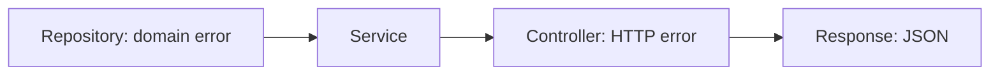

# Error Handling

Use the CLI project from [First App](/en/learn/getting-started/first-app) and [Controllers](/en/learn/tutorial/2-controller). Manually extend the GET handler under `src/user`, created by `spine generate resource user`. The CLI generates and registers the resource; you implement domain errors and HTTP mappings.

## HTTP errors and responses

Wrap success results in `httpx.Response[T]` and return a separate `error`. A raw `(User, error)` is not a supported HTTP response. The current `httperr` package has four helpers.

| Helper | HTTP | |
|---|---|---|
| `httperr.BadRequest(message)` | 400 | Invalid input |
| `httperr.Unauthorized(message)` | 401 | Authentication required |
| `httperr.NotFound(message)` | 404 | Missing resource |
| `httperr.InternalServerError(message)` | 500 | Deliberate public error message |

`HTTPError.Message` is exposed to clients. Do not put raw database errors or secrets in it. Unexpected general errors become HTTP 500 with `{"message":"Internal server error"}`.

## Add lookup errors to the generated resource

This is an educational, read-only in-memory lookup. Replace the generated repository/controller files with the following and add `Find` to the service. Keep all files in `package user`. Reuse the existing constructor names, `user.Register(app)`, and `GET /user/:id` registration. This example does not provide database persistence or full CRUD.

```go
// src/user/user_repository.go
package user

import "errors"

var ErrUserNotFound = errors.New("user not found")
var ErrEmailAlreadyExists = errors.New("email already exists")

type User struct {
    ID int64 `json:"id"`
    Name string `json:"name"`
}

type UserRepository struct{ users map[int64]User }

func NewUserRepository() *UserRepository {
    return &UserRepository{users: map[int64]User{1: {ID: 1, Name: "Alice"}}}
}

func (r *UserRepository) FindByID(id int64) (User, error) {
    user, ok := r.users[id]
    if !ok {
        return User{}, ErrUserNotFound
    }
    return user, nil
}
```

```go
// src/user/user_service.go
func (s *UserService) Find(id int64) (User, error) {
    return s.repository.FindByID(id)
}
```

```go
// src/user/user_controller.go
package user

import (
    "errors"
    "net/http"

    "github.com/NARUBROWN/spine/pkg/httperr"
    "github.com/NARUBROWN/spine/pkg/httpx"
    "github.com/NARUBROWN/spine/pkg/path"
)

type UserController struct{ service *UserService }

func NewUserController(service *UserService) *UserController {
    return &UserController{service: service}
}

func (c *UserController) Get(id path.Int) (httpx.Response[User], error) {
    if id.Value <= 0 {
        return httpx.Response[User]{}, httperr.BadRequest("invalid user ID")
    }
    user, err := c.service.Find(id.Value)
    if err != nil {
        return httpx.Response[User]{}, toHTTPError(err)
    }
    return httpx.Response[User]{Body: user}, nil
}

func toHTTPError(err error) error {
    switch {
    case errors.Is(err, ErrUserNotFound):
        return httperr.NotFound("user not found")
    case errors.Is(err, ErrEmailAlreadyExists):
        return &httperr.HTTPError{
            Status: http.StatusConflict,
            Message: "email already exists",
            Cause: err,
        }
    default:
        return err
    }
}
```

## Responsibilities by layer

The repository returns domain errors; the service forwards them. The controller maps only expected errors to HTTP status codes. `errors.Is` also recognizes wrapped errors. Converting unknown errors to `BadRequest(err.Error())` would expose internal details; return them unchanged for the sanitized general 500 response.



## HTTPError and other status codes

Use `HTTPError` for statuses without helpers, such as 403 and 409. `Cause` supports error tracing through `Unwrap()` and is not included in the JSON response.

```go
type HTTPError struct {
    Status int
    Message string
    Cause error
}

func (e *HTTPError) Error() string { return e.Message }
func (e *HTTPError) Unwrap() error { return e.Cause }
```

```go
return &httperr.HTTPError{
    Status: http.StatusForbidden,
    Message: "permission denied",
}
```

## Validate request DTOs

This is an optional input-validation extension. Call `Validate()` from the handler; Spine does not invoke it automatically. Request DTOs must be pointers. The POST example echoes validated input and does not save a user. Add its POST route inside `Register` if you use it.

```go
// src/user/user_create.go
package user

import (
    "errors"
    "net/http"
    "unicode/utf8"

    "github.com/NARUBROWN/spine/pkg/httperr"
    "github.com/NARUBROWN/spine/pkg/httpx"
)

type CreateUserRequest struct {
    Name string `json:"name"`
    Email string `json:"email"`
}

func (r *CreateUserRequest) Validate() error {
    if r == nil || r.Name == "" {
        return errors.New("name is required")
    }
    if utf8.RuneCountInString(r.Name) > 100 {
        return errors.New("name must be at most 100 characters")
    }
    if r.Email == "" {
        return errors.New("email is required")
    }
    return nil
}

func (c *UserController) Create(req *CreateUserRequest) (httpx.Response[CreateUserRequest], error) {
    if err := req.Validate(); err != nil {
        return httpx.Response[CreateUserRequest]{}, httperr.BadRequest(err.Error())
    }
    return httpx.Response[CreateUserRequest]{
        Body: *req,
        Options: httpx.ResponseOptions{Status: http.StatusCreated},
    }, nil
}
```

```go
// src/user/user_route.go: Register
app.Route("POST", "/user", (*UserController).Create)
```

## Errors in interceptors

Returning an error from `PreHandle` stops controller execution. The following method excerpt belongs to an interceptor in `src/interceptor` with its own authentication service. The complete type must implement all four methods: `PreHandle`, `PostHandle`, `BeforeResponse`, and `AfterCompletion`. Register it with HTTP scope in `BuildApplication()`.

```go
func (i *AuthInterceptor) PreHandle(ctx core.ExecutionContext, meta core.HandlerMeta) error {
    token := ctx.Header("Authorization")
    if token == "" {
        return httperr.Unauthorized("authentication required")
    }
    user, err := i.auth.Validate(token)
    if err != nil {
        return httperr.Unauthorized("invalid token")
    }
    ctx.Set("auth.user", user)
    return nil
}
```

## Log errors

`AfterCompletion` can log execution errors. This is also an excerpt from a complete logging interceptor. Keep authentication tokens and request secrets out of logs.

```go
func (i *LoggingInterceptor) AfterCompletion(ctx core.ExecutionContext, meta core.HandlerMeta, err error) {
    if err != nil {
        log.Printf("[ERR] %s %s: %v", ctx.Method(), ctx.Path(), err)
    }
}
```

## Verify and check HTTP responses

```bash
gofmt -w src/user
go mod tidy
spine doctor
spine contract check
spine verify
spine dev
```

After contract and local checks, verify actual responses from another terminal. The results below apply to the read-only memory example above.

```bash
curl -i http://localhost:8080/user/1
curl -i http://localhost:8080/user/0
curl -i http://localhost:8080/user/2
```

| Request | HTTP | JSON |
|---|---|---|
| `/user/1` | 200 | `{"id":1,"name":"Alice"}` |
| `/user/0` | 400 | `{"message":"invalid user ID"}` |
| `/user/2` | 404 | `{"message":"user not found"}` |

When integrating a real database or authentication service, test its failure paths separately with E2E checks. Static contract analysis does not establish correct external-service error mapping.

- [httperr](/en/learn/core-concepts/httperr)
- [Interceptors](/en/learn/tutorial/4-interceptor)
