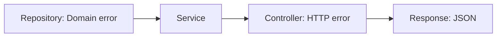

# Handle errors

Return HTTP 400 or 404 according to why a user lookup failed, and hide the internal details of unexpected errors from the response.

The feature-based `src/user` examples on this page use the `my-app` project created with `--layout legacy` in [Project Structure](/en/learn/tutorial/1-project-structure). CLI `v0.4.2` defaults to the role-based `layered-v1` layout. Both layouts use Spine `v0.6.5` and Echo platform `v0.1.0`.

Use the CLI project from [Your first app](/en/learn/tutorial/1-project-structure) and [Controllers](/en/learn/tutorial/2-controller). You need the `src/user` resource generated by `spine generate resource user`. The example below replaces the GET handler with a read-only in-memory lookup, so apply it separately from the database tutorial. Write the code that maps domain errors to HTTP status codes yourself.

## HTTP errors and responses

Wrap successful results in `httpx.Response[T]` and return errors through a separate `error` return value. Use `(httpx.Response[User], error)` as the handler's return signature, rather than `(User, error)`. `httperr` provides these four functions.

| Function | HTTP status | Purpose |
|---|---|---|
| `httperr.BadRequest(message)` | 400 | Invalid input |
| `httperr.Unauthorized(message)` | 401 | Authentication required |
| `httperr.NotFound(message)` | 404 | Resource not found |
| `httperr.InternalServerError(message)` | 500 | Server error message safe to expose to the client |

`HTTPError.Message` is exposed to the client, so do not copy internal database errors or secret values into it. Returning a regular `error` produces HTTP 500 with `{"message":"Internal server error"}`.

## Add lookup errors to the generated resource

Replace the generated `src/user/user_repository.go` and `src/user/user_controller.go` with the code below, and add the `Find` method to `src/user/user_service.go`. Put all files in `package user`. Keep the existing constructor names, `user.Register(app)`, and the `GET /user/:id` registration.

The repository contains only Alice, whose ID is 1. This example reproduces lookup errors and does not store data in a database.

```go
// src/user/user_repository.go
package user

import "errors"

var ErrUserNotFound = errors.New("user not found")
var ErrEmailAlreadyExists = errors.New("email already exists")

type User struct {
    ID int64 `json:"id"`
    Name string `json:"name"`
}

type UserRepository struct{ users map[int64]User }

func NewUserRepository() *UserRepository {
    return &UserRepository{users: map[int64]User{1: {ID: 1, Name: "Alice"}}}
}

func (r *UserRepository) FindByID(id int64) (User, error) {
    user, ok := r.users[id]
    if !ok {
        return User{}, ErrUserNotFound
    }
    return user, nil
}
```

```go
// src/user/user_service.go
func (s *UserService) Find(id int64) (User, error) {
    return s.repository.FindByID(id)
}
```

```go
// src/user/user_controller.go
package user

import (
    "errors"
    "net/http"

    "github.com/NARUBROWN/spine/pkg/httperr"
    "github.com/NARUBROWN/spine/pkg/httpx"
    "github.com/NARUBROWN/spine/pkg/path"
)

type UserController struct{ service *UserService }

func NewUserController(service *UserService) *UserController {
    return &UserController{service: service}
}

func (c *UserController) Get(id path.Int) (httpx.Response[User], error) {
    if id.Value <= 0 {
        return httpx.Response[User]{}, httperr.BadRequest("invalid user ID")
    }
    user, err := c.service.Find(id.Value)
    if err != nil {
        return httpx.Response[User]{}, toHTTPError(err)
    }
    return httpx.Response[User]{Body: user}, nil
}

func toHTTPError(err error) error {
    switch {
    case errors.Is(err, ErrUserNotFound):
        return httperr.NotFound("user not found")
    case errors.Is(err, ErrEmailAlreadyExists):
        return &httperr.HTTPError{
            Status: http.StatusConflict,
            Message: "email already exists",
            Cause: err,
        }
    default:
        return err
    }
}
```

## Responsibilities by layer

The repository returns domain errors, and the service passes them to the controller. The controller maps expected errors to HTTP status codes. Use `errors.Is` to identify domain errors even when they are wrapped in other errors.

Return unknown errors unchanged to use the default HTTP 500 handling. Converting them to `BadRequest(err.Error())` exposes internal error messages in the response. The in-memory repository above returns only `ErrUserNotFound`; the `ErrEmailAlreadyExists` branch shows a mapping you can use when you add a save operation later.



## HTTPError and additional status codes

`HTTPError.Unwrap()` returns `Cause`. Use `errors.Is` and `errors.As` to inspect the cause chain, or read the `Cause` field directly. The cause is not included in the JSON response.

```go
type HTTPError struct {
    Status int
    Message string
    Cause error
}

func (e *HTTPError) Error() string { return e.Message }
func (e *HTTPError) Unwrap() error { return e.Cause }
```

```go
return &httperr.HTTPError{
    Status: http.StatusForbidden,
    Message: "permission denied",
}
```

## Validate request DTOs

To add input validation, create `src/user/user_create.go` with the following code. `Validate()` is not called automatically, so call it directly in the handler and receive the request DTO as a pointer.

This POST handler returns HTTP 400 if the name or email is empty, or if the name exceeds 100 characters. If validation passes, it returns the input with HTTP 201 without saving the user. To use this handler, also add the POST route below to `Register` in `src/user/user_route.go`.

```go
// src/user/user_create.go
package user

import (
    "errors"
    "net/http"
    "unicode/utf8"

    "github.com/NARUBROWN/spine/pkg/httperr"
    "github.com/NARUBROWN/spine/pkg/httpx"
)

type CreateUserRequest struct {
    Name string `json:"name"`
    Email string `json:"email"`
}

func (r *CreateUserRequest) Validate() error {
    if r == nil || r.Name == "" {
        return errors.New("name is required")
    }
    if utf8.RuneCountInString(r.Name) > 100 {
        return errors.New("name must be at most 100 characters")
    }
    if r.Email == "" {
        return errors.New("email is required")
    }
    return nil
}

func (c *UserController) Create(req *CreateUserRequest) (httpx.Response[CreateUserRequest], error) {
    if err := req.Validate(); err != nil {
        return httpx.Response[CreateUserRequest]{}, httperr.BadRequest(err.Error())
    }
    return httpx.Response[CreateUserRequest]{
        Body: *req,
        Options: httpx.ResponseOptions{Status: http.StatusCreated},
    }, nil
}
```

```go
// src/user/user_route.go: Register
app.Route("POST", "/user", (*UserController).Create)
```

## Handle errors in interceptors

If `PreHandle` returns an error, the controller does not run. The following is a method excerpt from an interceptor with its own authentication service. Copying this method alone is not enough to use it. Define the type and authentication service in `src/interceptor`, and implement all four methods: `PreHandle`, `PostHandle`, `BeforeResponse`, and `AfterCompletion`. To apply the interceptor to HTTP requests, register it in `BuildApplication()` with the `boot.InterceptorHTTP` scope.

```go
func (i *AuthInterceptor) PreHandle(ctx core.ExecutionContext, meta core.HandlerMeta) error {
    token := ctx.Header("Authorization")
    if token == "" {
        return httperr.Unauthorized("authentication required")
    }
    user, err := i.auth.Validate(token)
    if err != nil {
        return httperr.Unauthorized("invalid token")
    }
    ctx.Set("auth.user", user)
    return nil
}
```

## Log errors

You can log the final execution error in `AfterCompletion`. The following method is also an excerpt from a logging interceptor, so it requires the full interceptor type and registration. Do not log authentication tokens or secret values from requests.

```go
func (i *LoggingInterceptor) AfterCompletion(ctx core.ExecutionContext, meta core.HandlerMeta, err error) {
    if err != nil {
        log.Printf("[ERR] %s %s: %v", ctx.Method(), ctx.Path(), err)
    }
}
```

## Verify and check HTTP responses

```bash
gofmt -w src/user
go mod tidy
go mod download all
spine doctor
spine contract check
spine verify
spine dev
```

After the contract checks and local checks pass, check the responses from another terminal. The results below apply to the read-only in-memory example.

```bash
curl -i http://localhost:8080/user/1
curl -i http://localhost:8080/user/0
curl -i http://localhost:8080/user/2
```

| Request | HTTP status | JSON |
|---|---|---|
| `/user/1` | 200 | `{"id":1,"name":"Alice"}` |
| `/user/0` | 400 | `{"message":"invalid user ID"}` |
| `/user/2` | 404 | `{"message":"user not found"}` |

These requests check how the handler processes integer IDs that reach it. Error handling for path values that cannot be parsed as numbers is separate from the `id.Value <= 0` validation in this example.

When you connect an actual database or authentication service, send requests that exercise those services' failure paths too. Static contract checks alone cannot verify error mappings for external services.

- [httperr](/en/learn/core-concepts/httperr)
- [Interceptors](/en/learn/tutorial/4-interceptor)
