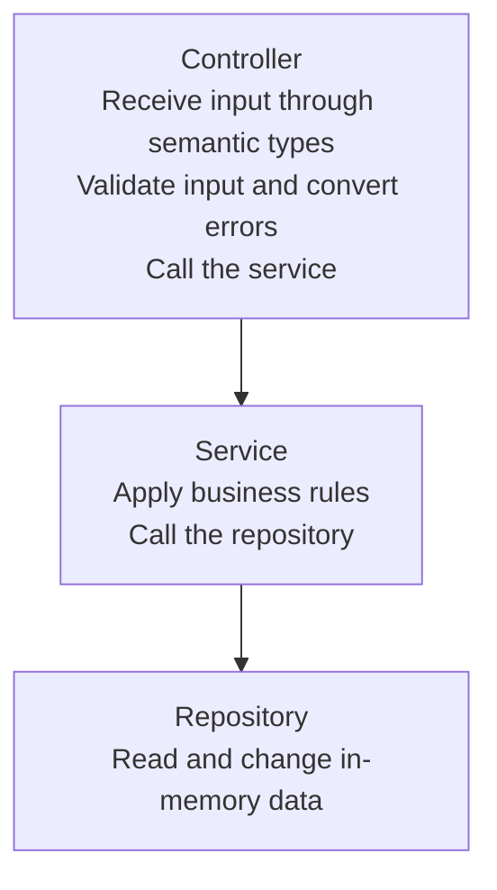

# Build a User CRUD API

Build an HTTP API to create, list, retrieve, update, and delete users. The example uses an in-memory repository without an ORM, so you can run it without setting up a database.

## Prerequisites

Install the stable [Spine CLI](/en/learn/getting-started/installation). This example uses CLI `v0.4.4` and core `v0.7.5`.

Stored users disappear when the server process stops.

Requests pass through the controller, service, and repository in that order. Each component has the following responsibilities.



## 1. Create the Project

Create a basic app and check its dependencies and project configuration. Run subsequent commands from `crud-example/`.

The commands below select stable dependencies from the `main` channel. Check the core and platform versions in the generated `go.mod`.

```sh
spine new crud-example --module example.com/crud-example --channel main --validator playground --no-interactive
cd crud-example
spine doctor
```

### File Layout

In the next steps, add five files under `src/` and replace the generated `internal/application/application.go`. Keep the root `main.go` and `spine.toml` as generated.

```text
crud-example/
├── go.mod
├── go.sum
├── main.go
├── spine.toml
├── internal/application/
│   ├── application.go
│   └── application_test.go
└── src/
    ├── model/user.go
    ├── repository/user_repository.go
    ├── dto/user_dto.go
    ├── service/user_service.go
    └── controller/user_controller.go
```

## 2. Add the User Model

Create `src/model/user.go`. This struct stores user details and the creation and update timestamps.

```go
// src/model/user.go
package model

import "time"

type User struct {
	ID        int64     `json:"id"`
	Name      string    `json:"name"`
	Email     string    `json:"email"`
	CreatedAt time.Time `json:"created_at"`
	UpdatedAt time.Time `json:"updated_at"`
}
```

## 3. Add an In-Memory Repository

Create `src/repository/user_repository.go`. It retrieves, saves, and deletes users, and provides a function to check for duplicate email addresses.

```go
// src/repository/user_repository.go
package repository

import (
	"errors"
	"sync"
	"time"

	"example.com/crud-example/src/model"
)

var (
	ErrUserNotFound       = errors.New("user not found")
	ErrEmailAlreadyExists = errors.New("email already exists")
)

type UserRepository struct {
	mu      sync.RWMutex
	users   map[int64]*model.User
	counter int64
}

func (*UserRepository) Constructor() *UserRepository {
	return &UserRepository{
		users:   make(map[int64]*model.User),
		counter: 0,
	}
}

func (r *UserRepository) FindAll() []*model.User {
	r.mu.RLock()
	defer r.mu.RUnlock()

	result := make([]*model.User, 0, len(r.users))
	for _, user := range r.users {
		result = append(result, user)
	}
	return result
}

func (r *UserRepository) FindByID(id int64) (*model.User, error) {
	r.mu.RLock()
	defer r.mu.RUnlock()

	user, ok := r.users[id]
	if !ok {
		return nil, ErrUserNotFound
	}
	return user, nil
}

func (r *UserRepository) FindByEmail(email string) (*model.User, error) {
	r.mu.RLock()
	defer r.mu.RUnlock()

	for _, user := range r.users {
		if user.Email == email {
			return user, nil
		}
	}
	return nil, ErrUserNotFound
}

func (r *UserRepository) ExistsByEmail(email string) bool {
	_, err := r.FindByEmail(email)
	return err == nil
}

func (r *UserRepository) Save(user *model.User) *model.User {
	r.mu.Lock()
	defer r.mu.Unlock()

	now := time.Now()

	if user.ID == 0 {
		r.counter++
		user.ID = r.counter
		user.CreatedAt = now
	}
	user.UpdatedAt = now

	r.users[user.ID] = user
	return user
}

func (r *UserRepository) Delete(id int64) error {
	r.mu.Lock()
	defer r.mu.Unlock()

	if _, ok := r.users[id]; !ok {
		return ErrUserNotFound
	}

	delete(r.users, id)
	return nil
}

func (r *UserRepository) Count() int {
	r.mu.RLock()
	defer r.mu.RUnlock()
	return len(r.users)
}
```

## 4. Add Request and Response DTOs

Create `src/dto/user_dto.go`. Define the fields accepted in requests and returned in responses, and convert the repository's user model into response DTOs.

```go
// src/dto/user_dto.go
package dto

import (
	"time"

	"example.com/crud-example/src/model"
)

// Request DTO

type CreateUserRequest struct {
	Name  string `json:"name" validate:"required"`
	Email string `json:"email" validate:"required,email"`
}

type UpdateUserRequest struct {
	Name  string `json:"name" validate:"required"`
	Email string `json:"email" validate:"required,email"`
}

// Response DTO

type UserResponse struct {
	ID        int64     `json:"id"`
	Name      string    `json:"name"`
	Email     string    `json:"email"`
	CreatedAt time.Time `json:"created_at"`
	UpdatedAt time.Time `json:"updated_at"`
}

type UserListResponse struct {
	Users []UserResponse `json:"users"`
	Total int            `json:"total"`
}

// Conversion function

func ToUserResponse(user *model.User) UserResponse {
	return UserResponse{
		ID:        user.ID,
		Name:      user.Name,
		Email:     user.Email,
		CreatedAt: user.CreatedAt,
		UpdatedAt: user.UpdatedAt,
	}
}

func ToUserListResponse(users []*model.User) UserListResponse {
	responses := make([]UserResponse, len(users))
	for i, user := range users {
		responses[i] = ToUserResponse(user)
	}
	return UserListResponse{
		Users: responses,
		Total: len(responses),
	}
}
```

## 5. Add the User Service

Create `src/service/user_service.go`. It checks for duplicate email addresses before creating or updating a user and converts repository return values into response DTOs.

```go
// src/service/user_service.go
package service

import (
	"example.com/crud-example/src/dto"
	"example.com/crud-example/src/model"
	"example.com/crud-example/src/repository"
)

type UserService struct {
	repo *repository.UserRepository
}

func (*UserService) Constructor(repo *repository.UserRepository) *UserService {
	return &UserService{repo: repo}
}

func (s *UserService) GetAllUsers() dto.UserListResponse {
	users := s.repo.FindAll()
	return dto.ToUserListResponse(users)
}

func (s *UserService) GetUserByID(id int64) (*dto.UserResponse, error) {
	user, err := s.repo.FindByID(id)
	if err != nil {
		return nil, err
	}

	response := dto.ToUserResponse(user)
	return &response, nil
}

func (s *UserService) CreateUser(req *dto.CreateUserRequest) (*dto.UserResponse, error) {
	// Check for duplicate emails
	if s.repo.ExistsByEmail(req.Email) {
		return nil, repository.ErrEmailAlreadyExists
	}

	user := &model.User{
		Name:  req.Name,
		Email: req.Email,
	}

	saved := s.repo.Save(user)
	response := dto.ToUserResponse(saved)
	return &response, nil
}

func (s *UserService) UpdateUser(id int64, req *dto.UpdateUserRequest) (*dto.UserResponse, error) {
	user, err := s.repo.FindByID(id)
	if err != nil {
		return nil, err
	}

	// Check for duplicates when the email changes
	if req.Email != user.Email && s.repo.ExistsByEmail(req.Email) {
		return nil, repository.ErrEmailAlreadyExists
	}

	user.Name = req.Name
	user.Email = req.Email

	saved := s.repo.Save(user)
	response := dto.ToUserResponse(saved)
	return &response, nil
}

func (s *UserService) DeleteUser(id int64) error {
	return s.repo.Delete(id)
}
```

## 6. Add the User Controller

Create `src/controller/user_controller.go`. It validates input, calls the service, and converts missing users and duplicate email addresses into HTTP errors.

```go
// src/controller/user_controller.go
package controller

import (
	"errors"

	"github.com/NARUBROWN/spine/pkg/api"
	"github.com/NARUBROWN/spine/pkg/httperr"
	"github.com/NARUBROWN/spine/pkg/httpx"
	"github.com/NARUBROWN/spine/pkg/input"

	"example.com/crud-example/src/dto"
	"example.com/crud-example/src/repository"
	"example.com/crud-example/src/service"
)

type UserController struct {
	service *service.UserService
}

func (*UserController) Constructor(service *service.UserService) *UserController {
	return &UserController{service: service}
}

func (c *UserController) RegisterRoutes(r *api.Registry) {
	r.GET("/users", func() httpx.Response[dto.UserListResponse] {
		return httpx.Response[dto.UserListResponse]{Body: c.service.GetAllUsers()}
	})

	r.GET("/users/:id", func(id input.Path[int64]) (httpx.Response[dto.UserResponse], error) {
		if *id <= 0 {
			return httpx.Response[dto.UserResponse]{}, httperr.BadRequest("Invalid user ID")
		}

		user, err := c.service.GetUserByID(*id)
		if err != nil {
			return httpx.Response[dto.UserResponse]{}, toHTTPError(err)
		}

		return httpx.Response[dto.UserResponse]{Body: *user}, nil
	})

	r.POST("/users", func(req input.Body[dto.CreateUserRequest]) (httpx.Response[dto.UserResponse], error) {
		user, err := c.service.CreateUser(req)
		if err != nil {
			return httpx.Response[dto.UserResponse]{}, toHTTPError(err)
		}

		return httpx.Response[dto.UserResponse]{Body: *user}, nil
	})

	r.PUT("/users/:id", func(id input.Path[int64], req input.Body[dto.UpdateUserRequest]) (httpx.Response[dto.UserResponse], error) {
		if *id <= 0 {
			return httpx.Response[dto.UserResponse]{}, httperr.BadRequest("Invalid user ID")
		}

		user, err := c.service.UpdateUser(*id, req)
		if err != nil {
			return httpx.Response[dto.UserResponse]{}, toHTTPError(err)
		}

		return httpx.Response[dto.UserResponse]{Body: *user}, nil
	})

	r.DELETE("/users/:id", func(id input.Path[int64]) error {
		if *id <= 0 {
			return httperr.BadRequest("Invalid user ID")
		}

		err := c.service.DeleteUser(*id)
		if err != nil {
			return toHTTPError(err)
		}

		return nil
	})
}

// Convert repository errors to HTTP errors
func toHTTPError(err error) error {
	switch {
	case errors.Is(err, repository.ErrUserNotFound):
		return httperr.NotFound("User not found")
	case errors.Is(err, repository.ErrEmailAlreadyExists):
		return httperr.BadRequest("Email is already in use")
	default:
		return err
	}
}
```

## 7. Register Constructors and Routes

Replace the entire contents of `internal/application/application.go` with the following code. Register the repository, service, and controller constructors, and connect the five routes. The generated root `main.go` calls `BuildApplication`, `Validate`, and `Run` in that order.

The built-in CORS interceptor has no `Constructor` method, so register a `constructor.Custom` factory with `app.Constructor`. Validate the configuration before registration and let the factory create the object. Apply it with `(*cors.CORSInterceptor)(nil)` to resolve it from the container.

```go
// internal/application/application.go
package application

import (
	echoplatform "github.com/NARUBROWN/spine-echo-platform"
	"time"

	"example.com/crud-example/src/controller"
	"example.com/crud-example/src/repository"
	"example.com/crud-example/src/service"

	"github.com/NARUBROWN/spine"
	playground "github.com/NARUBROWN/spine-validator-playground"
	"github.com/NARUBROWN/spine/interceptor/cors"
	"github.com/NARUBROWN/spine/pkg/boot"
	"github.com/NARUBROWN/spine/pkg/constructor"
)

func BuildApplication() (spine.App, boot.Options, error) {
	engine, err := playground.New()
	if err != nil {
		return nil, boot.Options{}, err
	}
	app := spine.New(echoplatform.Option(), spine.WithValidator(engine))
	app.Constructor(
		constructor.Repository(&repository.UserRepository{}),
		constructor.Service(&service.UserService{}),
		constructor.Controller(&controller.UserController{}),
	)

	corsConfig := cors.Config{
		AllowOrigins: []string{"*"},
		AllowMethods: []string{"GET", "POST", "PUT", "DELETE", "OPTIONS"},
		AllowHeaders: []string{"Content-Type"},
	}
	if err := cors.ValidateConfig(corsConfig); err != nil {
		return nil, boot.Options{}, err
	}
	app.Constructor(constructor.Custom(func() *cors.CORSInterceptor {
		return cors.New(corsConfig)
	}))
	app.InterceptorFor(boot.InterceptorHTTP, (*cors.CORSInterceptor)(nil))

	return app, boot.Options{
		Address:                ":8080",
		EnableGracefulShutdown: true,
		ShutdownTimeout:        10 * time.Second,
		HTTP:                   &boot.HTTPOptions{},
	}, nil
}
```

## 8. Validate and Start the Server

From the project root, format the code, check dependencies and code, and start the server.

```sh
gofmt -w src internal/application
go mod tidy
go mod download all
spine contract check
spine verify
spine dev
```

`contract check` checks static contracts. `verify` checks static contracts, gofmt, go vet, and Go tests. Use the HTTP requests below to confirm that the server handles actual requests.

## 9. Test CRUD with HTTP Requests

With the server running, open another terminal and send the following requests in order. The first user on a fresh server has the ID `1`. The dates in the responses are examples; actual values depend on when the user is created and updated.

### Create a User

Send a name and email address to receive HTTP 200 and the created user's details.

```bash
curl -X POST http://localhost:8080/users \
  -H "Content-Type: application/json" \
  -d '{"name": "Alice", "email": "hong@example.com"}'
```

```json
{
  "id": 1,
  "name": "Alice",
  "email": "hong@example.com",
  "created_at": "2025-01-19T10:00:00Z",
  "updated_at": "2025-01-19T10:00:00Z"
}
```

### List Users

Check that `users` includes the user you created and that `total` is `1`.

```bash
curl http://localhost:8080/users
```

```json
{
  "users": [
    {
      "id": 1,
      "name": "Alice",
      "email": "hong@example.com",
      "created_at": "2025-01-19T10:00:00Z",
      "updated_at": "2025-01-19T10:00:00Z"
    }
  ],
  "total": 1
}
```

### Retrieve a User

Retrieve the details of the user with ID `1`.

```bash
curl http://localhost:8080/users/1
```

```json
{
  "id": 1,
  "name": "Alice",
  "email": "hong@example.com",
  "created_at": "2025-01-19T10:00:00Z",
  "updated_at": "2025-01-19T10:00:00Z"
}
```

### Update a User

Send both the name and email address. Check that both fields and `updated_at` have changed in the response.

```bash
curl -X PUT http://localhost:8080/users/1 \
  -H "Content-Type: application/json" \
  -d '{"name": "Alice (updated)", "email": "hong2@example.com"}'
```

```json
{
  "id": 1,
  "name": "Alice (updated)",
  "email": "hong2@example.com",
  "created_at": "2025-01-19T10:00:00Z",
  "updated_at": "2025-01-19T10:05:00Z"
}
```

### Delete a User

Delete the user with ID `1`. Retrieving the deleted ID again returns HTTP 404.

```bash
curl -X DELETE http://localhost:8080/users/1
```

### Missing Users and Duplicate Email Addresses

Retrieving an ID that is absent from the repository returns HTTP 404 and the following error message.

```bash
# User does not exist
curl http://localhost:8080/users/999
```

```json
{
  "message": "User not found"
}
```

Since you deleted the user in the previous step, first create a user with the same email address again. The first request succeeds with HTTP 200. The second request to create a user with the same email address returns HTTP 400 and a duplicate error.

```bash
curl -X POST http://localhost:8080/users \
  -H "Content-Type: application/json" \
  -d '{"name": "Alice", "email": "hong@example.com"}'
# Duplicate email
curl -X POST http://localhost:8080/users \
  -H "Content-Type: application/json" \
  -d '{"name": "Bob", "email": "hong@example.com"}'
```

```json
{
  "message": "Email is already in use"
}
```

## Implementation Details to Review

### Receive Request Values Through Semantic Types

The controller accepts semantic types such as `input.Path[int64]` as arguments instead of an HTTP request object. It represents errors with `httperr`.

```go
// Receive input through semantic types
r.GET("/users/:id", func(id input.Path[int64]) (httpx.Response[dto.UserResponse], error) {
	if *id <= 0 {
		return httpx.Response[dto.UserResponse]{}, httperr.BadRequest("Invalid user ID")
	}

	user, err := c.service.GetUserByID(*id)
	if err != nil {
		return httpx.Response[dto.UserResponse]{}, toHTTPError(err)
	}

	return httpx.Response[dto.UserResponse]{Body: *user}, nil
})
```

### Dependency Injection

Spine connects the repository, service, and controller dependencies based on the argument types of the registered constructors.

```go
// Registering constructors resolves dependencies automatically
app.Constructor(
	constructor.Repository(&repository.UserRepository{}), // No dependencies
	constructor.Service(&service.UserService{}),          // Depends on the repository
	constructor.Controller(&controller.UserController{}), // Depends on the service
)
```

### Component Responsibilities

| Component | Responsibility | Components used |
|-------|------|------|
| Controller | Validate input, convert HTTP errors | Service |
| Service | Check for duplicate email addresses, convert response DTOs | Repository |
| Repository | Read and change in-memory data | None |

## Next Steps

To persist data, follow [Database Connection](/en/learn/tutorial/5-database) and replace the repository. To explore error handling further, see the [Error Handling Tutorial](/en/learn/tutorial/7-error-handling).
