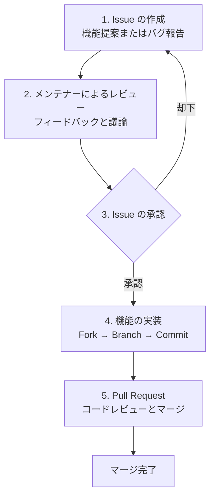

# 貢献する

Spine の機能、バグ修正、ドキュメントの改善を提案し、Pull Request を提出する手順です。実装前に GitHub Issue で変更の目的と範囲を相談してください。

## 貢献の手順

Issue の作成、メンテナーによるレビューと承認、実装、Pull Request の順に進めます。



## 1. Issue の作成

機能を実装する前に、必ず Issue を作成してください。

[Spine GitHub Issues](https://github.com/NARUBROWN/spine/issues) で新しい Issue を作成し、提案の種類に応じた情報を記載してください。

機能を提案する場合:

- 提案する機能
- その機能が必要な理由
- 想定する使用例

バグを報告する場合:

- バグの再現手順
- 期待する動作と実際の動作
- Go のバージョンや OS などの実行環境

## 2. メンテナーによるレビュー

メンテナーが Issue を確認し、意見を投稿します。必要に応じて、設計方針と実装範囲を相談します。

## 3. Issue の承認

メンテナーが Issue を承認してから実装を始めてください。承認前に作成した Pull Request は、マージされない場合があります。

## 4. Pull Request

実装が完了したら、GitHub で Pull Request を作成し、説明に関連する Issue 番号を記載してください。

```
Closes #123
```

## ドキュメントの修正と翻訳

このドキュメントサイトでは、`docs/ko` を内容の唯一の基準とします。まず韓国語のドキュメントを修正してレビューし、その後、同じ内容、コード、構造で `docs/en`、`docs/ja`、`docs/zh-Hans`、`docs/zh-Hant` に翻訳してください。

ドキュメントサイトのリポジトリルートで次のコマンドを実行すると、ドキュメントの構造と実行コードが各言語で一致しているか確認できます。

```bash
python3 scripts/check-doc-translations.py
```

ドキュメントをビルドした後は、翻訳された内部パスとセクションへのリンクも確認してください。

```bash
npm run docs:build
python3 scripts/check-doc-translations.py --check-rendered
```

## 質問がある場合

実装中に確認したいことがあれば、関連する Issue にコメントしてください。
