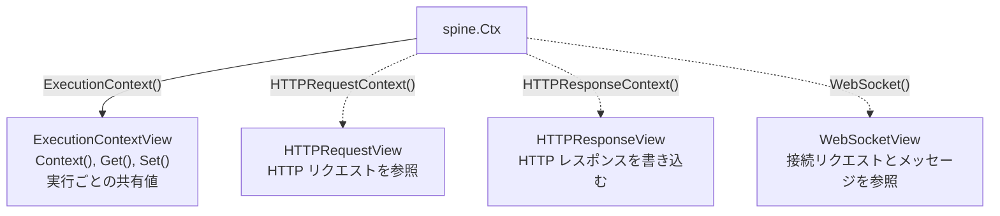

# 実行コンテキスト

::: info 0.7.5
0.7.5 API を対象とする文書です。公開タグと対応プラットフォームは[バージョン一覧](/ja/community/versions)で確認してください。
:::

## 共通の入り口 {#public-context}

HTTP ハンドラーでリクエストコンテキストが必要な場合は、任意の位置に `spine.Ctx` パラメーターを宣言します。 インターセプターは `github.com/NARUBROWN/spine/pkg/spine.Ctx` を受け取ります。ルートパッケージと併用するときは `spinectx` という別名を使います。サービスやリポジトリには `ctx.ExecutionContext().Context()` で得た標準 Go context を渡します。従来の context.Context 注入も互換対応しています。

```go
import spinectx "github.com/NARUBROWN/spine/pkg/spine"

func readRequest(ctx spinectx.Ctx) {
	execution := ctx.ExecutionContext()
	execution.Set("userID", "alice")
	value, exists := execution.Get("userID")
	goContext := execution.Context()
	request, supported := ctx.HTTPRequestContext()
	if supported {
		_ = request.Header("Authorization")
	}
	_, _, _ = value, exists, goContext
}
```

## 公開契約 {#contract}



```go
type Ctx interface {
	ExecutionContext() ExecutionContextView
	HTTPRequestContext() (HTTPRequestView, bool)
	HTTPResponseContext() (HTTPResponseView, bool)
	WebSocket() (WebSocketView, bool)
	Get(key string) (any, bool) // Deprecated
}
type ExecutionContextView interface {
	Context() context.Context
	Get(key string) (any, bool)
	Set(key string, value any)
}
```

## トランスポート別の参照 {#views}

| getter | 利用できる操作 |
| --- | --- |
| `ExecutionContext()` | Go context と実行単位の Get/Set |
| `HTTPRequestContext()` | Method, Path, Param, Query, Header, MultipartForm |
| `HTTPResponseContext()` | SetHeader, AddHeader, IsCommitted, WriteStatus/JSON/String/Bytes |
| `WebSocket()` | handshake リクエスト、ConnID、MessageType、Payload |

未対応の getter は nil, false を返します。HTTP 実行ではリクエストとレスポンスのビューを、WS handshake とメッセージでは WS ビューを提供します。イベント実行で HTTP/WS ビューを前提にしないでください。Payload と multipart ヘッダーはコピーです。

<span id="event-publishing"></span>

## 有効期間と移行 {#lifetime}

ストアはリクエストまたはメッセージごとに独立し、その実行のフックとハンドラーで共有します。すべての AfterCompletion 後に参照を解放し、以後の Get は nil, false、Set は何もしません。実行終了自体は Go context をキャンセルしません。WS handshake と後続メッセージはストアを共有しません。内部 writer の交換、Bind、SetRoute、EventBus、SenderKey は公開契約ではありません。発行には `publish.Event(ctx.ExecutionContext().Context(), event)`、送信には `ws.Send(ctx.ExecutionContext().Context(), ws.TextMessage, data)` を使います。通常の HTTP DTO 入力には入力ラッパーを使います。

[入力と DTO](/ja/learn/tutorial/2-controller) | [インターセプター](/ja/learn/tutorial/4-interceptor)

## WebSocket リクエストビュー {#websocket-request-context}

handshake の PreHandshake とメッセージのフックは spine.Ctx を受け取ります。request, ok := ctx.WebSocket() を確認し Header や Cookie を読みます。handshake の ConnID は空で、メッセージ種別と payload はまだありません。HTTPRequestContext() があるとは仮定しません。handshake と各メッセージの Set/Get は別々です。

```go
type WebSocketRequestView interface {
	Context() context.Context
	Path() string
	Header(string) string
	Headers() map[string][]string
	Query(string) string
	Queries() map[string][]string
	Cookie(string) (string, bool)
	Cookies() map[string]string
	RemoteAddr() string
	Host() string
	RequestURI() string
}
type WebSocketView interface {
	WebSocketRequestView
	ConnID() string
	MessageType() int
	Payload() []byte
}
```
