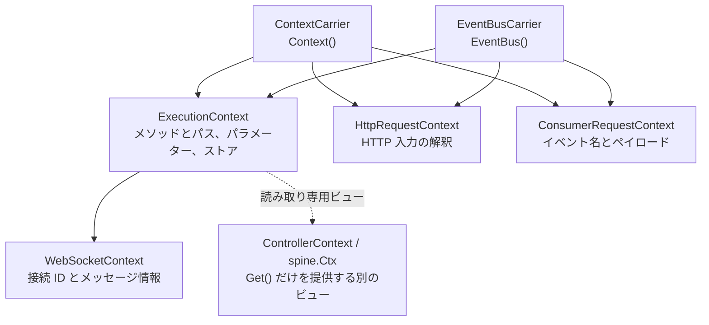

# 実行コンテキスト (ExecutionContext)

Spine はリクエストやメッセージごとに実行コンテキストを作成し、入力情報と実行状態をパイプラインに渡します。インターセプターは `core.ExecutionContext` で実行状態を読み書きし、HTTP コントローラーは意味を表す型と読み取り専用の `spine.Ctx` で必要な値だけを受け取ります。

このページの機能別 `src/user` の例は、[プロジェクト構造](/ja/learn/tutorial/1-project-structure)で `--layout legacy` を指定して作成した `my-app` を使用します。CLI `v0.4.0` の標準レイアウトは役割別の `layered-v1` です。どちらも Spine `v0.6.0` と Echo プラットフォーム `v0.1.0` を使用します。

この区別を理解すると、インターセプターが保存した値をコントローラーに渡し、HTTP、イベントコンシューマー、WebSocket で利用できる入力を判断できます。このドキュメントのインターフェースと動作は、Spine v0.6.0 を基準にしています。

アプリのハンドラー例は、[CLI で作成したプロジェクト](/ja/learn/tutorial/1-project-structure)に手動で追加する拡張です。生成された `BuildApplication` と、エラーを確認する `user.Register(app)` の呼び出しは維持してください。`core/` のインターフェースは公開契約なので、`internal/` の実装をアプリにコピーする必要はありません。

## コントローラーとインターセプターのアクセス範囲

コンテキストは、一つの大きなオブジェクトをすべてのコードに公開するための仕組みではありません。パイプラインを制御するコードとビジネスロジックで、必要なアクセス範囲を分けます。

| 使用箇所 | 受け取る型 | 利用できる機能 |
| --- | --- | --- |
| HTTP コントローラー | `context.Context` | キャンセルとタイムアウトの伝達、ドメインイベントの発行 |
| HTTP コントローラー | `pkg/spine.Ctx` | インターセプターが保存した値の参照 |
| HTTP コントローラー | `path.Int`、`query.Values`、DTO など | バインドしたリクエスト入力 |
| インターセプター | `core.ExecutionContext` | リクエスト情報の参照、ストアの読み書き、実行前後の処理 |
| HTTP 引数リゾルバー | `core.HttpRequestContext` | HTTP 本文、ヘッダー、フォームなどの入力の解釈 |
| コンシューマー引数リゾルバー | `core.ConsumerRequestContext` | イベント名とペイロードの解釈 |
| WebSocket 引数リゾルバー | `core.WebSocketContext` | 接続 ID、メッセージの型とペイロードの解釈 |

このドキュメントでの `spine.Ctx` は、ルートのアプリパッケージ `github.com/NARUBROWN/spine` ではなく、`github.com/NARUBROWN/spine/pkg/spine` の型です。同じファイルで両方のパッケージをインポートする場合は、別名で区別してください。

デフォルトの HTTP リゾルバーは、`core.ExecutionContext` や `core.HttpRequestContext` をコントローラーの引数として注入しません。コントローラーでレスポンスライターや本文のバインディングを直接扱う代わりに、入力の型と `httpx.Response[T]` の戻り値で必要な動作を表します。

## コンテキスト契約の関係

`ContextCarrier` と `EventBusCarrier` は共通機能を表します。HTTP とコンシューマーの入力契約は、この二つの契約を直接含み、WebSocket のメッセージ契約は `ExecutionContext` を拡張します。



矢印は、契約の包含関係を表します。`ControllerContext` と `spine.Ctx` は `ExecutionContext` を埋め込みません。同じストアを参照できるように、`Get()` だけを公開する別のインターフェースです。

HTTP ではカーネルの HTTPContext がプラットフォームの入力ビューを包み、`ExecutionContext` と `HttpRequestContext` を提供します。応答 writer には独立した `core.HTTPResponseContext` でアクセスします。`SetRoute` のルーティング状態はユーザーの `Set/Get` ストアと分離されます。コンシューマーは `ExecutionContext` と `ConsumerRequestContext` を実装します。

## 共通の基盤となる契約

### ContextCarrier

Go 標準の `context.Context` を渡します。キャンセル信号と期限をサービス、リポジトリ、外部 API の呼び出しに伝えるときに使います。

```go
// core/context.go
type ContextCarrier interface {
    Context() context.Context
}
```

HTTP では、リクエストの `context.Context` を使います。コントローラーが `context.Context` を引数として宣言すると、標準コンテキストリゾルバーがリクエストコンテキストを渡し、ドメインイベントの発行に必要な EventBus も関連付けます。

### EventBusCarrier

その実行に属する EventBus にアクセスします。

```go
// core/context.go
type EventBusCarrier interface {
    EventBus() EventBus
}
```

`core.EventBus` は、イベントを収集して取り出すための最小限の契約です。`publish.DomainEvent` は `github.com/NARUBROWN/spine/pkg/event/publish` に定義されています。

```go
// core/event_bus.go
type EventBus interface {
    Publish(events ...publish.DomainEvent)
    Drain() []publish.DomainEvent
}
```

コントローラーでは、通常は `EventBus()` を直接呼び出さず、受け取った `context.Context` を使って `publish.Event()` を呼び出します。具体的な使い方は、後述の [EventBus とイベント発行](#event-publishing)で説明します。

## ExecutionContext: パイプラインとインターセプターの実行状態

`core.ExecutionContext` は、パイプライン、ルーター、インターセプターが共通して使う契約です。

```go
// core/context.go
type ExecutionContext interface {
    ContextCarrier
    EventBusCarrier

    Method() string
    Path() string
    Params() map[string]string
    Header(name string) string
    PathKeys() []string
    SetRoute(params map[string]string, pathKeys []string)
    Queries() map[string][]string
    Set(key string, value any)
    Get(key string) (any, bool)
}
```

### リクエストとルーティングの情報

| メソッド | HTTP での意味 | 注意点 |
| --- | --- | --- |
| `Method()` | `GET`、`POST` などのリクエストメソッド | コンシューマーは `EVENT`、WebSocket は `WS` を返す |
| `Path()` | `/users/123` などの実際のリクエストパス | ルートパターン `/users/:id` と区別する |
| `Header(name)` | 指定したリクエストヘッダー | ヘッダーがなければ空文字列 |
| `Params()` | ルーターが抽出したパスの値 | グローバルの `PreHandle` は Spine のルーティング前に実行 |
| `PathKeys()` | ルートで宣言したパスパラメーターの順序 | `path.*` 型を順序に基づいてバインドする際に使用 |
| `Queries()` | 複数の値を保持するクエリマップ | 一つのキーに複数の値が含まれる場合がある |

たとえば、`/users/:userId/posts/:postId` ルートに `/users/123/posts/456?tag=go&tag=web` リクエストが届くと、ルーティング後に次の情報を読み取れます。

```go
ctx.Method()   // "GET"
ctx.Path()     // "/users/123/posts/456"
ctx.Params()   // {"userId": "123", "postId": "456"}
ctx.PathKeys() // ["userId", "postId"]
ctx.Queries()  // {"tag": ["go", "web"]}
```

上のコードは、インターセプターなどで読み取れる値の例です。HTTP コントローラーがこのコンテキストを直接受け取るわけではありません。

### Set() と Get(): 実行中の値の共有

インターセプターは、`Set()` で認証結果やリクエスト追跡情報を保存できます。コントローラーは、読み取り専用ビューの `Get()` で同じ値を読み取ります。

```go
// 인터셉터에서 저장
ctx.Set("auth.user", authInfo)

// 같은 실행에서 조회
value, ok := ctx.Get("auth.user")
```

`Get()` は、値とその有無を併せて返します。キーが存在しても、目的の型とは限らないため、値を使うコードで型も確認してください。ストアはリクエストまたはメッセージの実行に属するもので、グローバルキャッシュとしては使いません。

通常のマップと同様に、同時アクセスの保証は実装によって異なります。HTTP コンテキストのストアを、複数のゴルーチンから同時に読み書きできると想定しないでください。

## ControllerContext と spine.Ctx: コントローラーの読み取り専用ビュー

`core.ControllerContext` と `pkg/spine.Ctx` は、同じメソッド集合を提供します。

```go
// core/context.go
type ControllerContext interface {
    Get(key string) (any, bool)
}
```

```go
// pkg/spine/types.go
type Ctx interface {
    Get(key string) (any, bool)
}
```

デフォルトの HTTP リゾルバーは、実行コンテキストをこのビューで包んで渡します。コントローラーは `Get()` を呼び出せますが、`Set()`、`Method()`、`EventBus()` は呼び出せません。追加のメソッドを要求する独自のインターフェースに型を拡張しても、自動的にサポートされるわけではありません。

### インターセプターが保存した認証情報の読み取り

次のメソッドは、認証インターセプターが `auth.user` を保存したアプリの `UserController` に追加する例です。`context`、`github.com/NARUBROWN/spine/pkg/spine`、`pkg/path`、`pkg/httpx` をインポートします。実際のアプリでは、認証ポリシーに合わせて `authInfo` の有無と型を検査してください。

```go
// src/user/user_controller.go
func (c *UserController) GetUser(ctx context.Context, cc spine.Ctx, userId path.Int) httpx.Response[any] {
    authInfo, _ := cc.Get("auth.user")
    return httpx.Response[any]{Body: authInfo}
}
```

`core.ControllerContext` を宣言した場合も、HTTP では同じ読み取り専用ビューを受け取ります。アプリのコードでは、`spine.Ctx` で必要なアクセス範囲を表せます。認証インターセプターの作成と登録は、[インターセプターのチュートリアル](/ja/learn/tutorial/4-interceptor)を参照してください。

イベントコンシューマーと WebSocket のデフォルトのパイプラインには、`ControllerContextResolver` が登録されていません。HTTP で使える `spine.Ctx` 引数を、ほかのプロトコルのハンドラーにもそのまま宣言しないでください。

## HttpRequestContext: HTTP 入力の解釈

`core.HttpRequestContext` は、HTTP リゾルバーが個々のパラメーター、すべてのヘッダー、本文、マルチパートフォームを読み取るための契約です。`ExecutionContext` を埋め込まず、二つの基盤契約を直接含みます。

```go
// core/context.go
type HttpRequestContext interface {
    ContextCarrier
    EventBusCarrier

    Param(name string) string
    Query(name string) string
    Header(name string) string

    Params() map[string]string
    Queries() map[string][]string
    Headers() map[string][]string

    Bind(out any) error
    MultipartForm() (*multipart.Form, error)
}
```

ここでの `multipart.Form` は、Go 標準の `mime/multipart` の型です。

| メソッド | 動作 |
| --- | --- |
| `Param(name)` | 指定したパスパラメーターの値を参照 |
| `Query(name)` | 指定したクエリの最初の値を参照し、なければ空文字列を返す |
| `Header(name)` | リクエストヘッダーの値を参照 |
| `Params()` | パスパラメーターのマップを参照 |
| `Queries()` | 複数の値を保持するクエリマップを参照 |
| `Headers()` | すべてのリクエストヘッダーのマップを参照 |
| `Bind(out)` | 渡された DTO にリクエスト入力をバインド |
| `MultipartForm()` | マルチパートフォームとファイル情報を参照 |

### HTTP アダプターの動作

Spine の HTTP アダプターは Echo を使います。`Param()` は、まず Spine ルーターが保存した値を探し、なければ Echo のパスの値を確認します。`Params()` は、元のパスマップが変更されないようにコピーを返します。

一方、HTTP の `Headers()` はリクエストのヘッダーマップをそのまま返します。参照結果がすべてコピーだと想定せず、読み取り用として使ってください。

`Bind()` と `MultipartForm()` は、入力処理を Echo に委譲します。デフォルトの HTTP DTO リゾルバーは、構造体のポインターを作成して `Bind()` に渡します。アプリのコントローラーでも、次のようにポインターを宣言します。

```go
func (c *UserController) CreateUser(req *CreateUserRequest) (httpx.Response[User], error)
```

このコードはメソッドシグネチャの例で、`CreateUserRequest` と `User` はアプリで定義する型です。フォーム DTO はフィールドに `form` タグを使い、アップロードファイルは `pkg/multipart.UploadedFiles` で受け取れます。

Spine `v0.6.0` と Echo プラットフォーム `v0.1.0` は、不正な JSON や数値や真偽値のパス変換エラーに HTTP 400、未対応の本文 Content-Type に 415、本文サイズ制限の超過に 413 を返します。バインディング失敗はコントローラーの呼び出し前に発生します。業務検証のエラーと区別し、実際のリクエストで確認してください。 [実行パイプライン](/ja/learn/core-concepts/pipeline#error-responses)

## ConsumerRequestContext: イベント入力の解釈

`core.ConsumerRequestContext` は、イベント名と生のペイロードを提供します。

```go
// core/context.go
type ConsumerRequestContext interface {
    ContextCarrier
    EventBusCarrier

    EventName() string
    Payload() []byte
}
```

コンシューマーアダプターは、この契約と `ExecutionContext` の両方を実装します。HTTP リクエストではないため、共通メソッドは次のように動作します。

| メソッド | コンシューマーで返す値 |
| --- | --- |
| `Method()` | `EVENT` |
| `Path()` | イベント名 |
| `EventName()` | イベント名 |
| `Payload()` | 受信したメッセージの生のバイト列 |
| `Header(name)` | 空文字列 |
| `Params()` | `nil` |
| `PathKeys()` | `nil` |
| `Queries()` | `nil` |

デフォルトのコンシューマーリゾルバーは、`context.Context`、文字列のイベント名、`[]byte` のペイロード、構造体 DTO の値をサポートします。DTO は JSON ペイロードをデシリアライズして作成します。HTTP DTO のポインターの規則を、そのままコンシューマーに適用するわけではありません。

リゾルバーが必要とするペイロードがない場合や、JSON のデシリアライズが失敗した場合は、ハンドラーを呼び出しません。この実行失敗をメッセージの確認、再試行、dead-letter 処理にどう反映するかは、コンシューマーランタイムとメッセージ転送設定の責任です。HTTP のエラーレスポンス表をそのまま適用しないでください。

## WebSocketContext: メッセージと接続情報

`core.WebSocketContext` は、`ExecutionContext` に WebSocket のメッセージ情報を追加します。

```go
// core/context.go
type WebSocketContext interface {
    ExecutionContext

    ConnID() string
    MessageType() int
    Payload() []byte
}
```

WebSocket ランタイムは、受信したメッセージごとに実行コンテキストを作成します。`Method()` は `WS`、`Path()` は接続リクエストの実際のパスを返します。`ConnID()` は接続 ID、`MessageType()` はテキストやバイナリーなどのフレーム型、`Payload()` はそのメッセージのバイト列を返します。

デフォルトのリゾルバーは、`context.Context`、`pkg/ws.ConnectionID`、`[]byte`、構造体 DTO の値をサポートします。DTO はメッセージペイロードを JSON としてデシリアライズします。HTTP と異なり、DTO は構造体の値として受け取ります。

### 元の接続リクエストの情報

WebSocket では、HTTP upgrade 時に受け取ったヘッダー、クエリ、Cookie を、メッセージ処理中にも参照できます。そのために、別のリクエストビューを提供します。

```go
// core/context.go
type WebSocketRequestContext interface {
    ContextCarrier

    Path() string
    Header(name string) string
    Headers() map[string][]string
    Query(name string) string
    Queries() map[string][]string
    Cookie(name string) (string, bool)
    Cookies() map[string]string
    RemoteAddr() string
    Host() string
    RequestURI() string
}
```

```go
type WebSocketHandshakeContext interface {
    WebSocketRequestContext
}

type WebSocketMessageContext interface {
    WebSocketContext
    WebSocketRequestContext
}
```

デフォルトの WebSocket 実装は、upgrade リクエストの情報をコピーして保持します。`Headers()`、`Queries()`、`Cookies()` もコピーを返すため、参照結果を変更しても、保持しているリクエスト情報は変わりません。これらの値は接続時の情報であり、メッセージごとに新しい HTTP リクエストを受け取るわけではありません。

| 必要な値 | 使う契約 |
| --- | --- |
| メッセージペイロードと接続 ID | `core.WebSocketContext` |
| upgrade 前のヘッダー、クエリ、Cookie の検査 | `core.WebSocketHandshakeContext` |
| メッセージ処理と元のリクエスト情報の両方の参照 | `core.WebSocketMessageContext` |

デフォルト実装の `Header()` と `Queries()` は、このリクエスト情報を参照します。値がない場合もありますが、WebSocket だからといって常に空の値を返すわけではありません。独自の `WebSocketContext` 実装が追加のリクエストビューもサポートしていると想定せず、型を確認してください。

```go
// WebSocket 메시지를 처리하는 인터셉터 안에서 조회하는 예
if requestCtx, ok := ctx.(core.WebSocketMessageContext); ok {
    origin := requestCtx.Header("Origin")
    _ = origin
}
```

このコードは、コントローラーへの引数注入の例ではありません。インターセプターが受け取った `core.ExecutionContext` で、追加機能をサポートしているか確認するコードです。

### 接続前の検査とメッセージの前処理

接続前に認証や権限の検査が必要な場合は、任意の契約である `core.WebSocketHandshakeInterceptor` を実装します。

```go
type WebSocketHandshakeInterceptor interface {
    PreHandshake(ctx WebSocketHandshakeContext, meta HandlerMeta) error
}
```

WebSocket に適用するために登録した `core.Interceptor` がこの契約も実装している場合、ランタイムは先に接続スロットを予約し、HTTP upgrade の前に `PreHandshake` を呼び出します。認証待ちの接続も、接続数の上限に含めます。通常の `core.Interceptor.PreHandle` は、接続後にメッセージを処理するたびに呼び出します。接続自体を拒否するための検査と、メッセージごとの前処理を区別して書いてください。

## プロトコル別の入力比較

同じ実行パイプラインを使っていても、コンテキストの意味とデフォルトの引数型は異なります。

| 項目 | HTTP | イベントコンシューマー | WebSocket |
| --- | --- | --- | --- |
| 実行単位 | HTTP リクエスト一件 | 受信イベント一件 | 受信メッセージ一件 |
| `Method()` | HTTP メソッド | `EVENT` | `WS` |
| `Path()` | 実際のリクエストパス | イベント名 | 接続リクエストの実際のパス |
| `Header()` | リクエストヘッダー | 空文字列 | 保持した upgrade リクエストヘッダー |
| `Queries()` | リクエストクエリ | `nil` | 保持した upgrade リクエストクエリ |
| 本文入力 | HTTP の `Bind()` | イベントの `Payload()` | メッセージの `Payload()` |
| デフォルトの DTO 型 | 構造体のポインター | 構造体の値 | 構造体の値 |
| `context.Context` 引数 | サポート | サポート | サポート |
| `spine.Ctx` 引数 | サポート | デフォルトでは未登録 | デフォルトでは未登録 |

プロトコル固有の機能は、該当するインターフェースへの型アサーションで対応を確認してから使います。`ExecutionContext` があっても、HTTP の `Bind()` や WebSocket の `ConnID()` をすべて呼び出せるわけではありません。

## ストアのキーと実行タイミング

ルーティング情報と HTTP 応答 writer は、ユーザーの Set/Get ストアとは独立した型付き契約で管理します。ルーターは `SetRoute` でパス値を保存し、HTTP パイプラインは `HTTPResponseContext` で writer を選択します。

| API | 値の型 | 用途 |
| --- | --- | --- |
| `Params()` | `map[string]string` | ルーターが抽出したパスパラメーター |
| `PathKeys()` | `[]string` | パスパラメーターの宣言順序 |
| `HTTPResponseContext.ResponseWriter()` | `core.ResponseWriter` | HTTP レスポンスの書き込みとバッファー処理 |

`HTTPResponseContext.ResponseWriter()` は HTTP 応答 writer を返します。パイプラインは応答準備中に staging writer に置き換え、送信前に復元します。コントローラーは通常、writer に直接アクセスせず `httpx.Response[T]`、`httpx.Redirect`、`httpx.Binary` を返します。

コンテキストから読み取れる値は、実行タイミングにも依存します。グローバルの `PreHandle` はルーティング前、ルートの `PreHandle` はルーティングと引数バインディングの後に実行します。ストアに値が必要になるタイミングと、その値を作成する段階を併せて設計する必要があります。

## EventBus とイベント発行 {#event-publishing}

コントローラーが `context.Context` を宣言すると、標準コンテキストリゾルバーがその実行の EventBus を関連付けて渡します。コントローラーは、このコンテキストでドメインイベントを収集できます。

次の抜粋の `publish` は、`github.com/NARUBROWN/spine/pkg/event/publish` からインポートします。`OrderCreated` は、アプリで定義し、`Name() string` と `OccurredAt() time.Time` を実装するイベント型です。

```go
// src/user/user_controller.go
func (c *UserController) CreateOrder(ctx context.Context, orderId path.Int) httpx.Response[string] {
    // context.Context에 연결된 EventBus로 이벤트를 수집합니다.
    publish.Event(ctx, OrderCreated{
        OrderID: orderId.Value,
        At:      time.Now(),
    })

    return httpx.Response[string]{Body: "OK"}
}
```

`publish.Event()` の呼び出しだけで、外部ブローカーへの送信が完了するわけではありません。関連付けられた EventBus にイベントを集め、イベントディスパッチフックが登録されていれば、成功レスポンスのシリアライズと検証の後にイベントを取り出してディスパッチャーに渡します。フックの登録には、イベントパブリッシャーの構成が必要です。

ハンドラーがエラーを返した場合や、成功レスポンスの準備が失敗した場合は、ディスパッチフックを実行しません。ディスパッチが失敗すると、そのエラーをパイプラインの実行エラーとして扱います。ディスパッチフックは `BeforeResponse` と実際の HTTP レスポンス送信より先に実行するため、イベントを収集またはディスパッチしただけで、トランザクションのコミットやレスポンス送信が完了したと判断しないでください。

イベントの発行、トランザクションの終了処理、レスポンスの書き込みの順序は、[実行パイプライン](/ja/learn/core-concepts/pipeline)で確認できます。
