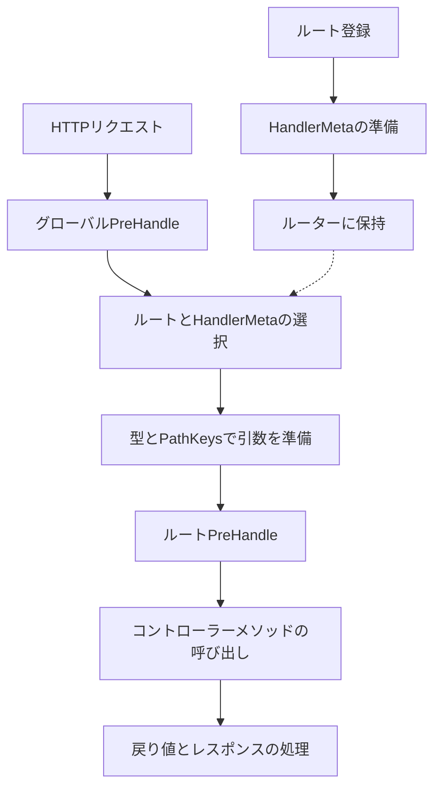

# ハンドラーメタデータ (HandlerMeta)

::: warning v0.7.0 Preview 入力 API の移行
このページの既存 API の説明と例は安定版 `v0.6.5` を対象としています。`v0.7.0-preview.1` から入力元別の Path、Query、Header DTO を利用できます。`query.Values`、`header.Values` とその生成および取得 API、`query.Pagination`、`path.Int`、`path.String`、`path.Boolean` は Deprecated です。

新しい DTO 方式は `v0.6.5` にそのまま適用できません。Preview でも、同じハンドラーで新しい DTO と Deprecated な入力を混在させると起動時に拒否されます。既存のボディ DTO とコンテキストは、どちらの方式とも併用できます。

対象バージョンと移行例は [Preview ハンドラー入力の移行](/ja/learn/migration/v0.7.0-preview)、仕様の設定は [ランタイム OpenAPI](/ja/reference/api/openapi)を参照してください。
:::

`core.HandlerMeta`は、リクエストに対応するコントローラーメソッドを実行するために必要な情報です。コントローラーの型、メソッド、パスパラメーターの順序、ルートインターセプターを保持します。アプリでは`app.Route`でハンドラーを登録し、インターセプターで`HandlerMeta`を読み取って実行対象を確認できます。

このページの機能別 `src/user` の例は、[プロジェクト構造](/ja/learn/tutorial/1-project-structure)で `--layout legacy` を指定して作成した `my-app` を使用します。CLI `v0.4.2` の標準レイアウトは役割別の `layered-v1` です。どちらも Spine `v0.6.5` と Echo プラットフォーム `v0.1.0` を使用します。

このページでは、Spine v0.6.5の公開型とHTTPの実行フローを基準に説明します。アプリでメタデータ生成関数やルーターの内部実装を直接作成する必要はありません。

## CLIプロジェクトでの配置

[CLIプロジェクト構造](/ja/learn/tutorial/1-project-structure)で作成した`example.com/my-app`を基準に、ユーザールートは`src/user/user_route.go`の`Register(app)`に宣言します。生成されるハンドラーは`(*UserController).Get`で、パスは`GET /user/:id`です。`internal/application/application.go`の`BuildApplication`は`user.Register(app)`のエラーを確認して返し、生成された`main.go`で検証と実行を進めます。

```go
// src/user/user_route.go の Register 内から抜粋
app.Route(
    "GET",
    "/user/:id",
    (*UserController).Get,  // メソッド式
)
```

以下の`GetUser`、管理者ハンドラー、認証インターセプターは、概念を説明するためのアプリ拡張例です。CLIが生成する`Get`とは別のメソッドなので、そのまま追加するには対応する型とメソッドも実装する必要があります。インターセプターの完全な実装と登録方法は、[インターセプターチュートリアル](/ja/learn/tutorial/4-interceptor)を参照してください。

## HandlerMetaのフィールド

`core.HandlerMeta`のフィールドは次のとおりです。`reflect`の型を使ってコントローラーとメソッドの情報を表します。

```go
// core/handler_meta.go
type HandlerMeta struct {
    // コントローラーの型 (Container Resolve の対象)
    ControllerType reflect.Type

    // 呼び出すメソッド
    Method reflect.Method

    // ルートで宣言されたパスパラメーターのキーの順序
    PathKeys []string

    // ハンドラーに適用されたインターセプター
    Interceptors []Interceptor
}
```

| フィールド | 型 | 役割 |
| --- | --- | --- |
| `ControllerType` | `reflect.Type` | 依存性コンテナーから取得するコントローラーのポインター型 |
| `Method` | `reflect.Method` | 呼び出すメソッドの名前、シグネチャ、関数情報 |
| `PathKeys` | `[]string` | ルートに宣言されたパスパラメーター名の順序 |
| `Interceptors` | `[]core.Interceptor` | そのルートに適用するインターセプターの一覧 |

`ControllerType`が`*UserController`で、`Method.Name`が`GetUser`の場合、パイプラインはコンテナーから`*UserController`のインスタンスを取得してから`GetUser`を呼び出します。

```go
meta.ControllerType  // reflect.Type of *UserController
```

```go
meta.Method.Name           // "GetUser"
meta.Method.Type           // func(*UserController, path.Int) (httpx.Response[User], error)
meta.Method.Func           // 呼び出し可能な reflect.Value
```

`PathKeys`は実際のリクエスト値ではなく、パスパラメーターの名前です。たとえば`/users/:userId/orders/:orderId`では`userId`、`orderId`の順序を保持し、この順序に従ってハンドラーの`path`型引数を対応付けます。リクエストごとに変わるパスパラメーターの値は、リクエストコンテキストから読み取ります。

`Interceptors`にはルートインターセプターだけが入ります。`app.Interceptor`で登録したグローバルインターセプターは、パイプラインが別に管理します。

```go
meta.Interceptors  // []core.Interceptor (ルート単位)
```

## メソッド式でハンドラーを登録する

ルートには、`(*UserController).GetUser`のような**メソッド式**を渡します。この式は特定のコントローラーインスタンスに結び付いていない関数で、最初の引数としてコントローラーのポインターを受け取ります。

```go
// メソッド式の実際の型
func(*UserController, path.Int) (httpx.Response[User], error)
//   ↑ receiver が最初の引数に変換される
```

Spineはこの情報から、コントローラーの型と呼び出すメソッドを確認します。コントローラーのインスタンスは、アプリのコンストラクタ登録に従って依存性コンテナーから取得します。

次の登録形式を区別してください。

| 登録形式 | 使用可否 | 説明 |
| --- | --- | --- |
| `(*UserController).GetUser` | 使用する | 最初の引数が`*UserController`であるメソッド式 |
| `UserController.GetUser` | 使用しない | 値型を最初の引数に取るため、ポインター型という条件を満たさない |
| `ctrl.GetUser` | 使用しない | 特定のインスタンスに結び付いたメソッド値なので、コントローラー引数を別に受け取らない |
| 通常の関数またはクロージャー | 使用しない | コントローラーの型とメソッドを確認する登録形式に合わない |

この条件は、ルートに渡す式の形式に関するものです。アプリのコントローラーはチュートリアルのようにポインターレシーバーで作成し、`(*Controller).Method`の形式で登録してください。

## ルートインターセプターを指定する

`route.WithInterceptors`は、そのルートに適用するインターセプターを受け取ります。`github.com/NARUBROWN/spine/pkg/route`をインポートして使用します。

```go
app.Route(
    "GET",
    "/users/:id",
    (*UserController).GetUser,
    route.WithInterceptors(&AuthInterceptor{}),
)
```

インターセプターを渡す方法は2つあります。

| 渡す値 | 生成方法 |
| --- | --- |
| `&AuthInterceptor{}` | アプリが作成したインスタンスをそのまま使用 |
| `(*AuthInterceptor)(nil)` | ブートストラップ中にコンテナーでそのポインター型のインスタンスを生成 |

依存性の注入が必要なインターセプターには、型付きのnilポインターを使用できます。この場合、インターセプターのコンストラクタと必要な依存性を登録する必要があります。型情報のない`nil`を渡すと、ルートインターセプターの登録に失敗します。

```go
// src/user/user_route.go の Register 内から抜粋
app.Route("GET", "/users/:id", (*UserController).GetUser)

// ルートインターセプターと併用
app.Route("GET", "/admin/users/:id", (*AdminController).GetUser,
    route.WithInterceptors((*AuthInterceptor)(nil)),  // nil ポインター → Container から Resolve
)
```

グローバルインターセプターとルートインターセプターを併用することもできます。グローバルインターセプターはすべてのリクエストに適用され、ルートインターセプターはそのルートだけに適用されます。

```go
// グローバル: すべてのリクエストに適用 (ルーティング前に実行)
app.Interceptor(&CORSInterceptor{})

// ルート: 特定のハンドラーにのみ適用 (ルーティング後、Controller 呼び出し前に実行)
app.Route("GET", "/admin/:id", (*AdminController).Get,
    route.WithInterceptors(&AuthInterceptor{}),
)
```

## インターセプターで実行対象を確認する

インターセプターの`PreHandle`、`PostHandle`、`BeforeResponse`、`AfterCompletion`は`HandlerMeta`を受け取ります。ログの記録やハンドラーごとのポリシー適用に、この情報を利用できます。

グローバルの`PreHandle`はルーティング前に実行されるため、空の`HandlerMeta`を受け取ります。このとき`ControllerType`はnilで、`Method.Name`も空です。ルートが決まった後は実際のハンドラーメタデータが渡されますが、ルーティング自体に失敗したリクエストでは実行対象が存在しない場合があります。フィールドにアクセスする前に確認してください。

次のコードは、`PreHandle`だけを抜粋した例です。`core`と`log`をインポートして使用します。登録可能なインターセプターには、残りの3つのメソッドも実装する必要があります。

```go
// src/interceptor/logging_interceptor.go
func (i *LoggingInterceptor) PreHandle(ctx core.ExecutionContext, meta core.HandlerMeta) error {
    controllerName := "<unresolved>"
    if meta.ControllerType != nil {
        controllerName = meta.ControllerType.String()
    }
    log.Printf(
        "[REQ] %s %s -> %s.%s",
        ctx.Method(),
        ctx.Path(),
        controllerName,
        meta.Method.Name,            // "GetUser"
    )
    return nil
}
```

このように、`core.ExecutionContext`はインターセプターからリクエスト情報にアクセスするために使用します。HTTPコントローラーが同じ型を引数に取る必要はありません。コントローラーでは、[型に基づく引数の注入](/ja/learn/tutorial/2-controller)に対応するリクエスト型を宣言してください。

## 登録時とリクエスト実行時

ブートストラップでは、ルート宣言から実行情報を準備します。

1. `app.Route`に宣言したハンドラーから、コントローラーの型とメソッドを確認します。
2. ルートインターセプターを準備し、`HandlerMeta`に関連付けます。
3. 完全なパスとパスパラメーターの順序をルーターに登録します。
4. 登録されたコントローラーと依存性を事前に生成します。

ハンドラーの形式が誤っている場合や、コントローラー、インターセプターの依存性を生成できない場合は、サーバーの起動処理で失敗します。生成されたプロジェクトのエラーを返す経路を維持し、この失敗を呼び出し元に伝えてください。

リクエストを受け取ると、準備したメタデータを次の順序で使用します。

1. グローバルインターセプターの`PreHandle`を実行します。
2. リクエストに対応するルートを探し、`HandlerMeta`を取得します。
3. メソッドのパラメーター型と`PathKeys`に従って引数を準備します。
4. ルートインターセプターの`PreHandle`を実行します。
5. コントローラーのインスタンスを取得し、メソッドを呼び出します。
6. 戻り値の処理とレスポンス前の処理を行い、レスポンスを送信します。

正常に実行された場合のフローは次のとおりです。エラーやインターセプターからの中断要求が発生すると、後続の段階が省略される場合があります。



成功したリクエストの`PostHandle`は、ルートインターセプター、グローバルインターセプターの順に実行し、それぞれの一覧内では登録の逆順で呼び出します。`BeforeResponse`と`AfterCompletion`のエラー処理と実行条件は、[インターセプターチュートリアル](/ja/learn/tutorial/4-interceptor)で確認してください。

## エラーの確認箇所

| 状況 | 確認する内容 |
| --- | --- |
| ハンドラーの登録に失敗 | `(*Controller).Method`の形式か、対象のメソッドが見つかるかを確認 |
| コントローラーの生成に失敗 | コントローラーのコンストラクタと、そのコンストラクタが受け取る依存性を登録したか確認 |
| ルートインターセプターの生成に失敗 | 型付きのnilポインターを使用したか、必要なコンストラクタを登録したか確認 |
| リクエスト引数の準備に失敗 | ハンドラーの引数型がサポートされているか、パスパラメーターの宣言順序が正しいか確認 |
| 一致するルートがない | HTTPメソッド、パス、グローバルパスプレフィックスを確認。標準のHTTP処理では404エラーレスポンスを返す |

`HandlerMeta`はハンドラーの実行対象を表します。リクエストデータの変換は引数リゾルバーが、実際の戻り値からHTTPレスポンスへの変換は戻り値ハンドラーが担当します。それぞれの役割を直接置き換えようとする前に、ルート宣言とコントローラーのシグネチャを確認してください。
