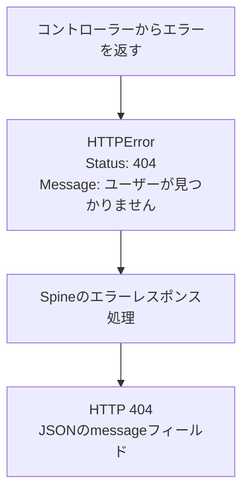

# httperrパッケージ

::: info
このページは Spine `v0.7.1` のエラー処理を説明します。従来の入力からの変更は[入力の移行](/ja/learn/migration/v0.7.1-preview)、文書設定は [OpenAPI](/ja/reference/api/openapi)を参照してください。
:::

`httperr`は、HTTPステータスコードとクライアントに伝えるエラーメッセージを保持するパッケージです。コントローラーから`httperr.NotFound("사용자를 찾을 수 없습니다")`のようにエラーを返すと、SpineがステータスコードとJSONエラーレスポンスに変換します。コントローラーでEchoなどのレスポンスオブジェクトを直接扱う必要はありません。

このページでは、Spine v0.7.1の`github.com/NARUBROWN/spine/pkg/httperr`を基準に説明します。

## CLIプロジェクトで使用する

以下のコントローラーは、[CLIで生成したプロジェクト](/ja/learn/tutorial/1-project-structure)に追加するコード断片です。`httpx`、`httperr`、`input`は、それぞれ`github.com/NARUBROWN/spine/pkg`配下のパッケージです。コントローラーのコンストラクタとルートを、`BuildApplication`で使用する登録経路に接続してください。`User`、リポジトリ、サービスなどの業務用の型は、アプリで定義します。

成功値は`httpx.Response[T]`で包み、失敗時には空のレスポンス値とエラーを一緒に返します。リクエスト本文を受け取る例のDTOは、`*PaymentRequest`のようにポインターで宣言します。

```go
func (c *UserController) GetUser(userId input.Path[int64]) (httpx.Response[User], error) {
    if *userId <= 0 {
        return httpx.Response[User]{}, httperr.BadRequest("유효하지 않은 사용자 ID입니다")
    }

    user, err := c.repo.FindByID(*userId)
    if err != nil {
        return httpx.Response[User]{}, httperr.NotFound("사용자를 찾을 수 없습니다")
    }

    return httpx.Response[User]{Body: user}, nil
}
```

このメソッドを`GET /users/:id`に登録した場合、次のように応答します。この例では、リポジトリの検索エラーをすべて404として処理すると仮定しています。実際のアプリでは、検索結果がない場合とデータベース障害を区別してステータスコードを選んでください。

```text
# 不正な ID
GET /users/-1
→ 400 {"message": "유효하지 않은 사용자 ID입니다"}

# 存在しないユーザー
GET /users/999
→ 404 {"message": "사용자를 찾을 수 없습니다"}

# 正常
GET /users/123
→ 200 {"id": 123, "name": "john"}
```



## HTTPErrorのフィールド

`HTTPError`はGoの`error`インターフェースを実装し、`Error()`は`Message`を返します。

```go
// pkg/httperr/types.go
type HTTPError struct {
    Status  int    // HTTP ステータスコード
    Message string // エラーメッセージ
    Cause   error  // 原因となるエラー (任意)
}

// error インターフェースを実装
func (e *HTTPError) Error() string {
    return e.Message
}
```

| フィールド | 型 | 用途 |
| --- | --- | --- |
| `Status` | `int` | クライアントに送信するHTTPエラーステータスコード |
| `Message` | `string` | JSONレスポンスの`message`フィールドに送信するメッセージ |
| `Cause` | `error` | アプリが保持する原因エラー。JSONレスポンスには含まれない |

ヘルパー関数は`error`インターフェース型を返しますが、実際の値は`*httperr.HTTPError`です。`errors.As`でこの型を取得できます。`fmt.Errorf("문맥: %w", err)`のようにエラーをラップしても、Spineは内部の`HTTPError`を探し、そのステータスコードと`Message`を使用します。

`Message`はクライアントにそのまま渡されます。SQL、秘密の値、内部パスのように公開すべきでない情報をメッセージに含めず、原因エラーやログに保持してください。

## 標準のヘルパー関数

Spine v0.7.1は、次の4つのヘルパーを提供します。すべて`msg string`を受け取り、`error`を返します。

| 関数 | ステータスコード | 使用する状況 |
| --- | --- | --- |
| `BadRequest(msg)` | 400 | リクエスト値がAPIの条件を満たさない |
| `Unauthorized(msg)` | 401 | 認証情報がない、または認証に失敗した |
| `NotFound(msg)` | 404 | リクエストされたリソースが見つからない |
| `InternalServerError(msg)` | 500 | サーバー内部のエラーを明示的なメッセージで応答する必要がある |

### 不正なリクエスト値

`BadRequest`は、型変換後にも必要な業務上の条件を検査する場合に使用できます。

```go
func BadRequest(msg string) error {
    return &HTTPError{Status: 400, Message: msg}
}
```

```go
if *userId <= 0 {
    return httpx.Response[User]{}, httperr.BadRequest("유효하지 않은 사용자 ID입니다")
}
```

### 認証の失敗

`Unauthorized`は、認証が必要な場合や認証に失敗した場合に使用します。認証済みのユーザーに必要な権限がない場合は、以下の拡張例のように403ステータスコードを選択できます。

```go
func Unauthorized(msg string) error {
    return &HTTPError{Status: 401, Message: msg}
}
```

```go
if !c.auth.IsValid(token) {
    return httpx.Response[User]{}, httperr.Unauthorized("인증이 필요합니다")
}
```

### リソースがない場合

`NotFound`は、リクエストされたリソースがない場合に使用します。

```go
func NotFound(msg string) error {
    return &HTTPError{Status: 404, Message: msg}
}
```

```go
user, err := c.repo.FindByID(id)
if err != nil {
    return httpx.Response[User]{}, httperr.NotFound("사용자를 찾을 수 없습니다")
}
```

### サーバー内部のエラー

`InternalServerError`は、ステータスコード500と指定したメッセージを返します。通常の`error`をそのまま返す場合とは異なり、このメッセージはクライアントに公開されます。

```go
func InternalServerError(msg string) error {
    return &HTTPError{Status: 500, Message: msg}
}
```

```go
result, err := c.externalService.Call()
if err != nil {
    return httpx.Response[Result]{}, httperr.InternalServerError("외부 서비스 호출에 실패했습니다")
}
```

## コントローラーの戻り値とエラーレスポンス

Spineは、コントローラーの戻り値からnilではないエラーを先に探します。エラーがある場合、成功値をレスポンスとして処理しません。

| 戻り値 | 標準のHTTP処理 |
| --- | --- |
| `httpx.Response[T]`、nilエラー | 成功値を処理 |
| `httpx.Response[T]`、`httperr.NotFound(...)` | 成功値の代わりに404エラーレスポンス |
| `httpx.Response[T]`、通常の`error` | 成功値の代わりに500エラーレスポンス |
| `error`だけを返し、値がnil | エラーレスポンスを作成しない |

JSONの成功値は、`httpx.Response[T]`に入れて返してください。リダイレクトとバイナリレスポンスには、それぞれ`httpx.Redirect`、`httpx.Binary`を使用します。任意のDTOを返すことと、HTTPの成功レスポンス型を返すことは異なります。

エラーレスポンスの本文は、`{"message":"..."}`形式です。標準処理の違いは次のとおりです。

| エラーの種類 | ステータスコード | `message` |
| --- | --- | --- |
| `*httperr.HTTPError` | `Status`に指定したエラーステータスコード | `Message` |
| `HTTPError`を`%w`でラップしたエラー | 内部の`HTTPError`のステータスコード | 内部の`HTTPError`の`Message` |
| 通常の`error` | 500 | `"Internal server error"` |

通常のエラーの`Error()`文字列は、標準のエラーレスポンスには公開しません。クライアントが知る必要のある失敗条件は`httperr`で明示し、詳細な原因はログで確認してください。

## 業務ルールの検証

リクエスト本文を受け取った後も、金額、上限、残高のようにアプリが定めた条件を検査する必要があります。それぞれの失敗分岐でエラーを返すと、成功レスポンスを作成せずにそのエラーを処理します。

```go
func (c *PaymentController) Process(req *PaymentRequest) (httpx.Response[Receipt], error) {
    if req.Amount <= 0 {
        return httpx.Response[Receipt]{}, httperr.BadRequest("결제 금액은 0보다 커야 합니다")
    }

    if req.Amount > 10000000 {
        return httpx.Response[Receipt]{}, httperr.BadRequest("1회 결제 한도를 초과했습니다")
    }

    balance, err := c.wallet.GetBalance(req.UserID)
    if err != nil {
        return httpx.Response[Receipt]{}, httperr.NotFound("지갑을 찾을 수 없습니다")
    }

    if balance < req.Amount {
        return httpx.Response[Receipt]{}, httperr.BadRequest("잔액이 부족합니다")
    }

    receipt, err := c.processPayment(req)
    if err != nil {
        return httpx.Response[Receipt]{}, err
    }
    return httpx.Response[Receipt]{Body: receipt}, nil
}
```

この例の`PaymentRequest`、`Receipt`、ウォレットの検索と決済処理は、アプリが実装します。ウォレットが見つからない場合と検索システムの障害を区別する責任も、アプリにあります。`c.processPayment`が通常のエラーを返すと、クライアントは標準の500メッセージを受け取ります。

## エラーだけを返すハンドラー

成功レスポンスの本文が不要なメソッドは、`error`だけを返すことができます。

```go
func (c *UserController) DeleteUser(userId input.Path[int64]) error {
    exists, err := c.repo.Exists(*userId)
    if err != nil {
        return err
    }
    if !exists {
        return httperr.NotFound("사용자를 찾을 수 없습니다")
    }

    if err := c.repo.Delete(*userId); err != nil {
        return err
    }

    return nil  // 成功時は nil を返す
}
```

nilを返すと、エラーレスポンスは作成しません。この形式だけでは、特定の成功ステータスコードを指定しません。削除の成功時に204などの明示的なステータスコードが必要な場合は、`httpx`のレスポンス型を使用してください。

ユーザーが存在しない場合は 404 を返し、リポジトリの障害はそのまま返します。アプリのエラー種別に応じて状態コードと再試行ポリシーを決めてください。

## その他のエラーステータスコードを使用する

標準のヘルパーにないステータスコードは、`HTTPError`を直接作成して使用できます。次の関数はアプリが定義する例であり、`httperr`が提供する関数ではありません。

```go
// HTTPError を直接生成
func Forbidden(msg string) error {
    return &httperr.HTTPError{Status: 403, Message: msg}
}

func Conflict(msg string) error {
    return &httperr.HTTPError{Status: 409, Message: msg}
}

func UnprocessableEntity(msg string) error {
    return &httperr.HTTPError{Status: 422, Message: msg}
}

func TooManyRequests(msg string) error {
    return &httperr.HTTPError{Status: 429, Message: msg}
}
```

エラーステータスコードには、400から599までの値を使用してください。レスポンスを書き込む際にステータスコードの有効性も検査するため、成功やリダイレクトのステータスを`HTTPError.Status`に入れてフローを制御しないでください。

## 原因エラーの保持とログの記録

`Cause`を使用すると、クライアントに表示するメッセージと内部の原因を一緒に保持できます。次の`WithCause`は、アプリが定義するヘルパーです。

```go
func WithCause(status int, msg string, cause error) error {
    return &httperr.HTTPError{
        Status:  status,
        Message: msg,
        Cause:   cause,
    }
}

// 使用例
user, err := c.repo.FindByID(id)
if err != nil {
    return httpx.Response[User]{}, WithCause(404, "사용자를 찾을 수 없습니다", err)
}
```

`HTTPError.Unwrap()` は `Cause` を返します。`errors.Is` と `errors.As` で原因の連鎖を調べるか、`Cause` を直接参照できます。原因エラーは JSON レスポンスに含まれません。

インターセプターの`AfterCompletion`では、リクエスト終了後に原因を記録できます。次のコードは、このメソッドだけを抜粋した例で、`core`、`httperr`、`errors`、`log`パッケージを使用します。登録可能な実装には、`PreHandle`、`PostHandle`、`BeforeResponse`も必要です。

```go
func (i *LoggingInterceptor) AfterCompletion(ctx core.ExecutionContext, meta core.HandlerMeta, err error) {
    if err != nil {
        var httpErr *httperr.HTTPError
        if errors.As(err, &httpErr) && httpErr.Cause != nil {
            log.Printf("[ERR] %s %s: %s (cause: %v)",
                ctx.Method(), ctx.Path(), httpErr.Message, httpErr.Cause)
        }
    }
}
```

## 実行中のエラーとレスポンス完了後

コントローラーが返したエラーのほかにも、ルーティング、引数の変換、コントローラーの呼び出し、レスポンスの処理中にエラーが発生する場合があります。Spineは、HTTPの実行フローでこれらのエラーを最終的なエラーレスポンスに変換します。

| 状況 | 標準の動作 |
| --- | --- |
| 一致するルートがない | 404エラーレスポンス |
| 実行中に`HTTPError`が発生 | 指定されたエラーステータスコードとメッセージで応答 |
| 選択した検証器のDTO規則違反 (`validation.Error`) | `message` と `fields` を含む400応答 |
| 通常の実行エラーが発生 | 500、`"Internal server error"`で応答 |
| リクエスト本文のサイズ制限を超過 | 413、`"Request entity too large"`で応答 |
| 実際のレスポンスがすでに書き込まれている | 追加のエラーレスポンスを書かず、二重応答を防ぐ |

Spine v0.7.1は、レスポンス前の処理を終えてから、準備したレスポンスを実際の転送層に反映します。`BeforeResponse`でエラーが発生すると、準備中の成功レスポンスがエラーレスポンスに変わる場合があります。`AfterCompletion`はレスポンス処理の後に実行されるため、この段階では新たなエラーレスポンスを作成しようとせず、エラーと転送結果を記録してください。

エラーはGoの戻り値で伝えてください。`panic`を、通常の入力検証や業務上の失敗を表す手段として使用しないでください。インターセプターによる中断と終了処理は、[インターセプターチュートリアル](/ja/learn/tutorial/4-interceptor)を参照してください。
