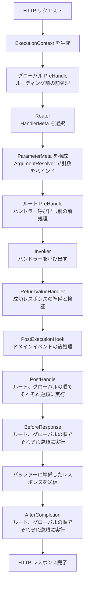

# 実行パイプライン

::: info
従来の生成関数とメソッド式は互換性のため維持されます。コールバックは[コントローラーの移行](/ja/learn/migration/preview-controller-routes)、入力制約は[入力の移行](/ja/learn/migration/v0.7.1-preview)、文書設定は [OpenAPI](/ja/reference/api/openapi)を参照してください。
:::

Spine の実行パイプラインは、リクエストを受け取ってハンドラーを選び、引数をバインドし、戻り値からレスポンスを作る流れです。インターセプターを実行するタイミングや、エラーが発生したときにどの段階まで処理が進むかを理解するための基準になります。

このドキュメントでは、Spine v0.7.1 の HTTP の実行順序を説明します。HTTP、イベントコンシューマー、WebSocket は同じパイプライン実装を使いますが、入力を解釈するリゾルバーとレスポンス処理の構成は異なります。

コントローラーの例は、[CLI で生成したプロジェクト](/ja/learn/tutorial/1-project-structure)に追加するコードです。リクエスト DTO はポインターで受け取り、通常の成功レスポンスは `github.com/NARUBROWN/spine/pkg/httpx` の `httpx.Response[T]` で返します。コンストラクタとルートは `BuildApplication` で登録します。

## HTTP リクエストの実行順序

正常なリクエストは次の順序で処理します。各インターセプターの `PreHandle` は登録順に、後処理メソッドは逆順に実行します。



ハンドラーが返した成功レスポンスは、すぐには送信しません。パイプラインはバッファーにレスポンスを準備し、後処理と `BeforeResponse` が終わってから実際の HTTP レスポンスに書き込みます。途中でエラーが発生した場合は、送信するレスポンスをエラーレスポンスに変更できます。

## リクエストコンテキストの生成

HTTP アダプターはリクエストごとに `core.ExecutionContext` を作成します。パイプラインはこのオブジェクトでリクエストのメソッドとパスを読み取り、インターセプターが保存した値を共有し、リクエストに属するイベントを収集します。

同じコンテキストを使っていても、各コンポーネントがアクセスできる範囲は異なります。

| コンポーネント | コンテキストの使い方 |
| --- | --- |
| ルーター | メソッドとパスからハンドラーを探し、パスパラメーターを保存 |
| インターセプター | リクエスト情報の参照、実行状態の保存、レスポンス前後の処理 |
| 引数リゾルバー | コンテキストからコントローラーの引数を生成 |
| 戻り値ハンドラー | コンテキストに関連付けられたレスポンスライターでレスポンスを準備 |
| コントローラー | 意味を表す型、`context.Context`、読み取り専用の `spine.Ctx` で必要な値だけを受け取る |

コントローラーには `core.ExecutionContext` を直接注入しません。インターセプターが保存した値をコントローラーで読み取る場合は、`pkg/spine.Ctx` を使います。メソッドごとのアクセス範囲は[実行コンテキスト](/ja/learn/core-concepts/execution-context)で説明します。

## グローバルインターセプター: ルーティング前の処理

`app.Interceptor()` で登録したグローバルインターセプターの `PreHandle` を最初に実行します。まだハンドラーを選んでいないため、この呼び出しには空の `core.HandlerMeta{}` を渡します。

この段階は、CORS プリフライトのようにルートを選ぶ前に処理する必要がある作業に使います。たとえば CORS インターセプターは、許可された `OPTIONS` リクエストのレスポンスを準備し、`core.ErrAbortPipeline` を返して後続の実行を中断できます。

グローバルの `PreHandle` では、次の制約を考慮する必要があります。

- 実行するコントローラーとメソッドは、まだ決まっていません。
- Spine ルーターは、まだパスパラメーターを保存していません。
- リクエスト DTO や `input.Path[int64]` などのコントローラー引数も、まだ生成していません。

ルーティングの成功後に実行する `PostHandle`、`BeforeResponse`、`AfterCompletion` には、選択したハンドラーのメタデータを渡します。ルーティング前に中断または失敗した場合は、空のメタデータで処理を終えます。

## ルーター: ハンドラーとパスパラメーターの選択

ルーターは `ctx.Method()` と `ctx.Path()` を使って登録済みのハンドラーを探します。一致するハンドラーがなければ 404 エラーを返します。パスにパラメーターがあれば、その値をコンテキストに保存し、宣言順序をメタデータに保持します。

`HandlerMeta` は、実行対象とルート設定を保持します。

```go
// core/handler_meta.go
type HandlerMeta struct {
    ControllerType reflect.Type   // 依存関係コンテナーから取得するコントローラーの型
    Method         reflect.Method // 呼び出すメソッド
    Callback       reflect.Value
    PathKeys       []string       // ルートで宣言したパスパラメーターの順序
    Interceptors   []Interceptor  // そのハンドラーに適用するインターセプター
}
```

`HandlerMeta` はリクエストごとにコントローラーを作る指示ではありません。従来のメソッド式はコンテナーからコントローラーを取得し、新しいルートコールバックは準備時に結び付けた関数を呼び出します。詳細は [HandlerMeta](/ja/learn/core-concepts/handler-meta) を参照してください。

## 引数バインディング: ParameterMeta と ArgumentResolver

ハンドラーを選ぶと、パイプラインは関数シグネチャを読み取り、各引数の型と位置を表す `ParameterMeta` を構成します。続いて、登録済みのリゾルバーのうち、その型をサポートする最初のリゾルバーが値を生成します。

リゾルバーが値を生成できない場合や、対応するリゾルバーがない場合は、コントローラーを呼び出さずにエラー処理へ進みます。**この段階は、ルートインターセプターの `PreHandle` より先に実行します。** そのため、ルートインターセプターで本文のバインディング前の検査を実行できると想定しないでください。

### パス入力の対応付け

v0.7.1 ではパス変数ごとにスカラー `input.Path[T]` 引数をルートの順に宣言します。数を一致させ、同じハンドラーでパス DTO や従来のパスラッパーと混在させないでください。

### HTTP でサポートする入力

`context.Context` と `spine.Ctx` のほか、`input.Path[T]`、`input.Query[T]`、`input.Body[T]` を受け取れます。ヘッダーは `header` タグ付きの別の構造体ポインター、ファイルは `multipart.UploadedFiles` で受け取ります。従来の `path` ラッパー、`query.Values`、`header.Values`、`query.Pagination` は非推奨で、新しい Path、Query、Header 入力と同じハンドラーで混在できません。

### リゾルバーの契約

内部リゾルバーは次の契約に従います。アプリでこのインターフェースや `internal/` パッケージをコピーして登録する必要はありません。

```go
type ArgumentResolver interface {
    Supports(parameterMeta ParameterMeta) bool
    Resolve(ctx core.ExecutionContext, parameterMeta ParameterMeta) (any, error)
}
```

リゾルバーは共通の `ExecutionContext` を受け取り、HTTP 入力が必要な場合は `core.HttpRequestContext` への型アサーションで対応を確認します。コンシューマーと WebSocket のリゾルバーは、それぞれのプロトコルのコンテキストからメッセージ本文を読み取ります。

## ルートインターセプター: ハンドラー呼び出し前の処理

`api.Interceptors()` / `route.WithInterceptors()` で登録したインターセプターは、特定のハンドラーにだけ適用します。ルーティングと引数バインディングが終わってから `PreHandle` を呼び出すため、選択済みの `HandlerMeta` とパスパラメーターを使えます。

| 区分 | 登録方法 | `PreHandle` の実行タイミング | 渡すメタデータ |
| --- | --- | --- | --- |
| グローバル | `app.Interceptor()` | ルーティング前 | 空の `HandlerMeta{}` |
| ルート | `api.Interceptors()` / `route.WithInterceptors()` | 引数バインディング後、ハンドラー呼び出し前 | 選択した `HandlerMeta` |

どちらも `core.Interceptor` の四つのメソッドを実装します。

```go
// core/interceptor.go
type Interceptor interface {
    PreHandle(ctx ExecutionContext, meta HandlerMeta) error
    PostHandle(ctx ExecutionContext, meta HandlerMeta)
    BeforeResponse(ctx ExecutionContext, meta HandlerMeta, executionErr error) error
    AfterCompletion(ctx ExecutionContext, meta HandlerMeta, err error)
}
```

`PreHandle` が通常のエラーを返すと、エラー処理へ進みます。`core.ErrAbortPipeline` を返すと、意図的にリクエストを終了したものとして扱います。この場合、インターセプター自身が必要なレスポンスを準備する必要があります。どちらの場合も、後続の `PreHandle` とコントローラーは実行しません。

登録例は[インターセプターのチュートリアル](/ja/learn/tutorial/4-interceptor)を参照してください。

## Invoker: コントローラーの呼び出し

Invoker は新しいルートコールバックをバインドした引数で呼び出します。従来のメソッド式では、まず依存性コンテナーからコントローラーを取得します。ハンドラーは入力を検査し、サービスを呼び出して結果またはエラーを返します。

次のメソッドは、`UserController`、`User`、`c.repo` があるアプリに追加する例です。`input`、`httpx`、`httperr` は、それぞれ Spine の `pkg/` パッケージからインポートします。

```go
func (c *UserController) GetUser(userId input.Path[int64]) (httpx.Response[User], error) {
    if *userId <= 0 {
        return httpx.Response[User]{}, httperr.BadRequest("유효하지 않은 사용자 ID")
    }
    user, err := c.repo.FindByID(*userId)
    if err != nil {
        return httpx.Response[User]{}, err
    }
    return httpx.Response[User]{Body: user}, nil
}
```

`userId` の数値変換は、コントローラーを呼び出す前に完了しています。上の `BadRequest` は、数値に変換した値が 0 以下の場合にだけ実行します。数値に変換できないパスの値が、この検査まで到達すると想定しないでください。

## ReturnValueHandler: 戻り値からレスポンスへの変換

パイプラインは、戻り値の中から `nil` でない `error` を先に探します。エラーがある場合は、成功値を処理せずにエラーレスポンスの経路へ進みます。エラーがなければ、最初の `nil` でない成功値を、対応する戻り値ハンドラーに渡します。

型情報を持つポインターやインターフェースに `nil` が入っている場合もスキップします。サポートしていない成功値の型を返すと、エラーになります。通常の構造体をそのまま返さず、`httpx.Response[T]` で包んでください。

| 戻り値ハンドラー | サポートする戻り値の型 | HTTP レスポンス |
| --- | --- | --- |
| `RedirectReturnValueHandler` | `httpx.Redirect` とそのポインター | `Location` ヘッダーとステータスコード、デフォルトは 302 |
| `BinaryReturnHandler` | `httpx.Binary` とそのポインター | バイナリー本文 |
| `StringReturnHandler` | `httpx.Response[string]` とそのポインター | テキスト本文 |
| `JSONReturnHandler` | 本文が文字列以外の `httpx.Response[T]` とそのポインター | JSON 本文 |
| `ErrorReturnHandler` | `error` | ステータスコードと `message` を含む JSON |

`ResponseOptions` でステータスコード、ヘッダー、Cookie を指定できます。レスポンスの準備中にシリアライズや Cookie の検証が失敗した場合、成功レスポンスは送信しません。

内部の戻り値ハンドラーの契約は次のとおりです。

```go
type ReturnValueHandler interface {
    Supports(returnType reflect.Type) bool
    Handle(value any, ctx core.ExecutionContext) error
}
```

## PostExecutionHook: イベントの後処理

成功値のシリアライズとレスポンスの検証が終わると、登録済みの `PostExecutionHook` を実行します。ドメインイベントのディスパッチフックは、リクエストの EventBus からイベントを取り出してディスパッチャーに渡します。

ハンドラーがエラーを返した場合や、成功レスポンスの準備が失敗した場合は、この段階に到達しません。フック自身がエラーを返した場合も実行失敗として扱い、後続の `PostHandle` をスキップします。

この段階が終わっても、HTTP レスポンスの送信が完了したことにはなりません。`BeforeResponse` と実際のレスポンス送信は、その後に実行します。イベントの収集と発行の方法は、[実行コンテキストの EventBus](/ja/learn/core-concepts/execution-context#event-publishing) を参照してください。

## レスポンス前後のインターセプター処理

### PostHandle

ハンドラー、成功レスポンスの準備、後処理フックがすべて成功すると、`PostHandle` を呼び出します。ルートインターセプターを逆順に実行した後、グローバルインターセプターを逆順に実行します。

`PostHandle` はエラーを返せません。トランザクションのコミットなど、結果を最終レスポンスに反映する必要がある処理は `BeforeResponse` で行います。

### BeforeResponse

`BeforeResponse` は成功と失敗の両方の経路で、**`PreHandle` が成功したインターセプターだけ**を呼び出します。ルートインターセプターを逆順に実行した後、グローバルインターセプターを逆順に実行します。

`executionErr` には、その時点までに発生したエラーを渡します。`BeforeResponse` で新しいエラーを返すと、既存のエラーに結合し、次のインターセプターと最終的なエラー処理に渡します。トランザクションインターセプターは、この時点の成功状況に応じてコミットまたはロールバックできます。

`PreHandle` でエラーや `core.ErrAbortPipeline` を返したインターセプター自身は、`BeforeResponse` の呼び出し対象に含まれません。

### AfterCompletion

レスポンス処理の後に `AfterCompletion` を呼び出します。ルートを選択済みであれば、ルートインターセプター全体を逆順に呼び出し、続いてグローバルインターセプター全体を逆順に呼び出します。成功、エラー、意図的な中断のいずれも、このクリーンアップ段階を通ります。

呼び出す範囲は `BeforeResponse` と異なります。`PreHandle` を実行できなかったインターセプターや、`PreHandle` で失敗したインターセプターにも `AfterCompletion` を呼び出すことがあります。リソースが生成されていなくてもクリーンアップコードが動作するように書いてください。ルーティング前に終了した場合は、まだルートインターセプターを選んでいないため、グローバルのクリーンアップだけを実行します。

この段階では、ログ記録、メトリクス収集、リソースのクリーンアップを行います。HTTP レスポンスへの書き込みを試みた後なので、`AfterCompletion` で発生したエラーによって送信済みのレスポンスを変更することはできません。

## エラーレスポンスとレスポンス送信 {#error-responses}

実行エラーは、`BeforeResponse` が終わってから HTTP エラーレスポンスに変換します。準備済みの成功レスポンスがあれば破棄し、エラーレスポンスを準備します。その後、バッファーのレスポンスを実際のレスポンスライターに書き込みます。

| エラー条件 | HTTP の処理 |
| --- | --- |
| 登録済みのハンドラーが見つからない | 404 |
| 有効な `httperr.HTTPError` | 指定したステータスコードとメッセージ |
| 選択した検証器のDTO規則違反 (`validation.Error`) | `message` と `fields` を含む400応答 |
| リクエスト本文の制限を超えた `http.MaxBytesError` | 413 |
| 個別にマッピングしていない実行エラー | 500、`Internal server error` |
| 実際のレスポンスがすでにコミット済み | 二重にレスポンスを書き込まない |

Spine `v0.7.1` と Echo プラットフォーム `v0.2.0` は、不正な JSON や数値や真偽値のパス変換エラーに HTTP 400、未対応の本文 Content-Type に 415、本文サイズ制限の超過に 413 を返します。バインディング失敗はコントローラーの呼び出し前に発生します。業務検証のエラーと区別し、実際のリクエストで確認してください。

実際のレスポンス送信中に発生したエラーは、最終的な実行エラーに含めます。まだレスポンスをコミットしていなければ、500 レスポンスの書き込みを試みます。送信済みのレスポンスを元に戻すことはできません。

## 中断箇所ごとの実行範囲

次の例は、グローバルインターセプターとルートインターセプターをそれぞれ一つ登録した場合です。`before` は `BeforeResponse`、`after` は `AfterCompletion` を表します。

### 正常処理

```text
pre:global → routing → binding → pre:route → handler
→ return → hook → post:route → post:global
→ before:route → before:global → flush → after:route → after:global
```

### ルートの PreHandle で中断

```text
pre:global → routing → binding → pre:route(中断)
→ before:global → flush → after:route → after:global
```

コントローラーは呼び出しません。中断したルートインターセプターの `BeforeResponse` は呼び出しませんが、`AfterCompletion` は呼び出します。

### グローバルの PreHandle で中断

```text
pre:global(中断) → flush → after:global
```

ルーターと引数バインディングは実行しません。この例では成功した `PreHandle` がないため、`BeforeResponse` も呼び出しません。

### 引数バインディングで失敗

```text
pre:global → routing → binding(失敗)
→ before:global → エラーレスポンスの準備 → flush → after:route → after:global
```

ルートインターセプターを選択済みなので、`AfterCompletion` は呼び出します。ただし、そのインターセプターの `PreHandle` はまだ実行していないため、ルートの `BeforeResponse` は呼び出しません。

## HTTP 以外の実行

イベントコンシューマーと WebSocket も、別々のパイプラインインスタンスで同じ実行構造を使います。HTTP 用のリゾルバーと戻り値ハンドラーがそのまま適用されるわけではありません。

| 実行の種類 | ルーティングの基準 | デフォルトの引数 | レスポンス処理 |
| --- | --- | --- | --- |
| HTTP | HTTP メソッドとリクエストパス | `context.Context`、`spine.Ctx`、パスとクエリの型、DTO など | HTTP 戻り値ハンドラーでレスポンスを準備 |
| イベントコンシューマー | `EVENT` とイベント名 | `context.Context`、イベント名、生のペイロード、構造体 DTO | コンシューマーランタイムで実行結果を処理 |
| WebSocket | `WS` と接続リクエストのパス | `context.Context`、`ws.ConnectionID`、生のペイロード、構造体 DTO | メッセージハンドラーの送信 API を使用 |

特に、HTTP DTO はポインターで受け取りますが、デフォルトのコンシューマーと WebSocket の DTO リゾルバーは構造体の値をサポートします。HTTP の `spine.Ctx` リゾルバーも、デフォルトのコンシューマーと WebSocket のパイプラインには登録されていません。各プロトコルのコンテキストと入力の違いは、[実行コンテキスト](/ja/learn/core-concepts/execution-context)を参照してください。
