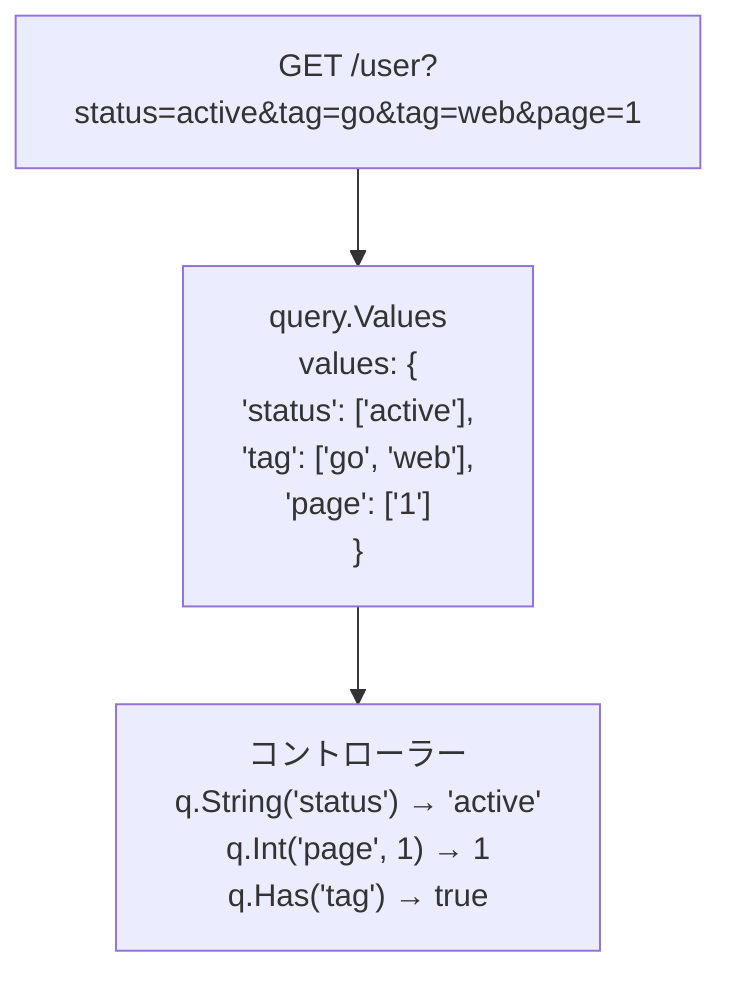

# query.Values

`query.Values`でHTTPクエリパラメーターを読み取り、デフォルト値を指定できます。コントローラーの引数に`q query.Values`を宣言し、必要なキーを文字列、整数、真偽値として取得して使用します。クエリパラメーターを任意のDTOに自動でマッピングする方法はサポートしていません。

このページの機能別 `src/user` の例は、[プロジェクト構造](/ja/learn/tutorial/1-project-structure)で `--layout legacy` を指定して作成した `my-app` を使用します。CLI `v0.4.0` の標準レイアウトは役割別の `layered-v1` です。どちらも Spine `v0.6.0` と Echo プラットフォーム `v0.1.0` を使用します。

このページでは、Spine v0.6.0の`github.com/NARUBROWN/spine/pkg/query`を基準に説明します。

## CLIプロジェクトで使用する

[最初のアプリ](/ja/learn/getting-started/first-app)でプロジェクトを作成し、[コントローラー](/ja/learn/tutorial/2-controller)で`src/user`リソースを生成した後から進めます。サンプルのハンドラーを同じ`package user`に追加し、そのハンドラーを使用するルートも登録してください。

`User`、検索条件とページレスポンスの型、サービスの検索メソッドはアプリで定義します。商品と注文の例も同じ方法による機能拡張です。各例は独立した選択肢なので、必要なメソッドとルートだけを追加してください。成功レスポンスは`httpx.Response[T]`で包み、次の2つのパッケージをインポートします。

```go
import (
    "github.com/NARUBROWN/spine/pkg/httpx"
    "github.com/NARUBROWN/spine/pkg/query"
)
```

基本例では、クエリパラメーターから`id`と`name`を読み取ってレスポンスを返します。

```go
// src/user/user_controller.go
func (c *UserController) GetUserQuery(q query.Values) httpx.Response[User] {
    return httpx.Response[User]{Body: User{
        ID:   q.Int("id", 0),
        Name: q.String("name"),
    }}
}
```

このメソッドを`GET /user`に登録した場合、リクエストとレスポンスは次のようになります。

```bash
# 요청
GET /user?id=123&name=john

# 응답
{
    "id": 123,
    "name": "john"
}
```

## クエリ値が渡される仕組み

HTTPリクエストのクエリパラメーターは、1つのキーに複数の文字列値を持つことができます。たとえば`?tag=go&tag=web`には、`tag`の値が2つあります。Spineはこのクエリマップを`query.Values`で包み、コントローラーに渡します。



ハンドラーには、`query.Values`を値型で宣言します。標準のリゾルバーはこの型そのものを処理し、`*query.Values`は同じ注入対象にはなりません。クエリ値の注入はHTTPリクエスト向けなので、ConsumerやWebSocketハンドラーで同じ動作を期待しないでください。

`query.Values`の読み取りメソッドは、元のクエリマップを変更しません。アプリのコードや単体テストで直接作成する場合は、`query.NewValues(values map[string][]string)`を使用できます。

```go
// pkg/query/types.go
type Values struct {
    values map[string][]string
}

func NewValues(values map[string][]string) Values {
    return Values{values: values}
}
```

`NewValues`は渡されたマップをコピーせずに保持します。生成後に元のマップを変更すると、同じマップを包む`Values`でも変更後の値を読み取ります。通常のHTTPハンドラーでは直接作成する必要はありません。

## 読み取りメソッド

| メソッド | 戻り値の型 | 値がない場合や変換できない場合 |
| --- | --- | --- |
| `Get(key)` | `string` | 空文字列 |
| `String(key)` | `string` | 空文字列。`Get`と同じ動作 |
| `Int(key, def)` | `int64` | 呼び出し時に指定した`def` |
| `GetBoolByKey(key, def)` | `bool` | 呼び出し時に指定した`def` |
| `Has(key)` | `bool` | キーがなければ`false` |

値を読み取るメソッドは、最初の値だけを使用します。同じキーが繰り返されても、`Get`、`String`、`Int`、`GetBoolByKey`がすべての値を返したり検査したりするわけではありません。

### 文字列を読み取る

`Get`と`String`は同じ動作をします。キーがない場合や値の一覧が空の場合は、空文字列を返します。

```go
// GET /user?name=john&status=active

q.Get("name")    // "john"
q.Get("status")  // "active"
q.Get("missing") // ""
```

```go
q.String("name")  // "john"
```

### 整数を読み取る

`Int(key string, def int64) int64`は、最初の値を10進数の64ビット符号付き整数に変換します。キーがない場合や値が空文字列の場合は、`def`を返します。数値ではない場合や`int64`の範囲を超える場合も、エラーを返さずに`def`を使用します。

```go
// GET /user?page=3&size=20

q.Int("page", 1)    // 3
q.Int("size", 10)   // 20
q.Int("offset", 0)  // 0 (키 없음 → 기본값)
q.Int("page", 1)    // 1 (만약 page=abc라면 → 기본값)
```

変換に成功した負数や0は、そのまま返します。ページ番号や価格範囲のように正の数だけを許可する値は、アプリで別に検査する必要があります。

### 真偽値を読み取る

`GetBoolByKey(key string, def bool) bool`は、最初の値を小文字に変換してから、次の文字列を判定します。

| 結果 | 認識する値 |
| --- | --- |
| `true` | `"true"`, `"1"`, `"yes"`, `"y"`, `"on"` |
| `false` | `"false"`, `"0"`, `"no"`, `"n"`, `"off"` |
| `def` | キーがない場合、または上記の一覧にない値 |

大文字と小文字は区別しませんが、空白は除去しません。たとえば`" TRUE "`は認識する値の一覧にないため、デフォルト値を使用します。

```go
// GET /user?active=true&verified=1&premium=yes

q.GetBoolByKey("active", false)    // true
q.GetBoolByKey("verified", false)  // true
q.GetBoolByKey("premium", false)   // true
q.GetBoolByKey("deleted", false)   // false (키 없음 → 기본값)
q.GetBoolByKey("active", false)    // false (만약 active=maybe → 기본값)
```

### キーの存在を確認する

`Has(key string) bool`は値ではなく、キーの存在を確認します。`?empty=`のように値が空でも、キーがあれば`true`です。

```go
// GET /user?status=active&empty=

q.Has("status")  // true
q.Has("empty")   // true (값은 비었지만 키는 존재)
q.Has("missing") // false
```

キーがない場合と、明示的に空文字列を送信した場合を区別するには、`Get`の結果だけでなく`Has`も確認してください。同様に、`Has`が`true`でも、整数や真偽値への変換に成功したという意味ではありません。

## 検索とフィルターに使用する

フィルターごとに、呼び出し側でデフォルト値を指定できます。次の例では、検索語、分類、価格範囲、在庫の有無を読み取り、サービスに渡します。

```go
func (c *ProductController) Search(q query.Values) httpx.Response[SearchResult] {
    keyword := q.String("q")
    category := q.String("category")
    minPrice := q.Int("min_price", 0)
    maxPrice := q.Int("max_price", 999999)
    inStock := q.GetBoolByKey("in_stock", true)

    products := c.service.Search(SearchCriteria{
        Keyword:  keyword,
        Category: category,
        MinPrice: minPrice,
        MaxPrice: maxPrice,
        InStock:  inStock,
    })

    return httpx.Response[SearchResult]{Body: SearchResult{
        Query:    keyword,
        Count:    len(products),
        Products: products,
    }}
}
```

```bash
GET /product?q=laptop&category=electronics&min_price=500&in_stock=true
```

この例では、不正な数値や真偽値もデフォルト値で処理します。不正な入力に400レスポンスを返すAPIでは、`String`で元の文字列を読み取り、`strconv.ParseInt`などによる変換の結果を確認してから`httperr.BadRequest`を返してください。デフォルト値による処理とバリデーションは、それぞれ異なる方針です。

### 渡されたフィルターだけを適用する

フィルターが任意の場合は、`Has`でキーが渡されたかを確認します。

```go
func (c *OrderController) List(q query.Values) httpx.Response[[]Order] {
    filters := OrderFilters{}

    if q.Has("user_id") {
        filters.UserID = q.Int("user_id", 0)
    }

    if q.Has("status") {
        filters.Status = q.String("status")
    }

    if q.Has("from_date") {
        filters.FromDate = parseDate(q.String("from_date"))
    }

    if q.Has("to_date") {
        filters.ToDate = parseDate(q.String("to_date"))
    }

    return httpx.Response[[]Order]{Body: c.service.FindByFilters(filters)}
}
```

`OrderFilters`と`parseDate`は、アプリが定義する型と関数です。日付の形式、開始日と終了日の順序、フィルターを省略した場合の動作も、アプリで決める必要があります。この例の`Has`による確認は、形式の検証の代わりにはなりません。

### 許可するフィルターを直接選ぶ

次のように、アプリが受け付けるフィルター名だけを確認し、サービスに渡すこともできます。

```go
// 동적 필터 처리
func (c *ProductController) Search(q query.Values) httpx.Response[[]Product] {
    filters := make(map[string]string)

    // 어떤 필터가 올지 미리 알 수 없음
    if q.Has("min_price") {
        filters["min_price"] = q.String("min_price")
    }
    if q.Has("max_price") {
        filters["max_price"] = q.String("max_price")
    }
    if q.Has("category") {
        filters["category"] = q.String("category")
    }

    return httpx.Response[[]Product]{Body: c.service.FindByFilters(filters)}
}
```

## ページネーションと併用する

固定の`page`、`size`の処理を`query.Pagination`に任せ、検索条件を`query.Values`で読み取ることができます。

```go
func (c *UserController) List(p query.Pagination, q query.Values) httpx.Response[PagedResult] {
    status := q.String("status")
    sortBy := q.String("sort_by")

    users := c.service.FindAll(status, sortBy, p.Page, p.Size)
    total := c.service.Count(status)

    return httpx.Response[PagedResult]{Body: PagedResult{
        Data:  users,
        Page:  p.Page,
        Size:  p.Size,
        Total: total,
    }}
}
```

```bash
GET /user?page=2&size=20&status=active&sort_by=created_at
```

| 項目 | `query.Values` | `query.Pagination` |
| --- | --- | --- |
| 用途 | 名前とデフォルト値をアプリが決めるクエリパラメーター | `page`、`size`を使用するページネーション |
| デフォルト値 | 各読み取りメソッドの呼び出し時に指定 | `page=1`, `size=20` |
| 型変換 | 必要なキーごとにメソッドを呼び出す | ページネーション引数の注入時に変換 |

同じリクエストで両方の型を宣言してもかまいません。`query.Values`でも`page`、`size`を読み取れるため、サービスに渡すページ情報の基準をどちらかに統一し、処理の重複を避けてください。

```go
// 고정된 페이지네이션만 필요 → query.Pagination
func List(p query.Pagination) httpx.Response[[]User]

// 동적 필터 + 페이지네이션 → 둘 다 사용
func Search(p query.Pagination, q query.Values) httpx.Response[[]User]

// 완전히 동적인 쿼리 → query.Values만
func CustomSearch(q query.Values) httpx.Response[[]User]
```

## 同じキーに複数の値がある場合

HTTPクエリでは、次のように同じキーを繰り返すことができます。

```
GET /product?tag=go&tag=web&tag=api
```

このリクエストで`q.String("tag")`と`q.Get("tag")`は、`"go"`だけを返します。Spine v0.6.0の`query.Values`には、値の一覧全体を取得する公開メソッドがなく、アプリから非公開フィールドの`values`に直接アクセスすることもできません。

複数の値を受け取る必要がある場合は、APIでカンマ区切りの文字列を1つ受け取り、アプリで分割する方法があります。次の例では、`strings`パッケージも必要です。

```go
// 쉼표 구분 방식
// GET /product?tags=go,web,api

func (c *ProductController) Search(q query.Values) httpx.Response[[]Product] {
    tagsRaw := q.String("tags")
    tags := strings.Split(tagsRaw, ",")

    return httpx.Response[[]Product]{Body: c.service.FindByTags(tags)}
}
```

この例では、`tags`が空の場合、`strings.Split`の結果に空文字列が含まれます。空の項目、重複するタグ、タグ名に含まれるカンマを許可するかは、アプリで決めて検査してください。

クエリパラメーターのキー、デフォルト値、許容範囲をコントローラーの近くに置くと、リクエストの処理規則を確認しやすくなります。リクエスト本文のDTOを受け取る方法は[コントローラーチュートリアル](/ja/learn/tutorial/2-controller)、エラーレスポンスは[httperr](/ja/learn/core-concepts/httperr)を参照してください。
