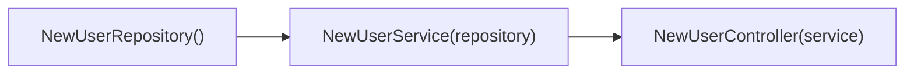

# 依存性の注入

[コントローラー](/ja/learn/tutorial/2-controller)で CLI が生成した `src/user` の依存関係を確認します。インストールとプロジェクト生成は[最初のアプリ](/ja/learn/getting-started/first-app)を参照してください。

SpineのDI（依存性の注入）を理解する。


## コアコンセプト

Spineの依存性注入は**コンストラクタベース**です。

- アノテーションなし (`@Autowired`、`@Injectable` 不要)
- DI 用の別設定は不要（`spine.toml` は CLI のプロジェクト設定）
- コンストラクタパラメータがそのまま依存関係の宣言になります


```go
// パラメータタイプを見て自動的に依存関係を注入
func NewUserService(repository *UserRepository) *UserService {
    return &UserService{repository: repository}
}
```

## CLI が生成した依存関係

まだ生成していない場合は `hello-spine` のルートで実行します。すでに存在する場合は再生成しないでください。

```bash
spine generate resource user --dry-run
```

プレビューで生成ファイルと登録コードの変更を確認し、以下のコマンドで生成します。

```bash
spine generate resource user
```

CLI は `src/user` の同じ `package user` に次のコンストラクタを生成します。

```go
// src/user/user_repository.go
package user

type UserRepository struct{}

func NewUserRepository() *UserRepository { return &UserRepository{} }
```

```go
// src/user/user_service.go
package user

type UserService struct{ repository *UserRepository }

func NewUserService(repository *UserRepository) *UserService {
    return &UserService{repository: repository}
}
```

```go
// src/user/user_controller.go
package user

type UserController struct{ service *UserService }

func NewUserController(service *UserService) *UserController {
    return &UserController{service: service}
}
```

`src/user/user_route.go` の `Register` がコンストラクタと `GET /user/:id` を登録します。CLI は `internal/application/application.go` の `BuildApplication()` にエラーを確認する `user.Register(app)` を追加します。同じコンストラクタを再登録しないでください。

```go
// src/user/user_route.go: Register
app.Constructor(NewUserRepository, NewUserService, NewUserController)
app.Route("GET", "/user/:id", (*UserController).Get)
```

## 登録と解決の順序

登録順に関係なく、必要な依存関係から解決します。解決したインスタンスはコンテナで共有し、リクエストごとには生成しません。

```go
// user_route.go の既存の Constructor 呼び出しを置き換える例です。
app.Constructor(NewUserController, NewUserService, NewUserRepository)
```



## コンストラクタのルール

### パラメータ

コンストラクタパラメータは**すでに登録されているタイプ**である必要があります。


```go
// ✅ 正しい例
func NewUserService(repo *UserRepository) *UserService

// ✅ 複数の依存関係も可能
func NewUserController(svc *UserService, logger *Logger) *UserController

// ✅ 依存関係なしも可能
func NewLogger() *Logger
```

### 戻り値のタイプ

コンストラクタは値を1つだけ返す必要があります。`(値, error)` を返すコンストラクタはサポートしません。戻り値の型が提供する型になり、nil の返却もエラーです。

```go
func NewUserService(repository *UserRepository) *UserService {
    return &UserService{repository: repository}
}
```

[データベースの例](/ja/learn/tutorial/5-database)の `database.NewDB() *bun.DB` のように、DBのproviderも単一の値を返すコンストラクタとして登録します。`BuildApplication` は登録だけを行うため、生成された検証テストはDB接続を開きません。接続エラーはアプリ起動時のprovider実行段階で処理されます。実際の接続は別途確認してください。

```go
// internal/application/application.go: BuildApplication
app.Constructor(database.NewDB)
```

## インターフェースの活用

この節は[データベース](/ja/learn/tutorial/5-database)の手動拡張です。`resource` は Bun の設定を生成しません。インターフェースと完全一致する provider を優先し、それがなければ実装する provider が1つの場合に注入します。候補が複数ある場合はエラーです。リクエストの `bun.Tx` がアプリ全体で共有するコンストラクタに再注入されることはありません。リクエストコンテキストから読み、サービスを経由して `bun.IDB` を受け取るリポジトリのメソッドに渡します。

### 問題状況

トランザクションを使用する場合、Repositoryは `*bun.DB` と `bun.Tx` の両方を処理する必要があります。


```go
// ❌ これだとトランザクションを使用できません
type UserRepository struct {
    db *bun.DB  // bun.Tx を受け取れない
}
```

### 解決: インターフェースの使用

`bun.IDB` インターフェースを使用すると、両方を受け入れることができます。


```go
// ✅ *bun.DB と bun.Tx はどちらも bun.IDB を実装しています
type UserRepository struct {
    db bun.IDB
}

func NewUserRepository(db bun.IDB) *UserRepository {
    return &UserRepository{db: db}
}
```

### インターセプターでトランザクションを注入


```go
// src/interceptor/tx_interceptor.go
func (i *TxInterceptor) PreHandle(ctx core.ExecutionContext, meta core.HandlerMeta) error {
    tx, err := i.db.BeginTx(ctx.Context(), nil)
    if err != nil {
        return err
    }
    
    ctx.Set("tx", tx)  // トランザクションを保存
    return nil
}

func (i *TxInterceptor) PostHandle(ctx core.ExecutionContext, meta core.HandlerMeta) {}

func (i *TxInterceptor) BeforeResponse(ctx core.ExecutionContext, meta core.HandlerMeta, executionErr error) error {
    v, ok := ctx.Get("tx")
    if !ok {
        return nil
    }

    tx, ok := v.(bun.Tx)
    if !ok {
        return errors.New("invalid transaction type")
    }
    
    if executionErr != nil {
        return tx.Rollback()
    } else {
        return tx.Commit()
    }
}

func (i *TxInterceptor) AfterCompletion(ctx core.ExecutionContext, meta core.HandlerMeta, err error) {}
```


## 機能ごとの登録

別の機能も CLI で生成すると、同じ composition root に登録されます。以下は独立した `order` リソースの生成例です。`user.Register` と `order.Register` の呼び出しは CLI が追加するため、重複追加しないでください。

```bash
spine generate resource order --dry-run
```

プレビューで生成ファイルと登録コードの変更を確認し、以下のコマンドで生成します。

```bash
spine generate resource order
```

### 複数回の Constructor 呼び出し

同じ `Register` 内で登録を複数の呼び出しに分けることもできます。各型は1回ずつ登録してください。

```go
// src/user/user_route.go: Register
app.Constructor(NewUserRepository)
app.Constructor(NewUserService)
app.Constructor(NewUserController)
```

## 同じタイプが複数ある場合

同じタイプのインスタンスが複数必要な場合は、ラッパータイプを使用します。


```go
// ❌ 区別できない
func NewApp(db1 *bun.DB, db2 *bun.DB) *App  // どっちがどっち？

// ✅ ラッパータイプで区別
type PrimaryDB struct{ *bun.DB }
type ReplicaDB struct{ *bun.DB }

func NewPrimaryDB() *PrimaryDB {
    return &PrimaryDB{connectToPrimary()}
}

func NewReplicaDB() *ReplicaDB {
    return &ReplicaDB{connectToReplica()}
}

func NewUserRepository(primary *PrimaryDB, replica *ReplicaDB) *UserRepository {
    return &UserRepository{
        writer: primary.DB,
        reader: replica.DB,
    }
}
```
## エラー処理

### 循環依存関係


```go
// ❌ A → B → A の循環
func NewA(b *B) *A { ... }
func NewB(a *A) *B { ... }

// 起動時にエラー発生
// circular dependency detected: *user.A -> *user.B -> *user.A
```

### 依存関係の欠落


```go
// UserRepository を登録しないと
app.Constructor(
    NewUserService,     // *UserRepository が必要
    NewUserController,
)

// 起動時にエラー発生
// no constructor registered for *user.UserRepository
```

## 検証の範囲

```bash
spine doctor
spine contract check
spine verify
```

`contract check` は静的 DI 契約を検査し、`verify` はローカルコードも検査します。`app.Validate(options)` だけではコンストラクタの実行や DI warm-up を検証できません。実際の初期化・DB 接続・リクエストはアプリ実行と別の E2E で確認します。循環・欠落依存関係は解決時にエラーとなり、生成された main は Run のエラーを確認します。

## 要点のまとめ

| 概念 | 説明 |
|------|------|
| **コンストラクタベース** | パラメータタイプで依存関係を宣言 |
| **自動解決** | 登録順序は任意、グラフを分析して生成 |
| **タイプのマッチング** | 同じタイプであれば自動的に注入 |
| **インターフェース** | 柔軟な依存関係の処理が可能 |

## 次のステップ

- [チュートリアル: インターセプター](/ja/learn/tutorial/4-interceptor) — リクエストの前/後処理
- [チュートリアル: データベース](/ja/learn/tutorial/5-database) — Bun ORM接続
