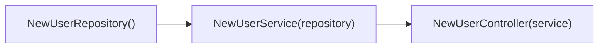

# 依存性注入

[コントローラー](/ja/learn/tutorial/2-controller)で作成した `src/user` リソースを使い、コンストラクタの登録と依存性注入（DI）を確認します。この手順を終えると、コントローラー、サービス、リポジトリを接続し、循環依存やコンストラクタの登録漏れを確認できるようになります。

このページの機能別 `src/user` の例は、[プロジェクト構造](/ja/learn/tutorial/1-project-structure)で `--layout legacy` を指定して作成した `my-app` を使用します。CLI `v0.4.2` の標準レイアウトは役割別の `layered-v1` です。どちらも Spine `v0.6.5` と Echo プラットフォーム `v0.1.0` を使用します。

[最初のアプリ](/ja/learn/tutorial/1-project-structure)のプロジェクトを用意し、`my-app` のルートで進めてください。後半のデータベースとラッパー型の例は、基本リソースに自動で含まれるものではなく、個別の拡張です。


## 基本概念

Spine は、登録されたコンストラクタのパラメーターの型を見て、必要なオブジェクトを先に作成して渡します。`@Autowired` や `@Injectable` のようなアノテーションや、DI 専用の設定ファイルは使いません。`spine.toml` は CLI プロジェクトの設定ファイルです。

次のコンストラクタでは、`*UserRepository` が `UserService` に必要な依存性です。

```go
// 파라미터 타입을 보고 자동으로 의존성 주입
func NewUserService(repository *UserRepository) *UserService {
    return &UserService{repository: repository}
}
```

## CLI で生成した依存性

まだ生成していない場合は、`my-app` のルートで実行します。すでに生成した場合は、再実行しないでください。

```bash
spine generate resource user --dry-run
```

プレビューで生成ファイルと登録コードの変更を確認してから、次のコマンドで生成します。

```bash
spine generate resource user
```

以下は、CLI が同じ `user` パッケージ内に生成したコードから、型とコンストラクタだけを抜粋したものです。既存のファイルをこのコードで上書きしないでください。コントローラーの `Get` メソッドは、生成されたファイル内に残します。

```go
// src/user/user_repository.go
package user

type UserRepository struct{}

func NewUserRepository() *UserRepository { return &UserRepository{} }
```

```go
// src/user/user_service.go
package user

type UserService struct{ repository *UserRepository }

func NewUserService(repository *UserRepository) *UserService {
    return &UserService{repository: repository}
}
```

```go
// src/user/user_controller.go
package user

type UserController struct{ service *UserService }

func NewUserController(service *UserService) *UserController {
    return &UserController{service: service}
}
```

`src/user/user_route.go` の `Register` は、三つのコンストラクタと `GET /user/:id` を登録します。CLI は `internal/application/application.go` の `BuildApplication()` に、`user.Register(app)` の呼び出しとエラー処理を追加します。登録済みのコンストラクタを再度追加しないでください。

```go
// src/user/user_route.go: Register
app.Constructor(NewUserRepository, NewUserService, NewUserController)
app.Route("GET", "/user/:id", (*UserController).Get)
```

## 登録順序と解決順序

コンストラクタの登録順序で、オブジェクトの生成順序が決まるわけではありません。コントローラーを作るにはサービスが、サービスを作るにはリポジトリが必要なため、リポジトリから生成します。生成したインスタンスはコンテナーが共有し、リクエストごとに新しく作ることはありません。

次のように登録順序を変えても、依存性を解決する順序は同じです。

```go
// user_route.go의 기존 Constructor 호출을 대체하는 예시입니다.
app.Constructor(NewUserController, NewUserService, NewUserRepository)
```



## コンストラクタのルール

### パラメーター

各パラメーターの型を提供するコンストラクタが登録されている必要があります。依存性がなければパラメーターを省略し、複数の依存性が必要ならパラメーターを複数宣言します。

以下はシグネチャだけを示した例です。実際のコードでは、各関数の本体と戻り値の型を実装する必要があります。

```go
// 저장소 의존성 선언
func NewUserService(repo *UserRepository) *UserService

// 여러 의존성 선언
func NewUserController(svc *UserService, logger *Logger) *UserController

// 의존성 없는 생성자
func NewLogger() *Logger
```

### 戻り値の型

コンストラクタは、値をちょうど一つ返す必要があります。その戻り値の型がコンテナーに登録される型になります。`(値, error)` を返すコンストラクタはサポートしていません。ポインターやインターフェースを返すコンストラクタが `nil` を返すと、依存性の解決に失敗します。

```go
func NewUserService(repository *UserRepository) *UserService {
    return &UserService{repository: repository}
}
```

データベースの接続関数も、[データベースの例](/ja/learn/tutorial/5-database)の `database.NewDB() *bun.DB` のように、値を一つだけ返すように実装します。`BuildApplication` でコンストラクタを登録しただけでは、接続関数は呼び出されません。そのため、生成された検証テストの成功は、データベースへの接続成功を意味しません。接続の初期化とエラー処理は、コンストラクタが実行されるアプリの起動段階で確認してください。

```go
// internal/application/application.go: BuildApplication
app.Constructor(database.NewDB)
```

## インターフェースを使う

インターフェース型をパラメーターとして宣言すると、次の順序で依存性を探します。

1. 戻り値の型がそのインターフェースと完全に一致するコンストラクタを使います。
2. 完全に一致するコンストラクタがなければ、そのインターフェースに代入できる戻り値の型を探します。
3. 候補が一つなら注入し、複数あれば `multiple constructors registered for interface` エラーを返します。候補がなければ依存性の不足を示すエラーを返します。

以下は、[データベース](/ja/learn/tutorial/5-database)の設定を済ませたアプリに適用する拡張例です。CLI の `resource` による生成結果には、Bun の設定は含まれません。

### データベースとトランザクションに共通する型

リポジトリのフィールドを `*bun.DB` に固定すると、そのフィールドに `bun.Tx` を入れることはできません。

```go
// 이 필드에는 *bun.DB만 저장할 수 있음
type UserRepository struct {
    db *bun.DB  // bun.Tx를 받을 수 없음
}
```

`*bun.DB` と `bun.Tx` の両方が実装する `bun.IDB` を使うと、この二つの型を同じ契約で扱えます。次のコードは、リポジトリのコンストラクタが依存性として `bun.IDB` を受け取る例です。

```go
// *bun.DB와 bun.Tx는 모두 bun.IDB를 구현
type UserRepository struct {
    db bun.IDB
}

func NewUserRepository(db bun.IDB) *UserRepository {
    return &UserRepository{db: db}
}
```

### リクエストごとのトランザクションを渡す

コンストラクタ注入と、リクエストごとの値の受け渡しでは、ライフタイムが異なります。コンストラクタで作成したサービスとリポジトリはアプリで共有するため、リクエストごとに作成した `bun.Tx` が既存インスタンスのフィールドに自動で再注入されることはありません。共有フィールドをリクエストごとのトランザクションで上書きすると、他のリクエストと混在するおそれがあります。

リクエストごとのトランザクションは、次の順序で渡します。

1. インターセプターの `PreHandle` でトランザクションを開始し、`ctx.Set("tx", tx)` で保存します。
2. コントローラーが `spine.Ctx.Get("tx")` で値を読み取り、`bun.Tx` 型かどうかを確認します。
3. コントローラーがサービスとリポジトリのメソッドに、`bun.IDB` 引数としてトランザクションを明示的に渡します。
4. インターセプターの `BeforeResponse` で実行結果に応じてコミットまたはロールバックし、その処理で発生したエラーを返します。

インターセプターの四つのライフサイクルメソッドの実装と登録方法は、[依存性注入が必要なインターセプター](/ja/learn/tutorial/4-interceptor)を参照してください。


## 機能ごとに登録する

別の機能を CLI で生成すると、各パッケージの `Register` 関数と、アプリを組み立てる `BuildApplication` に接続されます。以下は、独立した `order` リソースを追加する任意の例です。CLI が `order.Register(app)` の呼び出しを追加するため、自分で重複登録しないでください。

```bash
spine generate resource order --dry-run
```

プレビューで生成ファイルと登録コードの変更を確認してから、次のコマンドで生成します。

```bash
spine generate resource order
```

### コンストラクタの登録を複数の呼び出しに分ける

同じ `Register` 内で、登録を複数の呼び出しに分けることもできます。各型は一度ずつ登録してください。

```go
// src/user/user_route.go: Register
app.Constructor(NewUserRepository)
app.Constructor(NewUserService)
app.Constructor(NewUserController)
```

## 同じ型を複数使う

プライマリデータベースとレプリカデータベースを同じ型で登録すると、パラメーター名だけでは区別できません。異なるラッパー型を宣言して区別してください。

以下は、独立したリポジトリ設計の例です。`App`、`UserRepository` の `writer` と `reader` フィールド、`connectToPrimary`、`connectToReplica` は、アプリに合わせて実装する必要があります。

```go
// 파라미터 이름만으로 인스턴스를 구분할 수 없음
func NewApp(db1 *bun.DB, db2 *bun.DB) *App  // 어떤 게 어떤 건지?

// 서로 다른 래퍼 타입으로 구분
type PrimaryDB struct{ *bun.DB }
type ReplicaDB struct{ *bun.DB }

func NewPrimaryDB() *PrimaryDB {
    return &PrimaryDB{connectToPrimary()}
}

func NewReplicaDB() *ReplicaDB {
    return &ReplicaDB{connectToReplica()}
}

func NewUserRepository(primary *PrimaryDB, replica *ReplicaDB) *UserRepository {
    return &UserRepository{
        writer: primary.DB,
        reader: replica.DB,
    }
}
```

## 依存性のエラーを確認する

### 循環依存

`A` が `B` を必要とし、`B` も `A` を必要とする場合、どちらのオブジェクトも先に作ることができません。次のコードは、この関係を示す疑似コードです。

```go
// A → B → A 순환
func NewA(b *B) *A { ... }
func NewB(a *A) *B { ... }

// 부팅 시 에러 발생
// circular dependency detected: *user.A -> *user.B -> *user.A
```

### 依存性の不足

必要な型のコンストラクタがなければ、依存性の解決に失敗します。以下は、`NewUserRepository` の登録を省略した場合です。

```go
// UserRepository를 등록하지 않으면
app.Constructor(
    NewUserService,     // *UserRepository 필요
    NewUserController,
)

// 부팅 시 에러 발생
// no constructor registered for *user.UserRepository
```

## 登録を検証して実行を確認する

プロジェクトルートで、次のコマンドを実行します。

```bash
spine doctor
spine contract check
spine verify
```

`spine contract check` はソースから抽出した DI の契約を検査し、`spine verify` はフォーマット、`go vet`、テストも検査します。`app.Validate(options)` が成功しただけでは、コンストラクタの実行やインスタンスの初期化まで確認したことにはなりません。

実際の初期化とリクエスト処理は、`spine dev` でアプリを起動してから確認してください。データベースを接続した場合は、実際の接続とクエリも別途確認する必要があります。循環依存やコンストラクタの登録漏れがあると、依存性の解決時にエラーを返します。生成された `main.go` は `Run` のエラーを確認します。

## 次のステップ

- [チュートリアル: インターセプター](/ja/learn/tutorial/4-interceptor) — リクエストの前後の処理
- [チュートリアル: データベース](/ja/learn/tutorial/5-database) — Bun ORM の接続
