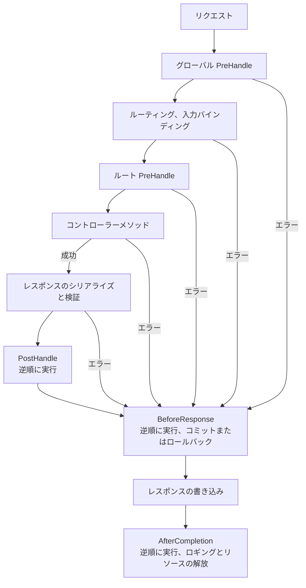

# インターセプター

インターセプターは認証やログなどの共通処理を担当します。この独立したアプリでは、グループ内の全ルートと個別ルートに認証を適用します。トークンはデモ用です。

## グループとルートに適用する

次のコードを別の Go モジュールの `main.go` に保存して実行します。

```bash
go get github.com/NARUBROWN/spine@v0.7.1 github.com/NARUBROWN/spine-echo-platform@v0.2.0
```

```go
package main

import (
	"github.com/NARUBROWN/spine"
	echoplatform "github.com/NARUBROWN/spine-echo-platform"
	"github.com/NARUBROWN/spine/core"
	"github.com/NARUBROWN/spine/pkg/api"
	"github.com/NARUBROWN/spine/pkg/boot"
	"github.com/NARUBROWN/spine/pkg/constructor"
	"github.com/NARUBROWN/spine/pkg/httperr"
	"github.com/NARUBROWN/spine/pkg/httpx"
	"github.com/NARUBROWN/spine/pkg/input"
	"log"
)

type Auth struct{}

func (*Auth) PreHandle(ctx core.ExecutionContext, meta core.HandlerMeta) error {
	if ctx.Header("Authorization") != "Bearer demo-token" {
		return httperr.Unauthorized("unauthorized")
	}
	return nil
}
func (*Auth) PostHandle(core.ExecutionContext, core.HandlerMeta)                  {}
func (*Auth) BeforeResponse(core.ExecutionContext, core.HandlerMeta, error) error { return nil }
func (*Auth) AfterCompletion(core.ExecutionContext, core.HandlerMeta, error)      {}

type Controller struct{}

func (*Controller) Constructor() *Controller { return &Controller{} }
func (*Controller) RegisterRoutes(r *api.Registry) {
	users := r.Group("/users", api.Interceptors(&Auth{}))
	users.GET("/:id", func(id input.Path[int64]) httpx.Response[map[string]int64] {
		return httpx.Response[map[string]int64]{Body: map[string]int64{"id": *id}}
	})
	r.GET("/profile", func() httpx.Response[string] {
		return httpx.Response[string]{Body: "profile"}
	}, api.Interceptors(&Auth{}))
}
func main() {
	app := spine.New(echoplatform.Option())
	app.Constructor(constructor.Controller(&Controller{}))
	if err := app.Run(boot.Options{Address: ":8080", HTTP: &boot.HTTPOptions{}}); err != nil {
		log.Fatal(err)
	}
}
```

`/users/:id` はグループから認証を継承し、`/profile` はルートで直接指定します。ネストしたグループも親の設定を継承します。

認証なしのリクエストは 401、トークン付きのリクエストは 200 を返します。本番環境では安全なトークン検証を実装してください。

```bash
curl -i http://localhost:8080/users/1
curl -i -H 'Authorization: Bearer demo-token' http://localhost:8080/users/1
curl -i -H 'Authorization: Bearer demo-token' http://localhost:8080/profile
```

## インターセプターのライフサイクル

Spine v0.7.1 の HTTP リクエストは、グローバルインターセプター、ルーティングと入力バインディング、ルートインターセプター、コントローラーの順に実行されます。インターセプターは、四つのライフサイクルメソッドをすべて実装する必要があります。



入力バインディングに失敗すると、ルートの `PreHandle` も実行されません。ボディの形式チェックより先に認証する必要があるポリシーは、グローバルインターセプターで処理してください。


## インターフェース

```go
type Interceptor interface {
    PreHandle(ctx ExecutionContext, meta HandlerMeta) error
    PostHandle(ctx ExecutionContext, meta HandlerMeta)
    BeforeResponse(ctx ExecutionContext, meta HandlerMeta, executionErr error) error
    AfterCompletion(ctx ExecutionContext, meta HandlerMeta, err error)
}
```

| メソッド | 実行タイミング | 戻り値 | 用途 |
|--------|----------|------|------|
| `PreHandle` | グローバルではルーティング前、ルートでは入力バインディング後 | `error` | 認証、検証、トランザクションの開始 |
| `PostHandle` | コントローラーとレスポンスの準備が成功した後 | なし | 処理完了の記録、後続処理 |
| `BeforeResponse` | レスポンスを実際に書き込む前 | `error` | トランザクションのコミットまたはロールバック |
| `AfterCompletion` | レスポンスの書き込みを試みた後 | なし | ロギング、リソースの解放 |

`BeforeResponse` は、それまでの実行エラーと、レスポンスのシリアライズ、Cookie、ステータスコードの検証エラーを `executionErr` として受け取ります。`PreHandle` に成功したインターセプターだけがこのメソッドを実行するため、その段階で開始したトランザクションを完了させるのに適しています。コミットやロールバックに失敗した場合は、エラーを返してください。

`AfterCompletion` は、エラーが発生した場合も、グローバルインターセプターと、ルーティングで特定したルートインターセプターに対して呼び出されます。`PreHandle` が実行されていないインターセプターも含まれる場合があるため、解放するリソースがあるかどうかを先に確認する必要があります。この時点ではレスポンスがすでに書き込まれている場合があるため、レスポンスの変更には使いません。


## 関連情報

全体への登録、コンストラクター注入、ライフサイクルの詳細は[インターセプター API](/ja/reference/api/interceptor)を参照してください。
