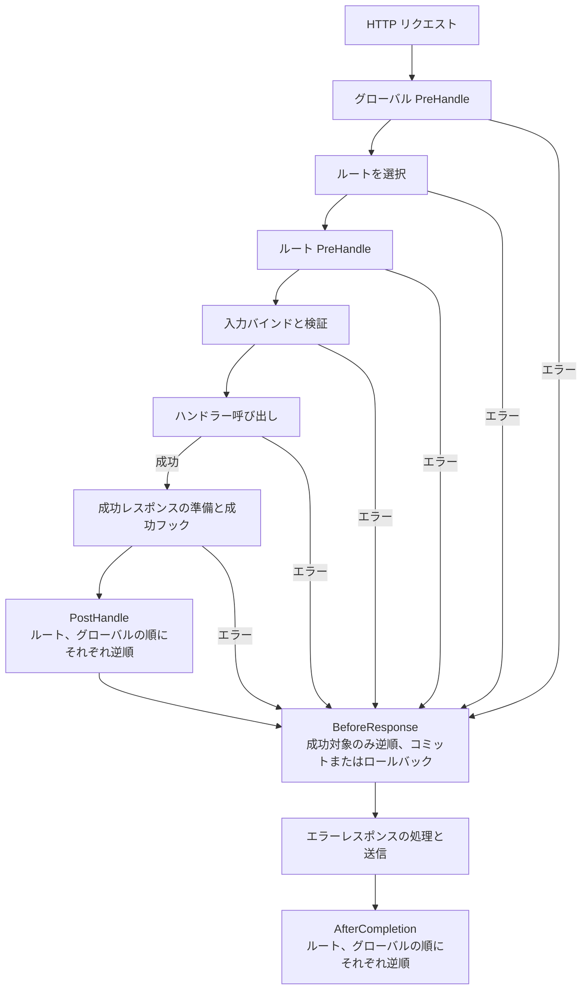

# インターセプター

全体とルートの PreHandle はどちらも入力バインド前です。認証失敗なら本文解析前に 401 を返します。

## 実行例

[コントローラーの依存](/ja/learn/tutorial/2-controller)

main.go を置き換えます。固定トークンは学習用です。constructor.Interceptor は DI 登録、api.Interceptors は適用範囲です。(*Auth)(nil) は DI から登録型を解決する目印です。

このサイトの例では、すべてのインターセプターを先に `app.Constructor` に登録します。`Constructor` メソッドを実装した独自のインターセプターは `constructor.Interceptor(&Auth{})` で登録し、適用時は `(*Auth)(nil)` のような typed nil を渡してコンテナーから取得します。適用 API に `&Auth{}` を直接渡すと、現在の実装ではコンストラクターを経由せずにそのオブジェクトが実行されるため使用しません。登録と適用範囲の指定は別の手順です。

```go
package main

import (
	"github.com/NARUBROWN/spine"
	echoplatform "github.com/NARUBROWN/spine-echo-platform"
	"github.com/NARUBROWN/spine/core"
	"github.com/NARUBROWN/spine/pkg/api"
	"github.com/NARUBROWN/spine/pkg/boot"
	"github.com/NARUBROWN/spine/pkg/constructor"
	"github.com/NARUBROWN/spine/pkg/httperr"
	"github.com/NARUBROWN/spine/pkg/httpx"
	"github.com/NARUBROWN/spine/pkg/input"
	spinectx "github.com/NARUBROWN/spine/pkg/spine"
	"log"
)

type Auth struct{}

func (*Auth) Constructor() *Auth { return &Auth{} }
func (*Auth) PreHandle(ctx spinectx.Ctx, meta core.HandlerMeta) error {
	request, ok := ctx.HTTPRequestContext()
	if !ok {
		return httperr.InternalServerError("HTTP request context unavailable")
	}
	if request.Header("Authorization") != "Bearer demo-token" {
		return httperr.Unauthorized("unauthorized")
	}
	ctx.ExecutionContext().Set("userID", "demo-user")
	return nil
}
func (*Auth) PostHandle(spinectx.Ctx, core.HandlerMeta)                  {}
func (*Auth) BeforeResponse(spinectx.Ctx, core.HandlerMeta, error) error { return nil }
func (*Auth) AfterCompletion(spinectx.Ctx, core.HandlerMeta, error)      {}

type Controller struct{}
type CreateUser struct {
	Name string `json:"name"`
}

func (*Controller) Constructor() *Controller { return &Controller{} }
func (*Controller) RegisterRoutes(r *api.Registry) {
	users := r.Group("/users", api.Interceptors((*Auth)(nil)))
	users.GET("/:id", func(id input.Path[int64]) httpx.Response[map[string]int64] {
		return httpx.Response[map[string]int64]{Body: map[string]int64{"id": *id}}
	})
	users.POST("/", func(body input.Body[CreateUser]) httpx.Response[string] {
		return httpx.Response[string]{Body: body.Name}
	})
	r.GET("/profile", func() httpx.Response[string] {
		return httpx.Response[string]{Body: "profile"}
	}, api.Interceptors((*Auth)(nil)))
}
func BuildApplication() (spine.App, boot.Options, error) {

	app := spine.New(echoplatform.Option())
	app.Constructor(constructor.Controller(&Controller{}), constructor.Interceptor(&Auth{}))
	return app, boot.Options{Address: ":8080", HTTP: &boot.HTTPOptions{}, EnableGracefulShutdown: true}, nil
}
func main() {
	app, options, err := BuildApplication()
	if err != nil {
		log.Fatal(err)
	}
	if err := app.Validate(options); err != nil {
		log.Fatal(err)
	}
	if err := app.Run(options); err != nil {
		log.Fatal(err)
	}
}
```

## グループとルート

```go
app.Constructor(
	constructor.Interceptor(&AuthInterceptor{}),
	constructor.Interceptor(&AuditInterceptor{}),
)
```

```go
func (*UserController) RegisterRoutes(r *api.Registry) {
	auth := (*AuthInterceptor)(nil)
	audit := (*AuditInterceptor)(nil)
	users := r.Group("/users", api.Interceptors(auth))
	users.GET("/", func() httpx.Response[[]int64] {
		return httpx.Response[[]int64]{Body: []int64{1}}
	})
	users.DELETE("/:id", func() httpx.Response[struct{}] {
		return httpx.Response[struct{}]{Options: httpx.ResponseOptions{Status: 204}}
	}, api.Interceptors(audit))
	r.GET("/profile", func() httpx.Response[string] {
		return httpx.Response[string]{Body: "profile"}
	}, api.Interceptors(auth))
}
```

この例を使うには、Auth と Audit のインターセプターを DI に登録します。GET /users は Auth、DELETE /users/:id は Auth の後に Audit を実行します。子グループは親を継承し、ルート設定は追加されます。HTTP 全体は InterceptorFor(boot.InterceptorHTTP, ...)、HTTP と WebSocket 全体は app.Interceptor または InterceptorAll です。同じ認証を重複適用しないでください。

## リクエスト確認

```sh
go run .
#
curl -i http://localhost:8080/users/1
curl -i -H 'Authorization: Bearer demo-token' http://localhost:8080/users/1
curl -i -H 'Authorization: Bearer demo-token' http://localhost:8080/profile
curl -i -H 'Content-Type: application/json' -d '{' http://localhost:8080/users
curl -i -H 'Authorization: Bearer demo-token' -H 'Content-Type: application/json' -d '{' http://localhost:8080/users
```

順に 401、200、200、401、400 です。本文が不正でも認証失敗なら 401 です。

## ライフサイクル



PreHandle は登録順、成功後の PostHandle、応答前の BeforeResponse、応答試行後の AfterCompletion は逆順です。BeforeResponse は PreHandle 成功対象だけに実行され、バインド、ハンドラー、直列化、応答検証のエラーを受け取ります。AfterCompletion は PreHandle 未到達でも実行される場合があるため、資源の有無を確認します。

BeforeResponse のエラーは応答でハンドラーのエラーに優先します。複数失敗時は最後の失敗を使い、完了フックには以前のエラーも渡します。

## 公開コンテキスト

四つのフックは spine.Ctx を受け取ります。値は ExecutionContext().Set/Get、標準コンテキストは ExecutionContext().Context()、HTTP は HTTPRequestContext() の bool 確認後に使います。ハンドラーへの直接 context.Context 注入も互換対応です。

## 次のステップ

[トランザクション](/ja/learn/tutorial/6-transaction) / [エラー処理](/ja/learn/tutorial/7-error-handling)
