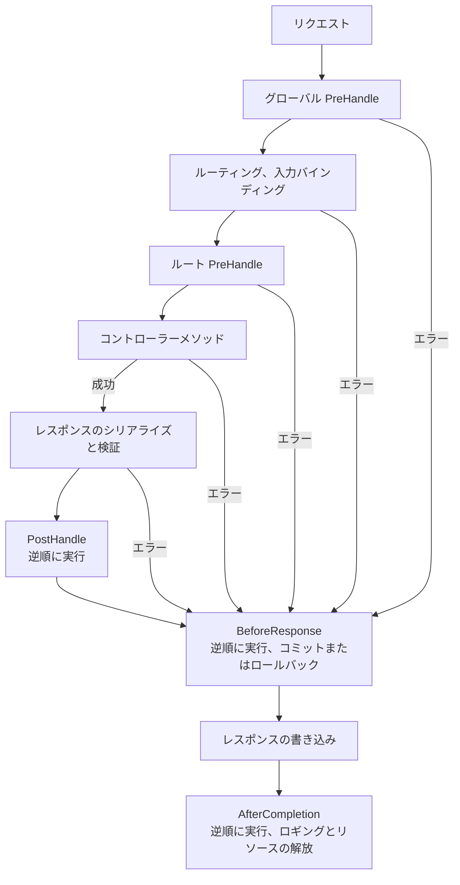

# インターセプター

ユーザー取得のリクエストにロギングとデモ用の認証を追加し、リクエストがインターセプターを通過する順序を確認します。インターセプターは、複数のハンドラーで共有する認証、権限チェック、ロギング、トランザクション処理を担当します。

このページの機能別 `src/user` の例は、[プロジェクト構造](/ja/learn/tutorial/1-project-structure)で `--layout legacy` を指定して作成した `my-app` を使用します。CLI `v0.4.0` の標準レイアウトは役割別の `layered-v1` です。どちらも Spine `v0.6.0` と Echo プラットフォーム `v0.1.0` を使用します。

## CLI プロジェクトから始める

[最初のアプリ](/ja/learn/tutorial/1-project-structure)と[プロジェクト構成](/ja/learn/tutorial/1-project-structure)で作成したプロジェクトを使います。コードのモジュールパスは `example.com/my-app` を基準にしているため、別のモジュールパスで作成した場合は、プロジェクトに合わせて変更してください。

ユーザーリソースがまだなければ、プロジェクトルートで生成します。すでに作成した場合は、生成手順を省略します。

```sh
spine generate resource user --dry-run
```

プレビューで生成ファイルと登録コードの変更を確認してから、生成します。

```sh
spine generate resource user
```

CLI は `src/user` のファイルと、`BuildApplication` 内の `user.Register(app)` の呼び出しを生成します。インターセプターのジェネレーターはないため、`src/interceptor` ディレクトリを作成し、以下のロギングと認証のインターセプターファイルを自分で作成してください。

アプリ全体への登録は `internal/application/application.go` に、ユーザールートの認証ポリシーは `src/user/user_route.go` に記述します。ルートの `main.go` にある構成、検証、実行の流れは維持します。後半の監査ログと注文トランザクションの例は個別の拡張であり、基本アプリの検証手順には必要ありません。


## インターセプターのライフサイクル

Spine v0.6.0 の HTTP リクエストは、グローバルインターセプター、ルーティングと入力バインディング、ルートインターセプター、コントローラーの順に実行されます。インターセプターは、四つのライフサイクルメソッドをすべて実装する必要があります。



入力バインディングに失敗すると、ルートの `PreHandle` も実行されません。ボディの形式チェックより先に認証する必要があるポリシーは、グローバルインターセプターで処理してください。


## インターフェース

```go
type Interceptor interface {
    PreHandle(ctx ExecutionContext, meta HandlerMeta) error
    PostHandle(ctx ExecutionContext, meta HandlerMeta)
    BeforeResponse(ctx ExecutionContext, meta HandlerMeta, executionErr error) error
    AfterCompletion(ctx ExecutionContext, meta HandlerMeta, err error)
}
```

| メソッド | 実行タイミング | 戻り値 | 用途 |
|--------|----------|------|------|
| `PreHandle` | グローバルではルーティング前、ルートでは入力バインディング後 | `error` | 認証、検証、トランザクションの開始 |
| `PostHandle` | コントローラーとレスポンスの準備が成功した後 | なし | 処理完了の記録、後続処理 |
| `BeforeResponse` | レスポンスを実際に書き込む前 | `error` | トランザクションのコミットまたはロールバック |
| `AfterCompletion` | レスポンスの書き込みを試みた後 | なし | ロギング、リソースの解放 |

`BeforeResponse` は、それまでの実行エラーと、レスポンスのシリアライズ、Cookie、ステータスコードの検証エラーを `executionErr` として受け取ります。`PreHandle` に成功したインターセプターだけがこのメソッドを実行するため、その段階で開始したトランザクションを完了させるのに適しています。コミットやロールバックに失敗した場合は、エラーを返してください。

`AfterCompletion` は、エラーが発生した場合も、グローバルインターセプターと、ルーティングで特定したルートインターセプターに対して呼び出されます。`PreHandle` が実行されていないインターセプターも含まれる場合があるため、解放するリソースがあるかどうかを先に確認する必要があります。この時点ではレスポンスがすでに書き込まれている場合があるため、レスポンスの変更には使いません。


## グローバルインターセプターとルートインターセプター

アプリ全体のポリシーはグローバルインターセプターに、特定のルートのポリシーはルートインターセプターに登録します。

| 項目 | グローバルインターセプター | ルートインターセプター |
|------|--------------|----------------|
| 適用範囲 | 対象のトランスポートのすべてのリクエスト | 特定のルートのみ |
| 登録方法 | `app.Interceptor()` | `route.WithInterceptors()` |
| 用途 | CORS、ロギング、トランザクション | 認証、権限チェック |
| 実行順序 | 先に実行 | グローバルの後に実行 |


## グローバルインターセプター

以下のロギングインターセプターをグローバルに登録すると、リクエストのメソッドとパスを記録します。成功時には `PostHandle`、失敗時には `AfterCompletion` のログを確認できます。

### ロギングインターセプターの例

```go
// src/interceptor/logging_interceptor.go
package interceptor

import (
    "log"
    "github.com/NARUBROWN/spine/core"
)

type LoggingInterceptor struct{}

func (i *LoggingInterceptor) PreHandle(ctx core.ExecutionContext, meta core.HandlerMeta) error {
    log.Printf("[REQ] %s %s", ctx.Method(), ctx.Path())
    return nil
}

func (i *LoggingInterceptor) PostHandle(ctx core.ExecutionContext, meta core.HandlerMeta) {
    log.Printf("[RES] %s %s OK",
        ctx.Method(),
        ctx.Path(),
    )
}

func (i *LoggingInterceptor) BeforeResponse(ctx core.ExecutionContext, meta core.HandlerMeta, executionErr error) error {
    return nil
}

func (i *LoggingInterceptor) AfterCompletion(ctx core.ExecutionContext, meta core.HandlerMeta, err error) {
    if err != nil {
        log.Printf("[ERR] %s %s : %v",
            ctx.Method(),
            ctx.Path(),
            err,
        )
    }
}
```

グローバル HTTP の `PreHandle` はルーティング前に実行されるため、この段階の `HandlerMeta` にはコントローラーの型とメソッドがありません。この情報が必要な場合は、ルートインターセプターか、後続のライフサイクルで取得してください。

### グローバルインターセプターを登録する

`internal/application/application.go` を次のように修正します。生成されたヘルスチェックのコントローラーと `user.Register(app)` の呼び出しを維持しながら、ロギングインターセプターを追加します。

```go
// internal/application/application.go
package application

import (
    platform "github.com/NARUBROWN/spine-echo-platform"
    "os"

    "example.com/my-app/src/interceptor"
    "example.com/my-app/src/user"
    "github.com/NARUBROWN/spine"
    "github.com/NARUBROWN/spine/pkg/boot"
    "github.com/NARUBROWN/spine/pkg/httpx"
)

type HealthController struct{}

func NewHealthController() *HealthController { return &HealthController{} }

func (c *HealthController) Get() httpx.Response[map[string]string] {
    return httpx.Response[map[string]string]{Body: map[string]string{"status": "ok"}}
}

func BuildApplication() (spine.App, boot.Options, error) {
    app := platform.New()
    app.Constructor(NewHealthController)
    app.Route("GET", "/health", (*HealthController).Get)
    app.Interceptor(&interceptor.LoggingInterceptor{})

    if err := user.Register(app); err != nil {
        return nil, boot.Options{}, err
    }

    address := ":8080"
    if port := os.Getenv("SPINE_PORT"); port != "" {
        address = ":" + port
    }
    return app, boot.Options{Address: address, HTTP: &boot.HTTPOptions{}}, nil
}
```


## ルートインターセプター

認証インターセプターを `GET /user/:id` に登録し、トークンのないリクエストを HTTP 401 で拒否します。ヘルスチェック用のルート `/health` には、この認証ポリシーを適用しません。

### 認証インターセプターの例

```go
// src/interceptor/auth_interceptor.go
package interceptor

import (
    "errors"

    "github.com/NARUBROWN/spine/core"
    "github.com/NARUBROWN/spine/pkg/httperr"
)

type AuthInterceptor struct{}

func (i *AuthInterceptor) PreHandle(ctx core.ExecutionContext, meta core.HandlerMeta) error {
    token := ctx.Header("Authorization")

    if token == "" {
        return httperr.Unauthorized("인증이 필요합니다.")
    }

    user, err := validateToken(token)
    if err != nil {
        return httperr.Unauthorized("유효하지 않은 토큰입니다.")
    }

    ctx.Set("currentUser", user)
    return nil
}

func (i *AuthInterceptor) PostHandle(ctx core.ExecutionContext, meta core.HandlerMeta) {}

func (i *AuthInterceptor) BeforeResponse(ctx core.ExecutionContext, meta core.HandlerMeta, executionErr error) error { return nil }

func (i *AuthInterceptor) AfterCompletion(ctx core.ExecutionContext, meta core.HandlerMeta, err error) {}

func validateToken(token string) (map[string]string, error) {
    if token != "Bearer demo-token" {
        return nil, errors.New("invalid demo token")
    }
    return map[string]string{"id": "1", "name": "Alice"}, nil
}
```

この例では `Authorization: Bearer demo-token` だけを許可し、それ以外のトークンには HTTP 401 を返します。固定トークンは動作確認用の公開デモであるため、実際のアプリでは認証サービスに置き換えてください。

### ルートインターセプターを登録する

生成された `src/user/user_route.go` を次のコードに変更します。`route.WithInterceptors()` で認証ポリシーを追加し、`BuildApplication` 内の `user.Register(app)` の呼び出しは維持します。

```go
// src/user/user_route.go
package user

import (
    "example.com/my-app/src/interceptor"
    "github.com/NARUBROWN/spine"
    "github.com/NARUBROWN/spine/pkg/route"
)

func Register(app spine.App) error {
    app.Constructor(NewUserRepository, NewUserService, NewUserController)
    app.Route(
        "GET",
        "/user/:id",
        (*UserController).Get,
        route.WithInterceptors(&interceptor.AuthInterceptor{}),
    )
    return nil
}
```


## ロギング、認証、CORS を一緒に適用する

前の節の `BuildApplication` を次のコードに置き換えると、ロギングに加えて CORS ポリシーを適用します。ユーザールートの認証インターセプターは `user_route.go` に残します。

CORS は、`https://app.example.com` から送信されたリクエストを許可するように設定します。`cors.NewValidated` の設定エラーを確認し、HTTP 専用のポリシーであるため `InterceptorFor(boot.InterceptorHTTP, ...)` で登録します。

```go
// internal/application/application.go
package application

import (
    platform "github.com/NARUBROWN/spine-echo-platform"
    "os"

    "example.com/my-app/src/interceptor"
    "example.com/my-app/src/user"
    "github.com/NARUBROWN/spine"
    "github.com/NARUBROWN/spine/pkg/boot"
    "github.com/NARUBROWN/spine/pkg/httpx"
    "github.com/NARUBROWN/spine/interceptor/cors"
)

type HealthController struct{}

func NewHealthController() *HealthController { return &HealthController{} }

func (c *HealthController) Get() httpx.Response[map[string]string] {
    return httpx.Response[map[string]string]{Body: map[string]string{"status": "ok"}}
}

func BuildApplication() (spine.App, boot.Options, error) {
    app := platform.New()
    app.Constructor(NewHealthController)
    app.Route("GET", "/health", (*HealthController).Get)
    app.Interceptor(&interceptor.LoggingInterceptor{})
    corsInterceptor, err := cors.NewValidated(cors.Config{
        AllowOrigins:     []string{"https://app.example.com"},
        AllowMethods:     []string{"GET", "POST", "PUT", "DELETE", "OPTIONS"},
        AllowHeaders:     []string{"Authorization", "Content-Type"},
        AllowCredentials: true,
    })
    if err != nil {
        return nil, boot.Options{}, err
    }
    app.InterceptorFor(boot.InterceptorHTTP, corsInterceptor)

    if err := user.Register(app); err != nil {
        return nil, boot.Options{}, err
    }

    address := ":8080"
    if port := os.Getenv("SPINE_PORT"); port != "" {
        address = ":" + port
    }
    return app, boot.Options{Address: address, HTTP: &boot.HTTPOptions{}}, nil
}
```


## ロギングと認証の動作を検証する

基本例のロギング、認証、CORS のコードを適用してから、プロジェクトルートで実行します。`spine contract check` は静的な契約を検査し、`spine verify` はローカルコードを検査します。実際のリクエストの認証とレスポンスは、サーバーを起動して別途確認します。

```sh
gofmt -w src/interceptor/*.go src/user/user_route.go internal/application/application.go
spine contract check
spine verify
spine dev
```

別のターミナルから、次のリクエストを送信します。

- `/health` は、認証なしで HTTP 200 を返すはずです。
- トークンのない `/user/1` リクエストは、HTTP 401 を返すはずです。
- デモ用トークンを送った `/user/1` リクエストは、HTTP 200 と `{"id":1}` を返すはずです。
- 最後のレスポンスには、`Access-Control-Allow-Origin: https://app.example.com` ヘッダーが含まれるはずです。

```bash
curl -i http://localhost:8080/health
curl -i http://localhost:8080/user/1
curl -i http://localhost:8080/user/1 \
  -H 'Authorization: Bearer demo-token' \
  -H 'Origin: https://app.example.com'
```

これらのリクエストで確認できるのは、デモ用の HTTP 認証だけです。実際の認証サービス、WebSocket 認証、データベーストランザクションの動作は、それぞれの環境を構成してから別途検証してください。

## 実行順序

`PreHandle` は登録順に実行します。成功後の `PostHandle`、`BeforeResponse`、`AfterCompletion` は、ルートインターセプターを逆順に実行してから、グローバルインターセプターを逆順に実行します。

### 成功したリクエストの実行フロー

先ほど登録したロギング、CORS、認証のインターセプターがすべて成功すると、次の順序で実行されます。

```text
リクエスト (GET /user/1)
   │
   ├─→ Logging.PreHandle     (グローバル 1)
   ├─→ CORS.PreHandle        (グローバル 2)
   ├─→ ルーティングと入力バインディング
   ├─→ Auth.PreHandle        (ルート 1)
   │
   ├─→ UserController.Get
   ├─→ レスポンスのシリアライズと検証
   │
   ├─→ Auth.PostHandle       (ルート 1)
   ├─→ CORS.PostHandle       (グローバル 2)
   ├─→ Logging.PostHandle    (グローバル 1)
   │
   ├─→ Auth.BeforeResponse       (ルート 1)
   ├─→ CORS.BeforeResponse       (グローバル 2)
   ├─→ Logging.BeforeResponse    (グローバル 1)
   │
   ├─→ レスポンスの書き込み
   │
   ├─→ Auth.AfterCompletion       (ルート 1)
   ├─→ CORS.AfterCompletion       (グローバル 2)
   └─→ Logging.AfterCompletion    (グローバル 1)

完了
```

`PostHandle` は、コントローラーが成功しても、レスポンスのシリアライズや検証に失敗した場合は実行しません。`BeforeResponse` は `PreHandle` に成功したインターセプターだけが実行し、`AfterCompletion` はルーティングで特定したインターセプターもリソース解放の対象にします。


## エラーが発生したリクエストの処理

### PreHandle でエラーを返す

`PreHandle` でエラーを返すと、後続のインターセプターの `PreHandle` とコントローラーは呼び出しません。すでに `PreHandle` に成功したインターセプターの `BeforeResponse` は実行し、最後に `AfterCompletion` でリソースを解放します。

以下は、認証失敗の分岐だけを抜粋したコードです。先ほど作成した `AuthInterceptor` をこのコードに置き換えると、トークンの有効性チェックがなくなるため、元の実装を維持してください。

```go
func (i *AuthInterceptor) PreHandle(ctx core.ExecutionContext, meta core.HandlerMeta) error {
    token := ctx.Header("Authorization")
    if token == "" {
        return httperr.Unauthorized("인증이 필요합니다.")
    }
    return nil
}
```

```text
リクエスト (GET /user/1, トークンなし)
   │
   ├─→ Logging.PreHandle     (成功)
   ├─→ CORS.PreHandle        (成功)
   ├─→ ルーティングと入力バインディング
   ├─→ Auth.PreHandle        (エラーを返す)
   │
   ├─→ CORS.BeforeResponse
   ├─→ Logging.BeforeResponse
   │
   ├─→ レスポンスの書き込み (401 Unauthorized)
   │
   ├─→ Auth.AfterCompletion
   ├─→ CORS.AfterCompletion
   └─→ Logging.AfterCompletion

完了
```


## リクエストの値を共有する: ExecutionContext

インターセプターは `core.ExecutionContext` からリクエスト情報を読み取り、同じリクエストを処理する他のインターセプターやコントローラーに値を渡します。コントローラーは読み取り専用の `spine.Ctx` で共有値を取得します。

### メソッド

| メソッド | 説明 |
|--------|------|
| `Context()` | `context.Context` を返す |
| `Method()` | HTTP メソッド（GET、POST など） |
| `Path()` | リクエストのパス |
| `Header(name)` | ヘッダーの値を取得 |
| `Params()` | すべてのパスパラメーターを取得 |
| `PathKeys()` | ルートで宣言したパスパラメーター名の順序 |
| `Queries()` | すべてのクエリパラメーターを取得 |
| `EventBus()` | リクエストのイベントバスを取得 |
| `Set(key, value)` | 値を保存 |
| `Get(key)` | 値を取得 |

### インターセプター間でデータを渡す

以下は、認証インターセプターが保存した `currentUser` を監査インターセプターが読み取る部分だけを抜粋した例です。監査インターセプターを追加するには、`AuditInterceptor` 型と四つのライフサイクルメソッドを実装し、認証インターセプターの後に登録してください。既存の認証インターセプターの `PreHandle` と重複して宣言しないでください。

```go
// AuthInterceptor — 사용자 정보 저장
func (i *AuthInterceptor) PreHandle(ctx core.ExecutionContext, meta core.HandlerMeta) error {
    token := ctx.Header("Authorization")
    user, err := validateToken(token)
    if err != nil {
        return httperr.Unauthorized("invalid credentials")
    }
    ctx.Set("currentUser", user)
    return nil
}

// 컨트롤러에서는 읽기 전용 spine.Ctx로 조회
// 또는 다른 인터셉터에서 조회
func (i *AuditInterceptor) PreHandle(ctx core.ExecutionContext, meta core.HandlerMeta) error {
    user, ok := ctx.Get("currentUser")
    if ok {
        log.Printf("User %v accessing %s", user, ctx.Path())
    }
    return nil
}
```


## ハンドラー情報: HandlerMeta

`core.HandlerMeta` は、ルーティングで決定したコントローラーとメソッドの情報を持ちます。グローバルの `PreHandle` はまだルーティング前であるため、型とメソッドは使えません。

| フィールド | 型 | 説明 |
|------|------|------|
| `ControllerType` | `reflect.Type` | コントローラーの型 |
| `Method` | `reflect.Method` | ハンドラーメソッド |
| `PathKeys` | `[]string` | ルートで宣言したパスパラメーター名の順序 |
| `Interceptors` | `[]Interceptor` | ルートにバインドされたインターセプター |

### 使用例

以下は、メタデータの取得部分を示す独立した例です。ルートインターセプターで実行すると、コントローラーとメソッドを記録できます。既存のロギングインターセプターと同じメソッドを重複して宣言しないでください。

```go
func (i *LoggingInterceptor) PreHandle(ctx core.ExecutionContext, meta core.HandlerMeta) error {
    if meta.ControllerType != nil {
        log.Printf("컨트롤러: %s", meta.ControllerType.String())
    }
    log.Printf("메서드: %s", meta.Method.Name)              // GetUser
    return nil
}
```


## 依存性注入が必要なインターセプター

依存性を受け取るインターセプターは、コンストラクタを `app.Constructor` に登録し、インターセプターの登録時には型を表すポインターを渡します。コンテナーがその型のインスタンスを作成して注入します。

### トランザクションインターセプターの例

以下は、[データベース](/ja/learn/tutorial/5-database)を接続したアプリに追加する、独立した拡張例です。基本的なロギングと認証の例の検証には必要ありません。

`PreHandle` はトランザクションをリクエストコンテキストに保存し、`BeforeResponse` は実行エラーがあればロールバックし、なければコミットします。コントローラーは `spine.Ctx` からトランザクションを読み取り、サービスとリポジトリのメソッドに渡す必要があります。コンストラクタで作成して共有しているサービスやリポジトリに、リクエストごとのトランザクションが自動で再注入されることはありません。

```go
// src/interceptor/tx_interceptor.go
package interceptor

import (
    "github.com/NARUBROWN/spine/core"
    "github.com/uptrace/bun"
)

type TxInterceptor struct {
    db *bun.DB
}

func NewTxInterceptor(db *bun.DB) *TxInterceptor {
    return &TxInterceptor{db: db}
}

func (i *TxInterceptor) PreHandle(ctx core.ExecutionContext, meta core.HandlerMeta) error {
    tx, err := i.db.BeginTx(ctx.Context(), nil)
    if err != nil {
        return err
    }
    ctx.Set("tx", tx)
    return nil
}

func (i *TxInterceptor) PostHandle(ctx core.ExecutionContext, meta core.HandlerMeta) {}

func (i *TxInterceptor) BeforeResponse(ctx core.ExecutionContext, meta core.HandlerMeta, executionErr error) error {
    v, ok := ctx.Get("tx")
    if !ok {
        return nil
    }

    tx, ok := v.(bun.Tx)
    if !ok {
        return nil
    }
    if executionErr != nil {
        return tx.Rollback()
    } else {
        return tx.Commit()
    }
}

func (i *TxInterceptor) AfterCompletion(ctx core.ExecutionContext, meta core.HandlerMeta, err error) {}
```

### グローバルに登録する

次の登録コードは、`BuildApplication` 内に追加する部分です。`NewDB` は `*bun.DB` を一つ返すコンストラクタとして実装する必要があります。

```go
app.Constructor(
    NewDB,
    interceptor.NewTxInterceptor,
)

app.Interceptor(
    (*interceptor.TxInterceptor)(nil),  // 타입으로 참조
)
```

### ルートに登録する

注文作成のリクエストにだけ適用するには、グローバルへの登録の代わりに、次のようにルートに登録します。`OrderController` のコンストラクタと `CreateOrder` メソッドは、別途実装して登録する必要があります。

```go
app.Constructor(
    NewDB,
    interceptor.NewTxInterceptor,
)

app.Route(
    "POST",
    "/orders",
    (*OrderController).CreateOrder,
    route.WithInterceptors((*interceptor.TxInterceptor)(nil)),  // 타입으로 참조
)
```


## 登録方法を選ぶ

グローバルとルートのどちらでも、依存性のないインターセプターはインスタンスを直接渡せます。依存性を受け取るインターセプターは、コンストラクタを登録してから型で参照します。

| 方法 | グローバルへの登録 | ルートへの登録 |
|------|----------|------------|
| インスタンスを渡す | `app.Interceptor(&interceptor.LoggingInterceptor{})` | `route.WithInterceptors(&interceptor.AuthInterceptor{})` |
| コンストラクタで解決する型を参照する | `app.Interceptor((*interceptor.TxInterceptor)(nil))` | `route.WithInterceptors((*interceptor.TxInterceptor)(nil))` |


## 次のステップ

- [チュートリアル: データベース](/ja/learn/tutorial/5-database) — Bun ORM の接続
- [チュートリアル: エラー処理](/ja/learn/tutorial/7-error-handling) — httperr の使い方
