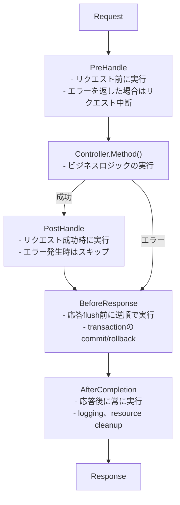

# インターセプター

インターセプターの作成と使用方法。

## CLIプロジェクトから始める

[最初のアプリ](/ja/learn/getting-started/first-app)と[プロジェクト構造](/ja/learn/tutorial/1-project-structure)の `example.com/my-app` を使用します。ユーザーリソースがまだなければ、プロジェクトルートで生成します。

```sh
spine generate resource user --dry-run
```

```sh
spine generate resource user
```

テキストのプレビューで生成ファイルを確認してから通常の生成コマンドを実行します。生成済みのリソースは再生成しません。

CLIは `src/user` と `BuildApplication` 内の `user.Register(app)` を生成します。インターセプター生成機能はないため、以下の `src/interceptor` ファイルは手動で作成します。ログイン・更新・注文などの追加メソッドはポリシー説明用の手動拡張で、生成結果には含まれません。登録は `internal/application/application.go`、ルートのポリシーは `src/user/user_route.go` に追加し、ルートの `main.go` は構築・検証・実行の役割を維持します。


## インターセプターとは？

インターセプターはリクエストの前後に実行されるロジックです。

- トランザクション管理
- ロギング
- 認証/認可
- リクエストの検証

## ライフサイクル

Spine v0.5.1のinterceptorは4段階のlifecycleを持ちます。





## インターフェース


```go
type Interceptor interface {
    PreHandle(ctx ExecutionContext, meta HandlerMeta) error
    PostHandle(ctx ExecutionContext, meta HandlerMeta)
    BeforeResponse(ctx ExecutionContext, meta HandlerMeta, executionErr error) error
    AfterCompletion(ctx ExecutionContext, meta HandlerMeta, err error)
}
```

| メソッド | 実行タイミング | 戻り値 | 用途 |
|--------|----------|------|------|
| `PreHandle` | コントローラー実行前 | `error` | 認証、検証、トランザクション開始 |
| `PostHandle` | コントローラー成功後 | なし | 応答の加工 |
| `BeforeResponse` |実際の応答を書き込む前| `error` | transactionのcommit/rollback |
| `AfterCompletion` |応答処理後に常に実行|なし|logging、resource cleanup|

`BeforeResponse`は直列化、Cookie、status検証のエラーを`executionErr`で受け取ります。transaction処理のエラーは必ず返してください。`AfterCompletion`の時点では応答がすでに書き込まれている場合があります。


## グローバルインターセプター vs ルートインターセプター

Spineは2つのレベルのインターセプターをサポートしています。

| 区分 | グローバルインターセプター | ルートインターセプター |
|------|--------------|----------------|
| 適用範囲 | すべてのリクエスト | 特定のルートのみ |
| 登録方法 | `app.Interceptor()` | `route.WithInterceptors()` |
| 用途 | CORS、ロギング、トランザクション | 認証、権限の検査 |
| 実行順序 | 先に実行される | グローバルの後に実行される |


## グローバルインターセプター

すべてのリクエストに適用されるインターセプターです。

### ロギングインターセプターの例


```go
// src/interceptor/logging_interceptor.go
package interceptor

import (
    "log"
    "github.com/NARUBROWN/spine/core"
)

type LoggingInterceptor struct{}

func (i *LoggingInterceptor) PreHandle(ctx core.ExecutionContext, meta core.HandlerMeta) error {
    log.Printf("[REQ] %s %s", ctx.Method(), ctx.Path())
    return nil
}

func (i *LoggingInterceptor) PostHandle(ctx core.ExecutionContext, meta core.HandlerMeta) {
    log.Printf("[RES] %s %s OK",
        ctx.Method(),
        ctx.Path(),
    )
}

func (i *LoggingInterceptor) BeforeResponse(ctx core.ExecutionContext, meta core.HandlerMeta, executionErr error) error {
    return nil
}

func (i *LoggingInterceptor) AfterCompletion(ctx core.ExecutionContext, meta core.HandlerMeta, err error) {
    if err != nil {
        log.Printf("[ERR] %s %s : %v",
            ctx.Method(),
            ctx.Path(),
            err,
        )
    }
}
```

グローバルHTTPの `PreHandle` はルーティング前に実行されるため、`HandlerMeta` の型やメソッドが空の場合があります。生成済みの `NewHealthController` は維持します。

### グローバルインターセプターの登録


```go
// internal/application/application.go
package application

import (
    "os"

    "example.com/my-app/src/interceptor"
    "example.com/my-app/src/user"
    "github.com/NARUBROWN/spine"
    "github.com/NARUBROWN/spine/pkg/boot"
    "github.com/NARUBROWN/spine/pkg/httpx"
)

type HealthController struct{}

func NewHealthController() *HealthController { return &HealthController{} }

func (c *HealthController) Get() httpx.Response[map[string]string] {
    return httpx.Response[map[string]string]{Body: map[string]string{"status": "ok"}}
}

func BuildApplication() (spine.App, boot.Options, error) {
    app := spine.New()
    app.Constructor(NewHealthController)
    app.Route("GET", "/health", (*HealthController).Get)
    app.Interceptor(&interceptor.LoggingInterceptor{})

    if err := user.Register(app); err != nil {
        return nil, boot.Options{}, err
    }

    address := ":8080"
    if port := os.Getenv("SPINE_PORT"); port != "" {
        address = ":" + port
    }
    return app, boot.Options{Address: address, HTTP: &boot.HTTPOptions{}}, nil
}
```


## ルートインターセプター

特定のルートにのみ適用されるインターセプターです。

### 認証インターセプターの例


```go
// src/interceptor/auth_interceptor.go
package interceptor

import (
    "errors"

    "github.com/NARUBROWN/spine/core"
    "github.com/NARUBROWN/spine/pkg/httperr"
)

type AuthInterceptor struct{}

func (i *AuthInterceptor) PreHandle(ctx core.ExecutionContext, meta core.HandlerMeta) error {
    token := ctx.Header("Authorization")
    
    if token == "" {
        return httperr.Unauthorized("認証が必要です。")
    }
    
    user, err := validateToken(token)
    if err != nil {
        return httperr.Unauthorized("無効なトークンです。")
    }
    
    ctx.Set("currentUser", user)
    return nil
}

func (i *AuthInterceptor) PostHandle(ctx core.ExecutionContext, meta core.HandlerMeta) {}

func (i *AuthInterceptor) BeforeResponse(ctx core.ExecutionContext, meta core.HandlerMeta, executionErr error) error { return nil }

func (i *AuthInterceptor) AfterCompletion(ctx core.ExecutionContext, meta core.HandlerMeta, err error) {}

func validateToken(token string) (map[string]string, error) {
    if token != "Bearer demo-token" {
        return nil, errors.New("invalid demo token")
    }
    return map[string]string{"id": "1", "name": "Alice"}, nil
}
```

トークン確認は動作確認用の公開デモです。実際のアプリでは認証サービスに置き換えてください。生成された `GET /user/:id` の登録を以下に変更し、`BuildApplication` の `user.Register(app)` は維持します。

### ルートインターセプターの登録

`route.WithInterceptors()` を使用します。


```go
// src/user/user_route.go
package user

import (
    "example.com/my-app/src/interceptor"
    "github.com/NARUBROWN/spine"
    "github.com/NARUBROWN/spine/pkg/route"
)

func Register(app spine.App) error {
    app.Constructor(NewUserRepository, NewUserService, NewUserController)
    app.Route(
        "GET",
        "/user/:id",
        (*UserController).Get,
        route.WithInterceptors(&interceptor.AuthInterceptor{}),
    )
    return nil
}
```


## グローバル + ルートインターセプターの組み合わせ

実際のアプリケーションでは、2つを一緒に使用します。


```go
// internal/application/application.go
package application

import (
    "os"

    "example.com/my-app/src/interceptor"
    "example.com/my-app/src/user"
    "github.com/NARUBROWN/spine"
    "github.com/NARUBROWN/spine/pkg/boot"
    "github.com/NARUBROWN/spine/pkg/httpx"
    "github.com/NARUBROWN/spine/interceptor/cors"
)

type HealthController struct{}

func NewHealthController() *HealthController { return &HealthController{} }

func (c *HealthController) Get() httpx.Response[map[string]string] {
    return httpx.Response[map[string]string]{Body: map[string]string{"status": "ok"}}
}

func BuildApplication() (spine.App, boot.Options, error) {
    app := spine.New()
    app.Constructor(NewHealthController)
    app.Route("GET", "/health", (*HealthController).Get)
    app.Interceptor(&interceptor.LoggingInterceptor{})
    corsInterceptor, err := cors.NewValidated(cors.Config{
        AllowOrigins:     []string{"https://app.example.com"},
        AllowMethods:     []string{"GET", "POST", "PUT", "DELETE", "OPTIONS"},
        AllowHeaders:     []string{"Authorization", "Content-Type"},
        AllowCredentials: true,
    })
    if err != nil {
        return nil, boot.Options{}, err
    }
    app.InterceptorFor(boot.InterceptorHTTP, corsInterceptor)

    if err := user.Register(app); err != nil {
        return nil, boot.Options{}, err
    }

    address := ":8080"
    if port := os.Getenv("SPINE_PORT"); port != "" {
        address = ":" + port
    }
    return app, boot.Options{Address: address, HTTP: &boot.HTTPOptions{}}, nil
}
```


## 実行順序

グローバルインターセプターが先に、ルートインターセプターが後で実行されます。

### 登録例


```go
// グローバルインターセプター
app.Interceptor(
    &interceptor.LoggingInterceptor{},   // グローバル 1
    &interceptor.CORSInterceptor{},      // グローバル 2
)

// ルートインターセプター
app.Route(
    "GET",
    "/users/:id",
    (*UserController).GetUser,
    route.WithInterceptors(&interceptor.AuthInterceptor{}),  // ルート 1
)
```

### 実行フロー

```
Request (GET /users/1)
   │
   ├─→ Logging.PreHandle     (グローバル 1)
   ├─→ CORS.PreHandle        (グローバル 2)
   ├─→ Auth.PreHandle        (ルート 1)
   │
   ├─→ UserController.GetUser
   │
   ├─→ Auth.PostHandle       (ルート 1)
   ├─→ CORS.PostHandle       (グローバル 2)
   ├─→ Logging.PostHandle    (グローバル 1)
   │
   ├─→ Auth.BeforeResponse       (ルート 1)
   ├─→ CORS.BeforeResponse       (グローバル 2)
   ├─→ Logging.BeforeResponse    (グローバル 1)
   │
   ├─→ Auth.AfterCompletion       (ルート 1)
   ├─→ CORS.AfterCompletion       (グローバル 2)
   └─→ Logging.AfterCompletion    (グローバル 1)
   
Response
```

- `PreHandle`: グローバル → ルートの順序
- `PostHandle`: ルート → グローバルの逆順
- `BeforeResponse`: `PreHandle`に成功したinterceptorだけをルート → グローバルの逆順
- `AfterCompletion`: ルート → グローバルの逆順


## エラー処理

### PreHandleでエラーを返す

`PreHandle`でエラーを返すと、リクエストが中断されます。


```go
func (i *AuthInterceptor) PreHandle(ctx core.ExecutionContext, meta core.HandlerMeta) error {
    token := ctx.Header("Authorization")
    if token == "" {
        return httperr.Unauthorized("認証が必要です。")
    }
    return nil
}
```

```
Request (GET /users/1, トークンなし)
   │
   ├─→ Logging.PreHandle     ✓
   ├─→ CORS.PreHandle        ✓
   ├─→ Auth.PreHandle        ✗ (エラーを返す)
   │
   ├─→ CORS.BeforeResponse
   ├─→ Logging.BeforeResponse
   │
   ├─→ Auth.AfterCompletion
   ├─→ CORS.AfterCompletion
   └─→ Logging.AfterCompletion
   
Response (401 Unauthorized)
```


## ExecutionContext

リクエストコンテキストに値を保存し、照会します。

### メソッド

| メソッド | 説明 |
|--------|------|
| `Context()` | `context.Context` を返す |
| `Method()` | HTTPメソッド (GET、POSTなど) |
| `Path()` | リクエストパス |
| `Header(name)` | ヘッダー値の照会 |
| `Set(key, value)` | 値の保存 |
| `Get(key)` | 値の照会 |

### インターセプター間のデータ伝達

次のコードは`PreHandle`でcontextを共有する部分だけを抜粋した例です。新しい型を実際に登録する場合は、4つのlifecycleメソッドをすべて実装してください。


```go
// AuthInterceptor — ユーザー情報を保存
func (i *AuthInterceptor) PreHandle(ctx core.ExecutionContext, meta core.HandlerMeta) error {
    token := ctx.Header("Authorization")
    user, err := validateToken(token)
    if err != nil {
        return httperr.Unauthorized("invalid credentials")
    }
    ctx.Set("currentUser", user)
    return nil
}

// 컨트롤러에서는 읽기 전용 spine.Ctx로 조회
// または別のインターセプターで照会
func (i *AuditInterceptor) PreHandle(ctx core.ExecutionContext, meta core.HandlerMeta) error {
    user, ok := ctx.Get("currentUser")
    if ok {
        log.Printf("User %v accessing %s", user, ctx.Path())
    }
    return nil
}
```


## HandlerMeta

実行されるハンドラーのメタ情報です。

| フィールド | タイプ | 説明 |
|------|------|------|
| `ControllerType` | `reflect.Type` | コントローラーのタイプ |
| `Method` | `reflect.Method` | ハンドラーメソッド |
| `Interceptors` | `[]Interceptor` | ルートにバインドされたインターセプター |

### 使用例


```go
func (i *LoggingInterceptor) PreHandle(ctx core.ExecutionContext, meta core.HandlerMeta) error {
    if meta.ControllerType != nil {
        log.Printf("コントローラー: %s", meta.ControllerType.String())
    }
    log.Printf("メソッド: %s", meta.Method.Name)              // GetUser
    return nil
}
```


## 依存性の注入が必要なインターセプター

コンストラクタを持つインターセプターは、まず `Constructor` に登録します。

### トランザクションインターセプターの例


```go
// src/interceptor/tx_interceptor.go
package interceptor

import (
    "github.com/NARUBROWN/spine/core"
    "github.com/uptrace/bun"
)

type TxInterceptor struct {
    db *bun.DB
}

func NewTxInterceptor(db *bun.DB) *TxInterceptor {
    return &TxInterceptor{db: db}
}

func (i *TxInterceptor) PreHandle(ctx core.ExecutionContext, meta core.HandlerMeta) error {
    tx, err := i.db.BeginTx(ctx.Context(), nil)
    if err != nil {
        return err
    }
    ctx.Set("tx", tx)
    return nil
}

func (i *TxInterceptor) PostHandle(ctx core.ExecutionContext, meta core.HandlerMeta) {}

func (i *TxInterceptor) BeforeResponse(ctx core.ExecutionContext, meta core.HandlerMeta, executionErr error) error {
    v, ok := ctx.Get("tx")
    if !ok {
        return nil
    }
    
    tx, ok := v.(bun.Tx)
    if !ok {
        return nil
    }
    if executionErr != nil {
        return tx.Rollback()
    } else {
        return tx.Commit()
    }
}

func (i *TxInterceptor) AfterCompletion(ctx core.ExecutionContext, meta core.HandlerMeta, err error) {}
```

### 登録 (グローバル)


```go
app.Constructor(
    NewDB,
    interceptor.NewTxInterceptor,
)

app.Interceptor(
    (*interceptor.TxInterceptor)(nil),  // タイプで参照
)
```

### 登録 (ルート)


```go
app.Constructor(
    NewDB,
    interceptor.NewTxInterceptor,
)

app.Route(
    "POST",
    "/orders",
    (*OrderController).CreateOrder,
    route.WithInterceptors((*interceptor.TxInterceptor)(nil)),  // タイプで参照
)
```


## 登録方法のまとめ

### グローバルインターセプター

| 方式 | コード | 使用タイミング |
|------|------|----------|
| インスタンスを直接渡す | `&interceptor.LoggingInterceptor{}` | 依存関係なし |
| タイプで参照 | `(*interceptor.TxInterceptor)(nil)` | 依存関係あり |


```go
app.Interceptor(
    &interceptor.LoggingInterceptor{},      // インスタンス
    (*interceptor.TxInterceptor)(nil),      // タイプ参照
)
```

### ルートインターセプター

| 方式 | コード | 使用タイミング |
|------|------|----------|
| インスタンスを直接渡す | `&interceptor.AuthInterceptor{}` | 依存関係なし |
| タイプで参照 | `(*interceptor.TxInterceptor)(nil)` | 依存関係あり |


```go
app.Route(
    "GET",
    "/users/:id",
    (*UserController).GetUser,
    route.WithInterceptors(
        &interceptor.AuthInterceptor{},         // インスタンス
        (*interceptor.TxInterceptor)(nil),      // タイプ参照
    ),
)
```


## 要点のまとめ

| 概念 | 説明 |
|------|------|
| **グローバルインターセプター** | `app.Interceptor()` — すべてのリクエストに適用 |
| **ルートインターセプター** | `route.WithInterceptors()` — 特定のルートのみ適用 |
| **実行順序** | global → route（`PostHandle`/`BeforeResponse`/`AfterCompletion`は逆順）|
| **4段階lifecycle** | PreHandle → PostHandle → BeforeResponse → AfterCompletion |
| **エラー時中断** | PreHandleでのエラー → コントローラースキップ |
| **コンテキスト共有** | `ctx.Set()` / `ctx.Get()` でデータ伝達 |


## 検証

プロジェクトルートで実行します。静的契約・ローカルGo検証と、実際のHTTP・WebSocket認証やDBのE2E検証は別です。

```sh
gofmt -w src/interceptor/*.go src/user/user_route.go internal/application/application.go
spine contract check
spine verify
spine dev
```

別のターミナルで確認します。healthはHTTP 200、トークンなしは401、デモトークン付きは200となり、最後の応答には設定したoriginのCORSヘッダーが含まれます。

```bash
curl -i http://localhost:8080/health
curl -i http://localhost:8080/user/1
curl -i http://localhost:8080/user/1 \
  -H 'Authorization: Bearer demo-token' \
  -H 'Origin: https://app.example.com'
```

## 次のステップ

- [チュートリアル: データベース](/ja/learn/tutorial/5-database) — Bun ORM接続
- [チュートリアル: エラー処理](/ja/learn/tutorial/7-error-handling) — httperr の使い方
