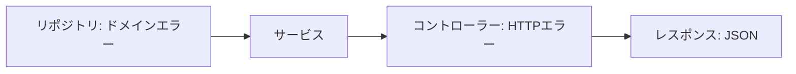

# エラー処理

ユーザーの取得に失敗した原因に応じてHTTP 400または404を返し、予期しないエラーの内部情報をレスポンスに公開しないようにします。

[最初のアプリ](/ja/learn/getting-started/first-app)と[コントローラー](/ja/learn/tutorial/2-controller)のCLIプロジェクトを使用します。`spine generate resource user` で生成した `src/user` が必要です。以下では、GETハンドラーを読み取り専用のメモリ内検索に置き換えるため、データベースのチュートリアルとは別に適用してください。ドメインエラーとHTTPステータスを対応付けるコードは手動で作成します。

## HTTPエラーとレスポンス

成功時の結果は `httpx.Response[T]` に格納し、エラーは別の `error` 戻り値で渡します。ハンドラーの戻り値の型は `(httpx.Response[User], error)` とし、`(User, error)` は使用しません。`httperr` は次の4つの関数を提供します。

| 関数 | HTTPステータス | 用途 |
|---|---|---|
| `httperr.BadRequest(message)` | 400 | 不正な入力 |
| `httperr.Unauthorized(message)` | 401 | 認証が必要 |
| `httperr.NotFound(message)` | 404 | リソースが存在しない |
| `httperr.InternalServerError(message)` | 500 | クライアントに公開するサーバーエラーメッセージ |

`HTTPError.Message` はクライアントに公開されるため、内部のDBエラーや秘密情報をそのまま入れないでください。通常の `error` を返すと、HTTP 500と `{"message":"Internal server error"}` に変換されます。

## 生成されたリソースに取得エラーを追加

生成された `src/user/user_repository.go` と `src/user/user_controller.go` を以下の内容に置き換え、`src/user/user_service.go` に `Find` メソッドを追加します。すべてのファイルを `package user` に置きます。既存のコンストラクタ名、`user.Register(app)`、`GET /user/:id` の登録は維持します。

リポジトリには、IDが1のAliceだけを保持します。取得エラーを再現するための例であり、DBにはデータを保存しません。

```go
// src/user/user_repository.go
package user

import "errors"

var ErrUserNotFound = errors.New("user not found")
var ErrEmailAlreadyExists = errors.New("email already exists")

type User struct {
    ID int64 `json:"id"`
    Name string `json:"name"`
}

type UserRepository struct{ users map[int64]User }

func NewUserRepository() *UserRepository {
    return &UserRepository{users: map[int64]User{1: {ID: 1, Name: "Alice"}}}
}

func (r *UserRepository) FindByID(id int64) (User, error) {
    user, ok := r.users[id]
    if !ok {
        return User{}, ErrUserNotFound
    }
    return user, nil
}
```

```go
// src/user/user_service.go
func (s *UserService) Find(id int64) (User, error) {
    return s.repository.FindByID(id)
}
```

```go
// src/user/user_controller.go
package user

import (
    "errors"
    "net/http"

    "github.com/NARUBROWN/spine/pkg/httperr"
    "github.com/NARUBROWN/spine/pkg/httpx"
    "github.com/NARUBROWN/spine/pkg/path"
)

type UserController struct{ service *UserService }

func NewUserController(service *UserService) *UserController {
    return &UserController{service: service}
}

func (c *UserController) Get(id path.Int) (httpx.Response[User], error) {
    if id.Value <= 0 {
        return httpx.Response[User]{}, httperr.BadRequest("invalid user ID")
    }
    user, err := c.service.Find(id.Value)
    if err != nil {
        return httpx.Response[User]{}, toHTTPError(err)
    }
    return httpx.Response[User]{Body: user}, nil
}

func toHTTPError(err error) error {
    switch {
    case errors.Is(err, ErrUserNotFound):
        return httperr.NotFound("user not found")
    case errors.Is(err, ErrEmailAlreadyExists):
        return &httperr.HTTPError{
            Status: http.StatusConflict,
            Message: "email already exists",
            Cause: err,
        }
    default:
        return err
    }
}
```

## 各レイヤーの責任

リポジトリはドメインエラーを返し、サービスはそれをコントローラーに渡します。コントローラーは想定したエラーをHTTPステータスに変換します。`errors.Is` を使用すると、別のエラーにラップされたドメインエラーも判定できます。

未知のエラーはそのまま返し、通常のHTTP 500の処理を使用します。これを `BadRequest(err.Error())` に変更すると、内部のエラーメッセージがレスポンスに公開されます。上のメモリ内リポジトリは `ErrUserNotFound` だけを返します。`ErrEmailAlreadyExists` の分岐は、後で保存機能を追加する際に使用するマッピングの例です。



## HTTPErrorとその他のステータス

HTTP 403や409のように専用の関数がないステータスは、`HTTPError` で表します。`Cause` は原因となったエラーを保持し、JSONレスポンスには含まれません。v0.5.1の `HTTPError` は `Unwrap()` を実装していないため、`errors.As` で `HTTPError` を見つけてから `Cause` フィールドを読み取ります。以下は `HTTPError` の構造とメソッドです。アプリで再定義する必要はありません。

```go
type HTTPError struct {
    Status int
    Message string
    Cause error
}

func (e *HTTPError) Error() string { return e.Message }
```

```go
return &httperr.HTTPError{
    Status: http.StatusForbidden,
    Message: "permission denied",
}
```

## リクエストDTOの検証

入力検証を追加するには、次の `src/user/user_create.go` を作成します。`Validate()` は自動で呼び出されないため、ハンドラーから直接呼び出します。リクエストDTOはポインタで受け取ります。

このPOSTハンドラーは、名前またはメールアドレスが空の場合や、名前が100文字を超える場合にHTTP 400を返します。検証を通過すると入力をHTTP 201で返しますが、ユーザーは保存しません。使用する場合は、以下のPOSTルートも `src/user/user_route.go` の `Register` に追加してください。

```go
// src/user/user_create.go
package user

import (
    "errors"
    "net/http"
    "unicode/utf8"

    "github.com/NARUBROWN/spine/pkg/httperr"
    "github.com/NARUBROWN/spine/pkg/httpx"
)

type CreateUserRequest struct {
    Name string `json:"name"`
    Email string `json:"email"`
}

func (r *CreateUserRequest) Validate() error {
    if r == nil || r.Name == "" {
        return errors.New("name is required")
    }
    if utf8.RuneCountInString(r.Name) > 100 {
        return errors.New("name must be at most 100 characters")
    }
    if r.Email == "" {
        return errors.New("email is required")
    }
    return nil
}

func (c *UserController) Create(req *CreateUserRequest) (httpx.Response[CreateUserRequest], error) {
    if err := req.Validate(); err != nil {
        return httpx.Response[CreateUserRequest]{}, httperr.BadRequest(err.Error())
    }
    return httpx.Response[CreateUserRequest]{
        Body: *req,
        Options: httpx.ResponseOptions{Status: http.StatusCreated},
    }, nil
}
```

```go
// src/user/user_route.go: Register
app.Route("POST", "/user", (*UserController).Create)
```

## インターセプターのエラー処理

`PreHandle` でエラーを返すと、コントローラーは実行されません。次のコードは、独自の認証サービスを持つインターセプターのメソッドの一部です。このメソッドだけをコピーしても使用できません。`src/interceptor` に型と認証サービスを定義し、`PreHandle`、`PostHandle`、`BeforeResponse`、`AfterCompletion` の4つのメソッドをすべて実装する必要があります。HTTPリクエストに適用するには、`BuildApplication()` で `boot.InterceptorHTTP` の範囲に登録します。

```go
func (i *AuthInterceptor) PreHandle(ctx core.ExecutionContext, meta core.HandlerMeta) error {
    token := ctx.Header("Authorization")
    if token == "" {
        return httperr.Unauthorized("authentication required")
    }
    user, err := i.auth.Validate(token)
    if err != nil {
        return httperr.Unauthorized("invalid token")
    }
    ctx.Set("auth.user", user)
    return nil
}
```

## エラーのログ記録

`AfterCompletion` で最終的な実行エラーをログに記録できます。次のコードもロギング用インターセプターから抜粋したメソッドであるため、インターセプター全体の型定義と登録が必要です。認証トークンやリクエストの秘密情報をログに記録しないでください。

```go
func (i *LoggingInterceptor) AfterCompletion(ctx core.ExecutionContext, meta core.HandlerMeta, err error) {
    if err != nil {
        log.Printf("[ERR] %s %s: %v", ctx.Method(), ctx.Path(), err)
    }
}
```

## 検証とHTTPレスポンスの確認

```bash
gofmt -w src/user
go mod tidy
spine doctor
spine contract check
spine verify
spine dev
```

契約検査とローカル検査を通過した後、別のターミナルでレスポンスを確認します。以下の結果は、読み取り専用のメモリ内検索の例を適用した場合の動作です。

```bash
curl -i http://localhost:8080/user/1
curl -i http://localhost:8080/user/0
curl -i http://localhost:8080/user/2
```

| リクエスト | HTTPステータス | JSON |
|---|---|---|
| `/user/1` | 200 | `{"id":1,"name":"Alice"}` |
| `/user/0` | 400 | `{"message":"invalid user ID"}` |
| `/user/2` | 404 | `{"message":"user not found"}` |

上のリクエストでは、ハンドラーに渡された整数IDに対する処理を確認します。数値として解釈できないパスの値のエラー処理は、この例の `id.Value <= 0` による検証とは別です。

実際のDBや認証サービスを接続した場合は、そのサービスが失敗する経路も実際にリクエストして確認してください。静的な契約検査だけでは、外部サービスのエラーマッピングは検証できません。

- [httperr](/ja/learn/core-concepts/httperr)
- [インターセプター](/ja/learn/tutorial/4-interceptor)
