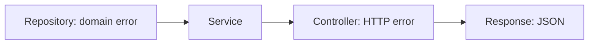

# エラー処理

[最初のアプリ](/ja/learn/getting-started/first-app)と[コントローラー](/ja/learn/tutorial/2-controller)の CLI プロジェクトを使います。`spine generate resource user` が生成した `src/user` の GET を手動で拡張します。生成・登録は CLI が行い、ドメインエラーと HTTP への変換は手動で実装します。

## HTTP エラーと応答

成功結果は `httpx.Response[T]` に入れ、別の `error` を返します。通常の構造体 `(User, error)` は HTTP 応答としてサポートしません。現在の `httperr` には4つのヘルパーがあります。

| Helper | HTTP | |
|---|---|---|
| `httperr.BadRequest(message)` | 400 | 不正な入力 |
| `httperr.Unauthorized(message)` | 401 | 認証が必要 |
| `httperr.NotFound(message)` | 404 | リソースなし |
| `httperr.InternalServerError(message)` | 500 | 意図した公開メッセージ |

`HTTPError.Message` はクライアントに公開されます。DB の内部エラーや秘密情報をそのまま入れないでください。予期しない通常のエラーは HTTP 500 と `{"message":"Internal server error"}` に変換されます。

## 生成したリソースに照会エラーを追加

以下は学習用の読み取り専用メモリ照会です。生成された repository・controller ファイルを置き換え、サービスに `Find` を追加します。すべて同じ `package user` に置きます。既存のコンストラクタ名と `user.Register(app)`・`GET /user/:id` の登録を再利用します。DB 永続化や CRUD 全体は提供しません。

```go
// src/user/user_repository.go
package user

import "errors"

var ErrUserNotFound = errors.New("user not found")
var ErrEmailAlreadyExists = errors.New("email already exists")

type User struct {
    ID int64 `json:"id"`
    Name string `json:"name"`
}

type UserRepository struct{ users map[int64]User }

func NewUserRepository() *UserRepository {
    return &UserRepository{users: map[int64]User{1: {ID: 1, Name: "Alice"}}}
}

func (r *UserRepository) FindByID(id int64) (User, error) {
    user, ok := r.users[id]
    if !ok {
        return User{}, ErrUserNotFound
    }
    return user, nil
}
```

```go
// src/user/user_service.go
func (s *UserService) Find(id int64) (User, error) {
    return s.repository.FindByID(id)
}
```

```go
// src/user/user_controller.go
package user

import (
    "errors"
    "net/http"

    "github.com/NARUBROWN/spine/pkg/httperr"
    "github.com/NARUBROWN/spine/pkg/httpx"
    "github.com/NARUBROWN/spine/pkg/path"
)

type UserController struct{ service *UserService }

func NewUserController(service *UserService) *UserController {
    return &UserController{service: service}
}

func (c *UserController) Get(id path.Int) (httpx.Response[User], error) {
    if id.Value <= 0 {
        return httpx.Response[User]{}, httperr.BadRequest("invalid user ID")
    }
    user, err := c.service.Find(id.Value)
    if err != nil {
        return httpx.Response[User]{}, toHTTPError(err)
    }
    return httpx.Response[User]{Body: user}, nil
}

func toHTTPError(err error) error {
    switch {
    case errors.Is(err, ErrUserNotFound):
        return httperr.NotFound("user not found")
    case errors.Is(err, ErrEmailAlreadyExists):
        return &httperr.HTTPError{
            Status: http.StatusConflict,
            Message: "email already exists",
            Cause: err,
        }
    default:
        return err
    }
}
```

## 各レイヤーの責任

リポジトリはドメインエラーを返し、サービスは伝達します。コントローラーは想定したエラーだけを HTTP ステータスに変換します。`errors.Is` はラップされたエラーにも対応します。不明なエラーを `BadRequest(err.Error())` にすると内部情報が漏れるため、そのまま返して一般的な 500 処理を使います。



## HTTPError と追加ステータス

403・409 などのヘルパーがない状態は `HTTPError` で表現します。`Cause` は原因追跡用で `Unwrap()` から参照でき、JSON 応答には含まれません。

```go
type HTTPError struct {
    Status int
    Message string
    Cause error
}

func (e *HTTPError) Error() string { return e.Message }
func (e *HTTPError) Unwrap() error { return e.Cause }
```

```go
return &httperr.HTTPError{
    Status: http.StatusForbidden,
    Message: "permission denied",
}
```

## リクエスト DTO の検証

以下は任意で追加する入力検証の例です。`Validate()` は自動実行されないためハンドラーから呼びます。リクエスト DTO はポインタで受け取ります。この POST は検証した入力を返すだけでユーザーを保存しません。使用する場合は `Register` に POST ルートを追加します。

```go
// src/user/user_create.go
package user

import (
    "errors"
    "net/http"
    "unicode/utf8"

    "github.com/NARUBROWN/spine/pkg/httperr"
    "github.com/NARUBROWN/spine/pkg/httpx"
)

type CreateUserRequest struct {
    Name string `json:"name"`
    Email string `json:"email"`
}

func (r *CreateUserRequest) Validate() error {
    if r == nil || r.Name == "" {
        return errors.New("name is required")
    }
    if utf8.RuneCountInString(r.Name) > 100 {
        return errors.New("name must be at most 100 characters")
    }
    if r.Email == "" {
        return errors.New("email is required")
    }
    return nil
}

func (c *UserController) Create(req *CreateUserRequest) (httpx.Response[CreateUserRequest], error) {
    if err := req.Validate(); err != nil {
        return httpx.Response[CreateUserRequest]{}, httperr.BadRequest(err.Error())
    }
    return httpx.Response[CreateUserRequest]{
        Body: *req,
        Options: httpx.ResponseOptions{Status: http.StatusCreated},
    }, nil
}
```

```go
// src/user/user_route.go: Register
app.Route("POST", "/user", (*UserController).Create)
```

## インターセプターのエラー処理

`PreHandle` がエラーを返すとコントローラーは実行されません。以下は独自の認証サービスを持つ `src/interceptor` のメソッド抜粋です。実際の型は `PreHandle`、`PostHandle`、`BeforeResponse`、`AfterCompletion` の4つを実装し、`BuildApplication()` で HTTP scope に登録します。

```go
func (i *AuthInterceptor) PreHandle(ctx core.ExecutionContext, meta core.HandlerMeta) error {
    token := ctx.Header("Authorization")
    if token == "" {
        return httperr.Unauthorized("authentication required")
    }
    user, err := i.auth.Validate(token)
    if err != nil {
        return httperr.Unauthorized("invalid token")
    }
    ctx.Set("auth.user", user)
    return nil
}
```

## エラーログ

`AfterCompletion` で実行エラーを記録できます。以下も完全なロギングインターセプターからの抜粋です。認証トークンやリクエストの秘密情報は記録しないでください。

```go
func (i *LoggingInterceptor) AfterCompletion(ctx core.ExecutionContext, meta core.HandlerMeta, err error) {
    if err != nil {
        log.Printf("[ERR] %s %s: %v", ctx.Method(), ctx.Path(), err)
    }
}
```

## 検証と HTTP 応答の確認

```bash
gofmt -w src/user
go mod tidy
spine doctor
spine contract check
spine verify
spine dev
```

契約・ローカル検査後、別のターミナルで実際の応答を確認します。以下は上記の読み取り専用メモリ例の結果です。

```bash
curl -i http://localhost:8080/user/1
curl -i http://localhost:8080/user/0
curl -i http://localhost:8080/user/2
```

| Request | HTTP | JSON |
|---|---|---|
| `/user/1` | 200 | `{"id":1,"name":"Alice"}` |
| `/user/0` | 400 | `{"message":"invalid user ID"}` |
| `/user/2` | 404 | `{"message":"user not found"}` |

実際の DB や認証サービスを接続する場合は、失敗経路を別の E2E で確認します。静的契約だけでは外部サービスのエラー変換は検証できません。

- [httperr](/ja/learn/core-concepts/httperr)
- [Interceptors](/ja/learn/tutorial/4-interceptor)
