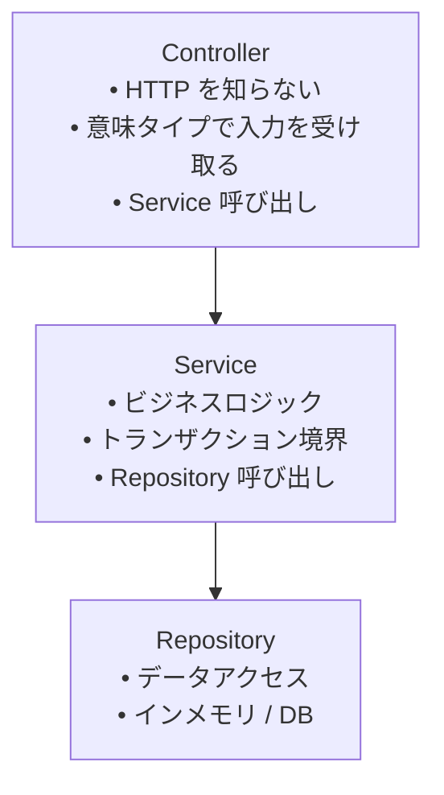

# CRUDの例

基本的なCRUD実装例。

## 概要

ORMなしでインメモリストアを使用するUser CRUD例：Controller→Service→Repositoryレイヤ構造で構成されています。

## CLIでプロジェクトを作成

[CLIのインストール](/ja/learn/getting-started/installation)後に基本アプリを生成します。以下のメモリ保存によるCRUD全体は手動で追加します。CLIのresource生成器はGETの骨組み、`slice --storage memory`は作成・取得の骨組みを提供しますが、以下の更新・削除までは生成しません。

```sh
spine new crud-example --module example.com/crud-example
cd crud-example
go mod tidy
spine doctor
```

## プロジェクト構造
```text
crud-example/
├── go.mod
├── main.go
├── spine.toml
├── internal/application/
│   ├── application.go
│   └── application_test.go
└── src/
    ├── model/user.go
    ├── repository/user_repository.go
    ├── dto/user_dto.go
    ├── service/user_service.go
    └── controller/user_controller.go
```

## Model


```go
// src/model/user.go
package model

import "time"

type User struct {
    ID        int64     `json:"id"`
    Name      string    `json:"name"`
    Email     string    `json:"email"`
    CreatedAt time.Time `json:"created_at"`
    UpdatedAt time.Time `json:"updated_at"`
}
```

## Repository


```go
// src/repository/user_repository.go
package repository

import (
    "errors"
    "sync"
    "time"

    "example.com/crud-example/src/model"
)

var (
    ErrUserNotFound      = errors.New("user not found")
    ErrEmailAlreadyExists = errors.New("email already exists")
)

type UserRepository struct {
    mu      sync.RWMutex
    users   map[int64]*model.User
    counter int64
}

func NewUserRepository() *UserRepository {
    return &UserRepository{
        users:   make(map[int64]*model.User),
        counter: 0,
    }
}

func (r *UserRepository) FindAll() []*model.User {
    r.mu.RLock()
    defer r.mu.RUnlock()

    result := make([]*model.User, 0, len(r.users))
    for _, user := range r.users {
        result = append(result, user)
    }
    return result
}

func (r *UserRepository) FindByID(id int64) (*model.User, error) {
    r.mu.RLock()
    defer r.mu.RUnlock()

    user, ok := r.users[id]
    if !ok {
        return nil, ErrUserNotFound
    }
    return user, nil
}

func (r *UserRepository) FindByEmail(email string) (*model.User, error) {
    r.mu.RLock()
    defer r.mu.RUnlock()

    for _, user := range r.users {
        if user.Email == email {
            return user, nil
        }
    }
    return nil, ErrUserNotFound
}

func (r *UserRepository) ExistsByEmail(email string) bool {
    _, err := r.FindByEmail(email)
    return err == nil
}

func (r *UserRepository) Save(user *model.User) *model.User {
    r.mu.Lock()
    defer r.mu.Unlock()

    now := time.Now()

    if user.ID == 0 {
        r.counter++
        user.ID = r.counter
        user.CreatedAt = now
    }
    user.UpdatedAt = now

    r.users[user.ID] = user
    return user
}

func (r *UserRepository) Delete(id int64) error {
    r.mu.Lock()
    defer r.mu.Unlock()

    if _, ok := r.users[id]; !ok {
        return ErrUserNotFound
    }

    delete(r.users, id)
    return nil
}

func (r *UserRepository) Count() int {
    r.mu.RLock()
    defer r.mu.RUnlock()
    return len(r.users)
}
```

## DTO


```go
// src/dto/user_dto.go
package dto

import (
    "time"

    "example.com/crud-example/src/model"
)

//リクエストDTO

type CreateUserRequest struct {
    Name  string `json:"name"`
    Email string `json:"email"`
}

type UpdateUserRequest struct {
    Name  string `json:"name"`
    Email string `json:"email"`
}

//レスポンスDTO

type UserResponse struct {
    ID        int64     `json:"id"`
    Name      string    `json:"name"`
    Email     string    `json:"email"`
    CreatedAt time.Time `json:"created_at"`
    UpdatedAt time.Time `json:"updated_at"`
}

type UserListResponse struct {
    Users []UserResponse `json:"users"`
    Total int            `json:"total"`
}

//変換関数

func ToUserResponse(user *model.User) UserResponse {
    return UserResponse{
        ID:        user.ID,
        Name:      user.Name,
        Email:     user.Email,
        CreatedAt: user.CreatedAt,
        UpdatedAt: user.UpdatedAt,
    }
}

func ToUserListResponse(users []*model.User) UserListResponse {
    responses := make([]UserResponse, len(users))
    for i, user := range users {
        responses[i] = ToUserResponse(user)
    }
    return UserListResponse{
        Users: responses,
        Total: len(responses),
    }
}
```

## Service


```go
// src/service/user_service.go
package service

import (
    "example.com/crud-example/src/dto"
    "example.com/crud-example/src/model"
    "example.com/crud-example/src/repository"
)

type UserService struct {
    repo *repository.UserRepository
}

func NewUserService(repo *repository.UserRepository) *UserService {
    return &UserService{repo: repo}
}

func (s *UserService) GetAllUsers() dto.UserListResponse {
    users := s.repo.FindAll()
    return dto.ToUserListResponse(users)
}

func (s *UserService) GetUserByID(id int64) (*dto.UserResponse, error) {
    user, err := s.repo.FindByID(id)
    if err != nil {
        return nil, err
    }

    response := dto.ToUserResponse(user)
    return &response, nil
}

func (s *UserService) CreateUser(req *dto.CreateUserRequest) (*dto.UserResponse, error) {
// メールの重複チェック
    if s.repo.ExistsByEmail(req.Email) {
        return nil, repository.ErrEmailAlreadyExists
    }

    user := &model.User{
        Name:  req.Name,
        Email: req.Email,
    }

    saved := s.repo.Save(user)
    response := dto.ToUserResponse(saved)
    return &response, nil
}

func (s *UserService) UpdateUser(id int64, req *dto.UpdateUserRequest) (*dto.UserResponse, error) {
    user, err := s.repo.FindByID(id)
    if err != nil {
        return nil, err
    }

// メール変更時の重複チェック
    if req.Email != user.Email && s.repo.ExistsByEmail(req.Email) {
        return nil, repository.ErrEmailAlreadyExists
    }

    user.Name = req.Name
    user.Email = req.Email

    saved := s.repo.Save(user)
    response := dto.ToUserResponse(saved)
    return &response, nil
}

func (s *UserService) DeleteUser(id int64) error {
    return s.repo.Delete(id)
}
```

## Controller


```go
// src/controller/user_controller.go
package controller

import (
    "errors"

    "github.com/NARUBROWN/spine/pkg/httperr"
    "github.com/NARUBROWN/spine/pkg/httpx"
    "github.com/NARUBROWN/spine/pkg/path"

    "example.com/crud-example/src/dto"
    "example.com/crud-example/src/repository"
    "example.com/crud-example/src/service"
)

type UserController struct {
    service *service.UserService
}

func NewUserController(service *service.UserService) *UserController {
    return &UserController{service: service}
}

// GET /users
func (c *UserController) List() httpx.Response[dto.UserListResponse] {
    return httpx.Response[dto.UserListResponse]{Body: c.service.GetAllUsers()}
}

// GET /users/:id
func (c *UserController) GetByID(id path.Int) (httpx.Response[dto.UserResponse], error) {
    if id.Value <= 0 {
return httpx.Response[dto.UserResponse]{}, httperr.BadRequest("無効なユーザー ID")
    }

    user, err := c.service.GetUserByID(id.Value)
    if err != nil {
        return httpx.Response[dto.UserResponse]{}, toHTTPError(err)
    }

    return httpx.Response[dto.UserResponse]{Body: *user}, nil
}

// POST /users
func (c *UserController) Create(req *dto.CreateUserRequest) (httpx.Response[dto.UserResponse], error) {
    if req.Name == "" {
return httpx.Response[dto.UserResponse]{}, httperr.BadRequest("名前は必須")
    }
    if req.Email == "" {
return httpx.Response[dto.UserResponse]{}, httperr.BadRequest("メールは必須")
    }

    user, err := c.service.CreateUser(req)
    if err != nil {
        return httpx.Response[dto.UserResponse]{}, toHTTPError(err)
    }

    return httpx.Response[dto.UserResponse]{Body: *user}, nil
}

// PUT /users/:id
func (c *UserController) Update(id path.Int, req *dto.UpdateUserRequest) (httpx.Response[dto.UserResponse], error) {
    if id.Value <= 0 {
return httpx.Response[dto.UserResponse]{}, httperr.BadRequest("無効なユーザー ID")
    }
    if req.Name == "" {
return httpx.Response[dto.UserResponse]{}, httperr.BadRequest("名前は必須")
    }
    if req.Email == "" {
return httpx.Response[dto.UserResponse]{}, httperr.BadRequest("メールは必須")
    }

    user, err := c.service.UpdateUser(id.Value, req)
    if err != nil {
        return httpx.Response[dto.UserResponse]{}, toHTTPError(err)
    }

    return httpx.Response[dto.UserResponse]{Body: *user}, nil
}

// DELETE /users/:id
func (c *UserController) Delete(id path.Int) error {
    if id.Value <= 0 {
return httperr.BadRequest("無効なユーザー ID")
    }

    err := c.service.DeleteUser(id.Value)
    if err != nil {
        return toHTTPError(err)
    }

    return nil
}

// RepositoryエラーをHTTPエラーに変換する
func toHTTPError(err error) error {
    switch {
    case errors.Is(err, repository.ErrUserNotFound):
return httperr.NotFound("ユーザーが見つかりません")
    case errors.Is(err, repository.ErrEmailAlreadyExists):
return httperr.BadRequest("既に使用中のメールです")
    default:
        return httperr.BadRequest(err.Error())
    }
}
```

## アプリの構成

生成されたルートの`main.go`はそのまま使い、`BuildApplication`、`Validate`、`Run`の順に呼び出します。以下で`internal/application/application.go`を置き換え、モデル、リポジトリ、DTO、サービス、コントローラーを`src/`に手動で追加します。

```go
// internal/application/application.go
package application

import (
    "time"

    "example.com/crud-example/src/controller"
    "example.com/crud-example/src/repository"
    "example.com/crud-example/src/service"

    "github.com/NARUBROWN/spine"
    "github.com/NARUBROWN/spine/interceptor/cors"
    "github.com/NARUBROWN/spine/pkg/boot"
)

func BuildApplication() (spine.App, boot.Options, error) {
    app := spine.New()
    app.Constructor(
        repository.NewUserRepository,
        service.NewUserService,
        controller.NewUserController,
    )
    app.Route("GET", "/users", (*controller.UserController).List)
    app.Route("GET", "/users/:id", (*controller.UserController).GetByID)
    app.Route("POST", "/users", (*controller.UserController).Create)
    app.Route("PUT", "/users/:id", (*controller.UserController).Update)
    app.Route("DELETE", "/users/:id", (*controller.UserController).Delete)

    corsInterceptor, err := cors.NewValidated(cors.Config{
        AllowOrigins: []string{"*"},
        AllowMethods: []string{"GET", "POST", "PUT", "DELETE", "OPTIONS"},
        AllowHeaders: []string{"Content-Type"},
    })
    if err != nil {
        return nil, boot.Options{}, err
    }
    app.InterceptorFor(boot.InterceptorHTTP, corsInterceptor)

    return app, boot.Options{
        Address: ":8080",
        EnableGracefulShutdown: true,
        ShutdownTimeout: 10 * time.Second,
        HTTP: &boot.HTTPOptions{},
    }, nil
}
```

## 検証と実行

```sh
gofmt -w src internal/application
go mod tidy
spine contract check
spine verify
spine dev
```

`contract check`は静的契約、`verify`は契約、gofmt、vet、Goテストを確認します。作成・取得・更新・削除の動作は以下のHTTPリクエストで確認します。プロセス終了時にメモリ内のデータは消えます。永続化は[データベースチュートリアル](/ja/learn/tutorial/5-database)で別に構成します。

## APIテスト

### ユーザーの作成


```bash
curl -X POST http://localhost:8080/users\
  -H "Content-Type: application/json" \
  -d '{"name": "ホン・ギルドン", "email": "hong@example.com"}'
```


```json
{
  "id": 1,
  "name": "ホン・ギルドン",
  "email": "hong@example.com",
  "created_at": "2025-01-19T10:00:00Z",
  "updated_at": "2025-01-19T10:00:00Z"
}
```
### ユーザーリストの照会


```bash
curl http://localhost:8080/users
```


```json
{
  "users": [
    {
      "id": 1,
"name": "ホン・ギルドン",
      "email": "hong@example.com",
      "created_at": "2025-01-19T10:00:00Z",
      "updated_at": "2025-01-19T10:00:00Z"
    }
  ],
  "total": 1
}
```
### ユーザー検索


```bash
curl http://localhost:8080/users/1
```


```json
{
  "id": 1,
  "name": "ホン・ギルドン",
  "email": "hong@example.com",
  "created_at": "2025-01-19T10:00:00Z",
  "updated_at": "2025-01-19T10:00:00Z"
}
```
### ユーザーの編集


```bash
curl -X PUT http://localhost:8080/users/1 \
  -H "Content-Type: application/json" \
  -d '{"name": "ホン・ギルドン（更新）", "email": "hong2@example.com"}'
```


```json
{
  "id": 1,
  "name": "ホン・ギルドン（更新）",
  "email": "hong2@example.com",
  "created_at": "2025-01-19T10:00:00Z",
  "updated_at": "2025-01-19T10:05:00Z"
}
```
### ユーザーの削除


```bash
curl -X DELETE http://localhost:8080/users/1
```
### エラー応答


```bash
# 存在しないユーザー
curl http://localhost:8080/users/999
```


```json
{
  "message": "ユーザーが見つかりません"
}
```


前の手順でユーザーを削除したため、同じメールアドレスで再作成します（200）。続けて同じメールアドレスで作成すると重複エラーになります（400）。

```bash
curl -X POST http://localhost:8080/users\
  -H "Content-Type: application/json" \
  -d '{"name": "ホン・ギルドン", "email": "hong@example.com"}'
# メールアドレスの重複
curl -X POST http://localhost:8080/users \
  -H "Content-Type: application/json" \
  -d '{"name": "キム・チョルス", "email": "hong@example.com"}'
```


```json
{
  "message": "メールアドレスは既に使用されています"
}
```
## コアポイント

### ControllerはHTTPを知らない

```go
// ✓ 意味タイプで入力を受け取る
func (c *UserController) GetByID(id path.Int) (httpx.Response[dto.UserResponse], error)

//✓httperrで意味だけを表現
return httpx.Response[dto.UserResponse]{}, httperr.NotFound("ユーザーが見つかりません")
```
### 依存性注入
```go
//コンストラクタ登録だけで依存性を自動解決
app.Constructor(
repository.NewUserRepository, // 依存関係なし
service.NewUserService, // Repository 依存
controller.NewUserController, // Service 依存
)
```
### レイヤーの分離

| レイヤー | 責任 | 依存 |
| --- | --- | --- |
| Controller | 入力検証、エラー変換 | Service |
| Service | ビジネスロジック | Repository |
| Repository | データアクセス | なし |
