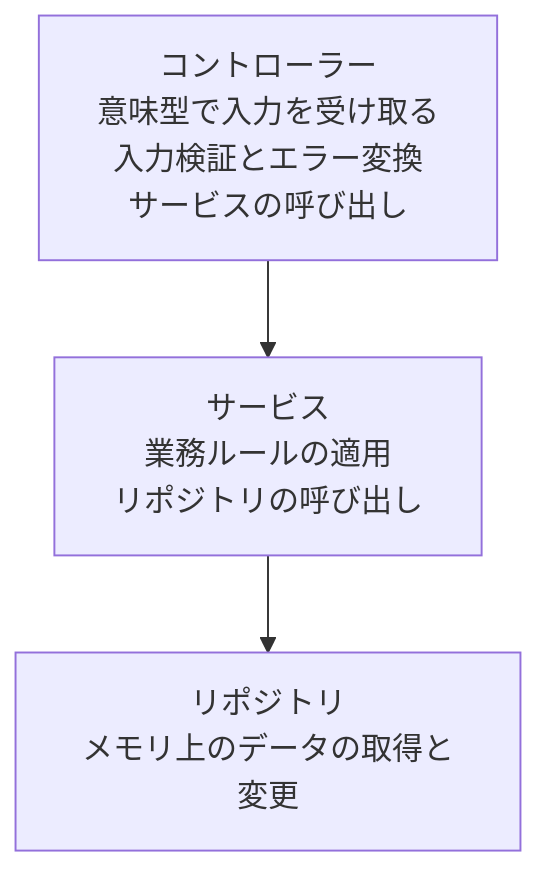

# ユーザー CRUD API を作る

ユーザーの作成、一覧取得、個別取得、更新、削除を行う HTTP API を作ります。ORM を使わずメモリ上のストアを使用するため、データベースを用意せずに実行できます。

## 事前準備

先に [CLI のインストール](/ja/learn/getting-started/installation)を完了してください。この例では、CLI 0.4.0 で作成した基本アプリに CRUD 全体のコードを手動で追加します。CLI の `resource` は GET のひな形を、`slice --storage memory` は作成と取得のひな形を生成します。更新と削除は以下のコードに含まれています。

保存したユーザーは、サーバープロセスを終了すると失われます。

リクエストはコントローラー、サービス、リポジトリの順に渡されます。各コンポーネントの役割は次のとおりです。



## 1. プロジェクトを作成する

基本アプリを作成し、依存関係とプロジェクト設定を確認します。以降のコマンドは `crud-example/` で実行します。

```sh
spine new crud-example --layout legacy --module example.com/crud-example
cd crud-example
spine doctor
```

### ファイル構成

以降の手順で `src/` 以下に 5 つのファイルを追加し、生成された `internal/application/application.go` を置き換えます。ルートの `main.go` と `spine.toml` はそのまま使用します。

```text
crud-example/
├── go.mod
├── go.sum
├── main.go
├── spine.toml
├── internal/application/
│   ├── application.go
│   └── application_test.go
└── src/
    ├── model/user.go
    ├── repository/user_repository.go
    ├── dto/user_dto.go
    ├── service/user_service.go
    └── controller/user_controller.go
```

## 2. ユーザーモデルを追加する

`src/model/user.go` を新規作成します。ユーザー情報と作成日時、更新日時を保存する構造体です。

```go
// src/model/user.go
package model

import "time"

type User struct {
    ID        int64     `json:"id"`
    Name      string    `json:"name"`
    Email     string    `json:"email"`
    CreatedAt time.Time `json:"created_at"`
    UpdatedAt time.Time `json:"updated_at"`
}
```

## 3. メモリ上のリポジトリを追加する

`src/repository/user_repository.go` を新規作成します。ユーザーの取得、保存、削除を担当し、メールアドレスの重複を確認する関数を提供します。

```go
// src/repository/user_repository.go
package repository

import (
    "errors"
    "sync"
    "time"

    "example.com/crud-example/src/model"
)

var (
    ErrUserNotFound      = errors.New("user not found")
    ErrEmailAlreadyExists = errors.New("email already exists")
)

type UserRepository struct {
    mu      sync.RWMutex
    users   map[int64]*model.User
    counter int64
}

func NewUserRepository() *UserRepository {
    return &UserRepository{
        users:   make(map[int64]*model.User),
        counter: 0,
    }
}

func (r *UserRepository) FindAll() []*model.User {
    r.mu.RLock()
    defer r.mu.RUnlock()

    result := make([]*model.User, 0, len(r.users))
    for _, user := range r.users {
        result = append(result, user)
    }
    return result
}

func (r *UserRepository) FindByID(id int64) (*model.User, error) {
    r.mu.RLock()
    defer r.mu.RUnlock()

    user, ok := r.users[id]
    if !ok {
        return nil, ErrUserNotFound
    }
    return user, nil
}

func (r *UserRepository) FindByEmail(email string) (*model.User, error) {
    r.mu.RLock()
    defer r.mu.RUnlock()

    for _, user := range r.users {
        if user.Email == email {
            return user, nil
        }
    }
    return nil, ErrUserNotFound
}

func (r *UserRepository) ExistsByEmail(email string) bool {
    _, err := r.FindByEmail(email)
    return err == nil
}

func (r *UserRepository) Save(user *model.User) *model.User {
    r.mu.Lock()
    defer r.mu.Unlock()

    now := time.Now()

    if user.ID == 0 {
        r.counter++
        user.ID = r.counter
        user.CreatedAt = now
    }
    user.UpdatedAt = now

    r.users[user.ID] = user
    return user
}

func (r *UserRepository) Delete(id int64) error {
    r.mu.Lock()
    defer r.mu.Unlock()

    if _, ok := r.users[id]; !ok {
        return ErrUserNotFound
    }

    delete(r.users, id)
    return nil
}

func (r *UserRepository) Count() int {
    r.mu.RLock()
    defer r.mu.RUnlock()
    return len(r.users)
}
```

## 4. リクエストとレスポンスの DTO を追加する

`src/dto/user_dto.go` を新規作成します。リクエストで受け取るフィールドとレスポンスで返すフィールドを定義し、リポジトリのユーザーモデルをレスポンス DTO に変換します。

```go
// src/dto/user_dto.go
package dto

import (
    "time"

    "example.com/crud-example/src/model"
)

// 요청 DTO

type CreateUserRequest struct {
    Name  string `json:"name"`
    Email string `json:"email"`
}

type UpdateUserRequest struct {
    Name  string `json:"name"`
    Email string `json:"email"`
}

// 응답 DTO

type UserResponse struct {
    ID        int64     `json:"id"`
    Name      string    `json:"name"`
    Email     string    `json:"email"`
    CreatedAt time.Time `json:"created_at"`
    UpdatedAt time.Time `json:"updated_at"`
}

type UserListResponse struct {
    Users []UserResponse `json:"users"`
    Total int            `json:"total"`
}

// 변환 함수

func ToUserResponse(user *model.User) UserResponse {
    return UserResponse{
        ID:        user.ID,
        Name:      user.Name,
        Email:     user.Email,
        CreatedAt: user.CreatedAt,
        UpdatedAt: user.UpdatedAt,
    }
}

func ToUserListResponse(users []*model.User) UserListResponse {
    responses := make([]UserResponse, len(users))
    for i, user := range users {
        responses[i] = ToUserResponse(user)
    }
    return UserListResponse{
        Users: responses,
        Total: len(responses),
    }
}
```

## 5. ユーザーサービスを追加する

`src/service/user_service.go` を新規作成します。作成と更新の前にメールアドレスの重複を確認し、リポジトリの戻り値をレスポンス DTO に変換します。

```go
// src/service/user_service.go
package service

import (
    "example.com/crud-example/src/dto"
    "example.com/crud-example/src/model"
    "example.com/crud-example/src/repository"
)

type UserService struct {
    repo *repository.UserRepository
}

func NewUserService(repo *repository.UserRepository) *UserService {
    return &UserService{repo: repo}
}

func (s *UserService) GetAllUsers() dto.UserListResponse {
    users := s.repo.FindAll()
    return dto.ToUserListResponse(users)
}

func (s *UserService) GetUserByID(id int64) (*dto.UserResponse, error) {
    user, err := s.repo.FindByID(id)
    if err != nil {
        return nil, err
    }

    response := dto.ToUserResponse(user)
    return &response, nil
}

func (s *UserService) CreateUser(req *dto.CreateUserRequest) (*dto.UserResponse, error) {
    // 이메일 중복 체크
    if s.repo.ExistsByEmail(req.Email) {
        return nil, repository.ErrEmailAlreadyExists
    }

    user := &model.User{
        Name:  req.Name,
        Email: req.Email,
    }

    saved := s.repo.Save(user)
    response := dto.ToUserResponse(saved)
    return &response, nil
}

func (s *UserService) UpdateUser(id int64, req *dto.UpdateUserRequest) (*dto.UserResponse, error) {
    user, err := s.repo.FindByID(id)
    if err != nil {
        return nil, err
    }

    // 이메일 변경 시 중복 체크
    if req.Email != user.Email && s.repo.ExistsByEmail(req.Email) {
        return nil, repository.ErrEmailAlreadyExists
    }

    user.Name = req.Name
    user.Email = req.Email

    saved := s.repo.Save(user)
    response := dto.ToUserResponse(saved)
    return &response, nil
}

func (s *UserService) DeleteUser(id int64) error {
    return s.repo.Delete(id)
}
```

## 6. ユーザーコントローラーを追加する

`src/controller/user_controller.go` を新規作成します。入力値を検証してからサービスを呼び出し、ユーザーが見つからない場合とメールアドレスが重複する場合を HTTP エラーに変換します。

```go
// src/controller/user_controller.go
package controller

import (
    "errors"

    "github.com/NARUBROWN/spine/pkg/httperr"
    "github.com/NARUBROWN/spine/pkg/httpx"
    "github.com/NARUBROWN/spine/pkg/path"

    "example.com/crud-example/src/dto"
    "example.com/crud-example/src/repository"
    "example.com/crud-example/src/service"
)

type UserController struct {
    service *service.UserService
}

func NewUserController(service *service.UserService) *UserController {
    return &UserController{service: service}
}

// GET /users
func (c *UserController) List() httpx.Response[dto.UserListResponse] {
    return httpx.Response[dto.UserListResponse]{Body: c.service.GetAllUsers()}
}

// GET /users/:id
func (c *UserController) GetByID(id path.Int) (httpx.Response[dto.UserResponse], error) {
    if id.Value <= 0 {
        return httpx.Response[dto.UserResponse]{}, httperr.BadRequest("유효하지 않은 사용자 ID입니다")
    }

    user, err := c.service.GetUserByID(id.Value)
    if err != nil {
        return httpx.Response[dto.UserResponse]{}, toHTTPError(err)
    }

    return httpx.Response[dto.UserResponse]{Body: *user}, nil
}

// POST /users
func (c *UserController) Create(req *dto.CreateUserRequest) (httpx.Response[dto.UserResponse], error) {
    if req.Name == "" {
        return httpx.Response[dto.UserResponse]{}, httperr.BadRequest("이름은 필수입니다")
    }
    if req.Email == "" {
        return httpx.Response[dto.UserResponse]{}, httperr.BadRequest("이메일은 필수입니다")
    }

    user, err := c.service.CreateUser(req)
    if err != nil {
        return httpx.Response[dto.UserResponse]{}, toHTTPError(err)
    }

    return httpx.Response[dto.UserResponse]{Body: *user}, nil
}

// PUT /users/:id
func (c *UserController) Update(id path.Int, req *dto.UpdateUserRequest) (httpx.Response[dto.UserResponse], error) {
    if id.Value <= 0 {
        return httpx.Response[dto.UserResponse]{}, httperr.BadRequest("유효하지 않은 사용자 ID입니다")
    }
    if req.Name == "" {
        return httpx.Response[dto.UserResponse]{}, httperr.BadRequest("이름은 필수입니다")
    }
    if req.Email == "" {
        return httpx.Response[dto.UserResponse]{}, httperr.BadRequest("이메일은 필수입니다")
    }

    user, err := c.service.UpdateUser(id.Value, req)
    if err != nil {
        return httpx.Response[dto.UserResponse]{}, toHTTPError(err)
    }

    return httpx.Response[dto.UserResponse]{Body: *user}, nil
}

// DELETE /users/:id
func (c *UserController) Delete(id path.Int) error {
    if id.Value <= 0 {
        return httperr.BadRequest("유효하지 않은 사용자 ID입니다")
    }

    err := c.service.DeleteUser(id.Value)
    if err != nil {
        return toHTTPError(err)
    }

    return nil
}

// Repository 에러를 HTTP 에러로 변환
func toHTTPError(err error) error {
    switch {
    case errors.Is(err, repository.ErrUserNotFound):
        return httperr.NotFound("사용자를 찾을 수 없습니다")
    case errors.Is(err, repository.ErrEmailAlreadyExists):
        return httperr.BadRequest("이미 사용 중인 이메일입니다")
    default:
        return httperr.BadRequest(err.Error())
    }
}
```

## 7. コンストラクタとルートを登録する

`internal/application/application.go` 全体を次のコードに置き換えます。リポジトリ、サービス、コントローラーのコンストラクタを登録し、5 つのルートを接続します。生成されたルートの `main.go` は、`BuildApplication`、`Validate`、`Run` を順に実行します。

```go
// internal/application/application.go
package application

import (
    platform "github.com/NARUBROWN/spine-echo-platform"
    "time"

    "example.com/crud-example/src/controller"
    "example.com/crud-example/src/repository"
    "example.com/crud-example/src/service"

    "github.com/NARUBROWN/spine"
    "github.com/NARUBROWN/spine/interceptor/cors"
    "github.com/NARUBROWN/spine/pkg/boot"
)

func BuildApplication() (spine.App, boot.Options, error) {
    app := platform.New()
    app.Constructor(
        repository.NewUserRepository,
        service.NewUserService,
        controller.NewUserController,
    )
    app.Route("GET", "/users", (*controller.UserController).List)
    app.Route("GET", "/users/:id", (*controller.UserController).GetByID)
    app.Route("POST", "/users", (*controller.UserController).Create)
    app.Route("PUT", "/users/:id", (*controller.UserController).Update)
    app.Route("DELETE", "/users/:id", (*controller.UserController).Delete)

    corsInterceptor, err := cors.NewValidated(cors.Config{
        AllowOrigins: []string{"*"},
        AllowMethods: []string{"GET", "POST", "PUT", "DELETE", "OPTIONS"},
        AllowHeaders: []string{"Content-Type"},
    })
    if err != nil {
        return nil, boot.Options{}, err
    }
    app.InterceptorFor(boot.InterceptorHTTP, corsInterceptor)

    return app, boot.Options{
        Address: ":8080",
        EnableGracefulShutdown: true,
        ShutdownTimeout: 10 * time.Second,
        HTTP: &boot.HTTPOptions{},
    }, nil
}
```

## 8. 検証してサーバーを起動する

プロジェクトルートでコードの書式を整え、依存関係とコードを検査してからサーバーを起動します。

```sh
gofmt -w src internal/application
go mod tidy
go mod download all
spine contract check
spine verify
spine dev
```

`contract check` は静的な契約を検査します。`verify` は静的な契約に加え、gofmt、go vet、Go テストを検査します。サーバーが実際にリクエストを処理するかは、次の HTTP リクエストで確認します。

## 9. HTTP リクエストで CRUD を確認する

サーバーを起動した状態で別のターミナルを開き、以下のリクエストを順に送信します。新しく起動したサーバーで最初のユーザーの ID は `1` です。レスポンスの日付は例であり、実際の作成日時と更新日時によって異なります。

### ユーザーの作成

名前とメールアドレスを送信すると、HTTP 200 と作成したユーザー情報が返されます。

```bash
curl -X POST http://localhost:8080/users \
  -H "Content-Type: application/json" \
  -d '{"name": "홍길동", "email": "hong@example.com"}'
```

```json
{
  "id": 1,
  "name": "홍길동",
  "email": "hong@example.com",
  "created_at": "2025-01-19T10:00:00Z",
  "updated_at": "2025-01-19T10:00:00Z"
}
```

### ユーザー一覧の取得

先ほど作成したユーザーが `users` に含まれ、`total` が `1` であることを確認します。

```bash
curl http://localhost:8080/users
```

```json
{
  "users": [
    {
      "id": 1,
      "name": "홍길동",
      "email": "hong@example.com",
      "created_at": "2025-01-19T10:00:00Z",
      "updated_at": "2025-01-19T10:00:00Z"
    }
  ],
  "total": 1
}
```

### ユーザーの取得

ID が `1` のユーザー情報を取得します。

```bash
curl http://localhost:8080/users/1
```

```json
{
  "id": 1,
  "name": "홍길동",
  "email": "hong@example.com",
  "created_at": "2025-01-19T10:00:00Z",
  "updated_at": "2025-01-19T10:00:00Z"
}
```

### ユーザーの更新

名前とメールアドレスを一緒に送信します。レスポンスで 2 つのフィールドと `updated_at` が変更されたことを確認します。

```bash
curl -X PUT http://localhost:8080/users/1 \
  -H "Content-Type: application/json" \
  -d '{"name": "홍길동(수정)", "email": "hong2@example.com"}'
```

```json
{
  "id": 1,
  "name": "홍길동(수정)",
  "email": "hong2@example.com",
  "created_at": "2025-01-19T10:00:00Z",
  "updated_at": "2025-01-19T10:05:00Z"
}
```

### ユーザーの削除

ID が `1` のユーザーを削除します。削除した ID で再度取得すると、HTTP 404 が返されます。

```bash
curl -X DELETE http://localhost:8080/users/1
```

### 存在しないユーザーと重複するメールアドレス

リポジトリに存在しない ID を取得すると、HTTP 404 と次のエラーメッセージが返されます。

```bash
# 존재하지 않는 사용자
curl http://localhost:8080/users/999
```

```json
{
  "message": "사용자를 찾을 수 없습니다"
}
```

前の手順でユーザーを削除したため、まず同じメールアドレスのユーザーを再作成します。最初のリクエストは HTTP 200 で成功し、続けて同じメールアドレスで作成する 2 回目のリクエストは、HTTP 400 と重複エラーを返します。

```bash
curl -X POST http://localhost:8080/users \
  -H "Content-Type: application/json" \
  -d '{"name": "홍길동", "email": "hong@example.com"}'
# 중복 이메일
curl -X POST http://localhost:8080/users \
  -H "Content-Type: application/json" \
  -d '{"name": "김철수", "email": "hong@example.com"}'
```

```json
{
  "message": "이미 사용 중인 이메일입니다"
}
```

## 実装で確認する点

### 意味型でリクエストの値を受け取る

コントローラーは HTTP リクエストオブジェクトの代わりに、`path.Int` などの意味型を引数として受け取ります。エラーは `httperr` で表現します。

```go
// 의미 타입으로 입력 받음
func (c *UserController) GetByID(id path.Int) (httpx.Response[dto.UserResponse], error)

// httperr로 의미만 표현
return httpx.Response[dto.UserResponse]{}, httperr.NotFound("사용자를 찾을 수 없습니다")
```

### 依存性注入

登録したコンストラクタの引数の型をもとに、リポジトリ、サービス、コントローラーの依存関係を接続します。

```go
// 생성자 등록만으로 의존성 자동 해결
app.Constructor(
    repository.NewUserRepository,  // 의존성 없음
    service.NewUserService,        // Repository 의존
    controller.NewUserController,  // Service 의존
)
```

### コンポーネントごとの責務

| コンポーネント | 責務 | 使用するコンポーネント |
|-------|------|------|
| コントローラー | 入力検証、HTTP エラーへの変換 | サービス |
| サービス | メールアドレスの重複確認、レスポンス DTO への変換 | リポジトリ |
| リポジトリ | メモリ上のデータの取得と変更 | なし |

## 次のステップ

データを永続的に保存するには、[データベース接続](/ja/learn/tutorial/5-database)に従ってリポジトリを変更してください。エラー処理を詳しく確認するには、[エラー処理のチュートリアル](/ja/learn/tutorial/7-error-handling)を参照してください。
