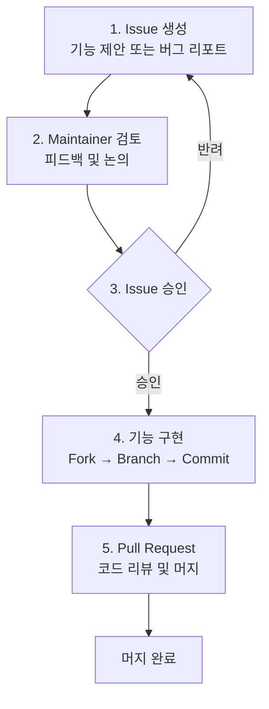

# 기여하기

Spine의 기능, 버그 수정과 문서 개선을 제안하고 Pull Request를 제출하는 절차입니다. 구현 전에 GitHub Issue에서 변경 목적과 범위를 논의하세요.

## 기여 절차

Issue 작성, 유지관리자 검토와 승인, 구현, Pull Request 순서로 진행합니다.



## 1. Issue 생성

기능 구현 전에 반드시 Issue를 먼저 작성하세요.

[Spine GitHub Issues](https://github.com/NARUBROWN/spine/issues)에 새 Issue를 작성하고 제안 유형에 맞는 정보를 포함하세요.

기능을 제안할 때:

- 제안하는 기능
- 기능이 필요한 이유
- 예상 사용 예시

버그를 제보할 때:

- 버그 재현 방법
- 예상 동작과 실제 동작
- Go 버전과 운영체제 등 실행 환경

## 2. 유지관리자 검토

유지관리자가 Issue를 검토하고 의견을 남깁니다. 필요한 경우 설계 방향과 구현 범위를 함께 논의합니다.

## 3. Issue 승인

유지관리자가 Issue를 승인한 뒤 구현을 시작하세요. 승인 전에 작성한 Pull Request는 병합되지 않을 수 있습니다.

## 4. Pull Request

구현을 마치면 GitHub에서 Pull Request를 만들고 설명에 관련 Issue 번호를 적으세요.

```
Closes #123
```

## 문서 수정과 번역

이 문서 사이트는 `docs/ko`를 내용의 단일 기준으로 사용합니다. 한국어 문서를 먼저 수정하고 검토한 뒤 `docs/en`, `docs/ja`, `docs/zh-Hans`, `docs/zh-Hant`에 같은 내용, 코드와 구조로 번역하세요.

문서 사이트의 저장소 루트에서 다음 명령으로 문서 구조와 실행 코드가 언어별로 일치하는지 검사할 수 있습니다.

```bash
python3 scripts/check-doc-translations.py
```

문서를 빌드한 뒤에는 번역된 내부 경로와 섹션 링크도 검사하세요.

```bash
go run scripts/check-go-examples.go docs
python3 scripts/check-v075-examples.py
npm run docs:build
python3 scripts/check-doc-translations.py --check-rendered
```

## 질문이 있다면

구현 중 확인할 내용이 있으면 관련 Issue에 댓글을 남기세요.
