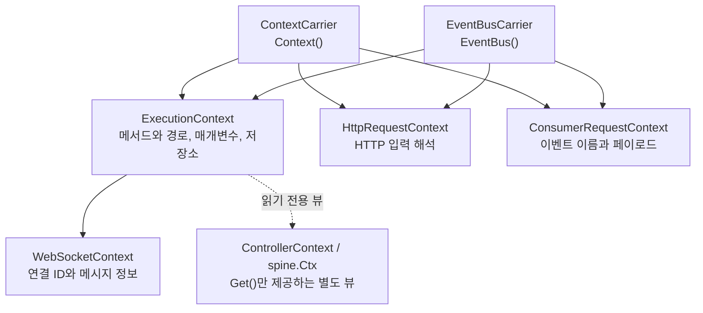

# 실행 컨텍스트 (ExecutionContext)

Spine은 요청이나 메시지마다 실행 컨텍스트를 만들어 입력 정보와 실행 상태를 파이프라인에 전달합니다. 인터셉터는 `core.ExecutionContext`로 실행 상태를 읽고 쓰며, HTTP 컨트롤러는 의미 타입과 읽기 전용 `spine.Ctx`로 필요한 값만 받습니다.

이 페이지의 기능별 `src/user` 예제는 [프로젝트 구조](/ko/learn/tutorial/1-project-structure)에서 `--layout legacy`로 생성한 `my-app`을 기준으로 합니다. CLI `v0.4.0`의 기본 `new`는 역할별 `layered-v1` 구조를 생성합니다. 두 레이아웃 모두 Spine `v0.6.0`과 Echo 플랫폼 `v0.1.0`을 사용합니다.

이 구분을 이해하면 인터셉터에서 저장한 값을 컨트롤러로 전달하고, HTTP, 이벤트 컨슈머, WebSocket에서 사용할 수 있는 입력을 판단할 수 있습니다. 이 문서의 인터페이스와 동작은 Spine v0.6.0을 기준으로 합니다.

앱 핸들러 예제는 [CLI로 만든 프로젝트](/ko/learn/tutorial/1-project-structure)에 추가하는 수동 확장입니다. 생성된 `BuildApplication`과 오류를 확인하는 `user.Register(app)` 호출을 유지하세요. `core/` 인터페이스는 공개 계약이며, `internal/` 구현을 앱에 복사할 필요는 없습니다.

## 컨트롤러와 인터셉터의 접근 범위

컨텍스트는 하나의 큰 객체를 모든 코드에 노출하기 위한 장치가 아닙니다. 파이프라인을 제어하는 코드와 비즈니스 로직에 필요한 접근 범위를 나눕니다.

| 사용할 위치 | 받을 타입 | 사용할 기능 |
| --- | --- | --- |
| HTTP 컨트롤러 | `context.Context` | 취소와 타임아웃 전달, 도메인 이벤트 발행 |
| HTTP 컨트롤러 | `pkg/spine.Ctx` | 인터셉터가 저장한 값 조회 |
| HTTP 컨트롤러 | `path.Int`, `query.Values`, DTO 등 | 바인딩한 요청 입력 |
| 인터셉터 | `core.ExecutionContext` | 요청 정보 조회, 저장소 읽기와 쓰기, 실행 전후 처리 |
| HTTP 인자 리졸버 | `core.HttpRequestContext` | HTTP 본문, 헤더, 폼 등 입력 해석 |
| 컨슈머 인자 리졸버 | `core.ConsumerRequestContext` | 이벤트 이름과 페이로드 해석 |
| WebSocket 인자 리졸버 | `core.WebSocketContext` | 연결 ID, 메시지 타입과 페이로드 해석 |

이 문서에서 `spine.Ctx`는 루트 앱 패키지 `github.com/NARUBROWN/spine`이 아니라 `github.com/NARUBROWN/spine/pkg/spine`의 타입입니다. 두 패키지를 한 파일에서 가져오면 별칭으로 구분하세요.

기본 HTTP 리졸버는 `core.ExecutionContext`나 `core.HttpRequestContext`를 컨트롤러 인자로 주입하지 않습니다. 컨트롤러에서 응답 작성기나 본문 바인딩을 직접 다루기보다 입력 타입과 `httpx.Response[T]` 반환값으로 필요한 동작을 표현합니다.

## 컨텍스트 계약의 관계

`ContextCarrier`와 `EventBusCarrier`는 공통 기능을 나타냅니다. HTTP와 컨슈머 입력 계약은 이 두 계약을 직접 포함하고, WebSocket 메시지 계약은 `ExecutionContext`를 확장합니다.



화살표는 포함하는 계약의 관계를 나타냅니다. `ControllerContext`와 `spine.Ctx`는 `ExecutionContext`를 임베딩하지 않습니다. 같은 저장소를 조회할 수 있도록 `Get()`만 노출한 별도 인터페이스입니다.

HTTP에서는 커널의 HTTPContext가 플랫폼 입력 뷰를 감싸 `ExecutionContext`와 `HttpRequestContext`를 제공합니다. 응답 writer는 별도 `core.HTTPResponseContext`로 접근합니다. `SetRoute`는 라우터 상태를 저장하며 사용자 `Set/Get` 저장소와 분리됩니다. 컨슈머는 `ExecutionContext`와 `ConsumerRequestContext`를 함께 구현합니다.

## 공통 기반 계약

### ContextCarrier

Go 표준 `context.Context`를 전달합니다. 취소 신호와 기한을 서비스, 저장소, 외부 API 호출로 전달할 때 사용합니다.

```go
// core/context.go
type ContextCarrier interface {
    Context() context.Context
}
```

HTTP에서는 요청의 `context.Context`를 사용합니다. 컨트롤러가 `context.Context`를 인자로 선언하면 표준 컨텍스트 리졸버가 요청 컨텍스트를 전달하고, 도메인 이벤트 발행에 필요한 EventBus도 연결합니다.

### EventBusCarrier

실행에 속한 EventBus에 접근합니다.

```go
// core/context.go
type EventBusCarrier interface {
    EventBus() EventBus
}
```

`core.EventBus`는 이벤트를 수집하고 꺼내는 최소 계약입니다. `publish.DomainEvent`는 `github.com/NARUBROWN/spine/pkg/event/publish`에 정의되어 있습니다.

```go
// core/event_bus.go
type EventBus interface {
    Publish(events ...publish.DomainEvent)
    Drain() []publish.DomainEvent
}
```

컨트롤러는 보통 `EventBus()`를 직접 호출하지 않고, 전달받은 `context.Context`로 `publish.Event()`를 호출합니다. 구체적인 사용법은 아래 [EventBus와 이벤트 발행](#event-publishing)에서 설명합니다.

## ExecutionContext: 파이프라인과 인터셉터의 실행 상태

`core.ExecutionContext`는 파이프라인, 라우터, 인터셉터가 공통으로 사용하는 계약입니다.

```go
// core/context.go
type ExecutionContext interface {
    ContextCarrier
    EventBusCarrier

    Method() string
    Path() string
    Params() map[string]string
    Header(name string) string
    PathKeys() []string
    SetRoute(params map[string]string, pathKeys []string)
    Queries() map[string][]string
    Set(key string, value any)
    Get(key string) (any, bool)
}
```

### 요청과 라우팅 정보

| 메서드 | HTTP에서의 의미 | 주의할 점 |
| --- | --- | --- |
| `Method()` | `GET`, `POST` 등 요청 메서드 | 컨슈머는 `EVENT`, WebSocket은 `WS` 반환 |
| `Path()` | `/users/123` 같은 실제 요청 경로 | 라우트 패턴 `/users/:id`와 구분 |
| `Header(name)` | 지정한 요청 헤더 | 헤더가 없으면 빈 문자열 |
| `Params()` | 라우터가 추출한 경로 값 | 전역 `PreHandle`은 Spine 라우팅 전 실행 |
| `PathKeys()` | 라우트에 선언한 경로 매개변수 순서 | `path.*` 타입의 순서 기반 바인딩에 사용 |
| `Queries()` | 여러 값을 보존한 쿼리 맵 | 하나의 키에 여러 값이 있을 수 있음 |

예를 들어 `/users/:userId/posts/:postId` 라우트에 `/users/123/posts/456?tag=go&tag=web` 요청이 들어오면 라우팅 후 다음 정보를 읽을 수 있습니다.

```go
ctx.Method()   // "GET"
ctx.Path()     // "/users/123/posts/456"
ctx.Params()   // {"userId": "123", "postId": "456"}
ctx.PathKeys() // ["userId", "postId"]
ctx.Queries()  // {"tag": ["go", "web"]}
```

위 코드는 인터셉터 등에서 읽을 수 있는 값의 예시입니다. HTTP 컨트롤러가 이 컨텍스트를 직접 받는다는 뜻은 아닙니다.

### Set()과 Get(): 실행 중 값 공유

인터셉터는 `Set()`으로 인증 결과나 요청 추적 정보를 저장할 수 있습니다. 컨트롤러는 읽기 전용 뷰의 `Get()`으로 같은 값을 읽습니다.

```go
// 인터셉터에서 저장
ctx.Set("auth.user", authInfo)

// 같은 실행에서 조회
value, ok := ctx.Get("auth.user")
```

`Get()`은 값과 존재 여부를 함께 반환합니다. 키가 있다고 해서 원하는 타입이라는 뜻은 아니므로, 값을 사용하는 코드에서 타입도 확인하세요. 저장소는 요청 또는 메시지 실행에 속하며 전역 캐시로 사용하지 않습니다.

일반 맵과 마찬가지로 동시 접근 보장은 구현체에 따라 다릅니다. HTTP 컨텍스트의 저장소를 여러 고루틴에서 동시에 읽고 쓰는 사용법을 가정하지 마세요.

## ControllerContext와 spine.Ctx: 컨트롤러의 읽기 전용 뷰

`core.ControllerContext`와 `pkg/spine.Ctx`는 같은 메서드 집합을 제공합니다.

```go
// core/context.go
type ControllerContext interface {
    Get(key string) (any, bool)
}
```

```go
// pkg/spine/types.go
type Ctx interface {
    Get(key string) (any, bool)
}
```

기본 HTTP 리졸버는 실행 컨텍스트를 이 뷰로 감싸 전달합니다. 컨트롤러는 `Get()`을 호출할 수 있지만 `Set()`, `Method()`, `EventBus()`는 호출할 수 없습니다. 추가 메서드를 요구하는 사용자 인터페이스로 타입을 확장해도 자동으로 지원되지는 않습니다.

### 인터셉터가 저장한 인증 정보 읽기

다음 메서드는 인증 인터셉터가 `auth.user`를 저장한 앱의 `UserController`에 추가하는 예입니다. `context`, `github.com/NARUBROWN/spine/pkg/spine`, `pkg/path`, `pkg/httpx`를 가져옵니다. 실제 앱에서는 `authInfo`의 존재 여부와 타입을 인증 정책에 맞게 검사하세요.

```go
// src/user/user_controller.go
func (c *UserController) GetUser(ctx context.Context, cc spine.Ctx, userId path.Int) httpx.Response[any] {
    authInfo, _ := cc.Get("auth.user")
    return httpx.Response[any]{Body: authInfo}
}
```

`core.ControllerContext`를 선언해도 HTTP에서는 같은 읽기 전용 뷰를 받습니다. 앱 코드에서는 `spine.Ctx`로 필요한 접근 범위를 표현할 수 있습니다. 인증 인터셉터 작성과 등록은 [인터셉터 튜토리얼](/ko/learn/tutorial/4-interceptor)을 참고하세요.

이벤트 컨슈머와 WebSocket의 기본 파이프라인에는 `ControllerContextResolver`가 등록되어 있지 않습니다. HTTP에서 사용할 수 있는 `spine.Ctx` 인자를 다른 프로토콜의 핸들러에도 그대로 선언하지 마세요.

## HttpRequestContext: HTTP 입력 해석

`core.HttpRequestContext`는 HTTP 리졸버가 개별 매개변수, 전체 헤더, 본문, 멀티파트 폼을 읽는 계약입니다. `ExecutionContext`를 임베딩하지 않고 두 기반 계약을 직접 포함합니다.

```go
// core/context.go
type HttpRequestContext interface {
    ContextCarrier
    EventBusCarrier

    Param(name string) string
    Query(name string) string
    Header(name string) string

    Params() map[string]string
    Queries() map[string][]string
    Headers() map[string][]string

    Bind(out any) error
    MultipartForm() (*multipart.Form, error)
}
```

여기서 `multipart.Form`은 Go 표준 `mime/multipart`의 타입입니다.

| 메서드 | 동작 |
| --- | --- |
| `Param(name)` | 해당 경로 매개변수의 값 조회 |
| `Query(name)` | 해당 쿼리의 첫 번째 값 조회, 없으면 빈 문자열 |
| `Header(name)` | 요청 헤더 값 조회 |
| `Params()` | 경로 매개변수 맵 조회 |
| `Queries()` | 다중 값을 보존한 쿼리 맵 조회 |
| `Headers()` | 전체 요청 헤더 맵 조회 |
| `Bind(out)` | 요청 입력을 전달한 DTO에 바인딩 |
| `MultipartForm()` | 멀티파트 폼과 파일 정보 조회 |

### HTTP 어댑터의 동작

Spine의 HTTP 어댑터는 Echo를 사용합니다. `Param()`은 Spine 라우터가 저장한 값을 먼저 찾고, 없으면 Echo의 경로 값을 확인합니다. `Params()`는 원본 경로 맵을 바꾸지 않도록 복사본을 반환합니다.

반면 HTTP `Headers()`는 요청의 헤더 맵을 그대로 반환합니다. 모든 조회 결과가 복사본이라고 가정하지 말고 읽기 용도로 사용하세요.

`Bind()`와 `MultipartForm()`은 Echo의 입력 처리에 위임합니다. 기본 HTTP DTO 리졸버는 구조체 포인터를 만들고 `Bind()`에 전달합니다. 앱의 컨트롤러에서도 다음과 같이 포인터를 선언합니다.

```go
func (c *UserController) CreateUser(req *CreateUserRequest) (httpx.Response[User], error)
```

이 코드는 메서드 시그니처의 예이며, `CreateUserRequest`와 `User`는 앱에서 정의하는 타입입니다. 폼 DTO는 필드에 `form` 태그를 사용하며, 업로드 파일은 `pkg/multipart.UploadedFiles`로 받을 수 있습니다.

Spine `v0.6.0`과 Echo 플랫폼 `v0.1.0`은 잘못된 JSON과 숫자 또는 불리언 경로 변환 실패를 HTTP 400으로 처리합니다. 지원하지 않는 본문 Content-Type은 415, 본문 크기 제한 초과는 413입니다. 바인딩 실패는 컨트롤러 호출 전에 발생하며, 핸들러의 업무 검증 오류와 구분해 실제 요청으로 확인하세요. [실행 파이프라인](/ko/learn/core-concepts/pipeline#error-responses)

## ConsumerRequestContext: 이벤트 입력 해석

`core.ConsumerRequestContext`는 이벤트 이름과 원시 페이로드를 제공합니다.

```go
// core/context.go
type ConsumerRequestContext interface {
    ContextCarrier
    EventBusCarrier

    EventName() string
    Payload() []byte
}
```

컨슈머 어댑터는 이 계약과 `ExecutionContext`를 함께 구현합니다. HTTP 요청이 아니므로 공통 메서드는 다음과 같이 동작합니다.

| 메서드 | 컨슈머에서 반환하는 값 |
| --- | --- |
| `Method()` | `EVENT` |
| `Path()` | 이벤트 이름 |
| `EventName()` | 이벤트 이름 |
| `Payload()` | 수신한 메시지의 원시 바이트 |
| `Header(name)` | 빈 문자열 |
| `Params()` | `nil` |
| `PathKeys()` | `nil` |
| `Queries()` | `nil` |

기본 컨슈머 리졸버는 `context.Context`, 문자열 이벤트 이름, `[]byte` 페이로드, 구조체 DTO 값을 지원합니다. DTO는 JSON 페이로드를 역직렬화해 만듭니다. HTTP DTO의 포인터 규칙을 컨슈머에 그대로 적용하지 않습니다.

리졸버가 요구하는 페이로드가 없거나 JSON 역직렬화에 실패하면 핸들러를 호출하지 않습니다. 이 실행 실패를 메시지 확인, 재시도, dead-letter 처리에 어떻게 반영할지는 컨슈머 런타임과 메시지 전송 설정의 책임입니다. HTTP 오류 응답 표를 그대로 적용하지 마세요.

## WebSocketContext: 메시지와 연결 정보

`core.WebSocketContext`는 `ExecutionContext`에 WebSocket 메시지 정보를 추가합니다.

```go
// core/context.go
type WebSocketContext interface {
    ExecutionContext

    ConnID() string
    MessageType() int
    Payload() []byte
}
```

WebSocket 런타임은 수신한 메시지마다 실행 컨텍스트를 만듭니다. `Method()`는 `WS`, `Path()`는 연결 요청의 실제 경로를 반환합니다. `ConnID()`는 연결 ID, `MessageType()`은 텍스트나 바이너리 등 프레임 타입, `Payload()`는 해당 메시지의 바이트를 반환합니다.

기본 리졸버는 `context.Context`, `pkg/ws.ConnectionID`, `[]byte`, 구조체 DTO 값을 지원합니다. DTO는 메시지 페이로드를 JSON으로 역직렬화합니다. HTTP와 달리 DTO는 구조체 값으로 받습니다.

### 원래 연결 요청의 정보

WebSocket에서는 HTTP upgrade 때 받은 헤더와 쿼리, 쿠키를 메시지 처리 중에도 조회할 수 있습니다. 이를 위해 별도의 요청 뷰를 제공합니다.

```go
// core/context.go
type WebSocketRequestContext interface {
    ContextCarrier

    Path() string
    Header(name string) string
    Headers() map[string][]string
    Query(name string) string
    Queries() map[string][]string
    Cookie(name string) (string, bool)
    Cookies() map[string]string
    RemoteAddr() string
    Host() string
    RequestURI() string
}
```

```go
type WebSocketHandshakeContext interface {
    WebSocketRequestContext
}

type WebSocketMessageContext interface {
    WebSocketContext
    WebSocketRequestContext
}
```

기본 WebSocket 구현은 upgrade 요청 정보를 복사해 보관합니다. `Headers()`, `Queries()`, `Cookies()`도 복사본을 반환하므로 조회 결과를 바꿔도 보관한 요청 정보가 변경되지 않습니다. 이 값은 연결 당시의 정보이며, 메시지마다 새로운 HTTP 요청을 받는다는 뜻은 아닙니다.

| 필요한 값 | 사용할 계약 |
| --- | --- |
| 메시지 페이로드와 연결 ID | `core.WebSocketContext` |
| upgrade 전 헤더, 쿼리, 쿠키 검사 | `core.WebSocketHandshakeContext` |
| 메시지 처리와 원래 요청 정보 함께 조회 | `core.WebSocketMessageContext` |

기본 구현의 `Header()`와 `Queries()`는 이 요청 정보를 조회합니다. 값이 없을 수는 있지만, WebSocket이라는 이유로 항상 빈 값을 반환하지는 않습니다. 직접 작성한 `WebSocketContext` 구현이 추가 요청 뷰도 지원한다고 가정하지 말고 타입을 확인하세요.

```go
// WebSocket 메시지를 처리하는 인터셉터 안에서 조회하는 예
if requestCtx, ok := ctx.(core.WebSocketMessageContext); ok {
    origin := requestCtx.Header("Origin")
    _ = origin
}
```

이 코드는 컨트롤러 인자 주입 예제가 아닙니다. 인터셉터가 받은 `core.ExecutionContext`에서 추가 기능의 지원 여부를 확인하는 코드입니다.

### 연결 전 검사와 메시지 전처리

연결 전에 인증이나 권한 검사가 필요하면 선택적 `core.WebSocketHandshakeInterceptor` 계약을 구현합니다.

```go
type WebSocketHandshakeInterceptor interface {
    PreHandshake(ctx WebSocketHandshakeContext, meta HandlerMeta) error
}
```

WebSocket에 적용하도록 등록한 `core.Interceptor`가 이 계약도 구현하면, 런타임은 연결 슬롯을 먼저 예약한 뒤 HTTP upgrade 전에 `PreHandshake`를 호출합니다. 인증을 기다리는 연결도 연결 상한에 포함됩니다. 일반 `core.Interceptor.PreHandle`은 연결 뒤에 메시지를 처리할 때마다 호출됩니다. 연결 자체를 거부해야 하는 검사와 메시지별 전처리를 구분해서 작성하세요.

## 프로토콜별 입력 비교

같은 실행 파이프라인을 사용해도 컨텍스트의 의미와 기본 인자 타입은 다릅니다.

| 항목 | HTTP | 이벤트 컨슈머 | WebSocket |
| --- | --- | --- | --- |
| 실행 단위 | HTTP 요청 한 건 | 수신 이벤트 한 건 | 수신 메시지 한 건 |
| `Method()` | HTTP 메서드 | `EVENT` | `WS` |
| `Path()` | 실제 요청 경로 | 이벤트 이름 | 연결 요청의 실제 경로 |
| `Header()` | 요청 헤더 | 빈 문자열 | 보존한 upgrade 요청 헤더 |
| `Queries()` | 요청 쿼리 | `nil` | 보존한 upgrade 요청 쿼리 |
| 본문 입력 | HTTP `Bind()` | 이벤트 `Payload()` | 메시지 `Payload()` |
| 기본 DTO 타입 | 구조체 포인터 | 구조체 값 | 구조체 값 |
| `context.Context` 인자 | 지원 | 지원 | 지원 |
| `spine.Ctx` 인자 | 지원 | 기본 미등록 | 기본 미등록 |

프로토콜에 특화된 기능은 해당 인터페이스로 타입을 확인한 뒤 사용합니다. `ExecutionContext`가 있다고 해서 HTTP `Bind()`나 WebSocket `ConnID()`를 모두 호출할 수 있는 것은 아닙니다.

## 저장소 키와 실행 시점

라우팅 정보와 HTTP 응답 writer는 타입이 명시된 계약으로 관리하며 사용자 `Set/Get` 저장소와 분리됩니다. 라우터는 `SetRoute`로 경로 값을 저장하고 HTTP 파이프라인은 `HTTPResponseContext`로 writer를 선택합니다.

| API | 값의 타입 | 용도 |
| --- | --- | --- |
| `Params()` | `map[string]string` | 라우터가 추출한 경로 매개변수 |
| `PathKeys()` | `[]string` | 경로 매개변수의 선언 순서 |
| `HTTPResponseContext.ResponseWriter()` | `core.ResponseWriter` | HTTP 응답 작성과 버퍼 처리 |

`HTTPResponseContext.ResponseWriter()`는 HTTP 응답 writer를 반환합니다. 파이프라인은 응답 준비 중 writer를 staging writer로 바꾸고 전송 전에 복구합니다. 컨트롤러는 writer를 직접 꺼내기보다 `httpx.Response[T]`, `httpx.Redirect`, `httpx.Binary`를 반환합니다.

컨텍스트에서 어떤 값을 읽을 수 있는지는 실행 시점에도 달려 있습니다. 전역 `PreHandle`은 라우팅 전, 라우트 `PreHandle`은 라우팅과 인자 바인딩 후에 실행합니다. 저장소에 값이 있어야 하는 시점과 이 값을 만드는 단계를 함께 설계해야 합니다.

## EventBus와 이벤트 발행 {#event-publishing}

컨트롤러가 `context.Context`를 선언하면 표준 컨텍스트 리졸버가 실행의 EventBus를 연결해 전달합니다. 컨트롤러는 이 컨텍스트로 도메인 이벤트를 수집할 수 있습니다.

다음 발췌의 `publish`는 `github.com/NARUBROWN/spine/pkg/event/publish`에서 가져옵니다. `OrderCreated`는 앱에서 정의하고 `Name() string`과 `OccurredAt() time.Time`을 구현하는 이벤트 타입입니다.

```go
// src/user/user_controller.go
func (c *UserController) CreateOrder(ctx context.Context, orderId path.Int) httpx.Response[string] {
    // context.Context에 연결된 EventBus로 이벤트를 수집합니다.
    publish.Event(ctx, OrderCreated{
        OrderID: orderId.Value,
        At:      time.Now(),
    })

    return httpx.Response[string]{Body: "OK"}
}
```

`publish.Event()` 호출만으로 외부 브로커 전송이 완료되는 것은 아닙니다. 연결된 EventBus에 이벤트를 모으며, 이벤트 디스패치 훅이 등록되어 있다면 성공 응답의 직렬화와 검증 뒤에 이벤트를 꺼내 디스패처로 전달합니다. 훅 등록에는 이벤트 퍼블리셔 구성이 필요합니다.

핸들러가 오류를 반환하거나 성공 응답 준비가 실패하면 디스패치 훅을 실행하지 않습니다. 디스패치가 실패하면 그 오류를 파이프라인의 실행 오류로 처리합니다. 디스패치 훅은 `BeforeResponse`와 실제 HTTP 응답 전송보다 먼저 실행하므로, 이벤트를 수집하거나 디스패치했다는 사실만으로 트랜잭션 커밋이나 응답 전송 완료를 판단하지 마세요.

이벤트 발행, 트랜잭션 마무리, 응답 기록의 순서는 [실행 파이프라인](/ko/learn/core-concepts/pipeline)에서 확인할 수 있습니다.
