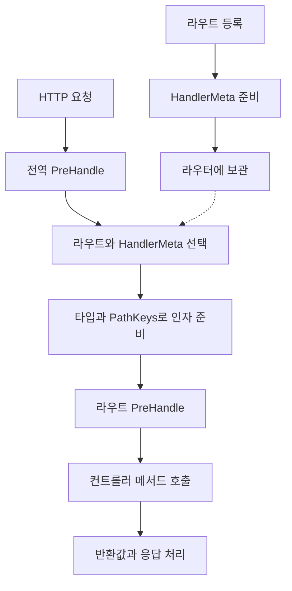

# 핸들러 메타데이터 (HandlerMeta)

::: warning v0.7.0 미리보기 입력 API 전환
이 페이지의 기존 API 설명과 예제는 안정 버전 `v0.6.5` 기준입니다. `v0.7.0-preview.1`부터 출처별 Path, Query, Header DTO를 지원하며 `query.Values`, `header.Values`와 해당 생성/조회 API, `query.Pagination`, `path.Int`, `path.String`, `path.Boolean`은 Deprecated입니다.

새 DTO 방식은 `v0.6.5`에 그대로 적용할 수 없습니다. 미리보기에서도 한 핸들러 안에서 새 DTO와 Deprecated 입력을 혼용하면 부팅 시 거부합니다. 기존 본문 DTO와 context는 계속 함께 사용할 수 있습니다.

적용 버전과 전환 예제는 [미리보기 핸들러 입력 전환](/ko/learn/migration/v0.7.0-preview), 명세 옵션은 [런타임 OpenAPI](/ko/reference/api/openapi)를 확인하세요.
:::

`core.HandlerMeta`는 요청에 맞는 컨트롤러 메서드를 실행하는 데 필요한 정보입니다. 컨트롤러 타입, 메서드, 경로 매개변수의 순서, 라우트 인터셉터를 담습니다. 앱에서는 `app.Route`로 핸들러를 등록하고, 인터셉터에서 `HandlerMeta`를 읽어 실행 대상을 확인할 수 있습니다.

이 페이지의 기능별 `src/user` 예제는 [프로젝트 구조](/ko/learn/tutorial/1-project-structure)에서 `--layout legacy`로 생성한 `my-app`을 기준으로 합니다. CLI `v0.4.2`의 기본 `new`는 역할별 `layered-v1` 구조를 생성합니다. 두 레이아웃 모두 Spine `v0.6.5`와 Echo 플랫폼 `v0.1.0`을 사용합니다.

이 페이지는 Spine v0.6.5의 공개 타입과 HTTP 실행 흐름을 기준으로 설명합니다. 앱에서 메타데이터 생성 함수나 라우터 내부 구현을 직접 작성할 필요는 없습니다.

## CLI 프로젝트에서의 위치

[CLI 프로젝트 구조](/ko/learn/tutorial/1-project-structure)에서 생성한 `example.com/my-app`을 기준으로, 사용자 라우트는 `src/user/user_route.go`의 `Register(app)`에 선언합니다. 생성된 핸들러는 `(*UserController).Get`이고 경로는 `GET /user/:id`입니다. `internal/application/application.go`의 `BuildApplication`은 `user.Register(app)`의 오류를 확인해 반환하며, 생성된 `main.go`에서 검증과 실행을 진행합니다.

```go
// src/user/user_route.go의 Register 내부 발췌
app.Route(
    "GET",
    "/user/:id",
    (*UserController).Get,  // 메서드 표현식
)
```

아래의 `GetUser`, 관리자 핸들러, 인증 인터셉터는 개념을 설명하기 위한 앱 확장 예제입니다. CLI가 생성한 `Get`과는 별도의 메서드이므로 그대로 추가하려면 해당 타입과 메서드도 구현해야 합니다. 인터셉터의 전체 구현과 등록 방법은 [인터셉터 튜토리얼](/ko/learn/tutorial/4-interceptor)을 참고하세요.

## HandlerMeta의 필드

`core.HandlerMeta`의 필드는 다음과 같습니다. `reflect` 타입을 통해 컨트롤러와 메서드 정보를 표현합니다.

```go
// core/handler_meta.go
type HandlerMeta struct {
    // 컨트롤러 타입 (Container Resolve 대상)
    ControllerType reflect.Type

    // 호출할 메서드
    Method reflect.Method

    // 라우트에 선언된 경로 매개변수 키의 순서
    PathKeys []string

    // 핸들러에 적용된 인터셉터
    Interceptors []Interceptor
}
```

| 필드 | 타입 | 역할 |
| --- | --- | --- |
| `ControllerType` | `reflect.Type` | 의존성 컨테이너에서 찾을 컨트롤러의 포인터 타입 |
| `Method` | `reflect.Method` | 호출할 메서드의 이름, 시그니처, 함수 정보 |
| `PathKeys` | `[]string` | 라우트에 선언된 경로 매개변수 이름의 순서 |
| `Interceptors` | `[]core.Interceptor` | 해당 라우트에 적용할 인터셉터 목록 |

`ControllerType`이 `*UserController`이고 `Method.Name`이 `GetUser`라면, 파이프라인은 컨테이너에서 `*UserController` 인스턴스를 구한 뒤 `GetUser`를 호출합니다.

```go
meta.ControllerType  // reflect.Type of *UserController
```

```go
meta.Method.Name           // "GetUser"
meta.Method.Type           // func(*UserController, path.Int) (httpx.Response[User], error)
meta.Method.Func           // 호출 가능한 reflect.Value
```

`PathKeys`는 실제 요청값이 아닌 경로 매개변수의 이름입니다. 예를 들어 `/users/:userId/orders/:orderId`에서는 `userId`, `orderId` 순서를 담고, 이 순서에 맞춰 핸들러의 `path` 타입 인자를 연결합니다. 요청마다 달라지는 경로 매개변수 값은 요청 컨텍스트에서 읽습니다.

`Interceptors`에는 라우트 인터셉터만 들어갑니다. `app.Interceptor`로 등록한 전역 인터셉터는 파이프라인에서 따로 관리합니다.

```go
meta.Interceptors  // []core.Interceptor (라우트 레벨)
```

## 메서드 표현식으로 핸들러 등록

라우트에는 `(*UserController).GetUser`와 같은 **메서드 표현식**을 전달합니다. 이 표현식은 특정 컨트롤러 인스턴스에 묶이지 않은 함수이며, 첫 번째 인자로 컨트롤러 포인터를 받습니다.

```go
// 메서드 표현식의 실제 타입
func(*UserController, path.Int) (httpx.Response[User], error)
//   ↑ receiver가 첫 번째 인자로 변환됨
```

Spine은 이 정보로 컨트롤러 타입과 호출할 메서드를 확인합니다. 컨트롤러 인스턴스는 앱의 생성자 등록에 따라 의존성 컨테이너에서 구합니다.

다음 등록 형태를 구분하세요.

| 등록 형태 | 사용 여부 | 설명 |
| --- | --- | --- |
| `(*UserController).GetUser` | 사용 | 첫 번째 인자가 `*UserController`인 메서드 표현식 |
| `UserController.GetUser` | 사용하지 않음 | 값 타입을 첫 번째 인자로 받으므로 포인터 타입 조건을 충족하지 않음 |
| `ctrl.GetUser` | 사용하지 않음 | 특정 인스턴스에 묶인 메서드 값이므로 컨트롤러 인자를 별도로 받지 않음 |
| 일반 함수 또는 클로저 | 사용하지 않음 | 컨트롤러 타입과 메서드를 확인하는 등록 형식에 맞지 않음 |

이 조건은 라우트에 전달하는 표현식의 형태에 관한 것입니다. 앱의 컨트롤러는 튜토리얼처럼 포인터 리시버로 작성하고, `(*Controller).Method` 형태로 등록하세요.

## 라우트 인터셉터 지정

`route.WithInterceptors`는 해당 라우트에 적용할 인터셉터를 받습니다. `github.com/NARUBROWN/spine/pkg/route`를 가져와 사용합니다.

```go
app.Route(
    "GET",
    "/users/:id",
    (*UserController).GetUser,
    route.WithInterceptors(&AuthInterceptor{}),
)
```

인터셉터를 전달하는 방식은 두 가지입니다.

| 전달값 | 생성 방식 |
| --- | --- |
| `&AuthInterceptor{}` | 앱이 만든 인스턴스를 그대로 사용 |
| `(*AuthInterceptor)(nil)` | 부트스트랩 중 컨테이너에서 해당 포인터 타입의 인스턴스를 생성 |

의존성을 주입받아야 하는 인터셉터에는 타입이 있는 nil 포인터를 사용할 수 있습니다. 이 경우 인터셉터 생성자와 필요한 의존성을 등록해야 합니다. 타입 정보가 없는 `nil`을 전달하면 라우트 인터셉터 등록이 실패합니다.

```go
// src/user/user_route.go의 Register 내부 발췌
app.Route("GET", "/users/:id", (*UserController).GetUser)

// 라우트 인터셉터와 함께
app.Route("GET", "/admin/users/:id", (*AdminController).GetUser,
    route.WithInterceptors((*AuthInterceptor)(nil)),  // nil 포인터 → Container에서 Resolve
)
```

전역 인터셉터와 라우트 인터셉터를 함께 사용할 수도 있습니다. 전역 인터셉터는 모든 요청에 적용되고, 라우트 인터셉터는 해당 라우트에만 적용됩니다.

```go
// 글로벌: 모든 요청에 적용 (라우팅 전 실행)
app.Interceptor(&CORSInterceptor{})

// 라우트: 특정 핸들러에만 적용 (라우팅 후, Controller 호출 전 실행)
app.Route("GET", "/admin/:id", (*AdminController).Get,
    route.WithInterceptors(&AuthInterceptor{}),
)
```

## 인터셉터에서 실행 대상 확인

인터셉터의 `PreHandle`, `PostHandle`, `BeforeResponse`, `AfterCompletion`은 `HandlerMeta`를 받습니다. 로깅이나 핸들러별 정책을 적용할 때 이 정보를 읽을 수 있습니다.

전역 `PreHandle`은 라우팅 전에 실행되므로 빈 `HandlerMeta`를 받습니다. 이때 `ControllerType`은 nil이고 `Method.Name`도 비어 있습니다. 라우트가 결정된 뒤에는 실제 핸들러 메타데이터가 전달되지만, 라우팅 자체가 실패한 요청에서는 실행 대상이 없을 수 있습니다. 필드에 접근하기 전에 확인하세요.

다음 코드는 `PreHandle`만 발췌한 예제입니다. `core`와 `log`를 가져와 사용하며, 등록 가능한 인터셉터에는 나머지 세 메서드도 구현해야 합니다.

```go
// src/interceptor/logging_interceptor.go
func (i *LoggingInterceptor) PreHandle(ctx core.ExecutionContext, meta core.HandlerMeta) error {
    controllerName := "<unresolved>"
    if meta.ControllerType != nil {
        controllerName = meta.ControllerType.String()
    }
    log.Printf(
        "[REQ] %s %s -> %s.%s",
        ctx.Method(),
        ctx.Path(),
        controllerName,
        meta.Method.Name,            // "GetUser"
    )
    return nil
}
```

`core.ExecutionContext`는 이처럼 인터셉터가 요청 정보에 접근하는 데 사용합니다. HTTP 컨트롤러가 같은 타입을 인자로 받아야 하는 것은 아닙니다. 컨트롤러에서는 [타입 기반 인자 주입](/ko/learn/tutorial/2-controller)에 맞는 요청 타입을 선언하세요.

## 등록 시점과 요청 실행 시점

부트스트랩에서는 라우트 선언을 실행 정보로 준비합니다.

1. `app.Route`에 선언한 핸들러에서 컨트롤러 타입과 메서드를 확인합니다.
2. 라우트 인터셉터를 준비하고 `HandlerMeta`에 연결합니다.
3. 전체 경로와 경로 매개변수의 순서를 라우터에 등록합니다.
4. 등록된 컨트롤러와 의존성을 미리 생성합니다.

핸들러 형식이 잘못되었거나 컨트롤러, 인터셉터의 의존성을 만들 수 없으면 서버 시작 과정에서 실패합니다. 생성된 프로젝트의 오류 반환 경로를 유지해 이 실패를 호출자에게 전달하세요.

요청이 들어오면 준비한 메타데이터를 다음 순서로 사용합니다.

1. 전역 인터셉터의 `PreHandle`을 실행합니다.
2. 요청에 맞는 라우트를 찾아 `HandlerMeta`를 얻습니다.
3. 메서드의 매개변수 타입과 `PathKeys`에 따라 인자를 준비합니다.
4. 라우트 인터셉터의 `PreHandle`을 실행합니다.
5. 컨트롤러 인스턴스를 구해 메서드를 호출합니다.
6. 반환값 처리와 응답 전 처리를 진행한 뒤 응답을 내보냅니다.

정상 실행의 흐름은 다음과 같습니다. 오류나 인터셉터의 중단 요청이 발생하면 후속 단계가 생략될 수 있습니다.



성공한 요청의 `PostHandle`은 라우트 인터셉터부터 전역 인터셉터 순서로 실행하며, 각 목록 안에서는 등록의 역순으로 호출합니다. `BeforeResponse`와 `AfterCompletion`의 오류 처리와 실행 조건은 [인터셉터 튜토리얼](/ko/learn/tutorial/4-interceptor)에서 확인하세요.

## 오류를 확인할 위치

| 상황 | 확인할 내용 |
| --- | --- |
| 핸들러 등록 실패 | `(*Controller).Method` 형태인지, 해당 메서드를 찾을 수 있는지 확인 |
| 컨트롤러 생성 실패 | 컨트롤러 생성자와 그 생성자가 받는 의존성을 등록했는지 확인 |
| 라우트 인터셉터 생성 실패 | 타입이 있는 nil 포인터를 사용했는지, 필요한 생성자를 등록했는지 확인 |
| 요청 인자 준비 실패 | 핸들러 인자 타입이 지원되는지, 경로 매개변수 선언 순서가 맞는지 확인 |
| 일치하는 라우트 없음 | HTTP 메서드, 경로, 전역 경로 접두사를 확인. 기본 HTTP 처리에서는 404 오류 응답 반환 |

`HandlerMeta`는 핸들러의 실행 대상을 설명합니다. 요청 데이터의 변환은 인자 리졸버가, 실제 반환값의 HTTP 응답 변환은 반환값 핸들러가 담당합니다. 각 역할을 직접 대체하려 하기 전에 라우트 선언과 컨트롤러 시그니처를 먼저 확인하세요.
