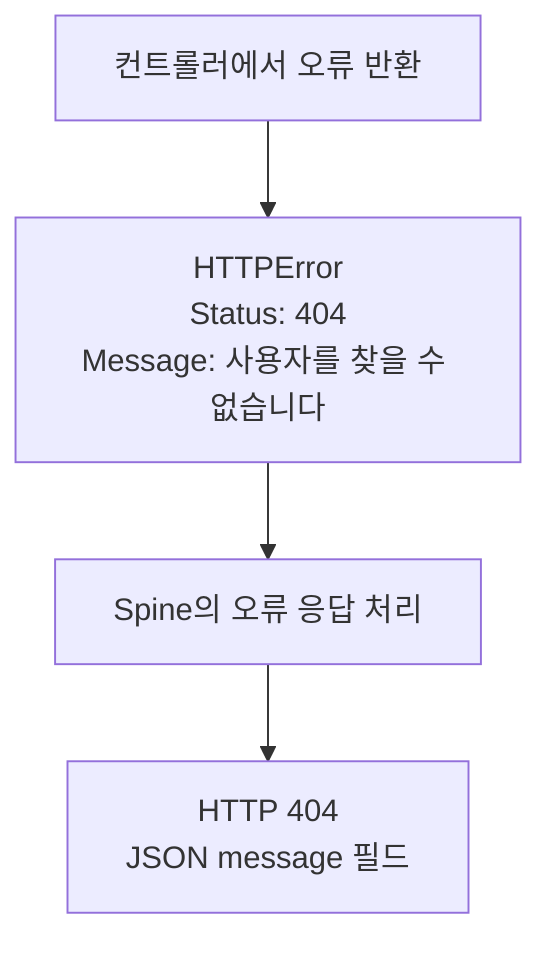

# httperr 패키지

`httperr`는 HTTP 상태 코드와 클라이언트에게 전달할 오류 메시지를 담는 패키지입니다. 컨트롤러에서 `httperr.NotFound("사용자를 찾을 수 없습니다")`처럼 오류를 반환하면 Spine이 상태 코드와 JSON 오류 응답으로 변환합니다. 컨트롤러가 Echo 등의 응답 객체를 직접 다룰 필요는 없습니다.

이 페이지는 Spine v0.6.0의 `github.com/NARUBROWN/spine/pkg/httperr`를 기준으로 설명합니다.

## CLI 프로젝트에서 사용하기

아래 컨트롤러는 [CLI로 생성한 프로젝트](/ko/learn/tutorial/1-project-structure)에 추가하는 코드 조각입니다. `httpx`, `httperr`, `path`는 각각 `github.com/NARUBROWN/spine/pkg` 아래 패키지입니다. 컨트롤러 생성자와 라우트를 `BuildApplication`에서 사용하는 등록 경로에 연결하세요. `User`, 저장소, 서비스 등 업무 타입은 앱에서 정의합니다.

성공 값은 `httpx.Response[T]`로 감싸고, 실패 시에는 빈 응답 값과 오류를 함께 반환합니다. 요청 본문을 받는 예제의 DTO는 `*PaymentRequest`처럼 포인터로 선언합니다.

```go
func (c *UserController) GetUser(userId path.Int) (httpx.Response[User], error) {
    if userId.Value <= 0 {
        return httpx.Response[User]{}, httperr.BadRequest("유효하지 않은 사용자 ID입니다")
    }

    user, err := c.repo.FindByID(userId.Value)
    if err != nil {
        return httpx.Response[User]{}, httperr.NotFound("사용자를 찾을 수 없습니다")
    }

    return httpx.Response[User]{Body: user}, nil
}
```

이 메서드를 `GET /users/:id`로 등록했다면 다음과 같이 응답합니다. 예제는 저장소의 조회 오류를 모두 404로 처리한다고 가정합니다. 실제 앱에서는 조회 결과가 없는 경우와 데이터베이스 장애를 구분해 상태 코드를 선택하세요.

```bash
# 잘못된 ID
GET /users/-1
→ 400 {"message": "유효하지 않은 사용자 ID입니다"}

# 존재하지 않는 사용자
GET /users/999
→ 404 {"message": "사용자를 찾을 수 없습니다"}

# 정상
GET /users/123
→ 200 {"id": 123, "name": "john"}
```



## HTTPError의 필드

`HTTPError`는 Go의 `error` 인터페이스를 구현하며, `Error()`는 `Message`를 반환합니다.

```go
// pkg/httperr/types.go
type HTTPError struct {
    Status  int    // HTTP 상태 코드
    Message string // 에러 메시지
    Cause   error  // 원인 에러 (선택)
}

// error 인터페이스 구현
func (e *HTTPError) Error() string {
    return e.Message
}
```

| 필드 | 타입 | 용도 |
| --- | --- | --- |
| `Status` | `int` | 클라이언트에게 보낼 HTTP 오류 상태 코드 |
| `Message` | `string` | JSON 응답의 `message` 필드에 보낼 메시지 |
| `Cause` | `error` | 앱이 보관할 원인 오류. JSON 응답에는 포함되지 않음 |

헬퍼 함수는 `error` 인터페이스 타입을 반환하지만 실제 값은 `*httperr.HTTPError`입니다. `errors.As`로 이 타입을 찾을 수 있습니다. `fmt.Errorf("문맥: %w", err)`처럼 오류를 감싸도 Spine은 내부의 `HTTPError`를 찾아 상태 코드와 `Message`를 사용합니다.

`Message`는 클라이언트에게 그대로 전달됩니다. SQL, 비밀값, 내부 경로처럼 공개하면 안 되는 정보는 메시지에 넣지 말고 원인 오류나 로그로 보관하세요.

## 기본 헬퍼 함수

Spine v0.6.0은 다음 네 가지 헬퍼를 제공합니다. 모두 `msg string`을 받아 `error`를 반환합니다.

| 함수 | 상태 코드 | 사용할 상황 |
| --- | --- | --- |
| `BadRequest(msg)` | 400 | 요청값이 API의 조건을 충족하지 않음 |
| `Unauthorized(msg)` | 401 | 인증 정보가 없거나 인증에 실패함 |
| `NotFound(msg)` | 404 | 요청한 리소스를 찾을 수 없음 |
| `InternalServerError(msg)` | 500 | 서버 내부 오류를 명시적인 메시지로 응답해야 함 |

### 잘못된 요청값

`BadRequest`는 타입 변환 이후에도 필요한 업무 조건을 검사할 때 사용할 수 있습니다.

```go
func BadRequest(msg string) error {
    return &HTTPError{Status: 400, Message: msg}
}
```

```go
if userId.Value <= 0 {
    return httpx.Response[User]{}, httperr.BadRequest("유효하지 않은 사용자 ID입니다")
}
```

### 인증 실패

`Unauthorized`는 인증이 필요하거나 인증에 실패한 경우에 사용합니다. 이미 인증된 사용자의 권한이 부족한 경우에는 아래의 확장 예제처럼 403 상태 코드를 선택할 수 있습니다.

```go
func Unauthorized(msg string) error {
    return &HTTPError{Status: 401, Message: msg}
}
```

```go
if !c.auth.IsValid(token) {
    return httpx.Response[User]{}, httperr.Unauthorized("인증이 필요합니다")
}
```

### 리소스 없음

`NotFound`는 요청한 리소스가 없을 때 사용합니다.

```go
func NotFound(msg string) error {
    return &HTTPError{Status: 404, Message: msg}
}
```

```go
user, err := c.repo.FindByID(id)
if err != nil {
    return httpx.Response[User]{}, httperr.NotFound("사용자를 찾을 수 없습니다")
}
```

### 서버 내부 오류

`InternalServerError`는 상태 코드 500과 지정한 메시지를 반환합니다. 일반 `error`를 그대로 반환할 때와 달리 이 메시지가 클라이언트에게 공개됩니다.

```go
func InternalServerError(msg string) error {
    return &HTTPError{Status: 500, Message: msg}
}
```

```go
result, err := c.externalService.Call()
if err != nil {
    return httpx.Response[Result]{}, httperr.InternalServerError("외부 서비스 호출에 실패했습니다")
}
```

## 컨트롤러 반환값과 오류 응답

Spine은 컨트롤러의 반환값에서 nil이 아닌 오류를 먼저 찾습니다. 오류가 있으면 성공 값을 응답으로 처리하지 않습니다.

| 반환값 | 기본 HTTP 처리 |
| --- | --- |
| `httpx.Response[T]`, nil 오류 | 성공 값 처리 |
| `httpx.Response[T]`, `httperr.NotFound(...)` | 성공 값 대신 404 오류 응답 |
| `httpx.Response[T]`, 일반 `error` | 성공 값 대신 500 오류 응답 |
| `error`만 반환하고 값이 nil | 오류 응답을 작성하지 않음 |

JSON 성공 값은 `httpx.Response[T]`에 담아 반환하세요. 리다이렉트와 바이너리 응답에는 각각 `httpx.Redirect`, `httpx.Binary`를 사용합니다. 임의의 DTO를 반환하는 것과 HTTP 성공 응답 타입을 반환하는 것은 다릅니다.

오류 응답 본문은 `{"message":"..."}` 형식입니다. 기본 처리의 차이는 다음과 같습니다.

| 오류 종류 | 상태 코드 | `message` |
| --- | --- | --- |
| `*httperr.HTTPError` | `Status`에 지정한 오류 상태 코드 | `Message` |
| `HTTPError`를 `%w`로 감싼 오류 | 내부 `HTTPError`의 상태 코드 | 내부 `HTTPError`의 `Message` |
| 일반 `error` | 500 | `"Internal server error"` |

일반 오류의 `Error()` 문자열은 기본 오류 응답에 노출하지 않습니다. 클라이언트가 알아야 하는 실패 조건은 `httperr`로 명시하고, 상세 원인은 로그에서 확인하세요.

## 업무 규칙 검증

요청 본문을 받은 뒤에도 금액, 한도, 잔액처럼 앱이 정한 조건을 검사해야 합니다. 각 실패 분기에서 오류를 반환하면 성공 응답을 만들지 않고 해당 오류를 처리합니다.

```go
func (c *PaymentController) Process(req *PaymentRequest) (httpx.Response[Receipt], error) {
    if req.Amount <= 0 {
        return httpx.Response[Receipt]{}, httperr.BadRequest("결제 금액은 0보다 커야 합니다")
    }

    if req.Amount > 10000000 {
        return httpx.Response[Receipt]{}, httperr.BadRequest("1회 결제 한도를 초과했습니다")
    }

    balance, err := c.wallet.GetBalance(req.UserID)
    if err != nil {
        return httpx.Response[Receipt]{}, httperr.NotFound("지갑을 찾을 수 없습니다")
    }

    if balance < req.Amount {
        return httpx.Response[Receipt]{}, httperr.BadRequest("잔액이 부족합니다")
    }

    receipt, err := c.processPayment(req)
    if err != nil {
        return httpx.Response[Receipt]{}, err
    }
    return httpx.Response[Receipt]{Body: receipt}, nil
}
```

이 예제의 `PaymentRequest`, `Receipt`, 지갑 조회와 결제 처리는 앱이 구현합니다. 지갑을 찾지 못한 경우와 조회 시스템의 장애를 구분하는 책임도 앱에 있습니다. `c.processPayment`가 일반 오류를 반환하면 클라이언트는 기본 500 메시지를 받습니다.

## 오류만 반환하는 핸들러

성공 응답 본문이 필요 없는 메서드는 `error`만 반환할 수 있습니다.

```go
func (c *UserController) DeleteUser(userId path.Int) error {
    exists, err := c.repo.Exists(userId.Value)
    if err != nil || !exists {
        return httperr.NotFound("사용자를 찾을 수 없습니다")
    }

    if err := c.repo.Delete(userId.Value); err != nil {
        return httperr.BadRequest("삭제할 수 없습니다")
    }

    return nil  // 성공 시 nil 반환
}
```

nil을 반환하면 오류 응답은 작성하지 않습니다. 이 형식만으로 특정 성공 상태 코드를 지정하지는 않습니다. 삭제 성공에 204 등 명시적인 상태 코드가 필요하다면 `httpx` 응답 타입을 사용하세요.

예제는 간결하게 보이도록 존재 확인 오류와 삭제 오류를 각각 404, 400으로 처리합니다. 실제 저장소 오류의 종류에 맞게 상태 코드와 재시도 정책을 구분해야 합니다.

## 다른 오류 상태 코드 사용하기

기본 헬퍼에 없는 상태 코드는 `HTTPError`를 직접 생성해 사용할 수 있습니다. 다음 함수들은 앱이 정의하는 예제이며 `httperr`가 제공하는 함수는 아닙니다.

```go
// 직접 HTTPError 생성
func Forbidden(msg string) error {
    return &httperr.HTTPError{Status: 403, Message: msg}
}

func Conflict(msg string) error {
    return &httperr.HTTPError{Status: 409, Message: msg}
}

func UnprocessableEntity(msg string) error {
    return &httperr.HTTPError{Status: 422, Message: msg}
}

func TooManyRequests(msg string) error {
    return &httperr.HTTPError{Status: 429, Message: msg}
}
```

오류 상태 코드에는 400부터 599 사이의 값을 사용하세요. 응답을 기록할 때 상태 코드가 유효한지도 검사하므로, 성공이나 리다이렉트 상태를 `HTTPError.Status`에 넣어 흐름을 제어하지 마세요.

## 원인 오류 보관과 로깅

`Cause`를 사용하면 클라이언트에게 보여 줄 메시지와 내부 원인을 함께 보관할 수 있습니다. 다음 `WithCause`는 앱에서 직접 정의하는 헬퍼입니다.

```go
func WithCause(status int, msg string, cause error) error {
    return &httperr.HTTPError{
        Status:  status,
        Message: msg,
        Cause:   cause,
    }
}

// 사용
user, err := c.repo.FindByID(id)
if err != nil {
    return httpx.Response[User]{}, WithCause(404, "사용자를 찾을 수 없습니다", err)
}
```

`HTTPError.Unwrap()`은 `Cause`를 반환합니다. `errors.Is`와 `errors.As`로 원인 오류를 추적할 수 있으며, `Cause` 필드도 직접 읽을 수 있습니다. 원인 오류는 JSON 응답에 포함되지 않습니다.

인터셉터의 `AfterCompletion`에서는 요청이 끝난 뒤 원인을 기록할 수 있습니다. 다음 코드는 해당 메서드만 발췌한 예제이며 `core`, `httperr`, `errors`, `log` 패키지를 사용합니다. 등록 가능한 구현체에는 `PreHandle`, `PostHandle`, `BeforeResponse`도 필요합니다.

```go
func (i *LoggingInterceptor) AfterCompletion(ctx core.ExecutionContext, meta core.HandlerMeta, err error) {
    if err != nil {
        var httpErr *httperr.HTTPError
        if errors.As(err, &httpErr) && httpErr.Cause != nil {
            log.Printf("[ERR] %s %s: %s (cause: %v)",
                ctx.Method(), ctx.Path(), httpErr.Message, httpErr.Cause)
        }
    }
}
```

## 실행 중 오류와 응답 완료 이후

컨트롤러가 반환한 오류 외에도 라우팅, 인자 변환, 컨트롤러 호출, 응답 처리 중에 오류가 발생할 수 있습니다. Spine은 HTTP 실행 흐름에서 이 오류를 최종 오류 응답으로 변환합니다.

| 상황 | 기본 동작 |
| --- | --- |
| 일치하는 라우트 없음 | 404 오류 응답 |
| 실행 중 `HTTPError` 발생 | 지정된 오류 상태 코드와 메시지로 응답 |
| 일반 실행 오류 발생 | 500, `"Internal server error"` 응답 |
| 요청 본문 크기 제한 초과 | 413, `"Request entity too large"` 응답 |
| 실제 응답이 이미 기록됨 | 추가 오류 응답을 쓰지 않아 이중 응답 방지 |

Spine v0.6.0은 응답 전 처리까지 마친 뒤 준비한 응답을 실제 전송 계층에 반영합니다. `BeforeResponse`에서 오류가 발생하면 준비 중이던 성공 응답이 오류 응답으로 바뀔 수 있습니다. `AfterCompletion`은 응답 처리 뒤에 실행되므로, 이 단계에서는 새 오류 응답을 작성하려 하기보다 오류와 전송 결과를 기록하세요.

오류는 Go의 반환값으로 전달하세요. `panic`은 정상적인 입력 검증이나 업무 실패를 표현하는 수단으로 사용하지 않습니다. 인터셉터의 중단과 마무리 처리는 [인터셉터 튜토리얼](/ko/learn/tutorial/4-interceptor)을 참고하세요.
