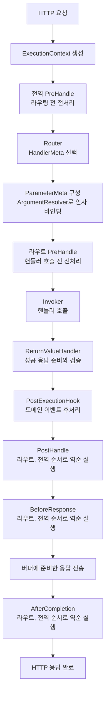

# 실행 파이프라인

::: info
이전 함수 생성자와 메서드 표현식은 호환을 위해 유지됩니다. 새 컨트롤러의 콜백은 [컨트롤러 전환](/ko/learn/migration/preview-controller-routes), 입력의 제약은 [입력 전환](/ko/learn/migration/v0.7.1-preview), 명세 설정은 [OpenAPI](/ko/reference/api/openapi)를 참고하세요.
:::

Spine의 실행 파이프라인은 요청을 받아 핸들러를 선택하고, 인자를 바인딩한 뒤, 반환값을 응답으로 만드는 흐름입니다. 인터셉터를 어느 시점에 실행해야 하는지, 오류가 발생하면 어떤 단계까지 진행하는지 이해할 때 이 흐름을 기준으로 삼습니다.

이 문서는 Spine v0.7.1의 HTTP 실행 순서를 설명합니다. HTTP, 이벤트 컨슈머, WebSocket은 같은 파이프라인 구현을 사용하지만, 입력을 해석하는 리졸버와 응답 처리 구성은 다릅니다.

컨트롤러 예제는 [CLI로 생성한 프로젝트](/ko/learn/tutorial/1-project-structure)에 추가하는 코드입니다. 요청 DTO는 포인터로 받고, 일반 성공 응답은 `github.com/NARUBROWN/spine/pkg/httpx`의 `httpx.Response[T]`로 반환합니다. 생성자와 라우트는 `BuildApplication`에서 등록합니다.

## HTTP 요청의 실행 순서

정상 요청은 다음 순서로 처리됩니다. 각 인터셉터의 `PreHandle`은 등록 순서로, 후처리 메서드는 역순으로 실행됩니다.



핸들러가 반환한 성공 응답은 바로 전송되지 않습니다. 파이프라인은 응답을 버퍼에 준비하고, 후처리와 `BeforeResponse`가 끝난 뒤 실제 HTTP 응답에 기록합니다. 중간에 오류가 발생하면 전송할 응답을 오류 응답으로 바꿀 수 있습니다.

## 요청 컨텍스트 생성

HTTP 어댑터는 요청마다 `core.ExecutionContext`를 만듭니다. 파이프라인은 이 객체로 요청의 메서드와 경로를 읽고, 인터셉터가 저장한 값을 공유하며, 요청에 속한 이벤트를 수집합니다.

같은 컨텍스트를 사용하더라도 각 구성 요소의 접근 범위는 다릅니다.

| 구성 요소 | 컨텍스트 사용 방식 |
| --- | --- |
| 라우터 | 메서드와 경로로 핸들러를 찾고 경로 매개변수 저장 |
| 인터셉터 | 요청 정보 조회, 실행 상태 저장, 응답 전후 처리 |
| 인자 리졸버 | 컨텍스트에서 컨트롤러 인자 생성 |
| 반환값 핸들러 | 컨텍스트에 연결된 응답 작성기로 응답 준비 |
| 컨트롤러 | 의미 타입, `context.Context`, 읽기 전용 `spine.Ctx`로 필요한 값만 수신 |

컨트롤러에는 `core.ExecutionContext`를 직접 주입하지 않습니다. 인터셉터에서 저장한 값을 컨트롤러가 읽어야 한다면 `pkg/spine.Ctx`를 사용합니다. 메서드별 접근 범위는 [실행 컨텍스트](/ko/learn/core-concepts/execution-context)에서 설명합니다.

## 전역 인터셉터: 라우팅 전 처리

`app.Interceptor()`로 등록한 전역 인터셉터의 `PreHandle`이 가장 먼저 실행됩니다. 아직 핸들러를 선택하지 않았으므로 이 호출에는 빈 `core.HandlerMeta{}`가 전달됩니다.

이 단계는 CORS preflight처럼 라우트 선택 전에 처리해야 하는 작업에 사용합니다. 예를 들어 CORS 인터셉터는 허용된 `OPTIONS` 요청의 응답을 준비하고 `core.ErrAbortPipeline`을 반환해 뒤의 실행을 중단할 수 있습니다.

전역 `PreHandle`에서는 다음 제약을 고려해야 합니다.

- 실행할 컨트롤러와 메서드가 아직 정해지지 않았습니다.
- Spine 라우터가 경로 매개변수를 아직 저장하지 않았습니다.
- 요청 DTO와 `input.Path[int64]` 같은 컨트롤러 인자도 아직 생성하지 않았습니다.

라우팅에 성공한 뒤 실행하는 `PostHandle`, `BeforeResponse`, `AfterCompletion`에는 선택된 핸들러의 메타데이터가 전달됩니다. 라우팅 전에 중단하거나 실패했다면 빈 메타데이터로 마무리합니다.

## 라우터: 핸들러와 경로 매개변수 선택

라우터는 `ctx.Method()`와 `ctx.Path()`로 등록된 핸들러를 찾습니다. 일치하는 핸들러가 없으면 404 오류를 반환합니다. 경로에 매개변수가 있으면 값을 컨텍스트에 저장하고, 선언 순서를 메타데이터에 유지합니다.

`HandlerMeta`는 실행할 대상과 라우트 설정을 담습니다.

```go
// core/handler_meta.go
type HandlerMeta struct {
    ControllerType reflect.Type   // 의존성 컨테이너에서 찾을 컨트롤러 타입
    Method         reflect.Method // 호출할 메서드
    Callback       reflect.Value
    PathKeys       []string       // 라우트에 선언한 경로 매개변수의 순서
    Interceptors   []Interceptor  // 해당 핸들러에 적용할 인터셉터
}
```

`HandlerMeta`는 요청마다 컨트롤러를 새로 만드는 지시가 아닙니다. 기존 메서드 표현식은 컨테이너에서 컨트롤러를 찾고, 새 라우트 콜백은 준비 단계에서 연결된 함수를 호출합니다. 자세한 필드는 [HandlerMeta](/ko/learn/core-concepts/handler-meta)를 참고하세요.

## 인자 바인딩: ParameterMeta와 ArgumentResolver

핸들러를 선택하면 파이프라인은 함수 시그니처를 읽어 각 인자의 타입과 위치를 나타내는 `ParameterMeta`를 구성합니다. 이어서 등록된 리졸버 중 해당 타입을 지원하는 첫 번째 리졸버가 값을 만듭니다.

리졸버가 값을 만들지 못하거나 지원하는 리졸버가 없으면 컨트롤러를 호출하지 않고 오류 처리로 넘어갑니다. **이 단계는 라우트 인터셉터의 `PreHandle`보다 먼저 실행됩니다.** 따라서 라우트 인터셉터에서 본문 바인딩 전 검사를 수행한다고 가정하면 안 됩니다.

### 경로 입력 연결

v0.7.1에서는 경로 변수가 여러 개일 때 스칼라 `input.Path[T]` 인자를 경로에 선언한 순서대로 하나씩 받습니다. 인자 수와 경로 변수 수는 같아야 하며, 스칼라와 경로 DTO 또는 기존 경로 래퍼는 같은 핸들러에서 혼용할 수 없습니다.

### HTTP에서 지원하는 입력

`context.Context`와 `spine.Ctx` 외에 `input.Path[T]`, `input.Query[T]`, `input.Body[T]`를 사용할 수 있습니다. 헤더는 `header` 태그가 있는 별도 구조체 포인터로 받고, 파일은 `multipart.UploadedFiles`로 받습니다. 기존 `path` 래퍼, `query.Values`, `header.Values`, `query.Pagination`은 Deprecated이며 새 Path, Query, Header 입력과 한 핸들러에서 혼용할 수 없습니다.

### 리졸버의 계약

다음은 내부 리졸버가 따르는 계약입니다. 앱에서 이 인터페이스나 `internal/` 패키지를 복사해 등록할 필요는 없습니다.

```go
type ArgumentResolver interface {
    Supports(parameterMeta ParameterMeta) bool
    Resolve(ctx core.ExecutionContext, parameterMeta ParameterMeta) (any, error)
}
```

리졸버는 공통 `ExecutionContext`를 받은 뒤, HTTP 입력이 필요하면 `core.HttpRequestContext`로 타입을 확인합니다. 컨슈머와 WebSocket 리졸버는 각각 해당 프로토콜의 컨텍스트에서 메시지 본문을 읽습니다.

## 라우트 인터셉터: 핸들러 호출 전 처리

`api.Interceptors()` / `route.WithInterceptors()`로 등록한 인터셉터는 특정 핸들러에만 적용됩니다. 라우팅과 인자 바인딩이 끝난 뒤 `PreHandle`을 호출하므로, 선택된 `HandlerMeta`와 경로 매개변수를 사용할 수 있습니다.

| 구분 | 등록 방법 | `PreHandle` 실행 시점 | 전달하는 메타데이터 |
| --- | --- | --- | --- |
| 전역 | `app.Interceptor()` | 라우팅 전 | 빈 `HandlerMeta{}` |
| 라우트 | `api.Interceptors()` / `route.WithInterceptors()` | 인자 바인딩 후, 핸들러 호출 전 | 선택된 `HandlerMeta` |

두 방식 모두 `core.Interceptor`의 네 메서드를 구현합니다.

```go
// core/interceptor.go
type Interceptor interface {
    PreHandle(ctx ExecutionContext, meta HandlerMeta) error
    PostHandle(ctx ExecutionContext, meta HandlerMeta)
    BeforeResponse(ctx ExecutionContext, meta HandlerMeta, executionErr error) error
    AfterCompletion(ctx ExecutionContext, meta HandlerMeta, err error)
}
```

`PreHandle`이 일반 오류를 반환하면 오류 처리로 넘어갑니다. `core.ErrAbortPipeline`을 반환하면 의도적으로 요청을 종료한 것으로 처리합니다. 이 경우 인터셉터가 필요한 응답을 직접 준비해야 합니다. 두 경우 모두 뒤에 있는 `PreHandle`과 컨트롤러는 실행하지 않습니다.

등록 예제는 [인터셉터 튜토리얼](/ko/learn/tutorial/4-interceptor)을 참고하세요.

## Invoker: 컨트롤러 호출

Invoker는 새 컨트롤러 라우트의 콜백을 바인딩한 인자로 호출합니다. 기존 메서드 표현식은 의존성 컨테이너에서 컨트롤러 인스턴스를 찾은 뒤 호출합니다. 핸들러는 입력값을 검사하고 서비스를 호출한 뒤 결과나 오류를 반환합니다.

다음 메서드는 `UserController`, `User`, `c.repo`가 있는 앱에 추가하는 예입니다. `input`, `httpx`, `httperr`는 각각 Spine의 `pkg/` 패키지에서 가져옵니다.

```go
func (c *UserController) GetUser(userId input.Path[int64]) (httpx.Response[User], error) {
    if *userId <= 0 {
        return httpx.Response[User]{}, httperr.BadRequest("유효하지 않은 사용자 ID")
    }
    user, err := c.repo.FindByID(*userId)
    if err != nil {
        return httpx.Response[User]{}, err
    }
    return httpx.Response[User]{Body: user}, nil
}
```

`userId`의 숫자 변환은 컨트롤러 호출 전에 끝납니다. 위의 `BadRequest`는 숫자로 변환된 값이 0 이하인 경우에만 실행됩니다. 숫자로 변환할 수 없는 경로 값이 이 검사에 도달한다고 가정하면 안 됩니다.

## ReturnValueHandler: 반환값을 응답으로 변환

파이프라인은 반환값 중 `nil`이 아닌 `error`를 먼저 찾습니다. 오류가 있으면 성공 값을 처리하지 않고 오류 응답 경로로 넘어갑니다. 오류가 없다면 첫 번째 `nil`이 아닌 성공 값을 지원하는 반환값 핸들러에 전달합니다.

타입 정보가 있는 포인터나 인터페이스에 `nil`이 들어 있는 경우도 건너뜁니다. 지원하지 않는 성공 타입을 반환하면 오류가 발생합니다. 일반 구조체를 그대로 반환하지 말고 `httpx.Response[T]`로 감싸세요.

| 반환값 핸들러 | 지원하는 반환 타입 | HTTP 응답 |
| --- | --- | --- |
| `RedirectReturnValueHandler` | `httpx.Redirect`, 해당 포인터 | `Location` 헤더와 상태 코드, 기본 302 |
| `BinaryReturnHandler` | `httpx.Binary`, 해당 포인터 | 바이너리 본문 |
| `StringReturnHandler` | `httpx.Response[string]`, 해당 포인터 | 텍스트 본문 |
| `JSONReturnHandler` | 문자열 외 본문의 `httpx.Response[T]`, 해당 포인터 | JSON 본문 |
| `ErrorReturnHandler` | `error` | 상태 코드와 `message`를 담은 JSON |

`ResponseOptions`로 상태 코드, 헤더, 쿠키를 지정할 수 있습니다. 응답 준비 중 직렬화나 쿠키 검증이 실패하면 성공 응답을 전송하지 않습니다.

내부 반환값 핸들러의 계약은 다음과 같습니다.

```go
type ReturnValueHandler interface {
    Supports(returnType reflect.Type) bool
    Handle(value any, ctx core.ExecutionContext) error
}
```

## PostExecutionHook: 이벤트 후처리

성공 반환값의 직렬화와 응답 검증이 끝나면 등록된 `PostExecutionHook`을 실행합니다. 도메인 이벤트 디스패치 훅은 요청의 EventBus에서 이벤트를 꺼내 디스패처로 전달합니다.

핸들러가 오류를 반환했거나 성공 응답 준비가 실패하면 이 단계에 도달하지 않습니다. 훅 자체가 오류를 반환해도 실행 실패로 처리하며, 뒤의 `PostHandle`은 건너뜁니다.

이 단계가 끝났다는 사실이 HTTP 응답 전송 완료를 뜻하지는 않습니다. `BeforeResponse`와 실제 응답 전송은 뒤에서 실행됩니다. 이벤트 수집과 발행 방법은 [실행 컨텍스트의 EventBus](/ko/learn/core-concepts/execution-context#event-publishing)를 참고하세요.

## 응답 전후의 인터셉터 처리

### PostHandle

핸들러, 성공 응답 준비, 후처리 훅이 모두 성공하면 `PostHandle`을 호출합니다. 라우트 인터셉터를 역순으로 실행한 뒤 전역 인터셉터를 역순으로 실행합니다.

`PostHandle`은 오류를 반환할 수 없습니다. 트랜잭션 커밋처럼 결과를 최종 응답에 반영해야 하는 작업은 `BeforeResponse`에서 처리합니다.

### BeforeResponse

`BeforeResponse`는 성공과 실패 경로 모두에서, **`PreHandle`이 성공한 인터셉터만** 호출합니다. 라우트 인터셉터를 역순으로 실행한 뒤 전역 인터셉터를 역순으로 실행합니다.

`executionErr`에는 그 시점까지 발생한 오류가 전달됩니다. `BeforeResponse`에서 새 오류를 반환하면 기존 오류에 합쳐 다음 인터셉터와 최종 오류 처리로 전달합니다. 트랜잭션 인터셉터는 이 시점에 성공 여부를 보고 커밋하거나 롤백할 수 있습니다.

`PreHandle`에서 오류나 `core.ErrAbortPipeline`을 반환한 인터셉터 자신은 `BeforeResponse` 호출 대상에 포함되지 않습니다.

### AfterCompletion

응답 처리 뒤에는 `AfterCompletion`을 호출합니다. 라우트를 선택했다면 라우트 인터셉터 전체를 역순으로 호출하고, 이어서 전역 인터셉터 전체를 역순으로 호출합니다. 성공, 오류, 의도적인 중단 모두 이 정리 단계를 거칩니다.

호출 범위는 `BeforeResponse`와 다릅니다. `PreHandle`을 실행하지 못했거나 `PreHandle`에서 실패한 인터셉터에도 `AfterCompletion`이 호출될 수 있습니다. 리소스가 생성되지 않은 경우에도 정리 코드가 동작하도록 작성하세요. 라우팅 전에 종료했다면 라우트 인터셉터는 아직 선택하지 않았으므로 전역 정리만 실행합니다.

이 단계에서는 로깅, 메트릭 수집, 리소스 정리를 수행합니다. HTTP 응답 기록을 시도한 뒤이므로 `AfterCompletion`에서 발생한 오류로 이미 전송된 응답을 바꿀 수는 없습니다.

## 오류 응답과 응답 전송 {#error-responses}

실행 오류는 `BeforeResponse`가 끝난 뒤 HTTP 오류 응답으로 변환합니다. 준비해 둔 성공 응답이 있으면 이를 되돌리고 오류 응답을 준비합니다. 그다음 버퍼의 응답을 실제 응답 작성기에 기록합니다.

| 오류 조건 | HTTP 처리 |
| --- | --- |
| 등록된 핸들러를 찾지 못함 | 404 |
| 유효한 `httperr.HTTPError` | 지정한 상태 코드와 메시지 |
| 선택한 검증기의 DTO 규칙 위반 (`validation.Error`) | 400, `message`와 `fields` 응답 |
| 요청 본문 제한을 넘은 `http.MaxBytesError` | 413 |
| 별도로 매핑하지 않은 실행 오류 | 500, `Internal server error` |
| 이미 실제 응답이 커밋됨 | 이중 응답을 쓰지 않음 |

Spine `v0.7.1`와 Echo 플랫폼 `v0.2.0-rc.1`은 잘못된 JSON과 숫자 또는 불리언 경로 변환 실패를 HTTP 400으로 처리합니다. 지원하지 않는 본문 Content-Type은 415, 본문 크기 제한 초과는 413입니다. 바인딩 실패는 컨트롤러 호출 전에 발생하며, 핸들러의 업무 검증 오류와 구분해 실제 요청으로 확인하세요.

실제 응답 전송 중 오류가 발생하면 최종 실행 오류에 포함됩니다. 아직 응답을 커밋하지 않았다면 500 응답을 쓰는 처리를 시도합니다. 이미 전송한 응답은 되돌릴 수 없습니다.

## 중단 지점별 실행 범위

다음 예는 전역 인터셉터와 라우트 인터셉터를 각각 하나씩 등록한 경우입니다. `before`는 `BeforeResponse`, `after`는 `AfterCompletion`을 뜻합니다.

### 정상 처리

```text
pre:global → routing → binding → pre:route → handler
→ return → hook → post:route → post:global
→ before:route → before:global → flush → after:route → after:global
```

### 라우트 PreHandle에서 중단

```text
pre:global → routing → binding → pre:route(중단)
→ before:global → flush → after:route → after:global
```

컨트롤러를 호출하지 않습니다. 중단한 라우트 인터셉터의 `BeforeResponse`는 호출하지 않지만, `AfterCompletion`은 호출합니다.

### 전역 PreHandle에서 중단

```text
pre:global(중단) → flush → after:global
```

라우터와 인자 바인딩을 실행하지 않습니다. 이 예에서는 성공한 `PreHandle`이 없으므로 `BeforeResponse`도 호출하지 않습니다.

### 인자 바인딩에서 실패

```text
pre:global → routing → binding(실패)
→ before:global → 오류 응답 준비 → flush → after:route → after:global
```

라우트 인터셉터를 선택한 뒤이므로 `AfterCompletion`은 호출합니다. 다만 해당 인터셉터의 `PreHandle`은 아직 실행하지 않았으므로 라우트 `BeforeResponse`는 호출하지 않습니다.

## HTTP 외의 실행

이벤트 컨슈머와 WebSocket도 별도의 파이프라인 인스턴스에서 같은 실행 구조를 사용합니다. HTTP용 리졸버와 반환값 핸들러가 그대로 적용되는 것은 아닙니다.

| 실행 종류 | 라우팅 기준 | 기본 인자 | 응답 처리 |
| --- | --- | --- | --- |
| HTTP | HTTP 메서드와 요청 경로 | `context.Context`, `spine.Ctx`, 경로와 쿼리 타입, DTO 등 | HTTP 반환값 핸들러로 응답 준비 |
| 이벤트 컨슈머 | `EVENT`와 이벤트 이름 | `context.Context`, 이벤트 이름, 원시 페이로드, 구조체 DTO | 컨슈머 런타임에서 실행 결과 처리 |
| WebSocket | `WS`와 연결 요청 경로 | `context.Context`, `ws.ConnectionID`, 원시 페이로드, 구조체 DTO | 메시지 핸들러의 전송 API 사용 |

특히 HTTP DTO는 포인터를 받지만, 기본 컨슈머와 WebSocket DTO 리졸버는 구조체 값을 지원합니다. HTTP의 `spine.Ctx` 리졸버도 기본 컨슈머와 WebSocket 파이프라인에는 등록되어 있지 않습니다. 각 프로토콜의 컨텍스트와 입력 차이는 [실행 컨텍스트](/ko/learn/core-concepts/execution-context)를 참고하세요.
