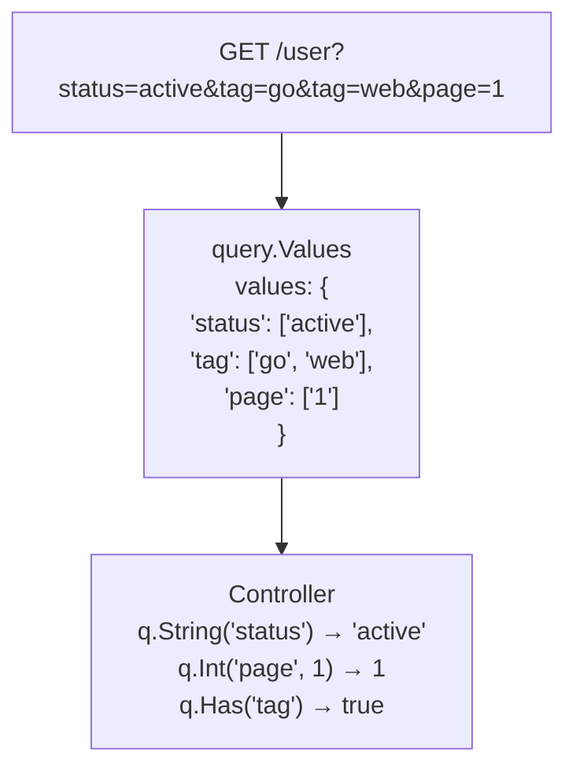

# query.Values

`query.Values`로 HTTP 쿼리 파라미터를 읽고 기본값을 지정할 수 있습니다. 컨트롤러 인자에 `q query.Values`를 선언한 뒤, 필요한 키를 문자열, 정수, 불리언으로 꺼내 사용합니다. 쿼리 파라미터를 임의의 DTO에 자동으로 매핑하는 방식은 지원하지 않습니다.

이 페이지의 기능별 `src/user` 예제는 [프로젝트 구조](/ko/learn/tutorial/1-project-structure)에서 `--layout legacy`로 생성한 `my-app`을 기준으로 합니다. CLI `v0.4.2`의 기본 `new`는 역할별 `layered-v1` 구조를 생성합니다. 두 레이아웃 모두 Spine `v0.6.5`와 Echo 플랫폼 `v0.1.0`을 사용합니다.

이 페이지는 Spine v0.6.5의 `github.com/NARUBROWN/spine/pkg/query`를 기준으로 설명합니다.

## CLI 프로젝트에서 사용하기

[첫 번째 앱](/ko/learn/getting-started/first-app)에서 프로젝트를 만들고 [컨트롤러](/ko/learn/tutorial/2-controller)에서 `src/user` 리소스를 생성한 뒤 이어갑니다. 예제 핸들러는 같은 `package user`에 추가하고, 해당 핸들러를 사용할 라우트도 등록하세요.

`User`, 검색 조건과 페이지 응답 타입, 서비스의 검색 메서드는 앱에서 직접 정의합니다. 상품과 주문 예제도 같은 방식의 기능 확장입니다. 각 예제는 독립된 대안이므로 필요한 메서드와 라우트만 추가하세요. 성공 응답은 `httpx.Response[T]`로 감싸며 다음 두 패키지를 가져옵니다.

```go
import (
    "github.com/NARUBROWN/spine/pkg/httpx"
    "github.com/NARUBROWN/spine/pkg/query"
)
```

기본 예제는 `id`와 `name`을 쿼리 파라미터에서 읽어 응답합니다.

```go
// src/user/user_controller.go
func (c *UserController) GetUserQuery(q query.Values) httpx.Response[User] {
    return httpx.Response[User]{Body: User{
        ID:   q.Int("id", 0),
        Name: q.String("name"),
    }}
}
```

이 메서드를 `GET /user`에 등록했을 때 요청과 응답은 다음과 같습니다.

```bash
# 요청
GET /user?id=123&name=john

# 응답
{
    "id": 123,
    "name": "john"
}
```

## 쿼리 값이 전달되는 방식

HTTP 요청의 쿼리 파라미터는 키 하나에 문자열 값 여러 개를 담을 수 있습니다. 예를 들어 `?tag=go&tag=web`에는 `tag` 값이 두 개 있습니다. Spine은 이 쿼리 맵을 `query.Values`로 감싸서 컨트롤러에 전달합니다.



핸들러에는 `query.Values`를 값 타입으로 선언합니다. 기본 리졸버는 정확히 이 타입을 처리하며, `*query.Values`는 같은 주입 대상이 아닙니다. 쿼리값 주입은 HTTP 요청용이므로 Consumer나 WebSocket 핸들러에서 같은 동작을 기대하면 안 됩니다.

`query.Values`의 읽기 메서드는 원본 쿼리 맵을 수정하지 않습니다. 앱 코드나 단위 테스트에서 직접 만들 때는 `query.NewValues(values map[string][]string)`를 사용할 수 있습니다.

```go
// pkg/query/types.go
type Values struct {
    values map[string][]string
}

func NewValues(values map[string][]string) Values {
    return Values{values: values}
}
```

`NewValues`는 전달받은 맵을 복사하지 않고 보관합니다. 생성 후 원본 맵을 바꾸면 같은 맵을 감싼 `Values`에서도 변경된 값을 읽게 됩니다. 일반적인 HTTP 핸들러에서는 직접 생성하지 않아도 됩니다.

## 읽기 메서드

| 메서드 | 반환 타입 | 값이 없거나 변환할 수 없을 때 |
| --- | --- | --- |
| `Get(key)` | `string` | 빈 문자열 |
| `String(key)` | `string` | 빈 문자열. `Get`과 같은 동작 |
| `Int(key, def)` | `int64` | 호출 시 지정한 `def` |
| `GetBoolByKey(key, def)` | `bool` | 호출 시 지정한 `def` |
| `Has(key)` | `bool` | 키가 없으면 `false` |

값을 읽는 메서드는 첫 번째 값만 사용합니다. 같은 키가 반복되어도 `Get`, `String`, `Int`, `GetBoolByKey`가 모든 값을 반환하거나 검사하지는 않습니다.

### 문자열 읽기

`Get`과 `String`은 같은 동작을 합니다. 키가 없거나 값 목록이 비어 있으면 빈 문자열을 반환합니다.

```go
// GET /user?name=john&status=active

q.Get("name")    // "john"
q.Get("status")  // "active"
q.Get("missing") // ""
```

```go
q.String("name")  // "john"
```

### 정수 읽기

`Int(key string, def int64) int64`는 첫 번째 값을 10진수의 64비트 부호 있는 정수로 변환합니다. 키가 없거나 값이 빈 문자열이면 `def`를 반환합니다. 숫자가 아니거나 `int64` 범위를 벗어난 경우에도 오류를 반환하지 않고 `def`를 사용합니다.

```go
// GET /user?page=3&size=20

q.Int("page", 1)    // 3
q.Int("size", 10)   // 20
q.Int("offset", 0)  // 0 (키 없음 → 기본값)
q.Int("page", 1)    // 1 (만약 page=abc라면 → 기본값)
```

변환에 성공한 음수나 0은 그대로 반환합니다. 페이지 번호, 가격 범위처럼 양수만 허용해야 하는 값은 앱에서 별도로 검사해야 합니다.

### 불리언 읽기

`GetBoolByKey(key string, def bool) bool`은 첫 번째 값을 소문자로 바꾼 뒤 다음 문자열을 판별합니다.

| 결과 | 인식하는 값 |
| --- | --- |
| `true` | `"true"`, `"1"`, `"yes"`, `"y"`, `"on"` |
| `false` | `"false"`, `"0"`, `"no"`, `"n"`, `"off"` |
| `def` | 키가 없거나 위 목록에 없는 값 |

대소문자는 구분하지 않지만 공백은 제거하지 않습니다. 예를 들어 `" TRUE "`는 인식 목록에 없으므로 기본값을 사용합니다.

```go
// GET /user?active=true&verified=1&premium=yes

q.GetBoolByKey("active", false)    // true
q.GetBoolByKey("verified", false)  // true
q.GetBoolByKey("premium", false)   // true
q.GetBoolByKey("deleted", false)   // false (키 없음 → 기본값)
q.GetBoolByKey("active", false)    // false (만약 active=maybe → 기본값)
```

### 키 존재 여부 확인

`Has(key string) bool`은 값이 아닌 키의 존재를 확인합니다. `?empty=`처럼 값이 비어 있어도 키가 있으면 `true`입니다.

```go
// GET /user?status=active&empty=

q.Has("status")  // true
q.Has("empty")   // true (값은 비었지만 키는 존재)
q.Has("missing") // false
```

키가 없는 경우와 명시적으로 빈 문자열을 보낸 경우를 구분해야 한다면, `Get`의 결과만 보지 말고 `Has`도 확인하세요. 마찬가지로 `Has`가 `true`여도 정수나 불리언 변환에 성공했다는 뜻은 아닙니다.

## 검색과 필터에 사용하기

필터마다 기본값을 호출부에 지정할 수 있습니다. 다음 예제는 검색어, 분류, 가격 범위, 재고 여부를 읽어 서비스에 전달합니다.

```go
func (c *ProductController) Search(q query.Values) httpx.Response[SearchResult] {
    keyword := q.String("q")
    category := q.String("category")
    minPrice := q.Int("min_price", 0)
    maxPrice := q.Int("max_price", 999999)
    inStock := q.GetBoolByKey("in_stock", true)

    products := c.service.Search(SearchCriteria{
        Keyword:  keyword,
        Category: category,
        MinPrice: minPrice,
        MaxPrice: maxPrice,
        InStock:  inStock,
    })

    return httpx.Response[SearchResult]{Body: SearchResult{
        Query:    keyword,
        Count:    len(products),
        Products: products,
    }}
}
```

```bash
GET /product?q=laptop&category=electronics&min_price=500&in_stock=true
```

이 예제에서는 잘못된 숫자나 불리언도 기본값으로 처리합니다. 잘못된 입력에 400 응답을 반환해야 하는 API라면 `String`으로 원문을 읽고 `strconv.ParseInt` 등의 변환 결과를 확인한 뒤 `httperr.BadRequest`를 반환하세요. 기본값 처리와 유효성 검사는 서로 다른 정책입니다.

### 전달된 필터만 적용하기

필터가 선택 사항일 때는 `Has`로 키가 전달되었는지 확인합니다.

```go
func (c *OrderController) List(q query.Values) httpx.Response[[]Order] {
    filters := OrderFilters{}

    if q.Has("user_id") {
        filters.UserID = q.Int("user_id", 0)
    }

    if q.Has("status") {
        filters.Status = q.String("status")
    }

    if q.Has("from_date") {
        filters.FromDate = parseDate(q.String("from_date"))
    }

    if q.Has("to_date") {
        filters.ToDate = parseDate(q.String("to_date"))
    }

    return httpx.Response[[]Order]{Body: c.service.FindByFilters(filters)}
}
```

`OrderFilters`와 `parseDate`는 앱이 정의하는 타입과 함수입니다. 날짜 형식, 시작일과 종료일의 순서, 필터를 생략했을 때의 동작도 앱에서 정해야 합니다. 이 예제의 `Has` 검사는 형식 검증을 대신하지 않습니다.

### 허용할 필터를 직접 선택하기

다음처럼 앱이 받아들일 필터 이름만 확인해 서비스에 전달할 수도 있습니다.

```go
// 동적 필터 처리
func (c *ProductController) Search(q query.Values) httpx.Response[[]Product] {
    filters := make(map[string]string)

    // 어떤 필터가 올지 미리 알 수 없음
    if q.Has("min_price") {
        filters["min_price"] = q.String("min_price")
    }
    if q.Has("max_price") {
        filters["max_price"] = q.String("max_price")
    }
    if q.Has("category") {
        filters["category"] = q.String("category")
    }

    return httpx.Response[[]Product]{Body: c.service.FindByFilters(filters)}
}
```

## 페이지네이션과 함께 사용하기

고정된 `page`, `size` 처리는 `query.Pagination`에 맡기고, 검색 조건은 `query.Values`로 읽을 수 있습니다.

```go
func (c *UserController) List(p query.Pagination, q query.Values) httpx.Response[PagedResult] {
    status := q.String("status")
    sortBy := q.String("sort_by")

    users := c.service.FindAll(status, sortBy, p.Page, p.Size)
    total := c.service.Count(status)

    return httpx.Response[PagedResult]{Body: PagedResult{
        Data:  users,
        Page:  p.Page,
        Size:  p.Size,
        Total: total,
    }}
}
```

```bash
GET /user?page=2&size=20&status=active&sort_by=created_at
```

| 구분 | `query.Values` | `query.Pagination` |
| --- | --- | --- |
| 용도 | 이름과 기본값을 앱이 정하는 쿼리 파라미터 | `page`, `size`를 사용하는 페이지네이션 |
| 기본값 | 각 읽기 메서드를 호출할 때 지정 | `page=1`, `size=20` |
| 타입 변환 | 필요한 키마다 메서드 호출 | 페이지네이션 인자 주입 시 변환 |

같은 요청에서 두 타입을 함께 선언해도 됩니다. `query.Values`에서도 `page`, `size`를 읽을 수 있으므로, 서비스에 전달할 페이지 정보의 기준을 한쪽으로 정해 중복 처리를 피하세요.

```go
// 고정된 페이지네이션만 필요 → query.Pagination
func List(p query.Pagination) httpx.Response[[]User]

// 동적 필터 + 페이지네이션 → 둘 다 사용
func Search(p query.Pagination, q query.Values) httpx.Response[[]User]

// 완전히 동적인 쿼리 → query.Values만
func CustomSearch(q query.Values) httpx.Response[[]User]
```

## 같은 키에 여러 값이 있을 때

HTTP 쿼리는 다음과 같이 같은 키를 반복할 수 있습니다.

```
GET /product?tag=go&tag=web&tag=api
```

이 요청에서 `q.String("tag")`와 `q.Get("tag")`는 `"go"`만 반환합니다. Spine v0.6.5의 `query.Values`에는 전체 값 목록을 꺼내는 공개 메서드가 없으며, 앱에서 비공개 필드 `values`에 직접 접근할 수도 없습니다.

여러 값을 받아야 한다면 API에서 쉼표로 구분한 문자열 하나를 받도록 정하고 앱에서 분리하는 방법이 있습니다. 다음 예제에는 `strings` 패키지도 필요합니다.

```go
// 쉼표 구분 방식
// GET /product?tags=go,web,api

func (c *ProductController) Search(q query.Values) httpx.Response[[]Product] {
    tagsRaw := q.String("tags")
    tags := strings.Split(tagsRaw, ",")

    return httpx.Response[[]Product]{Body: c.service.FindByTags(tags)}
}
```

이 예제에서는 `tags`가 비어 있으면 `strings.Split` 결과에 빈 문자열이 들어갑니다. 빈 항목, 중복 태그, 태그 이름에 포함된 쉼표를 허용할지는 앱에서 정하고 검사하세요.

쿼리 파라미터의 키, 기본값, 허용 범위를 컨트롤러 가까이에 두면 요청 처리 규칙을 확인하기 쉽습니다. 요청 본문 DTO를 받는 방법은 [컨트롤러 튜토리얼](/ko/learn/tutorial/2-controller), 오류 응답은 [httperr](/ko/learn/core-concepts/httperr)를 참고하세요.
