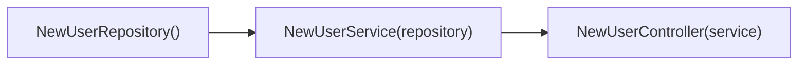

# 의존성 주입

[컨트롤러](/ko/learn/tutorial/2-controller)에서 만든 `src/user` 리소스를 기준으로 생성자 등록과 의존성 주입(DI)을 살펴봅니다. 이 과정을 마치면 컨트롤러, 서비스, 저장소를 연결하고 순환 의존성이나 누락된 생성자를 확인할 수 있습니다.

이 페이지의 기능별 `src/user` 예제는 [프로젝트 구조](/ko/learn/tutorial/1-project-structure)에서 `--layout legacy`로 생성한 `my-app`을 기준으로 합니다. CLI `v0.4.0`의 기본 `new`는 역할별 `layered-v1` 구조를 생성합니다. 두 레이아웃 모두 Spine `v0.6.0`과 Echo 플랫폼 `v0.1.0`을 사용합니다.

[첫 번째 앱](/ko/learn/tutorial/1-project-structure)의 프로젝트를 준비하고 `my-app` 루트에서 진행하세요. 뒤의 데이터베이스와 래퍼 타입 예제는 기본 리소스에 자동으로 포함되지 않는 별도 확장입니다.


## 핵심 개념

Spine은 등록된 생성자의 파라미터 타입을 보고 필요한 객체를 먼저 만든 뒤 전달합니다. `@Autowired`나 `@Injectable` 같은 어노테이션과 DI 전용 설정 파일은 사용하지 않습니다. `spine.toml`은 CLI 프로젝트 설정 파일입니다.

아래 생성자에서 `*UserRepository`는 `UserService`가 필요로 하는 의존성입니다.

```go
// 파라미터 타입을 보고 자동으로 의존성 주입
func NewUserService(repository *UserRepository) *UserService {
    return &UserService{repository: repository}
}
```

## CLI로 생성한 의존성

아직 생성하지 않았다면 `my-app` 루트에서 실행합니다. 이미 생성했다면 다시 실행하지 마세요.

```bash
spine-cli generate resource user --dry-run
```

미리보기에서 생성 파일과 등록 코드 변경을 확인한 뒤 아래 명령으로 생성합니다.

```bash
spine-cli generate resource user
```

다음은 CLI가 같은 `user` 패키지에 생성한 코드에서 타입과 생성자만 발췌한 것입니다. 기존 파일을 이 코드로 덮어쓰지 마세요. 컨트롤러의 `Get` 메서드는 생성된 파일에 유지합니다.

```go
// src/user/user_repository.go
package user

type UserRepository struct{}

func NewUserRepository() *UserRepository { return &UserRepository{} }
```

```go
// src/user/user_service.go
package user

type UserService struct{ repository *UserRepository }

func NewUserService(repository *UserRepository) *UserService {
    return &UserService{repository: repository}
}
```

```go
// src/user/user_controller.go
package user

type UserController struct{ service *UserService }

func NewUserController(service *UserService) *UserController {
    return &UserController{service: service}
}
```

`src/user/user_route.go`의 `Register`는 세 생성자와 `GET /user/:id`를 등록합니다. CLI는 `internal/application/application.go`의 `BuildApplication()`에 `user.Register(app)` 호출과 오류 처리를 추가합니다. 이미 등록된 생성자를 다시 추가하지 마세요.

```go
// src/user/user_route.go: Register
app.Constructor(NewUserRepository, NewUserService, NewUserController)
app.Route("GET", "/user/:id", (*UserController).Get)
```

## 등록 순서와 해결 순서

생성자 등록 순서는 객체 생성 순서를 결정하지 않습니다. 컨트롤러를 만들려면 서비스가 필요하고, 서비스를 만들려면 저장소가 필요하므로 저장소부터 생성합니다. 생성된 인스턴스는 컨테이너가 공유하며 요청마다 새로 만들지 않습니다.

다음처럼 등록 순서를 바꿔도 의존성을 해결하는 순서는 같습니다.

```go
// user_route.go의 기존 Constructor 호출을 대체하는 예시입니다.
app.Constructor(NewUserController, NewUserService, NewUserRepository)
```



## 생성자 규칙

### 파라미터

각 파라미터 타입을 제공하는 생성자가 등록되어 있어야 합니다. 의존성이 없으면 파라미터를 생략하고, 여러 의존성이 필요하면 파라미터를 여러 개 선언합니다.

다음은 시그니처만 보여 주는 예시입니다. 실제 코드에는 각 함수의 본문과 반환 타입을 구현해야 합니다.

```go
// 저장소 의존성 선언
func NewUserService(repo *UserRepository) *UserService

// 여러 의존성 선언
func NewUserController(svc *UserService, logger *Logger) *UserController

// 의존성 없는 생성자
func NewLogger() *Logger
```

### 반환 타입

생성자는 정확히 하나의 값을 반환해야 합니다. 그 반환 타입이 컨테이너에 등록되는 타입입니다. `(값, error)`를 반환하는 생성자는 지원하지 않으며, 포인터나 인터페이스를 반환하는 생성자가 `nil`을 반환하면 의존성 해결에 실패합니다.

```go
func NewUserService(repository *UserRepository) *UserService {
    return &UserService{repository: repository}
}
```

데이터베이스 연결 함수도 [데이터베이스 예제](/ko/learn/tutorial/5-database)의 `database.NewDB() *bun.DB`처럼 값을 하나만 반환하도록 구현합니다. `BuildApplication`에서 생성자를 등록하는 것만으로 연결 함수를 호출하지는 않습니다. 따라서 생성된 검증 테스트의 성공이 데이터베이스 접속 성공을 뜻하지 않습니다. 연결 초기화와 오류 처리는 생성자가 실행되는 앱 시작 단계에서 확인하세요.

```go
// internal/application/application.go: BuildApplication
app.Constructor(database.NewDB)
```

## 인터페이스 활용

인터페이스 타입을 파라미터로 선언하면 다음 순서로 의존성을 찾습니다.

1. 반환 타입이 해당 인터페이스와 정확히 일치하는 생성자를 사용합니다.
2. 정확히 일치하는 생성자가 없으면 해당 인터페이스에 할당할 수 있는 반환 타입을 찾습니다.
3. 후보가 하나이면 주입하고, 여러 개이면 `multiple constructors registered for interface` 오류를 반환합니다. 후보가 없으면 의존성 누락 오류를 반환합니다.

다음은 [데이터베이스](/ko/learn/tutorial/5-database) 설정을 마친 앱에서 적용하는 확장 예제입니다. CLI의 `resource` 생성 결과에는 Bun 설정이 포함되지 않습니다.

### 데이터베이스와 트랜잭션의 공통 타입

저장소 필드를 `*bun.DB`로 고정하면 그 필드에 `bun.Tx`를 넣을 수 없습니다.

```go
// 이 필드에는 *bun.DB만 저장할 수 있음
type UserRepository struct {
    db *bun.DB  // bun.Tx를 받을 수 없음
}
```

`*bun.DB`와 `bun.Tx`가 모두 구현하는 `bun.IDB`를 사용하면 두 타입을 같은 계약으로 다룰 수 있습니다. 아래 코드는 저장소 생성자가 `bun.IDB`를 의존성으로 받는 예시입니다.

```go
// *bun.DB와 bun.Tx는 모두 bun.IDB를 구현
type UserRepository struct {
    db bun.IDB
}

func NewUserRepository(db bun.IDB) *UserRepository {
    return &UserRepository{db: db}
}
```

### 요청별 트랜잭션 전달

생성자 주입과 요청별 값 전달은 수명이 다릅니다. 생성자로 만든 서비스와 저장소는 앱에서 공유하므로, 요청마다 만든 `bun.Tx`가 기존 인스턴스의 필드에 자동으로 다시 주입되지는 않습니다. 공유 필드에 요청별 트랜잭션을 덮어쓰면 다른 요청과 섞일 수 있습니다.

요청별 트랜잭션은 다음 순서로 전달합니다.

1. 인터셉터의 `PreHandle`에서 트랜잭션을 시작하고 `ctx.Set("tx", tx)`로 저장합니다.
2. 컨트롤러가 `spine.Ctx.Get("tx")`으로 값을 읽고 `bun.Tx` 타입인지 확인합니다.
3. 컨트롤러가 서비스와 저장소의 메서드에 `bun.IDB` 인자로 트랜잭션을 명시적으로 전달합니다.
4. 인터셉터의 `BeforeResponse`에서 실행 결과에 따라 커밋하거나 롤백하고, 그 과정의 오류를 반환합니다.

인터셉터의 네 수명주기 메서드 구현과 등록 방법은 [의존성 주입이 필요한 인터셉터](/ko/learn/tutorial/4-interceptor)를 참고하세요.


## 기능별 등록

다른 기능을 CLI로 생성하면 각 패키지의 `Register` 함수와 앱을 조립하는 `BuildApplication`에 연결됩니다. 아래는 별도의 `order` 리소스를 추가하는 선택 예제입니다. CLI가 `order.Register(app)` 호출을 추가하므로 직접 중복 등록하지 마세요.

```bash
spine-cli generate resource order --dry-run
```

미리보기에서 생성 파일과 등록 코드 변경을 확인한 뒤 아래 명령으로 생성합니다.

```bash
spine-cli generate resource order
```

### 생성자 등록을 여러 호출로 나누기

같은 `Register` 안에서 등록을 여러 호출로 나눌 수도 있습니다. 각 타입은 한 번씩 등록하세요.

```go
// src/user/user_route.go: Register
app.Constructor(NewUserRepository)
app.Constructor(NewUserService)
app.Constructor(NewUserController)
```

## 동일 타입 여러 개

같은 타입으로 주 데이터베이스와 복제 데이터베이스를 등록하면 파라미터 이름만으로 둘을 구분할 수 없습니다. 서로 다른 래퍼 타입을 선언해 구분하세요.

다음은 별도의 저장소 설계 예시입니다. `App`, `UserRepository`의 `writer`와 `reader` 필드, `connectToPrimary`, `connectToReplica`는 앱에 맞게 구현해야 합니다.

```go
// 파라미터 이름만으로 인스턴스를 구분할 수 없음
func NewApp(db1 *bun.DB, db2 *bun.DB) *App  // 어떤 게 어떤 건지?

// 서로 다른 래퍼 타입으로 구분
type PrimaryDB struct{ *bun.DB }
type ReplicaDB struct{ *bun.DB }

func NewPrimaryDB() *PrimaryDB {
    return &PrimaryDB{connectToPrimary()}
}

func NewReplicaDB() *ReplicaDB {
    return &ReplicaDB{connectToReplica()}
}

func NewUserRepository(primary *PrimaryDB, replica *ReplicaDB) *UserRepository {
    return &UserRepository{
        writer: primary.DB,
        reader: replica.DB,
    }
}
```

## 의존성 오류 확인

### 순환 의존성

`A`가 `B`를 필요로 하고 `B`가 다시 `A`를 필요로 하면 어느 객체도 먼저 만들 수 없습니다. 아래 코드는 이 관계를 보여 주는 의사 코드입니다.

```go
// A → B → A 순환
func NewA(b *B) *A { ... }
func NewB(a *A) *B { ... }

// 부팅 시 에러 발생
// circular dependency detected: *user.A -> *user.B -> *user.A
```

### 누락된 의존성

필요한 타입의 생성자가 없으면 의존성 해결에 실패합니다. 아래는 `NewUserRepository` 등록을 생략한 경우입니다.

```go
// UserRepository를 등록하지 않으면
app.Constructor(
    NewUserService,     // *UserRepository 필요
    NewUserController,
)

// 부팅 시 에러 발생
// no constructor registered for *user.UserRepository
```

## 등록 검증과 실행 확인

프로젝트 루트에서 다음 명령을 실행합니다.

```bash
spine-cli doctor
spine-cli contract check
spine-cli verify
```

`spine-cli contract check`는 소스에서 추출한 DI 계약을 검사하고, `spine-cli verify`는 포맷, `go vet`, 테스트도 검사합니다. `app.Validate(options)`의 성공만으로 생성자 실행이나 인스턴스 초기화까지 확인한 것은 아닙니다.

실제 초기화와 요청 처리는 `spine-cli dev`로 앱을 실행한 뒤 확인하세요. 데이터베이스를 연결했다면 실제 접속과 질의도 별도로 확인해야 합니다. 순환 의존성이나 누락된 생성자는 의존성 해결 과정에서 오류를 반환하며, 생성된 `main.go`는 `Run` 오류를 확인합니다.

## 다음 단계

- [튜토리얼: 인터셉터](/ko/learn/tutorial/4-interceptor) — 요청 전후 처리
- [튜토리얼: 데이터베이스](/ko/learn/tutorial/5-database) — Bun ORM 연결
