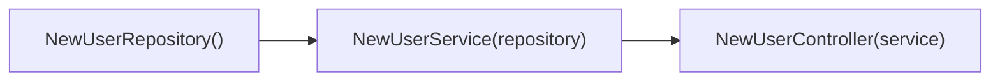

# 의존성 주입

[컨트롤러](/ko/learn/tutorial/2-controller)에서 CLI로 만든 `src/user` 리소스의 의존성을 살펴봅니다. 설치와 프로젝트 생성은 [첫 번째 앱](/ko/learn/getting-started/first-app)을 따릅니다.

Spine의 DI 이해하기.


## 핵심 개념

Spine의 의존성 주입은 **생성자 기반**입니다.

- 어노테이션 없음 (`@Autowired`, `@Injectable` 불필요)
- DI 바인딩용 별도 설정 파일 없음 (`spine.toml`은 CLI 프로젝트 설정)
- 생성자 파라미터가 곧 의존성 선언

```go
// 파라미터 타입을 보고 자동으로 의존성 주입
func NewUserService(repository *UserRepository) *UserService {
    return &UserService{repository: repository}
}
```

## CLI로 생성한 의존성

아직 생성하지 않았다면 `hello-spine` 루트에서 실행합니다. 이미 생성했다면 다시 실행하지 마세요.

```bash
spine generate resource user --dry-run
```

미리보기에서 생성 파일과 등록 코드 변경을 확인한 뒤 아래 명령으로 생성합니다.

```bash
spine generate resource user
```

다음은 CLI가 `src/user`의 같은 `package user`에 생성한 생성자들입니다.

```go
// src/user/user_repository.go
package user

type UserRepository struct{}

func NewUserRepository() *UserRepository { return &UserRepository{} }
```

```go
// src/user/user_service.go
package user

type UserService struct{ repository *UserRepository }

func NewUserService(repository *UserRepository) *UserService {
    return &UserService{repository: repository}
}
```

```go
// src/user/user_controller.go
package user

type UserController struct{ service *UserService }

func NewUserController(service *UserService) *UserController {
    return &UserController{service: service}
}
```

`src/user/user_route.go`의 `Register`가 이 생성자들과 `GET /user/:id`를 등록합니다. CLI는 `internal/application/application.go`의 `BuildApplication()`에서 `user.Register(app)`의 오류를 확인하도록 연결합니다. 이미 자동 등록된 생성자를 다시 등록하지 마세요.

```go
// src/user/user_route.go: Register
app.Constructor(NewUserRepository, NewUserService, NewUserController)
app.Route("GET", "/user/:id", (*UserController).Get)
```

## 등록 순서와 해결 순서

등록 순서와 관계없이 필요한 의존성을 먼저 해결합니다. 생성한 인스턴스는 컨테이너에서 공유하며 요청마다 새로 만들지 않습니다.

```go
// user_route.go의 기존 Constructor 호출을 대체하는 예시입니다.
app.Constructor(NewUserController, NewUserService, NewUserRepository)
```



## 생성자 규칙

### 파라미터

생성자 파라미터는 **provider가 등록된 타입**이어야 합니다.

```go
// ✅ 올바른 예
func NewUserService(repo *UserRepository) *UserService

// ✅ 여러 의존성도 가능
func NewUserController(svc *UserService, logger *Logger) *UserController

// ✅ 의존성 없음도 가능
func NewLogger() *Logger
```

### 반환 타입

생성자는 정확히 하나의 값을 반환해야 합니다. `(값, error)` 생성자는 지원하지 않습니다. 반환 타입이 제공하는 타입이 되며 nil 반환도 오류입니다.

```go
func NewUserService(repository *UserRepository) *UserService {
    return &UserService{repository: repository}
}
```

DB 연결 함수도 [데이터베이스 예제](/ko/learn/tutorial/5-database)의 `database.NewDB() *bun.DB`처럼 단일 값을 반환하도록 구현하고 생성자로 등록합니다. `BuildApplication`은 등록만 수행하므로 생성된 검증 테스트가 DB 연결을 열지 않습니다. 연결 오류는 생성자가 실행되는 앱 시작 단계에서 처리되며, 실제 접속 확인은 별도로 해야 합니다.

```go
// internal/application/application.go: BuildApplication
app.Constructor(database.NewDB)
```

## 인터페이스 활용

이 절은 [데이터베이스](/ko/learn/tutorial/5-database)의 수동 확장입니다. CLI의 `resource` 생성 결과에 Bun 설정이 들어 있지는 않습니다. 인터페이스와 정확히 일치하는 provider를 우선 사용하고, 그렇지 않으면 구현하는 provider가 하나일 때 주입합니다. 여러 후보가 있으면 오류입니다. 요청의 `bun.Tx`는 앱 전체에 공유하는 생성자에 자동으로 다시 주입되지 않습니다. 컨트롤러가 요청 컨텍스트에서 읽어 서비스·저장소의 `bun.IDB` 메서드 인자로 전달해야 합니다.

### 문제 상황

트랜잭션을 사용할 때, Repository는 `*bun.DB`와 `bun.Tx` 모두 처리해야 합니다.

```go
// ❌ 이렇게 하면 트랜잭션 사용 불가
type UserRepository struct {
    db *bun.DB  // bun.Tx를 받을 수 없음
}
```

### 해결: 인터페이스 사용

`bun.IDB` 인터페이스를 사용하면 둘 다 수용할 수 있습니다.

```go
// ✅ *bun.DB와 bun.Tx는 모두 bun.IDB를 구현
type UserRepository struct {
    db bun.IDB
}

func NewUserRepository(db bun.IDB) *UserRepository {
    return &UserRepository{db: db}
}
```

### 인터셉터에서 트랜잭션 주입

```go
// src/interceptor/tx_interceptor.go
func (i *TxInterceptor) PreHandle(ctx core.ExecutionContext, meta core.HandlerMeta) error {
    tx, err := i.db.BeginTx(ctx.Context(), nil)
    if err != nil {
        return err
    }
    
    ctx.Set("tx", tx)  // 트랜잭션 저장
    return nil
}

func (i *TxInterceptor) PostHandle(ctx core.ExecutionContext, meta core.HandlerMeta) {}

func (i *TxInterceptor) BeforeResponse(ctx core.ExecutionContext, meta core.HandlerMeta, executionErr error) error {
    v, ok := ctx.Get("tx")
    if !ok {
        return nil
    }

    tx, ok := v.(bun.Tx)
    if !ok {
        return errors.New("invalid transaction type")
    }
    
    if executionErr != nil {
        return tx.Rollback()
    } else {
        return tx.Commit()
    }
}

func (i *TxInterceptor) AfterCompletion(ctx core.ExecutionContext, meta core.HandlerMeta, err error) {}
```


## 기능별 등록

다른 기능도 CLI로 생성하면 같은 composition root에 등록됩니다. 아래는 별도의 `order` 리소스를 생성하는 예시입니다. `user.Register`와 `order.Register` 호출은 CLI가 추가하므로 직접 중복 추가하지 마세요.

```bash
spine generate resource order --dry-run
```

미리보기에서 생성 파일과 등록 코드 변경을 확인한 뒤 아래 명령으로 생성합니다.

```bash
spine generate resource order
```

### 여러 Constructor 호출

같은 `Register` 안에서 등록을 여러 호출로 나눌 수도 있습니다. 각 타입은 한 번씩 등록하세요.

```go
// src/user/user_route.go: Register
app.Constructor(NewUserRepository)
app.Constructor(NewUserService)
app.Constructor(NewUserController)
```

## 동일 타입 여러 개

같은 타입의 인스턴스가 여러 개 필요한 경우, 래퍼 타입을 사용합니다.

```go
// ❌ 구분 불가
func NewApp(db1 *bun.DB, db2 *bun.DB) *App  // 어떤 게 어떤 건지?

// ✅ 래퍼 타입으로 구분
type PrimaryDB struct{ *bun.DB }
type ReplicaDB struct{ *bun.DB }

func NewPrimaryDB() *PrimaryDB {
    return &PrimaryDB{connectToPrimary()}
}

func NewReplicaDB() *ReplicaDB {
    return &ReplicaDB{connectToReplica()}
}

func NewUserRepository(primary *PrimaryDB, replica *ReplicaDB) *UserRepository {
    return &UserRepository{
        writer: primary.DB,
        reader: replica.DB,
    }
}
```
## 에러 처리

### 순환 의존성

```go
// ❌ A → B → A 순환
func NewA(b *B) *A { ... }
func NewB(a *A) *B { ... }

// 부팅 시 에러 발생
// circular dependency detected: *user.A -> *user.B -> *user.A
```

### 누락된 의존성

```go
// UserRepository를 등록하지 않으면
app.Constructor(
    NewUserService,     // *UserRepository 필요
    NewUserController,
)

// 부팅 시 에러 발생
// no constructor registered for *user.UserRepository
```

## 검증 범위

```bash
spine doctor
spine contract check
spine verify
```

`contract check`는 정적 DI 계약을 검사하고 `verify`는 로컬 코드 검사도 수행합니다. `app.Validate(options)`만으로 생성자 실행과 DI warm-up을 검증했다고 볼 수 없습니다. 실제 초기화·DB 연결·요청은 앱 실행과 별도 E2E로 확인합니다. 순환·누락 의존성은 해결 과정에서 오류를 반환하며, 생성된 main은 Run 오류를 확인합니다.

## 핵심 정리

| 개념 | 설명 |
|------|------|
| **생성자 기반** | 파라미터 타입으로 의존성 선언 |
| **자동 해결** | 등록 순서 무관, 그래프 분석 후 생성 |
| **타입 매칭** | 같은 타입이면 자동 주입 |
| **인터페이스** | 유연한 의존성 처리 가능 |

## 다음 단계

- [튜토리얼: 인터셉터](/ko/learn/tutorial/4-interceptor) — 요청 전/후 처리
- [튜토리얼: 데이터베이스](/ko/learn/tutorial/5-database) — Bun ORM 연결
