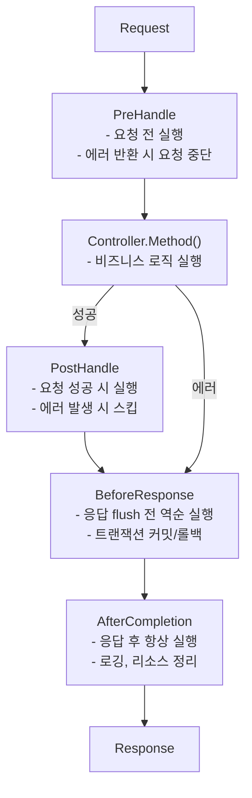

# 인터셉터

인터셉터 생성 및 사용하기.

## 인터셉터란?

인터셉터는 요청 전/후에 실행되는 로직입니다.

- 트랜잭션 관리
- 로깅
- 인증/인가
- 요청 검증

## 라이프사이클

Spine v0.5.1 인터셉터는 4단계 라이프사이클을 가집니다.




## 인터페이스

```go
type Interceptor interface {
    PreHandle(ctx ExecutionContext, meta HandlerMeta) error
    PostHandle(ctx ExecutionContext, meta HandlerMeta)
    BeforeResponse(ctx ExecutionContext, meta HandlerMeta, executionErr error) error
    AfterCompletion(ctx ExecutionContext, meta HandlerMeta, err error)
}
```

| 메서드 | 실행 시점 | 반환 | 용도 |
|--------|----------|------|------|
| `PreHandle` | 컨트롤러 실행 전 | `error` | 인증, 검증, 트랜잭션 시작 |
| `PostHandle` | 컨트롤러 성공 후 | 없음 | 응답 가공 |
| `BeforeResponse` | 응답을 실제로 쓰기 전 | `error` | transaction commit/rollback |
| `AfterCompletion` | 응답 처리 후 항상 | 없음 | 로깅, 리소스 정리 |

`BeforeResponse`는 직렬화, 쿠키, status 검증 오류를 `executionErr`로 받습니다. transaction 결과 오류는 반드시 반환하십시오. `AfterCompletion` 시점에는 응답이 이미 기록되었을 수 있습니다.


## 전역 인터셉터 vs 라우트 인터셉터

Spine은 두 가지 레벨의 인터셉터를 지원합니다.

| 구분 | 전역 인터셉터 | 라우트 인터셉터 |
|------|--------------|----------------|
| 적용 범위 | 모든 요청 | 특정 라우트만 |
| 등록 방법 | `app.Interceptor()` | `route.WithInterceptors()` |
| 용도 | CORS, 로깅, 트랜잭션 | 인증, 권한 검사 |
| 실행 순서 | 먼저 실행 | 전역 이후 실행 |


## 전역 인터셉터

모든 요청에 적용되는 인터셉터입니다.

### 로깅 인터셉터 예제

```go
// interceptor/logging_interceptor.go
package interceptor

import (
    "log"
    "github.com/NARUBROWN/spine/core"
)

type LoggingInterceptor struct{}

func (i *LoggingInterceptor) PreHandle(ctx core.ExecutionContext, meta core.HandlerMeta) error {
    log.Printf("[REQ] %s %s → %s.%s",
        ctx.Method(),
        ctx.Path(),
        meta.ControllerType.Name(),
        meta.Method.Name,
    )
    return nil
}

func (i *LoggingInterceptor) PostHandle(ctx core.ExecutionContext, meta core.HandlerMeta) {
    log.Printf("[RES] %s %s OK",
        ctx.Method(),
        ctx.Path(),
    )
}

func (i *LoggingInterceptor) BeforeResponse(ctx core.ExecutionContext, meta core.HandlerMeta, executionErr error) error {
    return nil
}

func (i *LoggingInterceptor) AfterCompletion(ctx core.ExecutionContext, meta core.HandlerMeta, err error) {
    if err != nil {
        log.Printf("[ERR] %s %s : %v",
            ctx.Method(),
            ctx.Path(),
            err,
        )
    }
}
```

### 전역 인터셉터 등록

```go
func main() {
    app := spine.New()
    
    // 전역 인터셉터 — 모든 요청에 적용
    app.Interceptor(
        &interceptor.LoggingInterceptor{},
    )
    
    app.Run(boot.Options{
		Address:                ":8080",
		EnableGracefulShutdown: true,
		ShutdownTimeout:        10 * time.Second,
		HTTP: &boot.HTTPOptions{},
	})
}
```


## 라우트 인터셉터

특정 라우트에만 적용되는 인터셉터입니다.

### 인증 인터셉터 예제

```go
// interceptor/auth_interceptor.go
package interceptor

import (
    "github.com/NARUBROWN/spine/core"
    "github.com/NARUBROWN/spine/pkg/httperr"
)

type AuthInterceptor struct{}

func (i *AuthInterceptor) PreHandle(ctx core.ExecutionContext, meta core.HandlerMeta) error {
    token := ctx.Header("Authorization")
    
    if token == "" {
        return httperr.Unauthorized("인증이 필요합니다.")
    }
    
    user, err := validateToken(token)
    if err != nil {
        return httperr.Unauthorized("유효하지 않은 토큰입니다.")
    }
    
    ctx.Set("currentUser", user)
    return nil
}

func (i *AuthInterceptor) PostHandle(ctx core.ExecutionContext, meta core.HandlerMeta) {}

func (i *AuthInterceptor) BeforeResponse(ctx core.ExecutionContext, meta core.HandlerMeta, executionErr error) error { return nil }

func (i *AuthInterceptor) AfterCompletion(ctx core.ExecutionContext, meta core.HandlerMeta, err error) {}

func validateToken(token string) (map[string]string, error) {
    // 토큰 검증 로직
    return map[string]string{"id": "1", "name": "Alice"}, nil
}
```

### 라우트 인터셉터 등록

`route.WithInterceptors()`를 사용합니다.

```go
import (
    "github.com/NARUBROWN/spine"
    "github.com/NARUBROWN/spine/pkg/route"
)

func main() {
    app := spine.New()
    
    app.Constructor(
        NewUserController,
    )
    
    // 인증 필요 없는 라우트
    app.Route(
        "POST",
        "/login",
        (*UserController).Login,
    )
    
    // 인증 필요한 라우트
    app.Route(
        "GET",
        "/users/:id",
        (*UserController).GetUser,
        route.WithInterceptors(&interceptor.AuthInterceptor{}),
    )
    
    // 인증 필요한 라우트
    app.Route(
        "PUT",
        "/users/:id",
        (*UserController).UpdateUser,
        route.WithInterceptors(&interceptor.AuthInterceptor{}),
    )
    
    app.Run(boot.Options{
		Address:                ":8080",
		EnableGracefulShutdown: true,
		ShutdownTimeout:        10 * time.Second,
		HTTP: &boot.HTTPOptions{},
	})
}
```


## 전역 + 라우트 인터셉터 조합

실제 애플리케이션에서는 두 가지를 함께 사용합니다.

```go
func main() {
    app := spine.New()
    
    app.Constructor(
        NewUserController,
    )
    
    // 전역 인터셉터 — 모든 요청에 적용
    app.Interceptor(
        &interceptor.LoggingInterceptor{},
        cors.New(cors.Config{
            AllowOrigins: []string{"*"},
            AllowMethods: []string{"GET", "POST", "PUT", "DELETE"},
        }),
    )
    
    // 공개 라우트 — 전역 인터셉터만 적용
    app.Route("POST", "/login", (*UserController).Login)
    app.Route("POST", "/signup", (*UserController).Signup)
    
    // 인증 필요 라우트 — 전역 + Auth 인터셉터
    app.Route(
        "GET",
        "/users/:id",
        (*UserController).GetUser,
        route.WithInterceptors(&interceptor.AuthInterceptor{}),
    )
    
    app.Route(
        "GET",
        "/me",
        (*UserController).GetMe,
        route.WithInterceptors(&interceptor.AuthInterceptor{}),
    )
    
    app.Run(boot.Options{
		Address:                ":8080",
		EnableGracefulShutdown: true,
		ShutdownTimeout:        10 * time.Second,
		HTTP: &boot.HTTPOptions{},
	})
}
```


## 실행 순서

전역 인터셉터가 먼저, 라우트 인터셉터가 나중에 실행됩니다.

### 등록 예시

```go
// 전역 인터셉터
app.Interceptor(
    &interceptor.LoggingInterceptor{},   // 전역 1
    &interceptor.CORSInterceptor{},      // 전역 2
)

// 라우트 인터셉터
app.Route(
    "GET",
    "/users/:id",
    (*UserController).GetUser,
    route.WithInterceptors(&interceptor.AuthInterceptor{}),  // 라우트 1
)
```

### 실행 흐름

```
Request (GET /users/1)
   │
   ├─→ Logging.PreHandle     (전역 1)
   ├─→ CORS.PreHandle        (전역 2)
   ├─→ Auth.PreHandle        (라우트 1)
   │
   ├─→ UserController.GetUser
   │
   ├─→ Auth.PostHandle       (라우트 1)
   ├─→ CORS.PostHandle       (전역 2)
   ├─→ Logging.PostHandle    (전역 1)
   │
   ├─→ Auth.BeforeResponse       (라우트 1)
   ├─→ CORS.BeforeResponse       (전역 2)
   ├─→ Logging.BeforeResponse    (전역 1)
   │
   ├─→ Auth.AfterCompletion       (라우트 1)
   ├─→ CORS.AfterCompletion       (전역 2)
   └─→ Logging.AfterCompletion    (전역 1)
   
Response
```

- `PreHandle`: 전역 → 라우트 순서
- `PostHandle`: 라우트 → 전역 역순
- `BeforeResponse`: `PreHandle`에 성공한 인터셉터만 라우트 → 전역 역순
- `AfterCompletion`: 라우트 → 전역 역순


## 에러 처리

### PreHandle에서 에러 반환

`PreHandle`에서 에러를 반환하면 요청이 중단됩니다.

```go
func (i *AuthInterceptor) PreHandle(ctx core.ExecutionContext, meta core.HandlerMeta) error {
    token := ctx.Header("Authorization")
    if token == "" {
        return httperr.Unauthorized("인증이 필요합니다.")
    }
    return nil
}
```

```
Request (GET /users/1, 토큰 없음)
   │
   ├─→ Logging.PreHandle     ✓
   ├─→ CORS.PreHandle        ✓
   ├─→ Auth.PreHandle        ✗ (에러 반환)
   │
   ├─→ CORS.BeforeResponse
   ├─→ Logging.BeforeResponse
   │
   ├─→ Auth.AfterCompletion
   ├─→ CORS.AfterCompletion
   └─→ Logging.AfterCompletion
   
Response (401 Unauthorized)
```


## ExecutionContext

요청 컨텍스트에서 값을 저장하고 조회합니다.

### 메서드

| 메서드 | 설명 |
|--------|------|
| `Context()` | `context.Context` 반환 |
| `Method()` | HTTP 메서드 (GET, POST 등) |
| `Path()` | 요청 경로 |
| `Header(name)` | 헤더 값 조회 |
| `Set(key, value)` | 값 저장 |
| `Get(key)` | 값 조회 |

### 인터셉터 간 데이터 전달

아래 코드는 `PreHandle`에서 컨텍스트를 공유하는 부분만 발췌한 예입니다. 새 타입을 실제로 등록하려면 네 수명주기 메서드를 모두 구현해야 합니다.

```go
// AuthInterceptor — 사용자 정보 저장
func (i *AuthInterceptor) PreHandle(ctx core.ExecutionContext, meta core.HandlerMeta) error {
    token := ctx.Header("Authorization")
    user, _ := validateToken(token)
    ctx.Set("currentUser", user)
    return nil
}

// 컨트롤러에서 조회하려면 ExecutionContext를 주입받아야 함
// 또는 다른 인터셉터에서 조회
func (i *AuditInterceptor) PreHandle(ctx core.ExecutionContext, meta core.HandlerMeta) error {
    user, ok := ctx.Get("currentUser")
    if ok {
        log.Printf("User %v accessing %s", user, ctx.Path())
    }
    return nil
}
```


## HandlerMeta

실행될 핸들러의 메타 정보입니다.

| 필드 | 타입 | 설명 |
|------|------|------|
| `ControllerType` | `reflect.Type` | 컨트롤러 타입 |
| `Method` | `reflect.Method` | 핸들러 메서드 |
| `Interceptors` | `[]Interceptor` | 라우트에 바인딩된 인터셉터 |

### 사용 예시

```go
func (i *LoggingInterceptor) PreHandle(ctx core.ExecutionContext, meta core.HandlerMeta) error {
    log.Printf("컨트롤러: %s", meta.ControllerType.Name())  // UserController
    log.Printf("메서드: %s", meta.Method.Name)              // GetUser
    return nil
}
```


## 의존성 주입이 필요한 인터셉터

생성자가 있는 인터셉터는 `Constructor`에 먼저 등록합니다.

### 트랜잭션 인터셉터 예제

```go
// interceptor/tx_interceptor.go
package interceptor

import (
    "github.com/NARUBROWN/spine/core"
    "github.com/uptrace/bun"
)

type TxInterceptor struct {
    db *bun.DB
}

func NewTxInterceptor(db *bun.DB) *TxInterceptor {
    return &TxInterceptor{db: db}
}

func (i *TxInterceptor) PreHandle(ctx core.ExecutionContext, meta core.HandlerMeta) error {
    tx, err := i.db.BeginTx(ctx.Context(), nil)
    if err != nil {
        return err
    }
    ctx.Set("tx", tx)
    return nil
}

func (i *TxInterceptor) PostHandle(ctx core.ExecutionContext, meta core.HandlerMeta) {}

func (i *TxInterceptor) BeforeResponse(ctx core.ExecutionContext, meta core.HandlerMeta, executionErr error) error {
    v, ok := ctx.Get("tx")
    if !ok {
        return nil
    }
    
    tx, ok := v.(bun.Tx)
    if !ok {
        return nil
    }
    if executionErr != nil {
        return tx.Rollback()
    } else {
        return tx.Commit()
    }
}

func (i *TxInterceptor) AfterCompletion(ctx core.ExecutionContext, meta core.HandlerMeta, err error) {}
```

### 등록 (전역)

```go
app.Constructor(
    NewDB,
    interceptor.NewTxInterceptor,
)

app.Interceptor(
    (*interceptor.TxInterceptor)(nil),  // 타입으로 참조
)
```

### 등록 (라우트)

```go
app.Constructor(
    NewDB,
    interceptor.NewTxInterceptor,
)

app.Route(
    "POST",
    "/orders",
    (*OrderController).CreateOrder,
    route.WithInterceptors((*interceptor.TxInterceptor)(nil)),  // 타입으로 참조
)
```


## 등록 방법 정리

### 전역 인터셉터

| 방식 | 코드 | 사용 시점 |
|------|------|----------|
| 인스턴스 직접 전달 | `&interceptor.LoggingInterceptor{}` | 의존성 없음 |
| 타입으로 참조 | `(*interceptor.TxInterceptor)(nil)` | 의존성 있음 |

```go
app.Interceptor(
    &interceptor.LoggingInterceptor{},      // 인스턴스
    (*interceptor.TxInterceptor)(nil),      // 타입 참조
)
```

### 라우트 인터셉터

| 방식 | 코드 | 사용 시점 |
|------|------|----------|
| 인스턴스 직접 전달 | `&interceptor.AuthInterceptor{}` | 의존성 없음 |
| 타입으로 참조 | `(*interceptor.TxInterceptor)(nil)` | 의존성 있음 |

```go
app.Route(
    "GET",
    "/users/:id",
    (*UserController).GetUser,
    route.WithInterceptors(
        &interceptor.AuthInterceptor{},         // 인스턴스
        (*interceptor.TxInterceptor)(nil),      // 타입 참조
    ),
)
```


## 핵심 정리

| 개념 | 설명 |
|------|------|
| **전역 인터셉터** | `app.Interceptor()` — 모든 요청에 적용 |
| **라우트 인터셉터** | `route.WithInterceptors()` — 특정 라우트만 |
| **실행 순서** | 전역 → 라우트 (`PostHandle`/`BeforeResponse`/`AfterCompletion`은 역순) |
| **4단계 라이프사이클** | PreHandle → PostHandle → BeforeResponse → AfterCompletion |
| **에러 시 중단** | PreHandle 에러 → 컨트롤러 스킵 |
| **컨텍스트 공유** | `ctx.Set()` / `ctx.Get()`으로 데이터 전달 |


## 다음 단계

- [튜토리얼: 데이터베이스](/ko/learn/tutorial/5-database) — Bun ORM 연결
- [튜토리얼: 에러 처리](/ko/learn/tutorial/7-error-handling) — httperr 사용법
