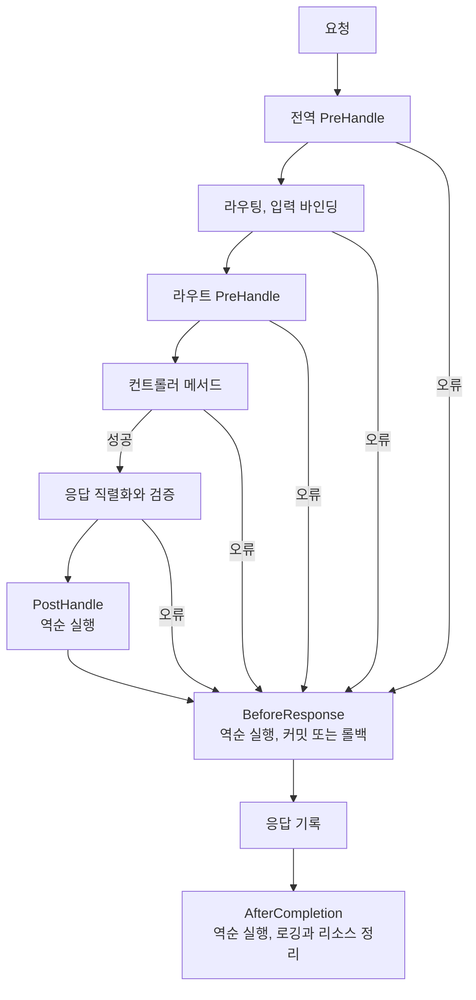

# 인터셉터

인터셉터는 인증, 로깅 같은 공통 처리를 담당합니다. 이 독립 앱은 그룹의 모든 라우트와 개별 라우트에 인증을 적용합니다. 토큰은 데모 전용입니다.

## 그룹과 라우트에 적용

아래 코드를 별도 Go 모듈의 `main.go`에 저장하고 실행하세요.

```bash
go get github.com/NARUBROWN/spine@v0.7.1 github.com/NARUBROWN/spine-echo-platform@v0.2.0
```

```go
package main

import (
	"github.com/NARUBROWN/spine"
	echoplatform "github.com/NARUBROWN/spine-echo-platform"
	"github.com/NARUBROWN/spine/core"
	"github.com/NARUBROWN/spine/pkg/api"
	"github.com/NARUBROWN/spine/pkg/boot"
	"github.com/NARUBROWN/spine/pkg/constructor"
	"github.com/NARUBROWN/spine/pkg/httperr"
	"github.com/NARUBROWN/spine/pkg/httpx"
	"github.com/NARUBROWN/spine/pkg/input"
	"log"
)

type Auth struct{}

func (*Auth) PreHandle(ctx core.ExecutionContext, meta core.HandlerMeta) error {
	if ctx.Header("Authorization") != "Bearer demo-token" {
		return httperr.Unauthorized("unauthorized")
	}
	return nil
}
func (*Auth) PostHandle(core.ExecutionContext, core.HandlerMeta)                  {}
func (*Auth) BeforeResponse(core.ExecutionContext, core.HandlerMeta, error) error { return nil }
func (*Auth) AfterCompletion(core.ExecutionContext, core.HandlerMeta, error)      {}

type Controller struct{}

func (*Controller) Constructor() *Controller { return &Controller{} }
func (*Controller) RegisterRoutes(r *api.Registry) {
	users := r.Group("/users", api.Interceptors(&Auth{}))
	users.GET("/:id", func(id input.Path[int64]) httpx.Response[map[string]int64] {
		return httpx.Response[map[string]int64]{Body: map[string]int64{"id": *id}}
	})
	r.GET("/profile", func() httpx.Response[string] {
		return httpx.Response[string]{Body: "profile"}
	}, api.Interceptors(&Auth{}))
}
func main() {
	app := spine.New(echoplatform.Option())
	app.Constructor(constructor.Controller(&Controller{}))
	if err := app.Run(boot.Options{Address: ":8080", HTTP: &boot.HTTPOptions{}}); err != nil {
		log.Fatal(err)
	}
}
```

`/users/:id`는 그룹에서 인증을 상속하고 `/profile`은 라우트에 직접 인증을 지정합니다. 중첩 그룹도 상위 그룹의 설정을 상속합니다.

인증 없이 요청하면 401, 토큰을 전달하면 200을 반환합니다. 실제 서비스에서는 안전한 토큰 검증을 구현하세요.

```bash
curl -i http://localhost:8080/users/1
curl -i -H 'Authorization: Bearer demo-token' http://localhost:8080/users/1
curl -i -H 'Authorization: Bearer demo-token' http://localhost:8080/profile
```

## 인터셉터 수명주기

Spine v0.7.1의 HTTP 요청은 전역 인터셉터, 라우팅과 입력 바인딩, 라우트 인터셉터, 컨트롤러 순서로 실행됩니다. 인터셉터는 네 수명주기 메서드를 모두 구현해야 합니다.



입력 바인딩이 실패하면 라우트의 `PreHandle`도 실행되지 않습니다. 본문 형식 검사보다 먼저 인증해야 하는 정책은 전역 인터셉터에서 처리하세요.


## 인터페이스

```go
type Interceptor interface {
    PreHandle(ctx ExecutionContext, meta HandlerMeta) error
    PostHandle(ctx ExecutionContext, meta HandlerMeta)
    BeforeResponse(ctx ExecutionContext, meta HandlerMeta, executionErr error) error
    AfterCompletion(ctx ExecutionContext, meta HandlerMeta, err error)
}
```

| 메서드 | 실행 시점 | 반환 | 용도 |
|--------|----------|------|------|
| `PreHandle` | 전역은 라우팅 전, 라우트는 입력 바인딩 후 | `error` | 인증, 검증, 트랜잭션 시작 |
| `PostHandle` | 컨트롤러와 응답 준비가 성공한 후 | 없음 | 처리 완료 기록, 후속 작업 |
| `BeforeResponse` | 응답을 실제로 기록하기 전 | `error` | 트랜잭션 커밋 또는 롤백 |
| `AfterCompletion` | 응답 기록을 시도한 뒤 | 없음 | 로깅, 리소스 정리 |

`BeforeResponse`는 앞선 실행 오류와 응답 직렬화, 쿠키, 상태 코드 검증 오류를 `executionErr`로 받습니다. `PreHandle`에 성공한 인터셉터만 이 메서드를 실행하므로, 그 단계에서 시작한 트랜잭션을 마무리하기에 적합합니다. 커밋이나 롤백이 실패하면 오류를 반환하세요.

`AfterCompletion`은 오류가 발생해도 전역 인터셉터와 라우팅으로 확인된 라우트 인터셉터에 호출됩니다. `PreHandle`까지 실행되지 않은 인터셉터도 포함될 수 있으므로, 정리할 리소스가 있는지 먼저 확인해야 합니다. 이 시점에는 응답이 이미 기록되었을 수 있어 응답 변경 용도로 사용하지 않습니다.


## 더 알아보기

전역 등록, 생성자 주입 및 수명주기 세부 사항은 [인터셉터 API](/ko/reference/api/interceptor)에서 확인하세요.
