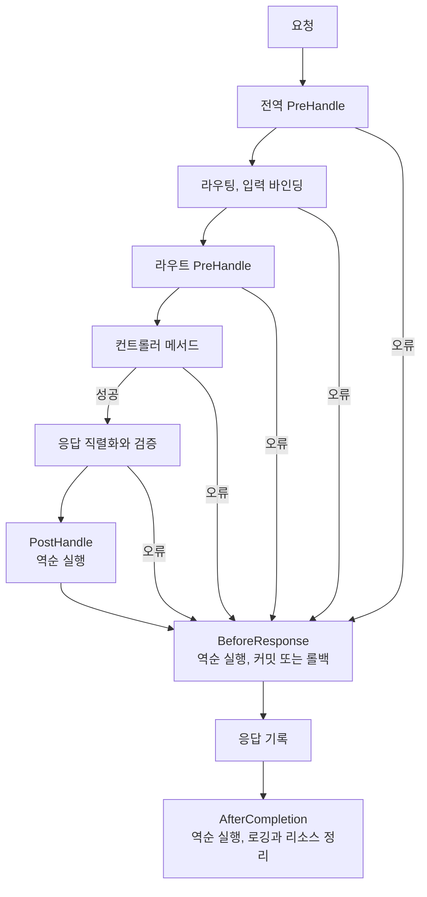

# 인터셉터

사용자 조회 요청에 로깅과 데모 인증을 추가하고, 요청이 인터셉터를 통과하는 순서를 확인합니다. 인터셉터는 여러 핸들러가 공유하는 인증, 권한 검사, 로깅, 트랜잭션 처리를 담당합니다.

이 페이지의 기능별 `src/user` 예제는 [프로젝트 구조](/ko/learn/tutorial/1-project-structure)에서 `--layout legacy`로 생성한 `my-app`을 기준으로 합니다. CLI `v0.4.0`의 기본 `new`는 역할별 `layered-v1` 구조를 생성합니다. 두 레이아웃 모두 Spine `v0.6.0`과 Echo 플랫폼 `v0.1.0`을 사용합니다.

## CLI 프로젝트에서 시작

[첫 번째 앱](/ko/learn/tutorial/1-project-structure)과 [프로젝트 구조](/ko/learn/tutorial/1-project-structure)에서 만든 프로젝트를 사용합니다. 코드의 모듈 경로는 `example.com/my-app`을 기준으로 하므로 다른 모듈 경로로 생성했다면 프로젝트에 맞게 바꾸세요.

사용자 리소스가 아직 없다면 프로젝트 루트에서 생성합니다. 이미 만들었다면 생성 단계를 건너뜁니다.

```sh
spine-cli generate resource user --dry-run
```

미리보기에서 생성 파일과 등록 코드 변경을 확인한 뒤 생성합니다.

```sh
spine-cli generate resource user
```

CLI는 `src/user` 파일과 `BuildApplication`의 `user.Register(app)` 호출을 생성합니다. 인터셉터 생성기는 없으므로 `src/interceptor` 디렉터리를 만들고 아래 로깅과 인증 인터셉터 파일을 직접 작성하세요.

앱 전체 등록은 `internal/application/application.go`, 사용자 라우트의 인증 정책은 `src/user/user_route.go`에 작성합니다. 루트 `main.go`의 구성, 검증, 실행 흐름은 유지합니다. 뒤의 감사 로깅과 주문 트랜잭션 예제는 별도 확장이며 기본 앱의 검증 단계에는 필요하지 않습니다.


## 인터셉터 수명주기

Spine v0.6.0의 HTTP 요청은 전역 인터셉터, 라우팅과 입력 바인딩, 라우트 인터셉터, 컨트롤러 순서로 실행됩니다. 인터셉터는 네 수명주기 메서드를 모두 구현해야 합니다.



입력 바인딩이 실패하면 라우트의 `PreHandle`도 실행되지 않습니다. 본문 형식 검사보다 먼저 인증해야 하는 정책은 전역 인터셉터에서 처리하세요.


## 인터페이스

```go
type Interceptor interface {
    PreHandle(ctx ExecutionContext, meta HandlerMeta) error
    PostHandle(ctx ExecutionContext, meta HandlerMeta)
    BeforeResponse(ctx ExecutionContext, meta HandlerMeta, executionErr error) error
    AfterCompletion(ctx ExecutionContext, meta HandlerMeta, err error)
}
```

| 메서드 | 실행 시점 | 반환 | 용도 |
|--------|----------|------|------|
| `PreHandle` | 전역은 라우팅 전, 라우트는 입력 바인딩 후 | `error` | 인증, 검증, 트랜잭션 시작 |
| `PostHandle` | 컨트롤러와 응답 준비가 성공한 후 | 없음 | 처리 완료 기록, 후속 작업 |
| `BeforeResponse` | 응답을 실제로 기록하기 전 | `error` | 트랜잭션 커밋 또는 롤백 |
| `AfterCompletion` | 응답 기록을 시도한 뒤 | 없음 | 로깅, 리소스 정리 |

`BeforeResponse`는 앞선 실행 오류와 응답 직렬화, 쿠키, 상태 코드 검증 오류를 `executionErr`로 받습니다. `PreHandle`에 성공한 인터셉터만 이 메서드를 실행하므로, 그 단계에서 시작한 트랜잭션을 마무리하기에 적합합니다. 커밋이나 롤백이 실패하면 오류를 반환하세요.

`AfterCompletion`은 오류가 발생해도 전역 인터셉터와 라우팅으로 확인된 라우트 인터셉터에 호출됩니다. `PreHandle`까지 실행되지 않은 인터셉터도 포함될 수 있으므로, 정리할 리소스가 있는지 먼저 확인해야 합니다. 이 시점에는 응답이 이미 기록되었을 수 있어 응답 변경 용도로 사용하지 않습니다.


## 전역 인터셉터와 라우트 인터셉터

앱 전체 정책은 전역 인터셉터에, 특정 라우트의 정책은 라우트 인터셉터에 등록합니다.

| 구분 | 전역 인터셉터 | 라우트 인터셉터 |
|------|--------------|----------------|
| 적용 범위 | 해당 전송 방식의 모든 요청 | 특정 라우트만 |
| 등록 방법 | `app.Interceptor()` | `route.WithInterceptors()` |
| 용도 | CORS, 로깅, 트랜잭션 | 인증, 권한 검사 |
| 실행 순서 | 먼저 실행 | 전역 이후 실행 |


## 전역 인터셉터

아래 로깅 인터셉터를 전역으로 등록하면 요청 메서드와 경로를 기록합니다. 성공 시에는 `PostHandle`, 실패 시에는 `AfterCompletion`의 로그를 확인할 수 있습니다.

### 로깅 인터셉터 예제

```go
// src/interceptor/logging_interceptor.go
package interceptor

import (
    "log"
    "github.com/NARUBROWN/spine/core"
)

type LoggingInterceptor struct{}

func (i *LoggingInterceptor) PreHandle(ctx core.ExecutionContext, meta core.HandlerMeta) error {
    log.Printf("[REQ] %s %s", ctx.Method(), ctx.Path())
    return nil
}

func (i *LoggingInterceptor) PostHandle(ctx core.ExecutionContext, meta core.HandlerMeta) {
    log.Printf("[RES] %s %s OK",
        ctx.Method(),
        ctx.Path(),
    )
}

func (i *LoggingInterceptor) BeforeResponse(ctx core.ExecutionContext, meta core.HandlerMeta, executionErr error) error {
    return nil
}

func (i *LoggingInterceptor) AfterCompletion(ctx core.ExecutionContext, meta core.HandlerMeta, err error) {
    if err != nil {
        log.Printf("[ERR] %s %s : %v",
            ctx.Method(),
            ctx.Path(),
            err,
        )
    }
}
```

전역 HTTP `PreHandle`은 라우팅 전에 실행되므로 이 단계의 `HandlerMeta`에는 컨트롤러 타입과 메서드가 없습니다. 이 정보가 필요하면 라우트 인터셉터나 이후 수명주기에서 조회하세요.

### 전역 인터셉터 등록

`internal/application/application.go`를 다음과 같이 수정합니다. 생성된 상태 확인 컨트롤러와 `user.Register(app)` 호출을 유지하면서 로깅 인터셉터를 추가합니다.

```go
// internal/application/application.go
package application

import (
    platform "github.com/NARUBROWN/spine-echo-platform"
    "os"

    "example.com/my-app/src/interceptor"
    "example.com/my-app/src/user"
    "github.com/NARUBROWN/spine"
    "github.com/NARUBROWN/spine/pkg/boot"
    "github.com/NARUBROWN/spine/pkg/httpx"
)

type HealthController struct{}

func NewHealthController() *HealthController { return &HealthController{} }

func (c *HealthController) Get() httpx.Response[map[string]string] {
    return httpx.Response[map[string]string]{Body: map[string]string{"status": "ok"}}
}

func BuildApplication() (spine.App, boot.Options, error) {
    app := platform.New()
    app.Constructor(NewHealthController)
    app.Route("GET", "/health", (*HealthController).Get)
    app.Interceptor(&interceptor.LoggingInterceptor{})

    if err := user.Register(app); err != nil {
        return nil, boot.Options{}, err
    }

    address := ":8080"
    if port := os.Getenv("SPINE_PORT"); port != "" {
        address = ":" + port
    }
    return app, boot.Options{Address: address, HTTP: &boot.HTTPOptions{}}, nil
}
```


## 라우트 인터셉터

인증 인터셉터를 `GET /user/:id`에 등록해 토큰이 없는 요청을 HTTP 401로 거절합니다. 상태 확인 라우트 `/health`에는 이 인증 정책을 적용하지 않습니다.

### 인증 인터셉터 예제

```go
// src/interceptor/auth_interceptor.go
package interceptor

import (
    "errors"

    "github.com/NARUBROWN/spine/core"
    "github.com/NARUBROWN/spine/pkg/httperr"
)

type AuthInterceptor struct{}

func (i *AuthInterceptor) PreHandle(ctx core.ExecutionContext, meta core.HandlerMeta) error {
    token := ctx.Header("Authorization")

    if token == "" {
        return httperr.Unauthorized("인증이 필요합니다.")
    }

    user, err := validateToken(token)
    if err != nil {
        return httperr.Unauthorized("유효하지 않은 토큰입니다.")
    }

    ctx.Set("currentUser", user)
    return nil
}

func (i *AuthInterceptor) PostHandle(ctx core.ExecutionContext, meta core.HandlerMeta) {}

func (i *AuthInterceptor) BeforeResponse(ctx core.ExecutionContext, meta core.HandlerMeta, executionErr error) error { return nil }

func (i *AuthInterceptor) AfterCompletion(ctx core.ExecutionContext, meta core.HandlerMeta, err error) {}

func validateToken(token string) (map[string]string, error) {
    if token != "Bearer demo-token" {
        return nil, errors.New("invalid demo token")
    }
    return map[string]string{"id": "1", "name": "Alice"}, nil
}
```

이 예제는 `Authorization: Bearer demo-token`만 허용하고, 그 외의 토큰에는 HTTP 401을 반환합니다. 고정 토큰은 동작 확인용 공개 데모이므로 실제 앱에서는 인증 서비스로 교체하세요.

### 라우트 인터셉터 등록

생성된 `src/user/user_route.go`를 다음 코드로 수정합니다. `route.WithInterceptors()`로 인증 정책을 추가하고, `BuildApplication`의 `user.Register(app)` 호출은 유지합니다.

```go
// src/user/user_route.go
package user

import (
    "example.com/my-app/src/interceptor"
    "github.com/NARUBROWN/spine"
    "github.com/NARUBROWN/spine/pkg/route"
)

func Register(app spine.App) error {
    app.Constructor(NewUserRepository, NewUserService, NewUserController)
    app.Route(
        "GET",
        "/user/:id",
        (*UserController).Get,
        route.WithInterceptors(&interceptor.AuthInterceptor{}),
    )
    return nil
}
```


## 로깅, 인증, CORS 함께 적용

앞 절의 `BuildApplication`을 다음 코드로 바꾸면 로깅에 더해 CORS 정책을 적용합니다. 사용자 라우트의 인증 인터셉터는 `user_route.go`에 유지합니다.

CORS는 `https://app.example.com`에서 보낸 요청을 허용하도록 설정합니다. `cors.NewValidated`의 설정 오류를 확인하고, HTTP 전용 정책이므로 `InterceptorFor(boot.InterceptorHTTP, ...)`로 등록합니다.

```go
// internal/application/application.go
package application

import (
    platform "github.com/NARUBROWN/spine-echo-platform"
    "os"

    "example.com/my-app/src/interceptor"
    "example.com/my-app/src/user"
    "github.com/NARUBROWN/spine"
    "github.com/NARUBROWN/spine/pkg/boot"
    "github.com/NARUBROWN/spine/pkg/httpx"
    "github.com/NARUBROWN/spine/interceptor/cors"
)

type HealthController struct{}

func NewHealthController() *HealthController { return &HealthController{} }

func (c *HealthController) Get() httpx.Response[map[string]string] {
    return httpx.Response[map[string]string]{Body: map[string]string{"status": "ok"}}
}

func BuildApplication() (spine.App, boot.Options, error) {
    app := platform.New()
    app.Constructor(NewHealthController)
    app.Route("GET", "/health", (*HealthController).Get)
    app.Interceptor(&interceptor.LoggingInterceptor{})
    corsInterceptor, err := cors.NewValidated(cors.Config{
        AllowOrigins:     []string{"https://app.example.com"},
        AllowMethods:     []string{"GET", "POST", "PUT", "DELETE", "OPTIONS"},
        AllowHeaders:     []string{"Authorization", "Content-Type"},
        AllowCredentials: true,
    })
    if err != nil {
        return nil, boot.Options{}, err
    }
    app.InterceptorFor(boot.InterceptorHTTP, corsInterceptor)

    if err := user.Register(app); err != nil {
        return nil, boot.Options{}, err
    }

    address := ":8080"
    if port := os.Getenv("SPINE_PORT"); port != "" {
        address = ":" + port
    }
    return app, boot.Options{Address: address, HTTP: &boot.HTTPOptions{}}, nil
}
```


## 로깅과 인증 동작 검증

기본 예제의 로깅, 인증, CORS 코드를 적용한 뒤 프로젝트 루트에서 실행합니다. `spine-cli contract check`는 정적 계약을 검사하고 `spine-cli verify`는 로컬 코드 검사를 수행합니다. 실제 요청의 인증과 응답은 서버를 실행해 별도로 확인합니다.

```sh
gofmt -w src/interceptor/*.go src/user/user_route.go internal/application/application.go
spine-cli contract check
spine-cli verify
spine-cli dev
```

다른 터미널에서 다음 요청을 보냅니다.

- `/health`는 인증 없이 HTTP 200을 반환해야 합니다.
- 토큰이 없는 `/user/1` 요청은 HTTP 401을 반환해야 합니다.
- 데모 토큰을 보낸 `/user/1` 요청은 HTTP 200과 `{"id":1}`을 반환해야 합니다.
- 마지막 응답에는 `Access-Control-Allow-Origin: https://app.example.com` 헤더가 포함되어야 합니다.

```bash
curl -i http://localhost:8080/health
curl -i http://localhost:8080/user/1
curl -i http://localhost:8080/user/1 \
  -H 'Authorization: Bearer demo-token' \
  -H 'Origin: https://app.example.com'
```

위 요청은 데모 HTTP 인증만 확인합니다. 실제 인증 서비스, WebSocket 인증, 데이터베이스 트랜잭션의 동작은 각 환경을 구성한 뒤 별도로 검증하세요.

## 실행 순서

`PreHandle`은 등록 순서로 실행합니다. 성공 이후의 `PostHandle`, `BeforeResponse`, `AfterCompletion`은 라우트 인터셉터부터 역순으로 실행한 뒤 전역 인터셉터를 역순으로 실행합니다.

### 성공한 요청의 실행 흐름

앞서 등록한 로깅, CORS, 인증 인터셉터가 모두 성공하면 다음 순서로 실행됩니다.

```text
요청 (GET /user/1)
   │
   ├─→ Logging.PreHandle     (전역 1)
   ├─→ CORS.PreHandle        (전역 2)
   ├─→ 라우팅과 입력 바인딩
   ├─→ Auth.PreHandle        (라우트 1)
   │
   ├─→ UserController.Get
   ├─→ 응답 직렬화와 검증
   │
   ├─→ Auth.PostHandle       (라우트 1)
   ├─→ CORS.PostHandle       (전역 2)
   ├─→ Logging.PostHandle    (전역 1)
   │
   ├─→ Auth.BeforeResponse       (라우트 1)
   ├─→ CORS.BeforeResponse       (전역 2)
   ├─→ Logging.BeforeResponse    (전역 1)
   │
   ├─→ 응답 기록
   │
   ├─→ Auth.AfterCompletion       (라우트 1)
   ├─→ CORS.AfterCompletion       (전역 2)
   └─→ Logging.AfterCompletion    (전역 1)

완료
```

`PostHandle`은 컨트롤러가 성공해도 응답 직렬화나 검증에서 실패하면 실행하지 않습니다. `BeforeResponse`는 `PreHandle`에 성공한 인터셉터만 실행하고, `AfterCompletion`은 라우팅으로 확인된 인터셉터까지 정리 대상으로 삼습니다.


## 오류가 발생한 요청의 처리

### PreHandle에서 오류 반환

`PreHandle`에서 오류를 반환하면 이후 인터셉터의 `PreHandle`과 컨트롤러를 호출하지 않습니다. 이미 `PreHandle`에 성공한 인터셉터의 `BeforeResponse`는 실행하며, 마지막에 `AfterCompletion`으로 정리합니다.

아래는 인증 실패 분기만 발췌한 코드입니다. 앞서 작성한 `AuthInterceptor`를 이 코드로 교체하면 토큰 유효성 검사가 빠지므로 그대로 유지하세요.

```go
func (i *AuthInterceptor) PreHandle(ctx core.ExecutionContext, meta core.HandlerMeta) error {
    token := ctx.Header("Authorization")
    if token == "" {
        return httperr.Unauthorized("인증이 필요합니다.")
    }
    return nil
}
```

```text
요청 (GET /user/1, 토큰 없음)
   │
   ├─→ Logging.PreHandle     (성공)
   ├─→ CORS.PreHandle        (성공)
   ├─→ 라우팅과 입력 바인딩
   ├─→ Auth.PreHandle        (오류 반환)
   │
   ├─→ CORS.BeforeResponse
   ├─→ Logging.BeforeResponse
   │
   ├─→ 응답 기록 (401 Unauthorized)
   │
   ├─→ Auth.AfterCompletion
   ├─→ CORS.AfterCompletion
   └─→ Logging.AfterCompletion

완료
```


## 요청 값 공유: ExecutionContext

인터셉터는 `core.ExecutionContext`에서 요청 정보를 읽고, 같은 요청을 처리하는 다른 인터셉터나 컨트롤러에 값을 전달합니다. 컨트롤러는 읽기 전용인 `spine.Ctx`로 공유 값을 조회합니다.

### 메서드

| 메서드 | 설명 |
|--------|------|
| `Context()` | `context.Context` 반환 |
| `Method()` | HTTP 메서드 (GET, POST 등) |
| `Path()` | 요청 경로 |
| `Header(name)` | 헤더 값 조회 |
| `Params()` | 경로 파라미터 전체 조회 |
| `PathKeys()` | 라우트에 선언한 경로 파라미터 이름의 순서 |
| `Queries()` | 쿼리 파라미터 전체 조회 |
| `EventBus()` | 요청의 이벤트 버스 조회 |
| `Set(key, value)` | 값 저장 |
| `Get(key)` | 값 조회 |

### 인터셉터 간 데이터 전달

아래는 인증 인터셉터가 저장한 `currentUser`를 감사 인터셉터가 읽는 부분만 발췌한 예제입니다. 감사 인터셉터를 추가하려면 `AuditInterceptor` 타입과 네 수명주기 메서드를 구현하고, 인증 인터셉터 다음에 등록하세요. 기존 인증 인터셉터의 `PreHandle`과 중복 선언하지 마세요.

```go
// AuthInterceptor — 사용자 정보 저장
func (i *AuthInterceptor) PreHandle(ctx core.ExecutionContext, meta core.HandlerMeta) error {
    token := ctx.Header("Authorization")
    user, err := validateToken(token)
    if err != nil {
        return httperr.Unauthorized("invalid credentials")
    }
    ctx.Set("currentUser", user)
    return nil
}

// 컨트롤러에서는 읽기 전용 spine.Ctx로 조회
// 또는 다른 인터셉터에서 조회
func (i *AuditInterceptor) PreHandle(ctx core.ExecutionContext, meta core.HandlerMeta) error {
    user, ok := ctx.Get("currentUser")
    if ok {
        log.Printf("User %v accessing %s", user, ctx.Path())
    }
    return nil
}
```


## 핸들러 정보: HandlerMeta

`core.HandlerMeta`는 라우팅으로 결정된 컨트롤러와 메서드 정보를 담습니다. 전역 `PreHandle`에서는 아직 라우팅 전이므로 타입과 메서드를 사용할 수 없습니다.

| 필드 | 타입 | 설명 |
|------|------|------|
| `ControllerType` | `reflect.Type` | 컨트롤러 타입 |
| `Method` | `reflect.Method` | 핸들러 메서드 |
| `PathKeys` | `[]string` | 라우트에 선언한 경로 파라미터 이름의 순서 |
| `Interceptors` | `[]Interceptor` | 라우트에 바인딩된 인터셉터 |

### 사용 예시

다음은 메타데이터 조회 부분을 보여 주는 별도 예제입니다. 라우트 인터셉터에서 실행하면 컨트롤러와 메서드를 기록할 수 있습니다. 기존 로깅 인터셉터와 같은 메서드를 중복 선언하지 마세요.

```go
func (i *LoggingInterceptor) PreHandle(ctx core.ExecutionContext, meta core.HandlerMeta) error {
    if meta.ControllerType != nil {
        log.Printf("컨트롤러: %s", meta.ControllerType.String())
    }
    log.Printf("메서드: %s", meta.Method.Name)              // GetUser
    return nil
}
```


## 의존성 주입이 필요한 인터셉터

의존성을 받는 인터셉터는 생성자를 `app.Constructor`에 등록하고, 인터셉터 등록에는 타입을 나타내는 포인터를 전달합니다. 컨테이너가 해당 타입의 인스턴스를 만들어 주입합니다.

### 트랜잭션 인터셉터 예제

다음은 [데이터베이스](/ko/learn/tutorial/5-database)를 연결한 앱에 추가하는 독립적인 확장 예제입니다. 기본 로깅과 인증 예제의 검증에는 필요하지 않습니다.

`PreHandle`은 트랜잭션을 요청 컨텍스트에 저장하고, `BeforeResponse`는 실행 오류가 있으면 롤백하고 없으면 커밋합니다. 컨트롤러는 `spine.Ctx`에서 트랜잭션을 읽어 서비스와 저장소 메서드에 전달해야 합니다. 공유 생성자로 만든 서비스나 저장소에 요청별 트랜잭션이 자동으로 다시 주입되지는 않습니다.

```go
// src/interceptor/tx_interceptor.go
package interceptor

import (
    "github.com/NARUBROWN/spine/core"
    "github.com/uptrace/bun"
)

type TxInterceptor struct {
    db *bun.DB
}

func NewTxInterceptor(db *bun.DB) *TxInterceptor {
    return &TxInterceptor{db: db}
}

func (i *TxInterceptor) PreHandle(ctx core.ExecutionContext, meta core.HandlerMeta) error {
    tx, err := i.db.BeginTx(ctx.Context(), nil)
    if err != nil {
        return err
    }
    ctx.Set("tx", tx)
    return nil
}

func (i *TxInterceptor) PostHandle(ctx core.ExecutionContext, meta core.HandlerMeta) {}

func (i *TxInterceptor) BeforeResponse(ctx core.ExecutionContext, meta core.HandlerMeta, executionErr error) error {
    v, ok := ctx.Get("tx")
    if !ok {
        return nil
    }

    tx, ok := v.(bun.Tx)
    if !ok {
        return nil
    }
    if executionErr != nil {
        return tx.Rollback()
    } else {
        return tx.Commit()
    }
}

func (i *TxInterceptor) AfterCompletion(ctx core.ExecutionContext, meta core.HandlerMeta, err error) {}
```

### 전역 등록

다음 등록 코드는 `BuildApplication` 안에 추가하는 부분입니다. `NewDB`는 `*bun.DB` 하나를 반환하는 생성자로 구현해야 합니다.

```go
app.Constructor(
    NewDB,
    interceptor.NewTxInterceptor,
)

app.Interceptor(
    (*interceptor.TxInterceptor)(nil),  // 타입으로 참조
)
```

### 라우트 등록

주문 생성 요청에만 적용하려면 전역 등록 대신 아래처럼 라우트에 등록합니다. `OrderController`의 생성자와 `CreateOrder` 메서드는 별도로 구현하고 등록해야 합니다.

```go
app.Constructor(
    NewDB,
    interceptor.NewTxInterceptor,
)

app.Route(
    "POST",
    "/orders",
    (*OrderController).CreateOrder,
    route.WithInterceptors((*interceptor.TxInterceptor)(nil)),  // 타입으로 참조
)
```


## 등록 방식 선택

전역과 라우트 모두 의존성이 없는 인터셉터는 인스턴스를 직접 전달할 수 있습니다. 의존성을 받는 인터셉터는 생성자를 등록한 뒤 타입으로 참조합니다.

| 방식 | 전역 등록 | 라우트 등록 |
|------|----------|------------|
| 인스턴스 전달 | `app.Interceptor(&interceptor.LoggingInterceptor{})` | `route.WithInterceptors(&interceptor.AuthInterceptor{})` |
| 생성자로 해결할 타입 참조 | `app.Interceptor((*interceptor.TxInterceptor)(nil))` | `route.WithInterceptors((*interceptor.TxInterceptor)(nil))` |


## 다음 단계

- [튜토리얼: 데이터베이스](/ko/learn/tutorial/5-database) — Bun ORM 연결
- [튜토리얼: 에러 처리](/ko/learn/tutorial/7-error-handling) — httperr 사용법
