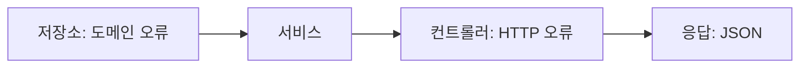

# 오류 처리

사용자 조회가 실패한 원인에 따라 HTTP 400이나 404를 반환하고, 예상하지 못한 오류의 내부 내용을 응답에서 숨깁니다.

이 페이지의 기능별 `src/user` 예제는 [프로젝트 구조](/ko/learn/tutorial/1-project-structure)에서 `--layout legacy`로 생성한 `my-app`을 기준으로 합니다. CLI `v0.4.0`의 기본 `new`는 역할별 `layered-v1` 구조를 생성합니다. 두 레이아웃 모두 Spine `v0.6.0`과 Echo 플랫폼 `v0.1.0`을 사용합니다.

[첫 번째 앱](/ko/learn/tutorial/1-project-structure)과 [컨트롤러](/ko/learn/tutorial/2-controller)의 CLI 프로젝트를 사용합니다. `spine-cli generate resource user`로 생성한 `src/user`가 필요합니다. 아래에서는 GET 핸들러를 읽기 전용 메모리 조회로 교체하므로, 데이터베이스 튜토리얼과 별도로 적용하세요. 도메인 오류와 HTTP 상태를 연결하는 코드는 직접 작성합니다.

## HTTP 오류와 응답

성공 결과는 `httpx.Response[T]`에 담고 오류는 별도의 `error` 반환값으로 전달합니다. 핸들러의 반환 형식은 `(httpx.Response[User], error)`로 작성하며 `(User, error)`를 사용하지 않습니다. `httperr`는 다음 네 함수를 제공합니다.

| 함수 | HTTP 상태 | 용도 |
|---|---|---|
| `httperr.BadRequest(message)` | 400 | 잘못된 입력 |
| `httperr.Unauthorized(message)` | 401 | 인증 필요 |
| `httperr.NotFound(message)` | 404 | 리소스 없음 |
| `httperr.InternalServerError(message)` | 500 | 클라이언트에 공개할 서버 오류 메시지 |

`HTTPError.Message`는 클라이언트에 노출되므로 내부 DB 오류나 비밀 값을 그대로 넣지 마세요. 일반 `error`를 반환하면 HTTP 500과 `{"message":"Internal server error"}`로 변환됩니다.

## 생성된 리소스에 조회 오류 추가

생성된 `src/user/user_repository.go`와 `src/user/user_controller.go`를 아래 내용으로 교체하고, `src/user/user_service.go`에 `Find` 메서드를 추가합니다. 파일은 모두 `package user`에 둡니다. 기존 생성자 이름, `user.Register(app)`, `GET /user/:id` 등록은 유지합니다.

저장소는 ID가 1인 Alice만 보관합니다. 조회 오류를 재현하기 위한 예제이며 DB에 데이터를 저장하지 않습니다.

```go
// src/user/user_repository.go
package user

import "errors"

var ErrUserNotFound = errors.New("user not found")
var ErrEmailAlreadyExists = errors.New("email already exists")

type User struct {
    ID int64 `json:"id"`
    Name string `json:"name"`
}

type UserRepository struct{ users map[int64]User }

func NewUserRepository() *UserRepository {
    return &UserRepository{users: map[int64]User{1: {ID: 1, Name: "Alice"}}}
}

func (r *UserRepository) FindByID(id int64) (User, error) {
    user, ok := r.users[id]
    if !ok {
        return User{}, ErrUserNotFound
    }
    return user, nil
}
```

```go
// src/user/user_service.go
func (s *UserService) Find(id int64) (User, error) {
    return s.repository.FindByID(id)
}
```

```go
// src/user/user_controller.go
package user

import (
    "errors"
    "net/http"

    "github.com/NARUBROWN/spine/pkg/httperr"
    "github.com/NARUBROWN/spine/pkg/httpx"
    "github.com/NARUBROWN/spine/pkg/path"
)

type UserController struct{ service *UserService }

func NewUserController(service *UserService) *UserController {
    return &UserController{service: service}
}

func (c *UserController) Get(id path.Int) (httpx.Response[User], error) {
    if id.Value <= 0 {
        return httpx.Response[User]{}, httperr.BadRequest("invalid user ID")
    }
    user, err := c.service.Find(id.Value)
    if err != nil {
        return httpx.Response[User]{}, toHTTPError(err)
    }
    return httpx.Response[User]{Body: user}, nil
}

func toHTTPError(err error) error {
    switch {
    case errors.Is(err, ErrUserNotFound):
        return httperr.NotFound("user not found")
    case errors.Is(err, ErrEmailAlreadyExists):
        return &httperr.HTTPError{
            Status: http.StatusConflict,
            Message: "email already exists",
            Cause: err,
        }
    default:
        return err
    }
}
```

## 계층별 책임

저장소는 도메인 오류를 반환하고 서비스는 이를 컨트롤러로 전달합니다. 컨트롤러는 예상한 오류를 HTTP 상태로 변환합니다. `errors.Is`를 사용하면 다른 오류가 감싸고 있는 도메인 오류도 판별할 수 있습니다.

알 수 없는 오류는 그대로 반환해 일반 HTTP 500 처리를 사용합니다. 이를 `BadRequest(err.Error())`로 바꾸면 내부 오류 메시지가 응답에 노출됩니다. 위의 메모리 저장소는 `ErrUserNotFound`만 반환하며, `ErrEmailAlreadyExists` 분기는 이후 저장 기능을 추가할 때 사용할 매핑 예시입니다.



## HTTPError와 추가 상태

`HTTPError.Unwrap()`은 `Cause`를 반환합니다. `errors.Is`와 `errors.As`로 원인 오류를 추적할 수 있으며, `Cause` 필드도 직접 읽을 수 있습니다. 원인 오류는 JSON 응답에 포함되지 않습니다.

```go
type HTTPError struct {
    Status int
    Message string
    Cause error
}

func (e *HTTPError) Error() string { return e.Message }
func (e *HTTPError) Unwrap() error { return e.Cause }
```

```go
return &httperr.HTTPError{
    Status: http.StatusForbidden,
    Message: "permission denied",
}
```

## 요청 DTO 검증

입력 검증을 추가하려면 다음 `src/user/user_create.go`를 작성합니다. `Validate()`는 자동 호출되지 않으므로 핸들러에서 직접 호출하고, 요청 DTO는 포인터로 받습니다.

이 POST 핸들러는 이름이나 이메일이 비어 있거나 이름이 100자를 넘으면 HTTP 400을 반환합니다. 검증을 통과하면 입력을 HTTP 201로 반환하며 사용자를 저장하지는 않습니다. 사용할 경우 아래 POST 라우트도 `src/user/user_route.go`의 `Register`에 추가하세요.

```go
// src/user/user_create.go
package user

import (
    "errors"
    "net/http"
    "unicode/utf8"

    "github.com/NARUBROWN/spine/pkg/httperr"
    "github.com/NARUBROWN/spine/pkg/httpx"
)

type CreateUserRequest struct {
    Name string `json:"name"`
    Email string `json:"email"`
}

func (r *CreateUserRequest) Validate() error {
    if r == nil || r.Name == "" {
        return errors.New("name is required")
    }
    if utf8.RuneCountInString(r.Name) > 100 {
        return errors.New("name must be at most 100 characters")
    }
    if r.Email == "" {
        return errors.New("email is required")
    }
    return nil
}

func (c *UserController) Create(req *CreateUserRequest) (httpx.Response[CreateUserRequest], error) {
    if err := req.Validate(); err != nil {
        return httpx.Response[CreateUserRequest]{}, httperr.BadRequest(err.Error())
    }
    return httpx.Response[CreateUserRequest]{
        Body: *req,
        Options: httpx.ResponseOptions{Status: http.StatusCreated},
    }, nil
}
```

```go
// src/user/user_route.go: Register
app.Route("POST", "/user", (*UserController).Create)
```

## 인터셉터의 오류 처리

`PreHandle`에서 오류를 반환하면 컨트롤러를 실행하지 않습니다. 다음은 자체 인증 서비스가 있는 인터셉터의 메서드 일부입니다. 이 메서드만 복사해서는 사용할 수 없습니다. `src/interceptor`에 타입과 인증 서비스를 정의하고 `PreHandle`, `PostHandle`, `BeforeResponse`, `AfterCompletion` 네 메서드를 모두 구현해야 합니다. HTTP 요청에 적용하려면 `BuildApplication()`에서 `boot.InterceptorHTTP` 범위로 등록합니다.

```go
func (i *AuthInterceptor) PreHandle(ctx core.ExecutionContext, meta core.HandlerMeta) error {
    token := ctx.Header("Authorization")
    if token == "" {
        return httperr.Unauthorized("authentication required")
    }
    user, err := i.auth.Validate(token)
    if err != nil {
        return httperr.Unauthorized("invalid token")
    }
    ctx.Set("auth.user", user)
    return nil
}
```

## 오류 로깅

`AfterCompletion`에서 최종 실행 오류를 로그로 남길 수 있습니다. 다음도 로깅 인터셉터에서 발췌한 메서드이므로 전체 인터셉터 타입과 등록이 필요합니다. 로그에 인증 토큰이나 요청의 비밀 값을 남기지 마세요.

```go
func (i *LoggingInterceptor) AfterCompletion(ctx core.ExecutionContext, meta core.HandlerMeta, err error) {
    if err != nil {
        log.Printf("[ERR] %s %s: %v", ctx.Method(), ctx.Path(), err)
    }
}
```

## 검증과 HTTP 확인

```bash
gofmt -w src/user
go mod tidy
go mod download all
spine-cli doctor
spine-cli contract check
spine-cli verify
spine-cli dev
```

계약과 로컬 검사를 통과한 뒤 다른 터미널에서 응답을 확인합니다. 아래 결과는 읽기 전용 메모리 예제를 적용했을 때의 동작입니다.

```bash
curl -i http://localhost:8080/user/1
curl -i http://localhost:8080/user/0
curl -i http://localhost:8080/user/2
```

| 요청 | HTTP 상태 | JSON |
|---|---|---|
| `/user/1` | 200 | `{"id":1,"name":"Alice"}` |
| `/user/0` | 400 | `{"message":"invalid user ID"}` |
| `/user/2` | 404 | `{"message":"user not found"}` |

위 요청은 핸들러까지 전달된 정수 ID에 대한 처리를 확인합니다. 숫자로 해석할 수 없는 경로 값의 오류 처리는 이 예제의 `id.Value <= 0` 검증과 별개입니다.

실제 DB나 인증 서비스를 연결하면 해당 서비스의 실패 경로도 직접 요청해 확인하세요. 정적 계약 검사만으로 외부 서비스의 오류 매핑을 검증할 수는 없습니다.

- [httperr](/ko/learn/core-concepts/httperr)
- [인터셉터](/ko/learn/tutorial/4-interceptor)
