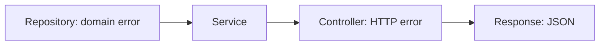

# 에러 처리

[첫 번째 앱](/ko/learn/getting-started/first-app)과 [컨트롤러](/ko/learn/tutorial/2-controller)의 CLI 프로젝트를 사용합니다. `spine generate resource user`로 생성한 `src/user`의 GET 핸들러를 직접 확장합니다. 프로젝트 생성·등록은 CLI가 수행하지만 도메인 오류와 HTTP 오류 매핑은 직접 구현합니다.

## HTTP 오류와 응답

성공 결과는 `httpx.Response[T]`에 담고 오류는 별도 `error`로 반환합니다. 일반 구조체 `(User, error)`를 HTTP 응답으로 반환하지 않습니다. `httperr`의 현재 헬퍼는 다음 네 가지입니다.

| Helper | HTTP | |
|---|---|---|
| `httperr.BadRequest(message)` | 400 | 잘못된 입력 |
| `httperr.Unauthorized(message)` | 401 | 인증 필요 |
| `httperr.NotFound(message)` | 404 | 리소스 없음 |
| `httperr.InternalServerError(message)` | 500 | 의도한 공개 오류 메시지 |

`HTTPError.Message`는 클라이언트에 노출됩니다. 내부 DB 오류나 비밀 값을 그대로 넣지 마세요. 예상하지 못한 일반 오류는 HTTP 500과 `{"message":"Internal server error"}`로 변환됩니다.

## 생성된 리소스에 조회 오류 추가

다음 코드는 설명용 읽기 전용 메모리 조회입니다. CLI가 생성한 repository·controller 파일을 아래 내용으로 교체하고 서비스에 `Find` 메서드를 추가합니다. 파일은 같은 `package user`에 둡니다. 기존 생성자 이름과 `user.Register(app)`·`GET /user/:id` 등록은 그대로 사용합니다. DB 영속 저장이나 전체 CRUD 예제가 아닙니다.

```go
// src/user/user_repository.go
package user

import "errors"

var ErrUserNotFound = errors.New("user not found")
var ErrEmailAlreadyExists = errors.New("email already exists")

type User struct {
    ID int64 `json:"id"`
    Name string `json:"name"`
}

type UserRepository struct{ users map[int64]User }

func NewUserRepository() *UserRepository {
    return &UserRepository{users: map[int64]User{1: {ID: 1, Name: "Alice"}}}
}

func (r *UserRepository) FindByID(id int64) (User, error) {
    user, ok := r.users[id]
    if !ok {
        return User{}, ErrUserNotFound
    }
    return user, nil
}
```

```go
// src/user/user_service.go
func (s *UserService) Find(id int64) (User, error) {
    return s.repository.FindByID(id)
}
```

```go
// src/user/user_controller.go
package user

import (
    "errors"
    "net/http"

    "github.com/NARUBROWN/spine/pkg/httperr"
    "github.com/NARUBROWN/spine/pkg/httpx"
    "github.com/NARUBROWN/spine/pkg/path"
)

type UserController struct{ service *UserService }

func NewUserController(service *UserService) *UserController {
    return &UserController{service: service}
}

func (c *UserController) Get(id path.Int) (httpx.Response[User], error) {
    if id.Value <= 0 {
        return httpx.Response[User]{}, httperr.BadRequest("invalid user ID")
    }
    user, err := c.service.Find(id.Value)
    if err != nil {
        return httpx.Response[User]{}, toHTTPError(err)
    }
    return httpx.Response[User]{Body: user}, nil
}

func toHTTPError(err error) error {
    switch {
    case errors.Is(err, ErrUserNotFound):
        return httperr.NotFound("user not found")
    case errors.Is(err, ErrEmailAlreadyExists):
        return &httperr.HTTPError{
            Status: http.StatusConflict,
            Message: "email already exists",
            Cause: err,
        }
    default:
        return err
    }
}
```

## 계층별 책임

저장소는 도메인 오류를 반환하고, 서비스는 이를 전달합니다. 컨트롤러에서 예상한 오류만 HTTP 상태로 매핑합니다. `errors.Is`는 감싼 오류도 판별하며, 알 수 없는 오류를 `BadRequest(err.Error())`로 바꾸면 내부 정보가 노출되므로 그대로 반환해 일반 500 처리를 사용합니다.



## HTTPError와 추가 상태

403·409처럼 헬퍼가 없는 상태는 `HTTPError`로 표현합니다. `Cause`는 원인 추적용이고 `Unwrap()`으로 접근할 수 있으며 JSON 응답에는 포함되지 않습니다.

```go
type HTTPError struct {
    Status int
    Message string
    Cause error
}

func (e *HTTPError) Error() string { return e.Message }
func (e *HTTPError) Unwrap() error { return e.Cause }
```

```go
return &httperr.HTTPError{
    Status: http.StatusForbidden,
    Message: "permission denied",
}
```

## 요청 DTO 검증

다음은 별도로 추가하는 입력 검증 예제입니다. `Validate()`는 자동 호출되지 않으므로 핸들러에서 호출합니다. 요청 DTO는 포인터여야 합니다. 아래 POST는 검증한 입력을 반환하는 예시이며 사용자 저장은 수행하지 않습니다. 사용할 경우 `Register`에 POST 라우트를 직접 추가하세요.

```go
// src/user/user_create.go
package user

import (
    "errors"
    "net/http"
    "unicode/utf8"

    "github.com/NARUBROWN/spine/pkg/httperr"
    "github.com/NARUBROWN/spine/pkg/httpx"
)

type CreateUserRequest struct {
    Name string `json:"name"`
    Email string `json:"email"`
}

func (r *CreateUserRequest) Validate() error {
    if r == nil || r.Name == "" {
        return errors.New("name is required")
    }
    if utf8.RuneCountInString(r.Name) > 100 {
        return errors.New("name must be at most 100 characters")
    }
    if r.Email == "" {
        return errors.New("email is required")
    }
    return nil
}

func (c *UserController) Create(req *CreateUserRequest) (httpx.Response[CreateUserRequest], error) {
    if err := req.Validate(); err != nil {
        return httpx.Response[CreateUserRequest]{}, httperr.BadRequest(err.Error())
    }
    return httpx.Response[CreateUserRequest]{
        Body: *req,
        Options: httpx.ResponseOptions{Status: http.StatusCreated},
    }, nil
}
```

```go
// src/user/user_route.go: Register
app.Route("POST", "/user", (*UserController).Create)
```

## 인터셉터의 오류 처리

`PreHandle`에서 오류를 반환하면 컨트롤러 실행을 중단합니다. 다음은 자체 인증 서비스가 있는 `src/interceptor`의 메서드 발췌입니다. 실제 타입은 `PreHandle`, `PostHandle`, `BeforeResponse`, `AfterCompletion` 네 메서드를 모두 구현하고 `BuildApplication()`에서 HTTP scope로 등록해야 합니다.

```go
func (i *AuthInterceptor) PreHandle(ctx core.ExecutionContext, meta core.HandlerMeta) error {
    token := ctx.Header("Authorization")
    if token == "" {
        return httperr.Unauthorized("authentication required")
    }
    user, err := i.auth.Validate(token)
    if err != nil {
        return httperr.Unauthorized("invalid token")
    }
    ctx.Set("auth.user", user)
    return nil
}
```

## 오류 로깅

`AfterCompletion`은 반환된 실행 오류를 로깅할 수 있습니다. 다음도 완전한 로깅 인터셉터에서 발췌한 메서드입니다. 로그에 인증 토큰이나 요청의 비밀 값을 남기지 마세요.

```go
func (i *LoggingInterceptor) AfterCompletion(ctx core.ExecutionContext, meta core.HandlerMeta, err error) {
    if err != nil {
        log.Printf("[ERR] %s %s: %v", ctx.Method(), ctx.Path(), err)
    }
}
```

## 검증과 HTTP 확인

```bash
gofmt -w src/user
go mod tidy
spine doctor
spine contract check
spine verify
spine dev
```

계약·로컬 검사를 통과한 뒤 다른 터미널에서 실제 응답을 확인합니다. 다음 결과는 위 읽기 전용 메모리 예제를 적용했을 때의 동작입니다.

```bash
curl -i http://localhost:8080/user/1
curl -i http://localhost:8080/user/0
curl -i http://localhost:8080/user/2
```

| Request | HTTP | JSON |
|---|---|---|
| `/user/1` | 200 | `{"id":1,"name":"Alice"}` |
| `/user/0` | 400 | `{"message":"invalid user ID"}` |
| `/user/2` | 404 | `{"message":"user not found"}` |

실제 DB나 인증 서비스를 연결하면 해당 실패 경로를 별도 E2E로 확인합니다. 정적 계약 검사만으로 외부 서비스의 오류 매핑이 검증되지는 않습니다.

- [httperr](/ko/learn/core-concepts/httperr)
- [Interceptors](/ko/learn/tutorial/4-interceptor)
