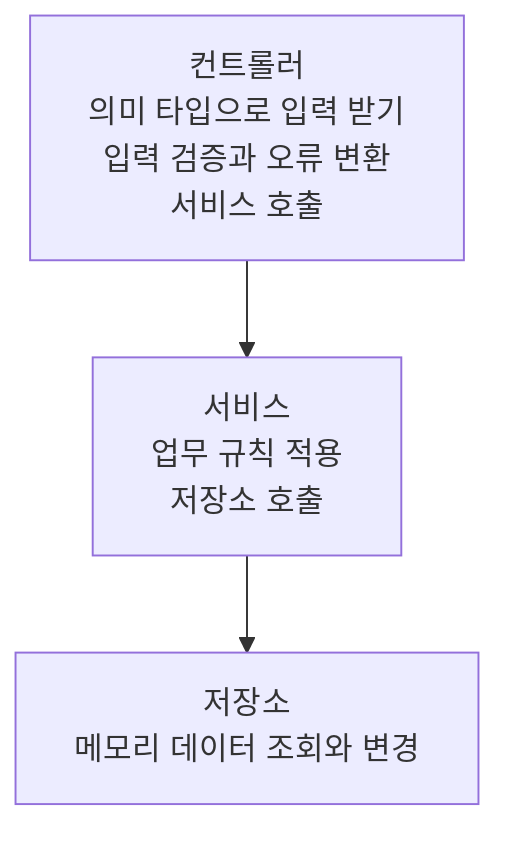

# 사용자 CRUD API 만들기

::: warning Preview
이 페이지는 정식 `v0.6.5` 예제를 포함합니다. Preview에서 `app.Route`는 Deprecated입니다. [새 컨트롤러와 라우트 전환](/ko/learn/migration/preview-controller-routes)을 확인하세요.
:::

::: warning v0.7.0 미리보기 입력 API 전환
이 페이지의 기존 API 설명과 예제는 안정 버전 `v0.6.5` 기준입니다. `v0.7.0-preview.1`부터 출처별 Path, Query, Header DTO를 지원하며 `query.Values`, `header.Values`와 해당 생성/조회 API, `query.Pagination`, `path.Int`, `path.String`, `path.Boolean`은 Deprecated입니다.

새 DTO 방식은 `v0.6.5`에 그대로 적용할 수 없습니다. 미리보기에서도 한 핸들러 안에서 새 DTO와 Deprecated 입력을 혼용하면 부팅 시 거부합니다. 기존 본문 DTO와 context는 계속 함께 사용할 수 있습니다.

적용 버전과 전환 예제는 [미리보기 핸들러 입력 전환](/ko/learn/migration/v0.7.0-preview), 명세 옵션은 [런타임 OpenAPI](/ko/reference/api/openapi)를 확인하세요.
:::

사용자를 생성하고 목록 조회, 개별 조회, 수정, 삭제하는 HTTP API를 만듭니다. ORM 없이 메모리 저장소를 사용하므로 데이터베이스를 준비하지 않고 실행할 수 있습니다.

## 시작 전 준비

[CLI 설치](/ko/learn/getting-started/installation)를 먼저 완료하세요. 이 예제는 CLI 0.4.2로 만든 기본 앱에 전체 CRUD 코드를 직접 추가합니다. CLI의 `resource`는 GET 골격을, `slice --storage memory`는 생성과 조회 골격을 제공합니다. 수정과 삭제는 아래 코드에 포함되어 있습니다.

저장한 사용자는 서버 프로세스를 종료하면 사라집니다.

요청은 컨트롤러, 서비스, 저장소 순서로 전달됩니다. 각 구성 요소는 다음 역할을 맡습니다.



## 1. 프로젝트 생성

기본 앱을 생성하고 의존성과 프로젝트 설정을 확인합니다. 이후 명령은 `crud-example/`에서 실행합니다.

```sh
spine new crud-example --layout legacy --module example.com/crud-example
cd crud-example
spine doctor
```

### 파일 배치

다음 단계에서 `src/` 아래에 다섯 파일을 추가하고, 생성된 `internal/application/application.go`를 교체합니다. 루트의 `main.go`와 `spine.toml`은 그대로 사용합니다.

```text
crud-example/
├── go.mod
├── go.sum
├── main.go
├── spine.toml
├── internal/application/
│   ├── application.go
│   └── application_test.go
└── src/
    ├── model/user.go
    ├── repository/user_repository.go
    ├── dto/user_dto.go
    ├── service/user_service.go
    └── controller/user_controller.go
```

## 2. 사용자 모델 추가

`src/model/user.go`를 새로 만듭니다. 사용자 정보와 생성 및 수정 시각을 저장하는 구조체입니다.

```go
// src/model/user.go
package model

import "time"

type User struct {
    ID        int64     `json:"id"`
    Name      string    `json:"name"`
    Email     string    `json:"email"`
    CreatedAt time.Time `json:"created_at"`
    UpdatedAt time.Time `json:"updated_at"`
}
```

## 3. 메모리 저장소 추가

`src/repository/user_repository.go`를 새로 만듭니다. 사용자 조회와 저장, 삭제를 담당하고 이메일 중복 여부를 확인할 함수를 제공합니다.

```go
// src/repository/user_repository.go
package repository

import (
    "errors"
    "sync"
    "time"

    "example.com/crud-example/src/model"
)

var (
    ErrUserNotFound      = errors.New("user not found")
    ErrEmailAlreadyExists = errors.New("email already exists")
)

type UserRepository struct {
    mu      sync.RWMutex
    users   map[int64]*model.User
    counter int64
}

func NewUserRepository() *UserRepository {
    return &UserRepository{
        users:   make(map[int64]*model.User),
        counter: 0,
    }
}

func (r *UserRepository) FindAll() []*model.User {
    r.mu.RLock()
    defer r.mu.RUnlock()

    result := make([]*model.User, 0, len(r.users))
    for _, user := range r.users {
        result = append(result, user)
    }
    return result
}

func (r *UserRepository) FindByID(id int64) (*model.User, error) {
    r.mu.RLock()
    defer r.mu.RUnlock()

    user, ok := r.users[id]
    if !ok {
        return nil, ErrUserNotFound
    }
    return user, nil
}

func (r *UserRepository) FindByEmail(email string) (*model.User, error) {
    r.mu.RLock()
    defer r.mu.RUnlock()

    for _, user := range r.users {
        if user.Email == email {
            return user, nil
        }
    }
    return nil, ErrUserNotFound
}

func (r *UserRepository) ExistsByEmail(email string) bool {
    _, err := r.FindByEmail(email)
    return err == nil
}

func (r *UserRepository) Save(user *model.User) *model.User {
    r.mu.Lock()
    defer r.mu.Unlock()

    now := time.Now()

    if user.ID == 0 {
        r.counter++
        user.ID = r.counter
        user.CreatedAt = now
    }
    user.UpdatedAt = now

    r.users[user.ID] = user
    return user
}

func (r *UserRepository) Delete(id int64) error {
    r.mu.Lock()
    defer r.mu.Unlock()

    if _, ok := r.users[id]; !ok {
        return ErrUserNotFound
    }

    delete(r.users, id)
    return nil
}

func (r *UserRepository) Count() int {
    r.mu.RLock()
    defer r.mu.RUnlock()
    return len(r.users)
}
```

## 4. 요청과 응답 DTO 추가

`src/dto/user_dto.go`를 새로 만듭니다. 요청으로 받을 필드와 응답으로 보낼 필드를 정의하고, 저장소의 사용자 모델을 응답 DTO로 변환합니다.

```go
// src/dto/user_dto.go
package dto

import (
    "time"

    "example.com/crud-example/src/model"
)

// 요청 DTO

type CreateUserRequest struct {
    Name  string `json:"name"`
    Email string `json:"email"`
}

type UpdateUserRequest struct {
    Name  string `json:"name"`
    Email string `json:"email"`
}

// 응답 DTO

type UserResponse struct {
    ID        int64     `json:"id"`
    Name      string    `json:"name"`
    Email     string    `json:"email"`
    CreatedAt time.Time `json:"created_at"`
    UpdatedAt time.Time `json:"updated_at"`
}

type UserListResponse struct {
    Users []UserResponse `json:"users"`
    Total int            `json:"total"`
}

// 변환 함수

func ToUserResponse(user *model.User) UserResponse {
    return UserResponse{
        ID:        user.ID,
        Name:      user.Name,
        Email:     user.Email,
        CreatedAt: user.CreatedAt,
        UpdatedAt: user.UpdatedAt,
    }
}

func ToUserListResponse(users []*model.User) UserListResponse {
    responses := make([]UserResponse, len(users))
    for i, user := range users {
        responses[i] = ToUserResponse(user)
    }
    return UserListResponse{
        Users: responses,
        Total: len(responses),
    }
}
```

## 5. 사용자 서비스 추가

`src/service/user_service.go`를 새로 만듭니다. 생성과 수정 전에 이메일 중복을 확인하고 저장소의 반환값을 응답 DTO로 바꿉니다.

```go
// src/service/user_service.go
package service

import (
    "example.com/crud-example/src/dto"
    "example.com/crud-example/src/model"
    "example.com/crud-example/src/repository"
)

type UserService struct {
    repo *repository.UserRepository
}

func NewUserService(repo *repository.UserRepository) *UserService {
    return &UserService{repo: repo}
}

func (s *UserService) GetAllUsers() dto.UserListResponse {
    users := s.repo.FindAll()
    return dto.ToUserListResponse(users)
}

func (s *UserService) GetUserByID(id int64) (*dto.UserResponse, error) {
    user, err := s.repo.FindByID(id)
    if err != nil {
        return nil, err
    }

    response := dto.ToUserResponse(user)
    return &response, nil
}

func (s *UserService) CreateUser(req *dto.CreateUserRequest) (*dto.UserResponse, error) {
    // 이메일 중복 체크
    if s.repo.ExistsByEmail(req.Email) {
        return nil, repository.ErrEmailAlreadyExists
    }

    user := &model.User{
        Name:  req.Name,
        Email: req.Email,
    }

    saved := s.repo.Save(user)
    response := dto.ToUserResponse(saved)
    return &response, nil
}

func (s *UserService) UpdateUser(id int64, req *dto.UpdateUserRequest) (*dto.UserResponse, error) {
    user, err := s.repo.FindByID(id)
    if err != nil {
        return nil, err
    }

    // 이메일 변경 시 중복 체크
    if req.Email != user.Email && s.repo.ExistsByEmail(req.Email) {
        return nil, repository.ErrEmailAlreadyExists
    }

    user.Name = req.Name
    user.Email = req.Email

    saved := s.repo.Save(user)
    response := dto.ToUserResponse(saved)
    return &response, nil
}

func (s *UserService) DeleteUser(id int64) error {
    return s.repo.Delete(id)
}
```

## 6. 사용자 컨트롤러 추가

`src/controller/user_controller.go`를 새로 만듭니다. 입력값을 검증한 뒤 서비스를 호출하고, 사용자를 찾지 못한 경우와 이메일이 중복된 경우를 HTTP 오류로 변환합니다.

```go
// src/controller/user_controller.go
package controller

import (
    "errors"

    "github.com/NARUBROWN/spine/pkg/httperr"
    "github.com/NARUBROWN/spine/pkg/httpx"
    "github.com/NARUBROWN/spine/pkg/path"

    "example.com/crud-example/src/dto"
    "example.com/crud-example/src/repository"
    "example.com/crud-example/src/service"
)

type UserController struct {
    service *service.UserService
}

func NewUserController(service *service.UserService) *UserController {
    return &UserController{service: service}
}

// GET /users
func (c *UserController) List() httpx.Response[dto.UserListResponse] {
    return httpx.Response[dto.UserListResponse]{Body: c.service.GetAllUsers()}
}

// GET /users/:id
func (c *UserController) GetByID(id path.Int) (httpx.Response[dto.UserResponse], error) {
    if id.Value <= 0 {
        return httpx.Response[dto.UserResponse]{}, httperr.BadRequest("유효하지 않은 사용자 ID입니다")
    }

    user, err := c.service.GetUserByID(id.Value)
    if err != nil {
        return httpx.Response[dto.UserResponse]{}, toHTTPError(err)
    }

    return httpx.Response[dto.UserResponse]{Body: *user}, nil
}

// POST /users
func (c *UserController) Create(req *dto.CreateUserRequest) (httpx.Response[dto.UserResponse], error) {
    if req.Name == "" {
        return httpx.Response[dto.UserResponse]{}, httperr.BadRequest("이름은 필수입니다")
    }
    if req.Email == "" {
        return httpx.Response[dto.UserResponse]{}, httperr.BadRequest("이메일은 필수입니다")
    }

    user, err := c.service.CreateUser(req)
    if err != nil {
        return httpx.Response[dto.UserResponse]{}, toHTTPError(err)
    }

    return httpx.Response[dto.UserResponse]{Body: *user}, nil
}

// PUT /users/:id
func (c *UserController) Update(id path.Int, req *dto.UpdateUserRequest) (httpx.Response[dto.UserResponse], error) {
    if id.Value <= 0 {
        return httpx.Response[dto.UserResponse]{}, httperr.BadRequest("유효하지 않은 사용자 ID입니다")
    }
    if req.Name == "" {
        return httpx.Response[dto.UserResponse]{}, httperr.BadRequest("이름은 필수입니다")
    }
    if req.Email == "" {
        return httpx.Response[dto.UserResponse]{}, httperr.BadRequest("이메일은 필수입니다")
    }

    user, err := c.service.UpdateUser(id.Value, req)
    if err != nil {
        return httpx.Response[dto.UserResponse]{}, toHTTPError(err)
    }

    return httpx.Response[dto.UserResponse]{Body: *user}, nil
}

// DELETE /users/:id
func (c *UserController) Delete(id path.Int) error {
    if id.Value <= 0 {
        return httperr.BadRequest("유효하지 않은 사용자 ID입니다")
    }

    err := c.service.DeleteUser(id.Value)
    if err != nil {
        return toHTTPError(err)
    }

    return nil
}

// Repository 에러를 HTTP 에러로 변환
func toHTTPError(err error) error {
    switch {
    case errors.Is(err, repository.ErrUserNotFound):
        return httperr.NotFound("사용자를 찾을 수 없습니다")
    case errors.Is(err, repository.ErrEmailAlreadyExists):
        return httperr.BadRequest("이미 사용 중인 이메일입니다")
    default:
        return httperr.BadRequest(err.Error())
    }
}
```

## 7. 생성자와 라우트 등록

`internal/application/application.go` 전체를 다음 코드로 교체합니다. 저장소와 서비스, 컨트롤러 생성자를 등록하고 다섯 라우트를 연결합니다. 생성된 루트 `main.go`는 `BuildApplication`, `Validate`, `Run`을 순서대로 실행합니다.

```go
// internal/application/application.go
package application

import (
    echoplatform "github.com/NARUBROWN/spine-echo-platform"
    "time"

    "example.com/crud-example/src/controller"
    "example.com/crud-example/src/repository"
    "example.com/crud-example/src/service"

    "github.com/NARUBROWN/spine"
    "github.com/NARUBROWN/spine/interceptor/cors"
    "github.com/NARUBROWN/spine/pkg/boot"
)

func BuildApplication() (spine.App, boot.Options, error) {
    app := spine.New(echoplatform.Option())
    app.Constructor(
        repository.NewUserRepository,
        service.NewUserService,
        controller.NewUserController,
    )
    app.Route("GET", "/users", (*controller.UserController).List)
    app.Route("GET", "/users/:id", (*controller.UserController).GetByID)
    app.Route("POST", "/users", (*controller.UserController).Create)
    app.Route("PUT", "/users/:id", (*controller.UserController).Update)
    app.Route("DELETE", "/users/:id", (*controller.UserController).Delete)

    corsInterceptor, err := cors.NewValidated(cors.Config{
        AllowOrigins: []string{"*"},
        AllowMethods: []string{"GET", "POST", "PUT", "DELETE", "OPTIONS"},
        AllowHeaders: []string{"Content-Type"},
    })
    if err != nil {
        return nil, boot.Options{}, err
    }
    app.InterceptorFor(boot.InterceptorHTTP, corsInterceptor)

    return app, boot.Options{
        Address: ":8080",
        EnableGracefulShutdown: true,
        ShutdownTimeout: 10 * time.Second,
        HTTP: &boot.HTTPOptions{},
    }, nil
}
```

## 8. 검증하고 서버 실행

프로젝트 루트에서 형식을 정리하고 의존성과 코드를 검사한 뒤 서버를 실행합니다.

```sh
gofmt -w src internal/application
go mod tidy
go mod download all
spine contract check
spine verify
spine dev
```

`contract check`는 정적 계약을 검사합니다. `verify`는 정적 계약과 gofmt, go vet, Go 테스트를 검사합니다. 서버가 실제 요청을 처리하는지는 다음 HTTP 요청으로 확인합니다.

## 9. HTTP 요청으로 CRUD 확인

서버를 실행한 상태에서 다른 터미널을 열어 아래 요청을 순서대로 보냅니다. 새 서버에서 첫 사용자의 ID는 `1`입니다. 응답의 날짜는 예시이며 실제 생성 시각과 수정 시각에 따라 달라집니다.

### 사용자 생성

이름과 이메일을 보내면 HTTP 200과 생성한 사용자 정보가 반환됩니다.

```bash
curl -X POST http://localhost:8080/users \
  -H "Content-Type: application/json" \
  -d '{"name": "홍길동", "email": "hong@example.com"}'
```

```json
{
  "id": 1,
  "name": "홍길동",
  "email": "hong@example.com",
  "created_at": "2025-01-19T10:00:00Z",
  "updated_at": "2025-01-19T10:00:00Z"
}
```

### 사용자 목록 조회

앞서 만든 사용자가 `users`에 포함되고 `total`이 `1`인지 확인합니다.

```bash
curl http://localhost:8080/users
```

```json
{
  "users": [
    {
      "id": 1,
      "name": "홍길동",
      "email": "hong@example.com",
      "created_at": "2025-01-19T10:00:00Z",
      "updated_at": "2025-01-19T10:00:00Z"
    }
  ],
  "total": 1
}
```

### 사용자 조회

ID가 `1`인 사용자의 정보를 조회합니다.

```bash
curl http://localhost:8080/users/1
```

```json
{
  "id": 1,
  "name": "홍길동",
  "email": "hong@example.com",
  "created_at": "2025-01-19T10:00:00Z",
  "updated_at": "2025-01-19T10:00:00Z"
}
```

### 사용자 수정

이름과 이메일을 함께 보냅니다. 응답에서 두 필드와 `updated_at`이 바뀌었는지 확인합니다.

```bash
curl -X PUT http://localhost:8080/users/1 \
  -H "Content-Type: application/json" \
  -d '{"name": "홍길동(수정)", "email": "hong2@example.com"}'
```

```json
{
  "id": 1,
  "name": "홍길동(수정)",
  "email": "hong2@example.com",
  "created_at": "2025-01-19T10:00:00Z",
  "updated_at": "2025-01-19T10:05:00Z"
}
```

### 사용자 삭제

ID가 `1`인 사용자를 삭제합니다. 삭제한 ID로 다시 조회하면 HTTP 404가 반환됩니다.

```bash
curl -X DELETE http://localhost:8080/users/1
```

### 존재하지 않는 사용자와 중복 이메일

저장소에 없는 ID를 조회하면 HTTP 404와 다음 오류 메시지가 반환됩니다.

```bash
# 존재하지 않는 사용자
curl http://localhost:8080/users/999
```

```json
{
  "message": "사용자를 찾을 수 없습니다"
}
```

앞 단계에서 사용자를 삭제했으므로 같은 이메일의 사용자를 먼저 다시 생성합니다. 첫 요청은 HTTP 200으로 성공하고, 이어 같은 이메일로 생성하는 두 번째 요청은 HTTP 400과 중복 오류를 반환합니다.

```bash
curl -X POST http://localhost:8080/users \
  -H "Content-Type: application/json" \
  -d '{"name": "홍길동", "email": "hong@example.com"}'
# 중복 이메일
curl -X POST http://localhost:8080/users \
  -H "Content-Type: application/json" \
  -d '{"name": "김철수", "email": "hong@example.com"}'
```

```json
{
  "message": "이미 사용 중인 이메일입니다"
}
```

## 구현에서 확인할 점

### 의미 타입으로 요청값 받기

컨트롤러는 HTTP 요청 객체 대신 `path.Int`와 같은 의미 타입을 인자로 받습니다. 오류는 `httperr`로 표현합니다.

```go
// 의미 타입으로 입력 받음
func (c *UserController) GetByID(id path.Int) (httpx.Response[dto.UserResponse], error)

// httperr로 의미만 표현
return httpx.Response[dto.UserResponse]{}, httperr.NotFound("사용자를 찾을 수 없습니다")
```

### 의존성 주입

등록한 생성자의 인자 타입을 바탕으로 저장소, 서비스, 컨트롤러의 의존성을 연결합니다.

```go
// 생성자 등록만으로 의존성 자동 해결
app.Constructor(
    repository.NewUserRepository,  // 의존성 없음
    service.NewUserService,        // Repository 의존
    controller.NewUserController,  // Service 의존
)
```

### 구성 요소별 책임

| 구성 요소 | 책임 | 사용하는 구성 요소 |
|-------|------|------|
| 컨트롤러 | 입력 검증, HTTP 오류 변환 | 서비스 |
| 서비스 | 이메일 중복 확인, 응답 DTO 변환 | 저장소 |
| 저장소 | 메모리 데이터 조회와 변경 | 없음 |

## 다음 단계

데이터를 영속적으로 저장하려면 [데이터베이스 연결](/ko/learn/tutorial/5-database)을 따라 저장소를 바꾸세요. 오류 처리 방식을 더 살펴보려면 [에러 처리 튜토리얼](/ko/learn/tutorial/7-error-handling)을 확인하세요.
