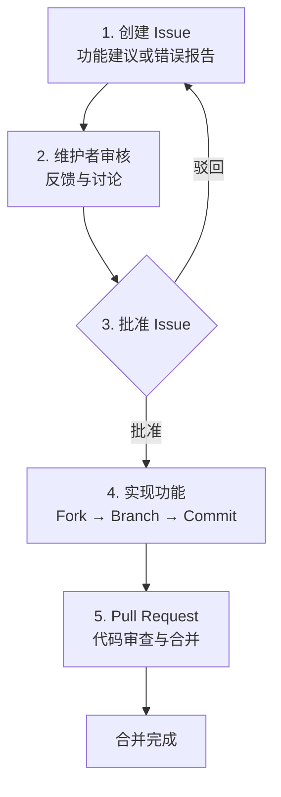

# 参与贡献

本页介绍如何为 Spine 提出功能、错误修复和文档改进建议，以及提交 Pull Request。在实现前，请先在 GitHub Issue 中讨论变更目的和范围。

## 贡献流程

流程依次为创建 Issue、维护者审核与批准、实现、提交 Pull Request。



## 1. 创建 Issue

实现功能前，必须先创建 Issue。

请在 [Spine GitHub Issues](https://github.com/NARUBROWN/spine/issues) 中创建新 Issue，并根据建议类型提供相应信息。

提出功能建议时：

- 建议的功能
- 需要该功能的原因
- 预期的使用示例

报告错误时：

- 错误复现步骤
- 预期行为与实际行为
- Go 版本、操作系统等运行环境信息

## 2. 维护者审核

维护者会审核 Issue 并留下反馈。必要时，双方会共同讨论设计方向和实现范围。

## 3. 批准 Issue

请在维护者批准 Issue 后开始实现。在批准前提交的 Pull Request 可能不会被合并。

## 4. Pull Request

实现完成后，请在 GitHub 上创建 Pull Request，并在描述中填写相关 Issue 编号。

```
Closes #123
```

## 文档修改与翻译

本文档站点以 `docs/ko` 作为内容的唯一依据。请先修改并审阅韩语文档，再将相同的内容、代码和结构翻译到 `docs/en`、`docs/ja`、`docs/zh-Hans` 和 `docs/zh-Hant`。

在文档站点的仓库根目录运行以下命令，可以检查各语言的文档结构和可执行代码是否一致。

```bash
python3 scripts/check-doc-translations.py
```

构建文档后，还应检查翻译后的内部路径和章节链接。

```bash
go run scripts/check-go-examples.go docs
python3 scripts/check-v075-examples.py
npm run docs:build
python3 scripts/check-doc-translations.py --check-rendered
```

## 如有疑问

如果在实现过程中有需要确认的内容，请在相关 Issue 中留言。
